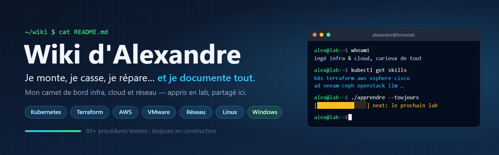

## Salut, moi c'est Alexandre !

Bienvenue sur mon **carnet de bord technique**. Ici, je documente tout ce que j'apprends : mes labs, mes projets, mes cours de l'ESGI, mes galères… et surtout **comment je m'en suis sorti**.

Ma règle est simple : *si je l'ai monté une fois, je l'écris pour pouvoir le refaire*. Et si ça peut aider quelqu'un d'autre au passage, c'est encore mieux.

>  Toutes les procédures ont été testées dans mon homelab ou en cours. Tu vois une erreur ou une meilleure façon de faire ? Dis-le moi, c'est comme ça qu'on progresse !
{.is-info}

Envie d'en savoir plus sur moi ? Mon portfolio : **[alexandre-faye.fr](https://alexandre-faye.fr)**

---

## 🚀 Mes projets préférés

- [🖥️ Cours VDI complet *De zéro à Omnissa Horizon en production, en 8 chapitres*](/fr/hyperviseur/VDI/00-sommaire)
- [☸️ Cluster Kubernetes *Installation, Traefik, Longhorn, Teleport…*](/fr/Kubernetes/Kubernetes)
- [☁️ EKS sécurisé + CI/CD GitLab *Toute l'infra AWS en Terraform*](/fr/terraform/eks-cicd)
- [🧱 OpenStack multinœud *Déployé avec Kolla-Ansible*](/fr/linux/OpenStack)
- [🔐 VPN post-quantique *IKEv2/IPsec, certificats X.509 et PPK*](/fr/Réseau/PQC)
- [🤖 Chatbot 100 % local *Un LLM de support, sans rien envoyer dans le cloud*](/fr/llm/chatbot)
{.links-list}

---

## 🗂️ Explorer par thème

| Thème | Ce que tu y trouveras | Pour commencer |
|---|---|---|
| ☸️ **Kubernetes** | Clusters K8s et K3s, Traefik, Longhorn, apps déployées | [Installer un cluster](/fr/Kubernetes/Kubernetes) |
| 🏗️ **Terraform / AWS** | Infra as Code, EKS, Load Balancer, CI/CD | [Installer Terraform](/fr/terraform/terraform) |
| 🖥️ **Hyperviseur** | ESXi, vCenter / vSAN, templates, VDI Horizon | [Installer un ESXi](/fr/hyperviseur/ESX) |
| 🌐 **Réseau** | OSPF, BGP, EIGRP, STP, SD-WAN Fortinet, Juniper | [Routage OSPF](/fr/Réseau/ospf) |
| 🐧 **Linux** | Docker, Ceph, Zabbix, Graylog, TrueNAS, self-hosting | [Docker Swarm HA](/fr/linux/docker/Docker_Swarm) |
| 🪟 **Windows** | Active Directory, GPO, LAPS, ADCS, Veeam | [Configurer l'AD](/fr/windows/AD/AD) |
| 🤖 **LLM** | IA générative en local | [Chatbot local](/fr/llm/chatbot) |
| 🎓 **ESGI** | Cours et TP d'école | [CCNA S1](/fr/esgi/cisco) |

---

## 🌱 En ce moment, je creuse…

- La **virtualisation de postes** avec Omnissa Horizon
- Le **stockage distribué** avec Ceph et la haute dispo KVM
- La **sécurité post-quantique** appliquée aux VPN

> 🧠 *« Plus j'apprends, plus je réalise tout ce qu'il me reste à apprendre… et c'est exactement ce qui me motive. »*
{.is-success}

