# vCenter : authentification Active Directory en LDAPS

> **Objectif :** se connecter au vCenter (et donc administrer l'ESXi) avec un compte de l'Active Directory `LAB.lan`, par exemple `adm-vmw-afaye`, au lieu de `administrator@vsphere.local`. La liaison entre le vCenter et l'AD doit être chiffrée (**LDAPS**).

---

## 1. Comprendre avant de faire

### 1.1 Comment le vCenter vérifie un compte AD

Quand tu tapes `adm-vmw-afaye` et ton mot de passe sur la page de connexion, le vCenter ne connaît pas ce compte. Il pose la question au contrôleur de domaine : *« ce compte, avec ce mot de passe, est-il valide ? »*. Cette demande s'appelle un **bind LDAP**.

```
 Toi ──(HTTPS, chiffré)──► vCenter ──(LDAP)──► DC01
                                    "adm-vmw-afaye / mot de passe"
```

### 1.2 Pourquoi LDAP « simple » ne suffit pas

| | LDAP | LDAPS |
|---|---|---|
| Port | 389 | **636** |
| Chiffrement | ❌ Le mot de passe passe **en clair** sur le réseau | ✅ Tout passe dans un tunnel **TLS**, comme en HTTPS |
| Vérification du serveur | ❌ Le vCenter ne sait pas s'il parle au vrai DC | ✅ Le DC présente un **certificat**, que le vCenter vérifie |
| Risque | Une machine qui écoute le réseau récupère le mot de passe de **chaque admin** qui se connecte | Aucun mot de passe lisible |

Ces mots de passe sont ceux des administrateurs vSphere, qui ont la main sur **toutes les VM**, y compris le DC. Il faut donc chiffrer.

### 1.3 Ce qu'il faut pour faire du LDAPS

LDAPS n'a rien à « activer » sur le DC. **Dès qu'un contrôleur de domaine possède un certificat valide pour l'authentification serveur, il ouvre automatiquement le port 636.** Tout le travail consiste donc à :

1. créer une **autorité de certification** (CA) qui fabrique ce certificat ;
2. délivrer un **certificat** au DC ;
3. donner ce certificat au **vCenter**, pour qu'il lui fasse confiance.

```
LAB-ROOT-CA          autorité de certification (installée sur DC01)
   │ signe
   ▼
DC01.lab.lan         certificat du DC, valable 1 an ──► LDAPS actif sur le port 636
   │ exporté (partie publique seulement)
   ▼
vCenter              ne fait confiance qu'à ce certificat précis
```

> **Choix pour le lab :** la CA est installée **directement sur DC01**, faute de machine supplémentaire. En production, on la met sur un serveur dédié, avec une racine hors ligne. Ici, le risque est acceptable : si DC01 est compromis, le domaine l'est de toute façon déjà.

---

## 2. Prérequis

| Élément | Valeur | Vérification |
|---|---|---|
| Domaine | `LAB.lan`, DC = **DC01.lab.lan** (192.168.50.10) | — |
| OU, groupes et comptes | Créés (voir la page *Préparation AD*) : `GG-VMW-Admins`, `GG-VMW-ReadOnly`, `svc-vcenter-ldap`, `adm-vmw-afaye` (membre de `GG-VMW-Admins`) | Console *Utilisateurs et ordinateurs AD* |
| DNS du vCenter | **192.168.50.10 uniquement** (pas de 8.8.8.8) | Console de la VM vCenter > F2 > *Configure Management Network > DNS Configuration* |
| Enregistrements DNS | `vcenter.lab.lan` → .12, `esx01.lab.lan` → .11, avec zone inverse et PTR | Console *DNS* sur DC01 |

> **Piège rencontré :** dans l'interface de gestion du vCenter (VAMI, `https://192.168.50.12:5480` > *Réseau*), l'assistant de modification refuse une adresse IP comme nom d'hôte (*« Specified hostname is invalid »*). Si tu mets `vcenter.lab.lan` à la place, tu **renommes** le vCenter, ce qui oblige à régénérer les certificats et réenregistrer les plug-ins. **Ne fais pas ça.** Pour changer seulement le DNS, passe par la **console de la VM vCenter (F2)**.

---

## 3. Installer l'autorité de certification sur DC01

### 3.1 Droits nécessaires

Installer une CA **d'entreprise** demande d'être membre du groupe **Administrateurs de l'entreprise**.

1. Sur DC01, ouvre **Utilisateurs et ordinateurs Active Directory**.
2. Va dans `lab.lan > Users`, puis double-clique sur **Administrateurs de l'entreprise**.
3. Dans l'onglet **Membres**, clique sur **Ajouter**, choisis `adm-dom-afaye`, puis **OK**.
4. **Déconnecte-toi puis reconnecte-toi** avec `adm-dom-afaye`, pour que le nouveau groupe soit pris en compte.

> On le retirera de ce groupe à la fin (section 4.6). Ce groupe doit rester vide au quotidien.

### 3.2 Empêcher la CA de publier des modèles par défaut

Par défaut, une CA d'entreprise publie une dizaine de modèles de certificats (Utilisateur, Ordinateur, Serveur Web, Administrateur…). Les modèles mal réglés sont **la première faille** des PKI Windows. On veut n'en publier **qu'un seul**, le nôtre.

Ce réglage se fait avec un petit fichier, créé **avant** l'installation :

1. Ouvre le **Bloc-notes en tant qu'administrateur**.
2. Colle ce texte :

```ini
[Version]
Signature="$Windows NT$"

[Certsrv_Server]
RenewalKeyLength=4096
RenewalValidityPeriod=Years
RenewalValidityPeriodUnits=10
LoadDefaultTemplates=0
AlternateSignatureAlgorithm=0

[BasicConstraintsExtension]
PathLength=0
Critical=Yes
```

3. Enregistre-le sous `C:\Windows\CAPolicy.inf`. Choisis **Type : Tous les fichiers** pour éviter d'obtenir `CAPolicy.inf.txt`.

| Ligne | Rôle |
|---|---|
| `LoadDefaultTemplates=0` | Aucun modèle publié automatiquement |
| `PathLength=0` | Cette CA ne peut pas créer d'autre CA en dessous d'elle |
| `RenewalKeyLength=4096` | Au renouvellement, la nouvelle clé sera en RSA 4096 |

### 3.3 Ajouter le rôle

1. Ouvre le **Gestionnaire de serveur**, puis **Gérer > Ajouter des rôles et fonctionnalités**.
2. Choisis **Installation basée sur un rôle ou une fonctionnalité**, puis le serveur **DC01**.
3. Coche **Services de certificats Active Directory**, puis **Ajouter des fonctionnalités**.
4. Dans **Services de rôle**, coche **uniquement** *Autorité de certification*.
   > ❌ Ne coche pas *Inscription de l'autorité de certification via le Web*. Ce composant est la cible d'une attaque connue (ESC8, relais NTLM), et on n'en a pas besoin.
5. Clique sur **Installer**.

### 3.4 Configurer la CA

À la fin de l'installation, clique sur le lien **Configurer les services de certificats Active Directory** (ou sur le drapeau jaune du Gestionnaire de serveur).

| Écran | Choix |
|---|---|
| Informations d'identification | `LAB\adm-dom-afaye` |
| Services de rôle | ✅ Autorité de certification |
| Type d'installation | **Autorité de certification d'entreprise**, intégrée à l'AD : toutes les machines du domaine lui feront confiance automatiquement |
| Type d'AC | **Autorité de certification racine** |
| Clé privée | **Créer une clé privée** |
| Chiffrement | Fournisseur **RSA#Microsoft Software Key Storage Provider**, longueur **4096**, hachage **SHA256** |
| Nom de l'AC | Nom commun : **`LAB-ROOT-CA`** |
| Période de validité | **10 ans** |
| Base de données | Emplacements par défaut |

Clique sur **Configurer**, puis sur **Fermer**.

### 3.5 Régler les extensions (CDP / AIA)

Chaque certificat émis contient deux adresses :
- **CDP** (*point de distribution de la liste de révocation*) : où télécharger la liste des certificats révoqués ;
- **AIA** (*accès aux informations de l'autorité*) : où télécharger le certificat de la CA, pour reconstruire la chaîne.

Par défaut, Windows y inscrit une adresse `http://dc01.lab.lan/CertEnroll/...`. **Aucun serveur web ne la sert**, ce qui provoque des délais et des erreurs de vérification. On la retire et on garde l'adresse LDAP, qui suffit pour les machines du domaine.

1. Ouvre **Autorité de certification** (`certsrv.msc`).
2. Fais un clic droit sur **LAB-ROOT-CA**, puis **Propriétés**, onglet **Extensions**.
3. Dans **Sélectionner l'extension : Point de distribution de la liste de révocation des certificats (CDP)** :
   - sélectionne la ligne `http://...` puis **Supprimer** ;
   - sélectionne la ligne `file://...` puis **Supprimer** ;
   - garde les lignes `C:\Windows\system32\CertSrv\CertEnroll\...` et `ldap:///CN=...`.
4. Dans **Sélectionner l'extension : Accès aux informations de l'autorité (AIA)**, supprime de même les lignes `http://...` et `file://...`.
5. Clique sur **Appliquer**. Windows propose de **redémarrer les services de certificats** : réponds **Oui**.

### 3.6 Activer l'audit de la CA

1. Dans la même fenêtre **Propriétés**, ouvre l'onglet **Audit** et coche **toutes** les cases.
2. Clique sur **OK**.
3. Ouvre **Stratégie de sécurité locale** (`secpol.msc`), puis va dans **Configuration avancée de la stratégie d'audit > Stratégies d'audit système > Accès à l'objet**.
4. Double-clique sur **Auditer les services de certification**, et coche ✅ **Succès** et ✅ **Échec**.

> Chaque émission, révocation ou modification de la CA sera tracée dans le journal **Sécurité**.

### 3.7 Vérifier qu'aucun modèle n'est publié

Dans `certsrv.msc`, déplie **LAB-ROOT-CA > Modèles de certificats**. La liste doit être **vide**, grâce au `CAPolicy.inf`.

---

## 4. Délivrer un certificat à DC01

### 4.1 Créer un modèle dédié aux contrôleurs de domaine

1. Fais un clic droit sur **Modèles de certificats**, puis **Gérer**. La console `certtmpl.msc` s'ouvre.
2. Fais un clic droit sur **Authentification Kerberos**, puis **Dupliquer le modèle**.
3. Règle chaque onglet :

| Onglet | Réglage |
|---|---|
| **Compatibilité** | Autorité de certification : **Windows Server 2016**. Destinataire : **Windows 10 / Windows Server 2016** |
| **Général** | Nom complet : **`LAB-DomainController`**. Validité : **1 an**. Renouvellement : **6 semaines** |
| **Traitement de la demande** | ❌ *Autoriser l'exportation de la clé privée* : **décoché** |
| **Chiffrement** | Fournisseur de stockage de clés, **RSA**, taille minimale **2048**, hachage **SHA256** |
| **Nom du sujet** | **Construire à partir des informations Active Directory**. Format : **Nom DNS**. ✅ **Nom DNS** dans les noms alternatifs |
| **Sécurité** | **Contrôleurs de domaine** et **Contrôleurs de domaine d'entreprise** : ✅ Lecture, ✅ Inscription, ✅ **Inscription automatique** |
| **Modèles obsolètes** | **Ajouter** : *Contrôleur de domaine*, *Authentification du contrôleur de domaine*, *Authentification Kerberos* |

4. Valide avec **OK**.

**Pourquoi ces choix :**
- **Partir d'« Authentification Kerberos »** : ce modèle contient déjà l'usage *Authentification du serveur*, indispensable pour LDAPS, ainsi que les usages Kerberos du DC.
- **Clé non exportable** : la clé privée ne pourra jamais sortir du DC, même par un administrateur.
- **Modèles obsolètes** : le DC remplace tout ancien certificat par celui-ci. Il n'en garde qu'**un seul**, et LDAPS n'a pas à choisir.

### 4.2 Publier le modèle sur la CA

1. Retourne dans `certsrv.msc`.
2. Fais un clic droit sur **Modèles de certificats**, puis **Nouveau > Modèle de certificat à délivrer**.
3. Sélectionne **LAB-DomainController** et clique sur **OK**.

> **Piège rencontré :** si `LAB-DomainController` n'apparaît pas dans la fenêtre « Activer les modèles de certificat », regarde la liste en arrière-plan. **Il est probablement déjà publié** : cette fenêtre ne propose que les modèles qui ne le sont pas encore.

### 4.3 Activer l'inscription automatique (GPO)

Cette stratégie permet aux machines de **demander et renouveler leurs certificats toutes seules**. C'est grâce à elle que le certificat de DC01 sera renouvelé chaque année sans intervention.

1. Ouvre **Gestion des stratégies de groupe**.
2. Fais un clic droit sur **lab.lan**, puis **Créer un objet GPO dans ce domaine et le lier ici**. Nom : `GPO-PKI-AutoEnrollment`.
3. Fais un clic droit sur la GPO, puis **Modifier**.
4. Va dans **Configuration ordinateur > Stratégies > Paramètres Windows > Paramètres de sécurité > Stratégies de clé publique**.
5. Double-clique sur **Client des services de certificats – Inscription automatique** et règle :
   - Modèle de configuration : **Activé**
   - ✅ Renouveler les certificats expirés, mettre à jour les certificats en attente et supprimer les certificats révoqués
   - ✅ Mettre à jour les certificats qui utilisent les modèles de certificats

### 4.4 Demander le certificat sans attendre

1. Sur DC01, ouvre **certlm.msc** (*Certificats – Ordinateur local*).
   > Ne confonds pas avec `certmgr.msc`, qui affiche les certificats de **l'utilisateur**.
2. Va dans **Personnel > Certificats**.
3. Fais un clic droit, puis **Toutes les tâches > Demander un nouveau certificat…**
4. Clique deux fois sur **Suivant**, en gardant la *Stratégie d'inscription Active Directory*.
5. Coche **LAB-DomainController**, puis clique sur **Inscrire**. Le résultat doit être **État : Réussite**.

> Si le modèle n'apparaît pas, coche **Afficher tous les modèles** : la raison du blocage s'affiche en rouge. Le plus souvent, c'est l'onglet **Sécurité** du modèle (section 4.1).

### 4.5 Contrôler le certificat

Dans **certlm.msc > Personnel > Certificats**, tu as maintenant **deux** certificats :

| Délivré à | Délivré par | Rôle |
|---|---|---|
| **DC01.lab.lan** | LAB-ROOT-CA | Le certificat du DC, **celui qu'on veut** |
| LAB-ROOT-CA | LAB-ROOT-CA | Le certificat de la CA elle-même (« auto-signé »). **On n'y touche pas.** |

> **Piège rencontré :** comme la CA est sur DC01, son propre certificat apparaît au même endroit. Il ne faut **pas** l'exporter pour le vCenter : il ne fonctionnerait pas.

Double-clique sur **DC01.lab.lan** et vérifie chaque onglet.

**Onglet Général :** les rôles, la validité d'un an, et en bas *« Vous avez une clé privée qui correspond à ce certificat »*.

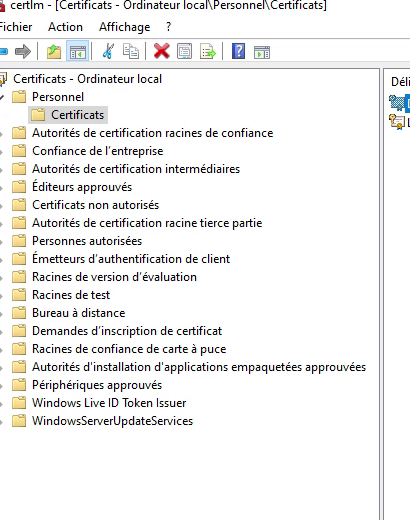

**Onglet Détails > Utilisation avancée de la clé :** **Authentification du serveur (1.3.6.1.5.5.7.3.1)** doit apparaître. C'est l'usage qui active LDAPS.

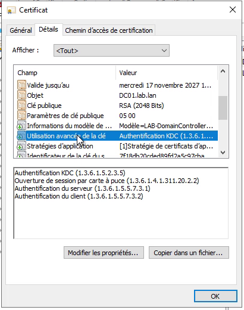

**Onglet Détails > Autre nom de l'objet :** `Nom DNS=DC01.lab.lan` doit apparaître. C'est **ce nom** qu'on mettra dans l'URL du vCenter. Les noms `lab.lan` et `LAB` sont ajoutés par le modèle Kerberos, c'est normal.


**Onglet Chemin d'accès de certification :** `LAB-ROOT-CA` doit apparaître, avec `DC01.lab.lan` en dessous, et le message **« Ce certificat est valide. »**

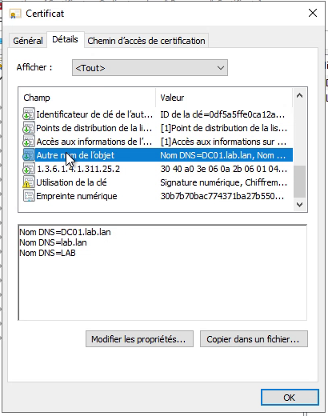

**Onglet Détails > Empreinte numérique :** 📝 **note cette valeur** dans ce wiki. Elle permettra de savoir si le certificat a été renouvelé (section 11).

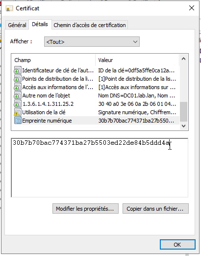

> Empreinte du certificat actuel : `________________________________` (valable jusqu'au 17/11/2027)

### 4.6 Retirer les droits temporaires

1. Ouvre **Utilisateurs et ordinateurs AD**, puis `lab.lan > Users > Administrateurs de l'entreprise`.
2. Dans l'onglet **Membres**, sélectionne `adm-dom-afaye`, puis clique sur **Supprimer** et **OK**.

---

## 5. Tester LDAPS depuis DC01

On utilise **ldp.exe**, l'outil graphique de test LDAP de Windows. Tu peux le lancer depuis le menu Démarrer : tape `ldp`.

1. Ouvre le menu **Connexion > Se connecter…**
2. Remplis la fenêtre :
   - Serveur : **`dc01.lab.lan`**. Utilise le nom et non l'IP : le certificat est émis pour ce nom.
   - Port : **`636`**
   - ✅ **SSL**
3. Clique sur **OK**.

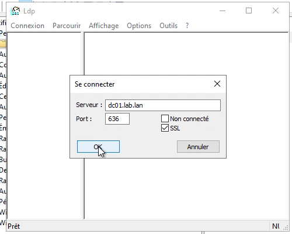

Le résultat :

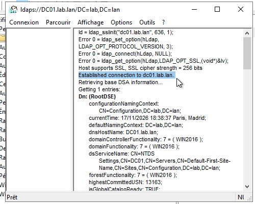

| Ligne affichée | Signification |
|---|---|
| `ldap_sslinit("dc01.lab.lan", 636, 1)` | Connexion sur le port 636, SSL activé |
| `Host supports SSL, SSL cipher strength = 256 bits` | Le tunnel TLS est établi, avec un chiffrement fort |
| `Established connection to dc01.lab.lan` | Le certificat est accepté : le nom correspond et la chaîne est de confiance |
| `Dn: (RootDSE)`, `dnsHostName: DC01.lab.lan` | Le DC répond **à l'intérieur** du tunnel |

✅ **LDAPS fonctionne.**

---

## 6. Exporter le certificat du DC pour le vCenter

Le vCenter n'est pas membre du domaine : il ne connaît pas `LAB-ROOT-CA`. On va lui donner **la partie publique** du certificat de DC01, et il ne fera confiance qu'à celui-là.

1. Dans **certlm.msc > Personnel > Certificats**, fais un clic droit sur **DC01.lab.lan** (⚠️ pas sur LAB-ROOT-CA), puis **Toutes les tâches > Exporter…**
2. Clique sur **Suivant**.
3. Choisis **Non, ne pas exporter la clé privée**, puis **Suivant**.
   > La clé privée ne quitte **jamais** le DC. Le vCenter n'a besoin que de la clé publique pour vérifier le DC.
4. Choisis **Codé à base 64 X.509 (.CER)**, puis **Suivant**. C'est le format texte (`-----BEGIN CERTIFICATE-----`) accepté par le vCenter.
5. Indique le nom de fichier **`C:\Temp\dc01.cer`**, puis **Suivant**.

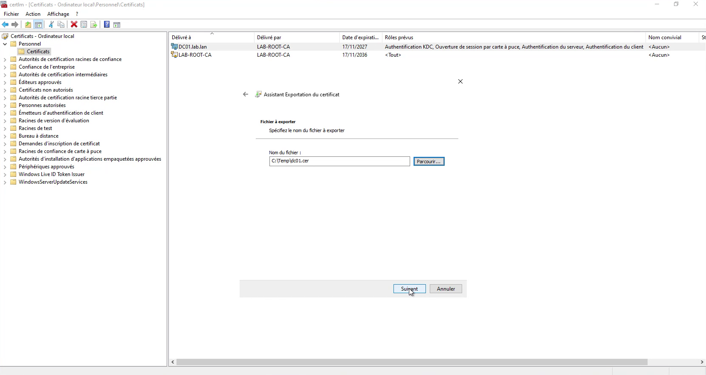

6. Vérifie le résumé : *Exporter les clés : Non*, *Format : X.509 encodé en base 64*. Clique sur **Terminer**.

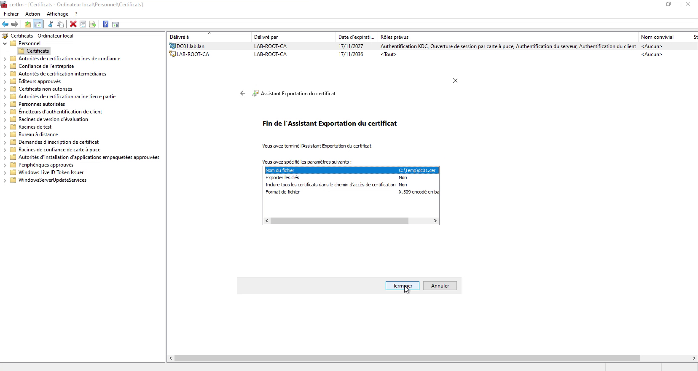

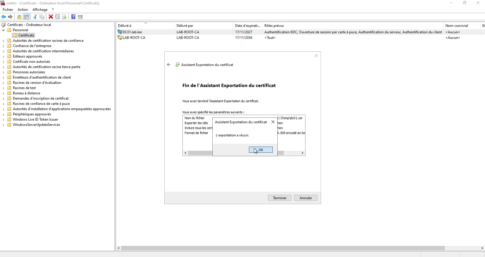

7. Copie `dc01.cer` sur le PC depuis lequel tu ouvres le client vSphere (partage `\\dc01\c$\Temp`, clé USB…).

---

## 7. Déclarer l'AD dans le vCenter (source d'identité)

### 7.1 Ajouter la source

1. Connecte-toi sur `https://192.168.50.12/ui` avec **administrator@vsphere.local**.
2. Va dans **Menu ☰ > Administration > Single Sign-On > Configuration**.
3. Ouvre l'onglet **Fournisseur d'identité**, puis le sous-menu **Sources d'identité**, et clique sur **AJOUTER**.
4. Remplis le formulaire :

| Champ | Valeur | Explication |
|---|---|---|
| Type de source d'identité | **Active Directory sur LDAP** | La méthode recommandée. « Active Directory (authentification Windows intégrée) » est dépréciée et oblige à joindre le vCenter au domaine. |
| Nom de la source d'identité | `LAB` | Nom affiché dans le vCenter |
| Nom unique de base pour les utilisateurs | `DC=LAB,DC=lan` | Où chercher les comptes : tout le domaine |
| Nom unique de base pour les groupes | `DC=LAB,DC=lan` | Où chercher les groupes |
| Nom de domaine | `LAB.lan` | |
| Alias de domaine | `LAB` | Permet aussi `LAB\adm-vmw-afaye` |
| Nom d'utilisateur | `svc-vcenter-ldap@LAB.lan` | Compte de service **sans privilège**, qui sert uniquement à lire l'annuaire |
| Mot de passe | celui du compte | |
| Connexion à | **Contrôleurs de domaine spécifiques** | Voir l'encadré ci-dessous |
| URL du serveur principal | **`ldaps://dc01.lab.lan:636`** | `ldaps` avec un **s**, et le **nom** du DC, pas son IP |
| URL secondaire du serveur | vide | Plus tard : `ldaps://dc02.lab.lan:636` si tu ajoutes un second DC |
| Certificats (pour LDAPS) | **PARCOURIR**, puis `dc01.cer` | Le certificat exporté en section 6 |

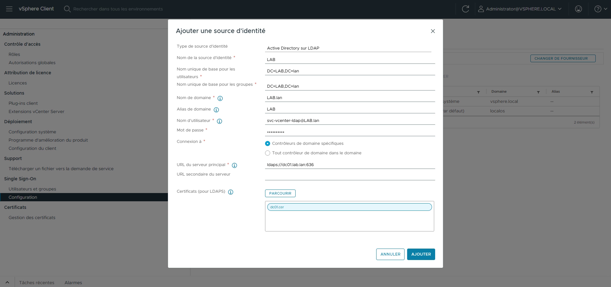

5. Une fois le certificat chargé, le **bandeau jaune** *« Cette connexion LDAP n'est pas sécurisée »* disparaît. Clique sur **AJOUTER**.

> **« Contrôleurs spécifiques » ou « Tout contrôleur du domaine » ?**
>
> | | Tout contrôleur | Contrôleurs spécifiques ✅ |
> |---|---|---|
> | Comment le vCenter trouve le DC | Par le DNS (enregistrements `_ldap._tcp`) | Par l'URL que tu saisis |
> | Ajout d'un DC02 | Automatique | À ajouter en URL secondaire |
> | Dépannage | Moins lisible : on ne sait pas quel DC a répondu | Clair |
> | LDAPS | Il faut le certificat de **chaque** DC | Le certificat du DC indiqué |
>
> Avec un seul DC, « spécifiques » est plus prévisible. C'est aussi le choix courant en production, avec deux DC en principal et secondaire.

> **Pourquoi le certificat du DC, et pas celui de la CA ?** Le vCenter ne fera confiance **qu'à ce certificat précis** : c'est l'**épinglage**. Même un autre certificat valide émis par la CA serait refusé. C'est le plus strict. La contrepartie : il faut réimporter le certificat à chaque renouvellement (section 11).

### 7.2 Définir LAB comme domaine par défaut

La source apparaît dans la liste, avec l'URL `ldaps://dc01.lab.lan:636`.

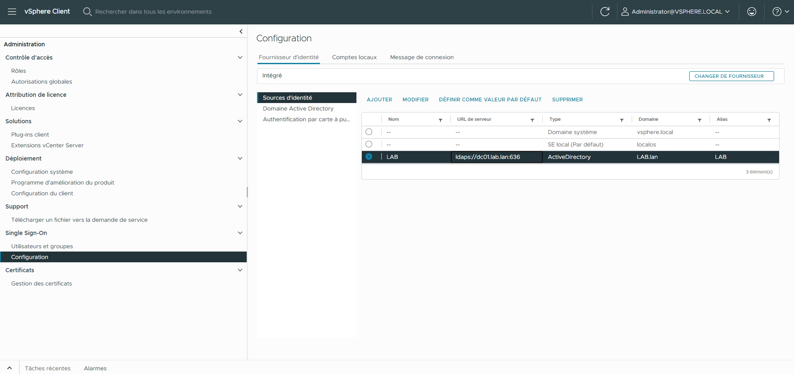

1. Sélectionne **LAB**, puis clique sur **DÉFINIR COMME VALEUR PAR DÉFAUT**.
2. Confirme avec **OK**.

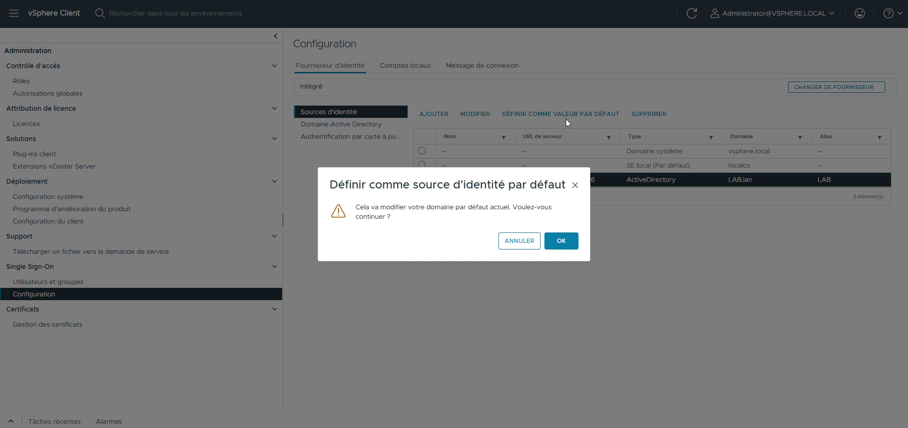

Le type affiche maintenant **ActiveDirectory (Par défaut)**. Tu peux te connecter en tapant simplement `adm-vmw-afaye`, sans `@lab.lan`.

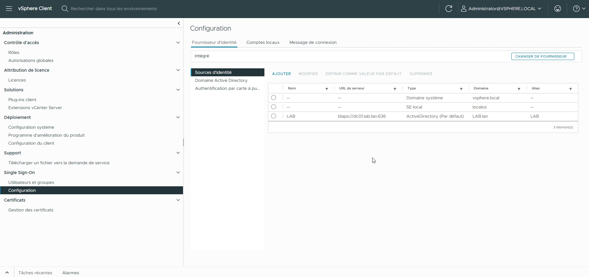

---

## 8. Donner les droits aux groupes AD

Déclarer l'AD ne suffit pas : il faut dire **qui** a **quels droits**. On donne les droits à des **groupes**, jamais à des comptes individuels. Pour ajouter un admin, il suffit ensuite de l'ajouter au groupe dans l'AD, sans toucher au vCenter.

### 8.1 Les autorisations globales

1. Va dans **Menu ☰ > Administration > Contrôle d'accès > Autorisations globales**.
2. Laisse **Fournisseur d'autorisations : VSPHERE.LOCAL**, puis clique sur **AJOUTER**.
3. Remplis la fenêtre :
   - Domaine : **LAB.lan**
   - Utilisateur/Groupe : tape `GG-VMW` et choisis **GG-VMW-Admins**
   - Rôle : **Administrateur**
   - ✅ **Propager vers les enfants**
4. Clique sur **OK**.

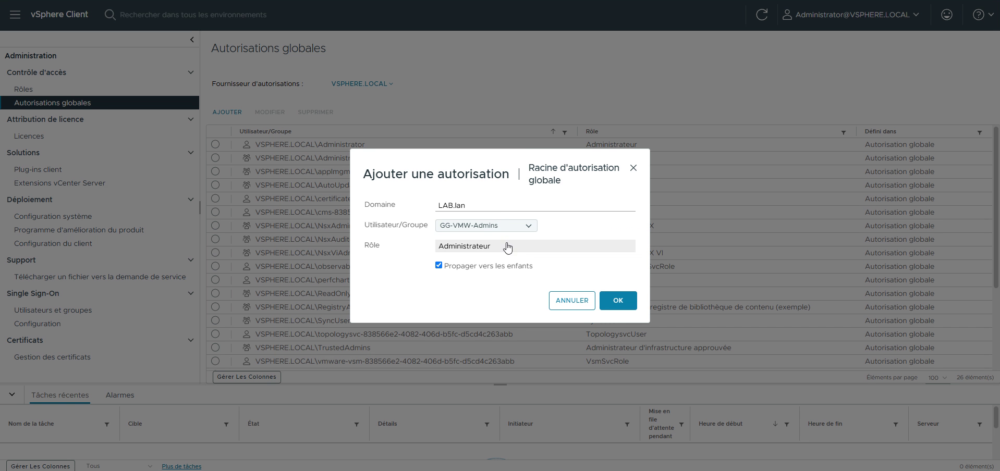

> Si la recherche trouve tes groupes, c'est la preuve que le vCenter lit bien l'AD **en LDAPS**.

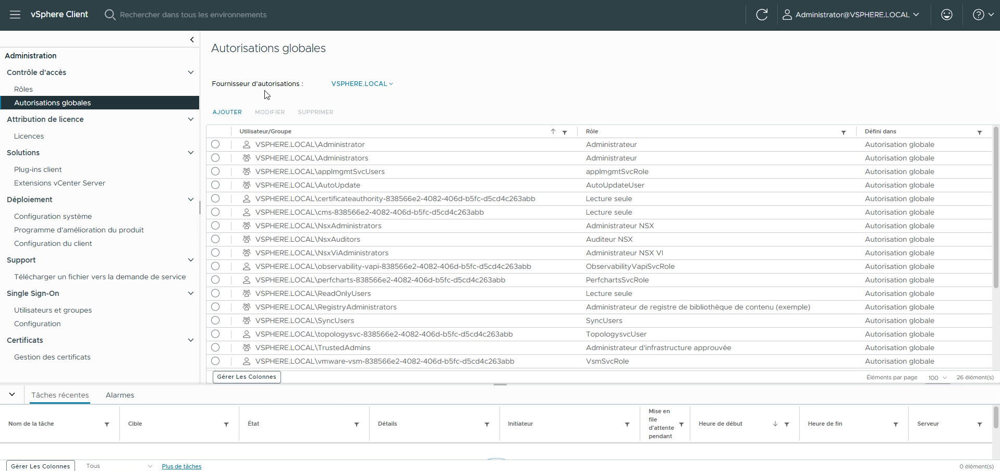

5. Recommence avec **GG-VMW-ReadOnly**, rôle **Lecture seule**, ✅ **Propager vers les enfants**.

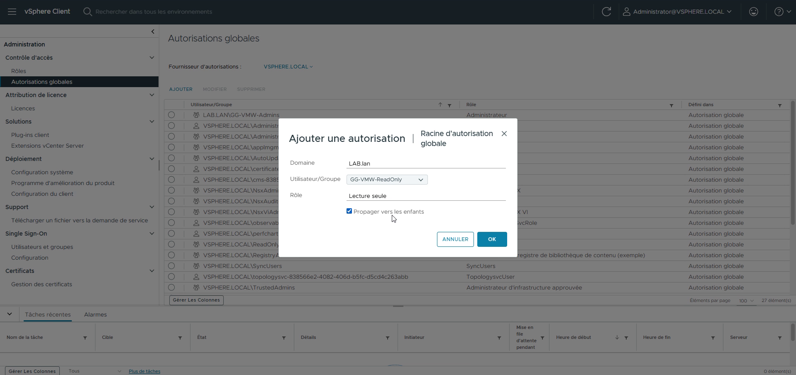

Résultat : `LAB.LAN\GG-VMW-Admins` avec le rôle **Administrateur**, et `LAB.LAN\GG-VMW-ReadOnly` avec le rôle **Lecture seule**.

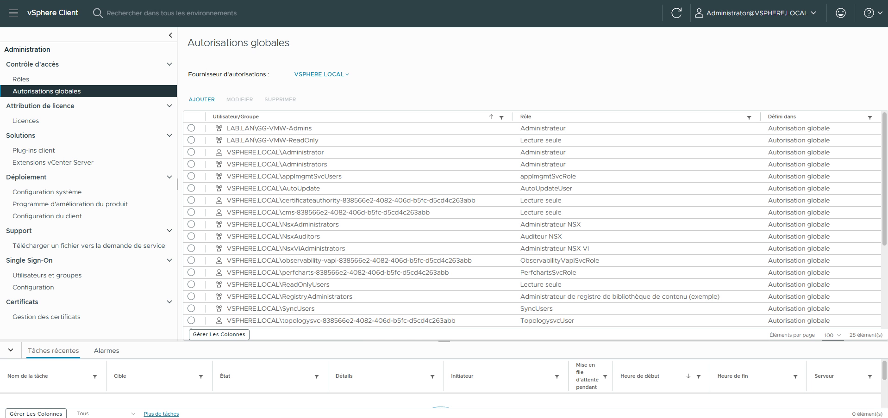

> **Autorisation globale ou autorisation sur l'inventaire ?**
> - **Globale** : couvre tout, y compris les étiquettes, les licences, les bibliothèques de contenu, et plusieurs vCenter liés.
> - **Sur l'objet vCenter** (*Inventaire > 192.168.50.12 > onglet Autorisations*) : couvre son inventaire (datacenter, cluster, ESXi, VM, réseaux, banques de données).

> **Piège rencontré :** la page *Autorisations globales* s'est affichée **vide**, sans aucun bouton. Ce n'est pas normal, car elle contient toujours les comptes `VSPHERE.LOCAL`. C'est un problème d'affichage :
> - recharge la page avec **Ctrl + F5** ;
> - ou dézoome ;
> - ou ouvre une fenêtre de navigation privée.
>
> En dernier recours, donne les droits sur **l'objet vCenter** dans l'inventaire.

### 8.2 (Facultatif) Administrer aussi le SSO

Les autorisations globales donnent la main sur l'inventaire. Pour qu'un admin AD puisse aussi gérer les sources d'identité et les comptes `vsphere.local` :

1. Va dans **Single Sign-On > Utilisateurs et groupes > Groupes**.
2. Ouvre le groupe **Administrators**, puis clique sur **AJOUTER DES MEMBRES**.
3. Choisis le domaine `LAB.lan` et le groupe `GG-VMW-Admins`.

---

## 9. Tester la connexion

1. Déconnecte-toi (en haut à droite, sur ton nom, puis **Se déconnecter**).
2. Sur la page de connexion, tape **`adm-vmw-afaye`** et son mot de passe.


3. Le nom **adm-vmw-afaye@lab.lan** s'affiche en haut à droite, avec tout l'inventaire : `DC-LAB > CL-LAB > 192.168.50.11` et les VM.

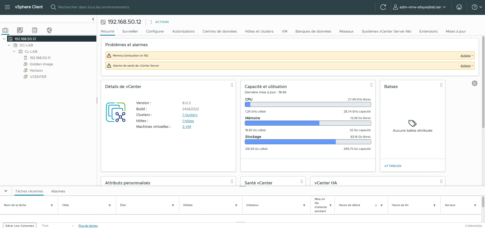

**Le vCenter est administré avec un compte AD, à travers une liaison LDAPS chiffrée.**

---

## 10. Et l'ESXi ?

**Il n'y a rien à faire pour administrer l'ESXi avec ton compte AD :** l'autorisation donnée au vCenter **descend** jusqu'à l'hôte `192.168.50.11` et à ses VM. Connecté au vCenter en `adm-vmw-afaye`, tu gères déjà l'ESXi.

Joindre l'ESXi lui-même au domaine ne sert qu'à se connecter en AD **directement** sur son interface (`https://192.168.50.11`). **On ne le fait pas**, pour trois raisons :

- **Traçabilité :** tout passe par le vCenter, où tout est tracé.
- **Compte de secours :** le compte `root` local reste disponible si le vCenter est en panne.
- **Sécurité :** une fois joint, un ESXi 8.0 U1 donne les droits root à **tout** groupe AD nommé « ESX Admins », même créé par un attaquant (faille **CVE-2024-37085**, exploitée par des rançongiciels).

> L'ESXi n'utiliserait de toute façon pas LDAPS. Il s'authentifie en **Kerberos**, comme un PC Windows, et aucun mot de passe ne circule.

En revanche, ces deux réglages sont **indispensables** (Horizon en aura besoin) :

| Réglage | Où | Valeur |
|---|---|---|
| DNS | Console de l'ESXi (F2) > *Configure Management Network* > *DNS Configuration* / *Custom DNS Suffixes* | `192.168.50.10`, nom `esx01`, suffixe `lab.lan` |
| Heure (NTP) | vCenter > hôte > **Configurer > Système > Configuration de l'heure > Modifier** | NTP, serveur `192.168.50.10`, *Démarrer et arrêter avec l'hôte* |

---

## 11. Maintenance

| Quand | Quoi | Comment |
|---|---|---|
| **Chaque année** (le certificat de DC01 se renouvelle seul, environ 6 semaines avant le 17/11/2027) | ⚠️ **Réimporter le nouveau certificat dans le vCenter** | Refais la section 6 (export), puis va dans **Sources d'identité > LAB > MODIFIER** et remplace le certificat. **Si tu oublies, plus personne ne peut se connecter au vCenter avec un compte AD.** |
| De temps en temps | Vérifier si le certificat a changé | `certlm.msc` > DC01.lab.lan > Détails > **Empreinte numérique**. Compare-la avec celle notée en section 4.5. |
| Après toute modification de la CA | Sauvegarder la CA | `certsrv.msc` > clic droit sur LAB-ROOT-CA > **Toutes les tâches > Sauvegarder l'autorité de certification** > ✅ Clé privée et certificat d'AC, ✅ Base de données. Copie ensuite la sauvegarde **hors de DC01**. |

> Si l'AD ou le certificat pose problème, tu peux toujours te connecter avec **`administrator@vsphere.local`**. Garde son mot de passe dans ton coffre : c'est le compte de secours.

---

## 12. Dépannage

| Symptôme | Cause probable | Solution |
|---|---|---|
| *« Cannot connect to one or more of the provided external server URLs »* à l'ajout de la source | URL en `ldap://` au lieu de `ldaps://`, IP au lieu du nom, ou mauvais certificat | `ldaps://dc01.lab.lan:636`, avec le certificat **DC01.lab.lan** (pas LAB-ROOT-CA) |
| Même erreur, URL correcte | Le vCenter ne résout pas `dc01.lab.lan` | DNS du vCenter = `192.168.50.10` (console de la VM, F2) |
| ldp : *« Cannot open connection »* sur le port 636 | DC01 n'a pas de certificat serveur | Section 4.4, puis vérifier dans `certlm.msc` |
| Le modèle n'apparaît pas dans « Demander un nouveau certificat » | Droits du modèle, ou modèle non publié | Onglet **Sécurité** du modèle, puis section 4.2 |
| Le groupe AD est introuvable dans « Ajouter une autorisation » | La source d'identité ne fonctionne pas, ou le mauvais domaine est choisi | Choisir **LAB.lan** dans *Domaine*, puis revérifier la source |
| Plus aucune connexion AD du jour au lendemain | Le certificat de DC01 a été renouvelé | Section 11 : réimporter le certificat |
| L'assistant réseau de la VAMI refuse le nom d'hôte | Il exige un nom complet et propose de **renommer** le vCenter | Annuler. Changer le DNS par la console de la VM (F2) |

---

## 13. Prochaine étape : durcissement du DC

Maintenant que le vCenter est en LDAPS, on peut **interdire le LDAP en clair** sur DC01, sans risque de couper le vCenter :

1. Observer les machines qui font encore du LDAP non signé (événement **2889** dans le journal *Directory Service*).
2. **Exiger la signature LDAP** et la **liaison de canal** (GPO sur l'OU *Domain Controllers*).
3. Désactiver **TLS 1.0 et 1.1**.
4. Donner un **mot de passe long** (32 caractères) à `svc-vcenter-ldap` et lui interdire l'ouverture de session interactive.
