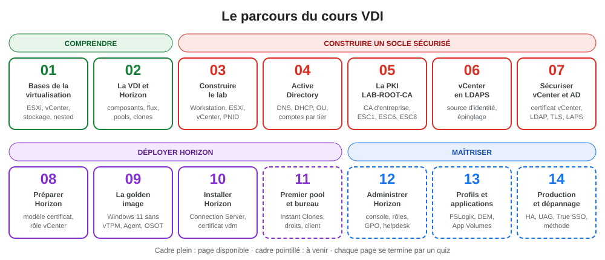
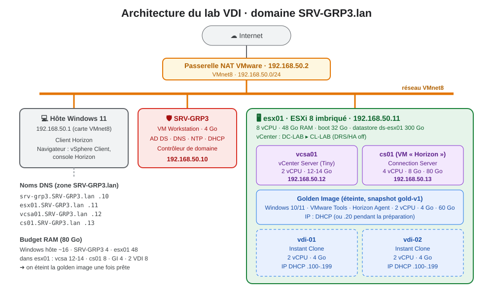

# 00 - Cours VDI : sommaire

> **Cours complet sur la VDI avec VMware vSphere et Omnissa Horizon 8**, de la théorie à un lab sécurisé comme en entreprise : comptes par tier, PKI interne, LDAPS, moindre privilège.
>
> Chaque page décrit ce qui a **réellement été fait** dans le lab, écran par écran, avec les captures, les pièges rencontrés et un quiz.

---

## Les pages

| # | Page | Ce que tu y apprends |
|---|---|---|
| 01 | [Les bases de la virtualisation](/fr/hyperviseur/VDI/01-bases-virtualisation) | Hyperviseurs type 1 et 2, anatomie d'une VM, stockage thin et thick, réseau virtuel, vCenter, cluster, snapshots, virtualisation imbriquée |
| 02 | [La VDI et Omnissa Horizon](/fr/hyperviseur/VDI/02-vdi-et-horizon) | VDI, RDS et DaaS, composants d'Horizon, parcours d'une connexion, protocole Blast, types de pools, clones instantanés |
| 03 | [Construire le lab](/fr/hyperviseur/VDI/03-construire-le-lab) | Le PC hôte, VMware Workstation et VMnet8, DC01, ESXi imbriqué, vCenter et le piège du PNID, cluster CL-LAB |
| 04 | [L'Active Directory du lab](/fr/hyperviseur/VDI/04-active-directory) | DNS et zone inverse, DHCP, OU, comptes par tier, groupes, délégation sur OU=Postes |
| 05 | [La PKI : LAB-ROOT-CA](/fr/hyperviseur/VDI/05-pki) | Autorité de certification sur DC01, CAPolicy.inf, CDP et AIA, modèle des DC, inscription automatique, attaques ESC1, ESC6 et ESC8 |
| 06 | [vCenter en LDAPS](/fr/hyperviseur/VDI/06-vcenter-ldaps) | Source d'identité AD en LDAPS, épinglage du certificat, autorisations globales, pourquoi l'ESXi n'est pas joint au domaine |
| 07 | [Sécuriser le vCenter et l'AD](/fr/hyperviseur/VDI/07-securiser-vcenter-ad) | Certificat LAB-ROOT-CA pour le vCenter, SSO, VAMI, mode de verrouillage de l'ESXi, signature LDAP, TLS, Protected Users, LAPS |
| 08 | [Préparer l'infrastructure pour Horizon](/fr/hyperviseur/VDI/08-preparation-horizon) | Serveur Horizon, modèle LAB-HorizonServer, dossiers VDI, pas de vTPM, rôle vCenter Horizon-InstantClone |
| 09 | [La golden image Windows 11](/fr/hyperviseur/VDI/09-golden-image) | VM sans vTPM, contournement LabConfig, compte local, VMware Tools, Horizon Agent, OSOT, snapshot |
| 10 | [Installer Horizon](/fr/hyperviseur/VDI/10-installation-horizon) | Connection Server, certificat `vdm`, licence, ajout du vCenter, compte de jonction, réglages de sécurité |
| 11 | [Premier pool et premier bureau](/fr/hyperviseur/VDI/11-premier-pool) | Pool de clones instantanés flottant, droits par groupe, VM internes, Horizon Client et Web Client |
| 12 | [Administrer Horizon au quotidien](/fr/hyperviseur/VDI/12-administrer-horizon) | Console, routine, service d'assistance, sessions et machines, délégation, sauvegarde, GPO des bureaux |
| 13 | [Profils, applications et cycle de vie de l'image](/fr/hyperviseur/VDI/13-profils-applications-image) | FSLogix, distribution des applications, nouvelle image sur le pool, retour arrière, mise à jour d'Horizon |
| 14 | [Production et aller plus loin](/fr/hyperviseur/VDI/14-production) | Haute disponibilité, UAG et MFA, plusieurs sites, base d'événements, dimensionnement, récapitulatif sécurité |

---

## Le lab en un coup d'œil

| Machine | IP | Système | Rôle | Où elle tourne |
|---|---|---|---|---|
| **DC01.lab.lan** | 192.168.50.10 | Windows Server | AD DS, DNS, DHCP, autorité de certification **LAB-ROOT-CA** | VMware Workstation |
| **esx01** | 192.168.50.11 | ESXi 8.0 U1 | Hyperviseur, cluster **CL-LAB** | VMware Workstation (imbriqué) |
| **vCenter** | 192.168.50.12 | vCenter 8.0.3, taille Tiny | Gestion vSphere | esx01 |
| **Horizon.lab.lan** | 192.168.50.13 | Windows Server 2022 | Futur Connection Server | esx01 |
| **GI-W11** | DHCP | Windows 11, sans vTPM | Golden image | esx01 |
| Bureaux VDI | DHCP .100 à .150 | Windows 11 | Clones instantanés | esx01 |

**Domaine :** `lab.lan`, NetBIOS `LAB`.

**Les comptes :**

| Tier | Compte | Sert à |
|---|---|---|
| 0 | `adm-dom-afaye` | Administrer l'AD, **uniquement sur les DC** |
| 1 | `adm-vmw-afaye` | Administrer vCenter et l'ESXi |
| 1 | `adm-hzn-afaye` | Administrer Horizon |
| Service | `svc-vcenter-ldap`, `svc-horizon-vc`, `svc-horizon-ic` | Un compte par usage, droits minimaux |
| Utilisateur | `afaye`, `user-test01`, `user-test02` | Ouvrir un bureau virtuel |

---

## Où en est le lab ?

| Étape | Page | État |
|---|---|---|
| Workstation, ESXi, vCenter, cluster CL-LAB | 03 | ✅ |
| DNS, zone inverse, DHCP | 04 | ✅ |
| OU, groupes, comptes par tier, délégation | 04 | ✅ |
| LAB-ROOT-CA, certificat de DC01, LDAPS | 05 | ✅ |
| vCenter relié à l'AD en LDAPS, autorisations globales | 06 | ✅ |
| DNS et NTP de l'ESXi | 03 | ⬜ |
| Certificat LAB-ROOT-CA du vCenter | 07 | ✅ |
| Durcissement du vCenter, de l'ESXi et de l'AD | 07 | ⬜ |
| Modèle LAB-HorizonServer, dossiers, rôle Horizon-InstantClone | 08 | ✅ |
| Supprimer NKP-LAB, `GG-HZN-Admins` administrateur local | 08 | ⬜ |
| Golden image Windows 11 (Agent 2412, VMXNET3) | 09 | 🟡 OSOT *Finaliser* et snapshot `v1` à confirmer |
| Connection Server installé, certificat `vdm`, vCenter, comptes, administrateurs | 10 | ✅ |
| Licence d'évaluation | 10 | ⏳ demandée |
| Premier pool, premier bureau | 11 | ⬜ |
| Délégation du support, sauvegarde, GPO des bureaux | 12 | ⬜ |
| Profils FSLogix, image `v2` | 13 | ⬜ |

---

## Les choix de sécurité du lab

| Choix | Pourquoi | Page |
|---|---|---|
| Comptes séparés par tier (`adm-dom`, `adm-vmw`, `adm-hzn`) | Un compte volé ne donne la main que sur son périmètre | 04 |
| Un compte de service par usage, droits minimaux | Moindre privilège, traçabilité | 04, 07 |
| PKI interne sans modèle par défaut ni inscription web | Pas d'attaque ESC1, ESC6 ni ESC8 | 05 |
| vCenter relié à l'AD **en LDAPS**, certificat épinglé | Aucun mot de passe en clair sur le réseau | 06 |
| ESXi **non joint** au domaine, en mode de verrouillage | Faille CVE-2024-37085 (« ESX Admins »), administration par le vCenter seul | 03, 07 |
| Certificat du vCenter émis par LAB-ROOT-CA, avec approbation | Plus d'alerte, ESC1 neutralisé | 07 |
| Signature LDAP, liaison de canal, TLS 1.2, Protected Users, LAPS | Durcissement de l'AD | 07 |
| Rôle vCenter dédié pour Horizon | Horizon n'est pas administrateur du vCenter | 08 |
| Certificat Horizon émis par LAB-ROOT-CA, nom tiré de l'AD | Pas d'alerte de certificat, pas d'ESC1 | 08, 10 |
| Bureaux non persistants, GPO dédiée à `OU=Postes` | Pas de persistance d'un logiciel malveillant, pas de fuite par presse-papiers ou USB | 11, 12 |
| Profils FSLogix cloisonnés par utilisateur | Personne ne lit le profil d'un autre | 13 |

> **Le compromis du lab :** pas de vTPM dans la golden image (page 08). En production, on le garde.

---

## Dates à ne pas oublier

| Quoi | Quand |
|---|---|
| Renouveler le certificat de DC01 et le réimporter dans le vCenter | **Fin septembre 2027** (expiration le 17/11/2027) |
| Renouveler le certificat du vCenter | 1 an après son émission (page 07) |
| Renouveler le certificat Horizon (`vdm`) | **Vers le 22/10/2027** (expiration le 22/11/2027, page 10) |
| Fin de la licence d'évaluation Horizon | Date affichée dans **Licence produit et utilisation** après sa saisie (page 10) |
