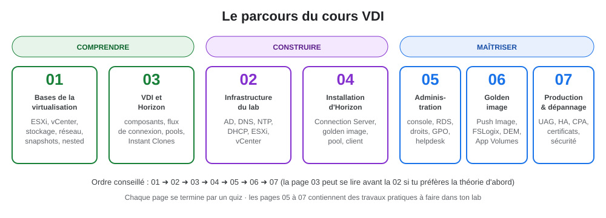

# Cours VDI : VMware vSphere + Omnissa Horizon

> Ce cours part de zéro : **comprendre** la virtualisation, **construire** un lab VDI complet sur un seul PC, puis **maîtriser** Horizon au niveau attendu en entreprise. Chaque page a des schémas, des commandes prêtes à l'emploi et un quiz.
{.is-info}

## Les pages

| # | Page | Ce que tu y apprends |
|---|---|---|
| 01 | [Les bases de la virtualisation](/hyperviseur/VDI/01-bases-virtualisation) | Hyperviseurs type 1 et 2, anatomie d'une VM, datastores, thin / thick, réseau virtuel, vCenter, cluster (vMotion, DRS, HA), snapshots, virtualisation imbriquée |
| 02 | [Mise en place de l'infrastructure du lab](/hyperviseur/VDI/02-infrastructure-lab) | Architecture et plan d'adressage, AD / DNS / NTP / DHCP, OU et comptes de service, ESXi nested, réseau en mode promiscuité, déploiement de vCenter, checklist |
| 03 | [La VDI et Omnissa Horizon](/hyperviseur/VDI/03-vdi-et-horizon) | VDI vs RDS vs DaaS, composants d'Horizon, parcours détaillé d'une connexion, protocoles Blast / PCoIP, types de pools, Instant Clones |
| 04 | [Installation d'Horizon pas à pas](/hyperviseur/VDI/04-installation-horizon) | Connection Server, console, ajout de vCenter, golden image Windows 11, Horizon Agent, pool Instant Clone, client, dépannage de l'installation |
| 05 | [Administrer Horizon au quotidien](/hyperviseur/VDI/05-horizon-administration) | Console, pools, machines, sessions, farms RDS et applications publiées, droits, rôles, paramètres globaux, GPO, Teams, helpdesk, supervision, API |
| 06 | [Golden image, cycle de vie, profils et applications](/hyperviseur/VDI/06-horizon-golden-image) | Construire et maintenir l'image, Push Image, tests, FSLogix, DEM, App Volumes, antivirus et activation en VDI |
| 07 | [Horizon en production et dépannage](/hyperviseur/VDI/07-horizon-production) | Architecture de référence, haute disponibilité, UAG, certificats, True SSO, Cloud Pod Architecture, dimensionnement, sauvegarde, mises à jour, sécurité, méthode de dépannage, glossaire |

## Le lab en un coup d'œil

| Machine | IP | Rôle |
|---|---|---|
| SRV-GRP3 | 192.168.50.10 | AD DS, DNS, NTP, DHCP (domaine `SRV-GRP3.lan`) |
| esx01 | 192.168.50.11 | ESXi 8 imbriqué dans VMware Workstation |
| vcsa01 | 192.168.50.12 | vCenter Server (Tiny) |
| cs01 (VM « Horizon ») | 192.168.50.13 | Horizon Connection Server 2412 |
| Golden Image | DHCP | Windows 11 + Tools + Horizon Agent |
| vdi-01, vdi-02 | DHCP .100-.199 | Bureaux Instant Clone |

## Où en est le lab ?

| Étape | État |
|---|---|
| ESXi installé, datastore `ds-esx01` | ✅ fait |
| vCenter déployé, `DC-LAB` / `CL-LAB` | ✅ fait (stage 2 à vérifier) |
| VM « Horizon » et « Golden Image » créées | ✅ fait |
| Installeurs Connection Server et Agent 2412 téléchargés | ✅ fait |
| DNS, NTP, DHCP, comptes AD, promiscuité vSwitch0 | ⬜ [page 02](/hyperviseur/VDI/02-infrastructure-lab) |
| Connection Server installé et configuré | ⬜ [page 04, étapes 2 à 4](/hyperviseur/VDI/04-installation-horizon) |
| Golden image prête (Tools, domaine, agent, snapshot) | ⬜ [page 04, étapes 5 à 7](/hyperviseur/VDI/04-installation-horizon) |
| Pool Instant Clone + droits | ⬜ [page 04, étapes 8 et 9](/hyperviseur/VDI/04-installation-horizon) |
| Client Horizon, première connexion | ⬜ [page 04, étape 10](/hyperviseur/VDI/04-installation-horizon) |
| TP d'administration (RDS, GPO, rôles) | ⬜ [page 05](/hyperviseur/VDI/05-horizon-administration) |
| FSLogix, Push Image | ⬜ [page 06](/hyperviseur/VDI/06-horizon-golden-image) |

## Corrections apportées par rapport au résumé initial

| Sujet | Résumé initial | Correction |
|---|---|---|
| Nom de domaine | `lan` | **`SRV-GRP3.lan`** : FQDN `esx01.srv-grp3.lan`, `vcsa01.srv-grp3.lan`, `cs01.srv-grp3.lan` |
| Comptes de service | `svc-vcenter`, `svc-horizon` | + **`svc-icdomain`** pour que les Instant Clones puissent créer leurs comptes ordinateur |
| Disque de la golden image | 60 Go | **64 Go minimum** pour Windows 11 |
| Disque des bureaux | 40 Go choisis dans le pool | Pour un Instant Clone, le disque **est celui de la golden image** (thin et partagé) |
| DHCP | « DHCP ou .20 » | Un serveur DHCP **unique** (SRV-GRP3), DHCP de VMnet8 désactivé |
| Réseau nested | Non mentionné | **Promiscuité, changements de MAC et transmissions forgées** à accepter sur vSwitch0 |