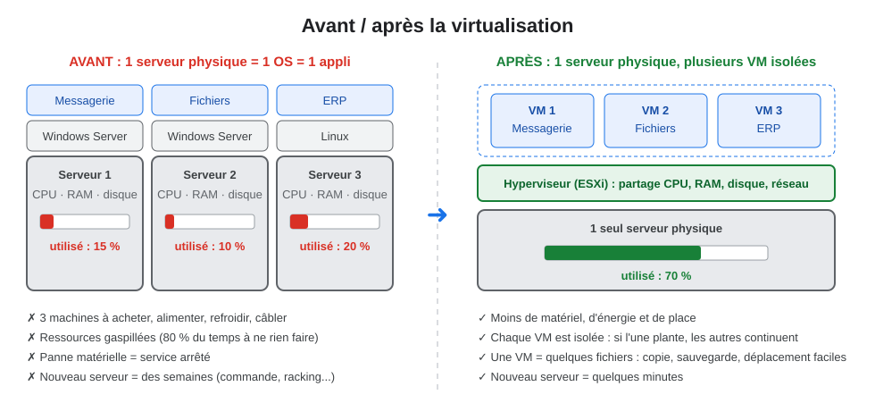
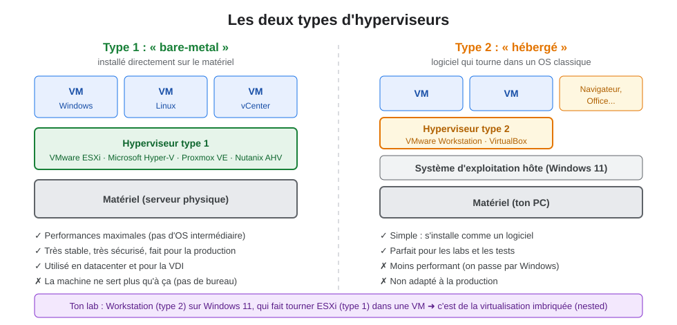
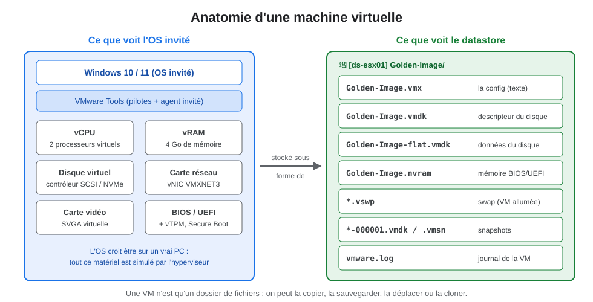
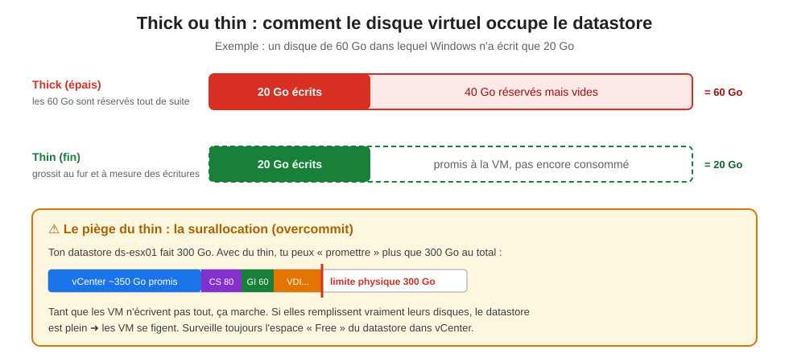
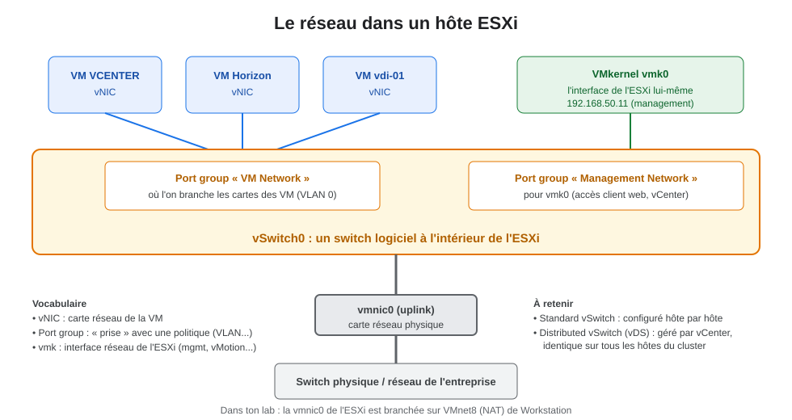
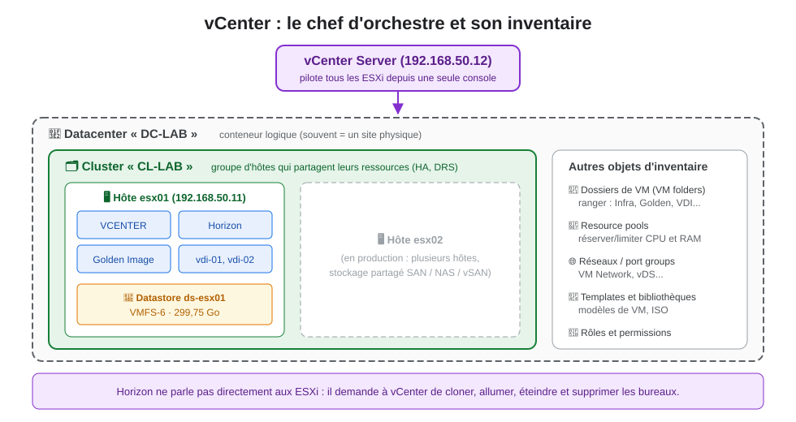
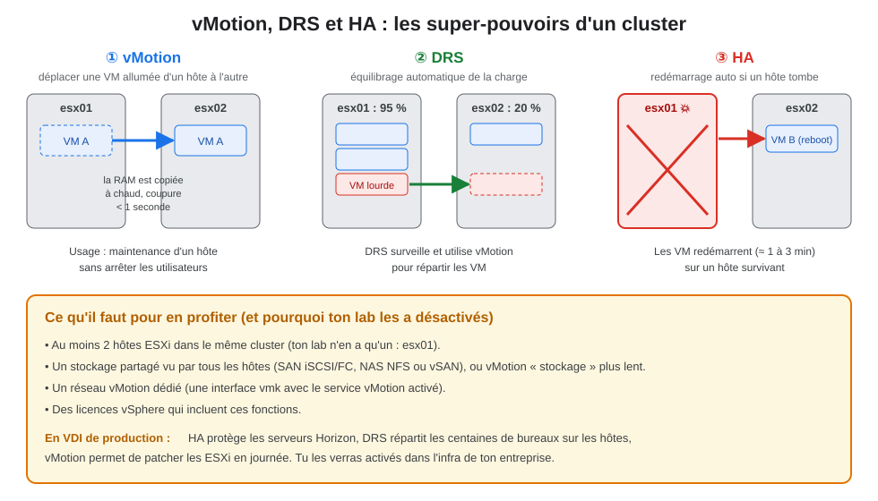
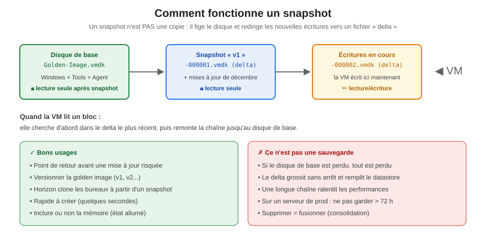
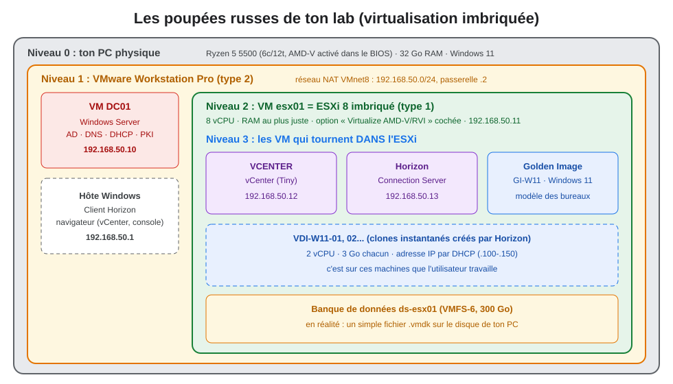

# 01 - Les bases de la virtualisation

> **Objectif de la page :** comprendre ce qu'est une machine virtuelle, ce que fait un hyperviseur, et comment vSphere (ESXi + vCenter) les organise. Tout le reste du cours s'appuie sur ces notions.

---

## 1. Le problème de départ

Avant la virtualisation, on installait **un service par serveur physique** : un serveur pour l'AD, un pour la messagerie, un pour la base de données… Chacun utilisait en moyenne 10 à 15 % de son processeur. Le reste du temps, il chauffait la salle pour rien.

La virtualisation découpe un serveur physique en **plusieurs machines virtuelles (VM)**. Chacune croit avoir son propre matériel, alors qu'elles se partagent le même.

| Sans virtualisation | Avec virtualisation |
|---|---|
| 1 service = 1 serveur | 1 serveur = 10, 20, 50 VM |
| Ajouter un serveur : commande, livraison, câblage | Ajouter une VM : quelques minutes |
| Une panne matérielle arrête le service | La VM redémarre sur un autre hôte (HA) |
| Sauvegarde du serveur entier compliquée | Une VM n'est qu'un ensemble de fichiers |

---

## 2. L'hyperviseur : type 1 et type 2

L'**hyperviseur** est le logiciel qui crée les VM et leur distribue le processeur, la mémoire, le disque et le réseau.

| | Type 1 | Type 2 |
|---|---|---|
| S'installe | Directement sur le matériel | Comme un logiciel, dans un Windows ou un Linux |
| Exemples | **VMware ESXi**, Microsoft Hyper-V, Proxmox VE | **VMware Workstation**, VirtualBox |
| Usage | Production, datacenter | Poste de travail, tests, labs |
| Performances | Maximales | Le système hôte prend sa part |

> **Dans ce lab, on utilise les deux** : VMware Workstation (type 2) sur le PC, et dedans un ESXi (type 1). C'est la virtualisation imbriquée (partie 9).

---

## 3. Anatomie d'une machine virtuelle

Une VM n'est qu'**un dossier de fichiers** sur une banque de données :

| Fichier | Contenu |
|---|---|
| `.vmx` | La configuration : nombre de vCPU, RAM, cartes réseau, disques… |
| `.vmdk` | Le descripteur du disque virtuel |
| `-flat.vmdk` | Les données du disque |
| `.nvram` | Le BIOS ou l'UEFI de la VM |
| `.vswp` | Le fichier d'échange, créé au démarrage, de la taille de la RAM non réservée |
| `-delta.vmdk` / `-sesparse.vmdk` | Les modifications depuis un snapshot |
| `vmware.log` | Le journal de la VM, utile en dépannage |

Le **matériel virtuel** vu par le système invité :

| Composant | Ce qu'il faut savoir |
|---|---|
| **vCPU** | Un fil d'exécution du processeur physique. Ne donne pas plus de vCPU que nécessaire : une VM à 8 vCPU doit attendre 8 cœurs libres pour s'exécuter |
| **Mémoire** | Peut être surréservée : on promet plus de RAM aux VM qu'il n'y en a. ESXi récupère alors la mémoire inutilisée, mais au-delà d'un certain point tout ralentit (alarme *Memory Exhaustion*) |
| **Carte réseau** | **VMXNET3** (paravirtualisée, la plus rapide, pilote fourni par les VMware Tools) ou **E1000E** (émulée, reconnue par Windows sans pilote) |
| **Contrôleur disque** | **LSI Logic SAS** ou **NVMe** (pilotes dans Windows), **VMware Paravirtual** (plus rapide, mais pilote à fournir à l'installation) |
| **Micrologiciel** | **EFI** (obligatoire pour Windows 11) ou BIOS. Le démarrage sécurisé n'existe qu'en EFI |
| **vTPM** | Puce TPM virtuelle. Elle exige un fournisseur de clés dans le vCenter |

Les **VMware Tools** sont les pilotes et services installés dans la VM : pilotes VMXNET3 et PVSCSI, arrêt propre depuis le vCenter, synchronisation, remontée de l'IP et du nom dans le vSphere Client. Une VM sans Tools fonctionne mal.

---

## 4. Le stockage

### 4.1 Les banques de données

Une **banque de données** (*datastore*) est l'espace où ESXi range les dossiers des VM :

| Type | Description |
|---|---|
| **VMFS** | Système de fichiers de VMware, sur un disque local ou un LUN SAN (iSCSI, Fibre Channel). Plusieurs ESXi peuvent l'utiliser en même temps |
| **NFS** | Un partage réseau d'un NAS |
| **vSAN** | Les disques locaux de plusieurs ESXi regroupés en une banque partagée |

Dans le lab : une banque VMFS locale, **ds-esx01**, sur le second disque de l'ESXi.

### 4.2 Provisionnement dynamique ou statique

| Mode | Place réservée à la création | Avantage | Inconvénient |
|---|---|---|---|
| **Dynamique** (*thin*) | Rien : le fichier grossit au fil des écritures | Économise l'espace | On peut promettre plus que la banque ne contient. Si elle se remplit, les VM se figent |
| **Statique, mise à zéro différée** (*lazy zeroed*) | Toute la taille | Espace garanti | Consomme tout de suite |
| **Statique, mise à zéro immédiate** (*eager zeroed*) | Toute la taille, effacée à la création | Performances maximales, requis pour Fault Tolerance | Création lente |

> **Dans un lab, tout en dynamique.** Mais surveille l'espace libre de la banque de données : c'est la première chose à regarder quand une VM se fige.

---

## 5. Le réseau virtuel

Chaque ESXi contient des **commutateurs virtuels** :

| Élément | Rôle |
|---|---|
| **vSwitch standard** | Commutateur propre à un ESXi |
| **vSphere Distributed Switch** | Commutateur unique géré par le vCenter pour tous les ESXi d'un cluster |
| **Groupe de ports** | Un « type de prise » sur le vSwitch, avec ses réglages (VLAN, sécurité). Les VM se branchent dessus |
| **vmnic** | Carte réseau physique de l'ESXi (liaison montante) |
| **vmk** (VMkernel) | Interface réseau de l'ESXi lui-même : administration, vMotion, stockage |

**Les trois réglages de sécurité d'un vSwitch :** mode promiscuité, modifications d'adresse MAC, transmissions forgées. En production, ils restent sur **Rejeter**. En virtualisation imbriquée, il faut les **accepter** (page 03).

---

## 6. vCenter : tout gérer depuis un seul endroit

Un ESXi seul s'administre avec son **Host Client** (`https://IP-de-l-esxi/ui`). Dès qu'on a plusieurs hôtes, on installe **vCenter Server** :

- une **appliance** Linux (VCSA) déployée comme une VM ;
- une seule console, le **vSphere Client**, pour tous les ESXi ;
- les fonctions avancées : cluster, vMotion, DRS, HA, modèles, rôles et autorisations ;
- l'authentification centralisée (**SSO**), avec le domaine interne `vsphere.local` et des sources d'identité externes comme l'AD (page 06).

L'inventaire est une arborescence :

> **Horizon a besoin du vCenter.** C'est à lui qu'il demande de cloner, allumer et supprimer les bureaux. Il ne parle jamais directement à l'ESXi.

---

## 7. Le cluster : vMotion, DRS et HA

Un **cluster** regroupe plusieurs ESXi qui partagent le stockage et le réseau.

| Fonction | Ce qu'elle fait |
|---|---|
| **vMotion** | Déplace une VM **allumée** d'un hôte à l'autre, sans coupure |
| **Storage vMotion** | Déplace les fichiers d'une VM allumée vers une autre banque de données |
| **DRS** | Répartit automatiquement les VM entre les hôtes selon leur charge |
| **HA** | Si un hôte tombe, redémarre ses VM sur les autres (coupure de quelques minutes) |
| **Fault Tolerance** | Une copie de la VM tourne en permanence sur un autre hôte : aucune coupure |

> Le lab n'a qu'**un seul hôte** : DRS et HA n'ont aucun intérêt. On crée quand même le cluster **CL-LAB**, parce que l'assistant de pool Horizon demande un cluster.

---

## 8. Snapshots, clones et modèles

| Notion | Ce que c'est | Attention |
|---|---|---|
| **Snapshot** | Une photo de la VM à un instant : on peut y revenir. Les écritures suivantes vont dans un fichier delta | **Ce n'est pas une sauvegarde.** Un snapshot qui reste des semaines grossit et ralentit la VM |
| **Clone complet** | Une copie indépendante d'une VM | Prend autant de place que l'original |
| **Clone lié** | Une VM qui lit le disque d'une autre et n'écrit que ses différences | Très économe en place |
| **Modèle** (*template*) | Une VM figée qui sert à en déployer d'autres | Ne peut pas être allumée |

> **Les clones instantanés d'Horizon** reposent sur un **snapshot** de la golden image : Horizon clone la VM à partir de ce snapshot, en partageant son disque et même sa mémoire (page 02).

---

## 9. La virtualisation imbriquée

Le lab tient sur **un seul PC** :

Pour que ça fonctionne :

| Condition | Où |
|---|---|
| Virtualisation matérielle activée (SVM chez AMD, VT-x chez Intel) | BIOS du PC |
| Hyper-V, *Intégrité de la mémoire* et WSL2 désactivés, sinon Workstation est lui-même virtualisé et ralentit | Windows |
| ☑ *Virtualize Intel VT-x/EPT or AMD-V/RVI* sur la VM esx01 | Paramètres de la VM dans Workstation |
| Sécurité du vSwitch0 de l'ESXi en **Accepter** | Host Client ou vCenter (page 03) |

> **Pourquoi c'est lent :** chaque niveau ajoute une couche de traduction, et tout partage le même processeur et la même mémoire. Le déploiement du vCenter ou la création d'un pool prennent plusieurs dizaines de minutes : c'est normal.

---

## 10. Qui fait quoi : VMware, Broadcom et Omnissa

| Produit | Éditeur aujourd'hui |
|---|---|
| vSphere (ESXi, vCenter), Workstation | **Broadcom**, qui a racheté VMware fin 2023 |
| Horizon, App Volumes, Dynamic Environment Manager, Workspace ONE | **Omnissa**, l'ancienne division *End-User Computing* de VMware, revendue en 2024 |

> Dans les documentations récentes, « VMware Horizon » est devenu « **Omnissa Horizon** ». Les services et les dossiers ont changé de nom (`C:\ProgramData\Omnissa\…`), mais le produit est le même.

---

## 11. Glossaire

| Terme | Définition |
|---|---|
| **ESXi** | Hyperviseur type 1 de VMware |
| **vCenter / VCSA** | Serveur de gestion de vSphere, livré en appliance |
| **vSphere Client** | Console web du vCenter |
| **Host Client** | Console web d'un ESXi seul |
| **DCUI** | Console texte jaune et grise de l'ESXi (touche F2) |
| **VAMI** | Interface d'administration de l'appliance vCenter, port 5480 |
| **Banque de données** | Espace de stockage des VM |
| **VMFS** | Système de fichiers des banques de données VMware |
| **VMware Tools** | Pilotes et services installés dans une VM |
| **Snapshot** | État figé d'une VM auquel on peut revenir |
| **Imbriqué** (*nested*) | Hyperviseur qui tourne dans une VM |

---

## 12. Quiz

<b>1. Quelle est la différence entre un hyperviseur de type 1 et de type 2 ? Donne un exemple de chaque dans le lab.</b>
 
Le type 1 s'installe directement sur le matériel (ESXi, l'hôte esx01). Le type 2 s'installe dans un système existant (VMware Workstation, sur le PC Windows).

<b>2. Pourquoi un snapshot n'est-il pas une sauvegarde ?</b>
 
Il dépend du disque d'origine, sur la même banque de données. Si ce disque ou la banque est perdu, le snapshot l'est aussi. En plus, il grossit et ralentit la VM avec le temps.

<b>3. Une VM a une carte VMXNET3 mais Windows ne voit aucune carte réseau. Pourquoi ?</b>
 
Le pilote VMXNET3 est fourni par les VMware Tools. Tant qu'ils ne sont pas installés, Windows ne reconnaît pas la carte.

<b>4. Pourquoi créer un cluster avec un seul hôte ?</b>
 
DRS et HA n'y servent à rien, mais l'assistant de pool Horizon demande un cluster et un pool de ressources.

<b>5. Les VM de mon ESXi imbriqué n'ont pas de réseau alors que l'ESXi répond. Que vérifier ?</b>
 
La sécurité du vSwitch0 : en imbriqué, il faut accepter le mode promiscuité, les modifications d'adresse MAC et les transmissions forgées. Sinon, le vSwitch rejette les trames des VM, dont la MAC n'est pas celle de la carte de l'ESXi.

---

[Sommaire](/fr/hyperviseur/VDI/00-sommaire) · Page suivante : [02 - La VDI et Omnissa Horizon ➜](/fr/hyperviseur/VDI/02-vdi-et-horizon)
