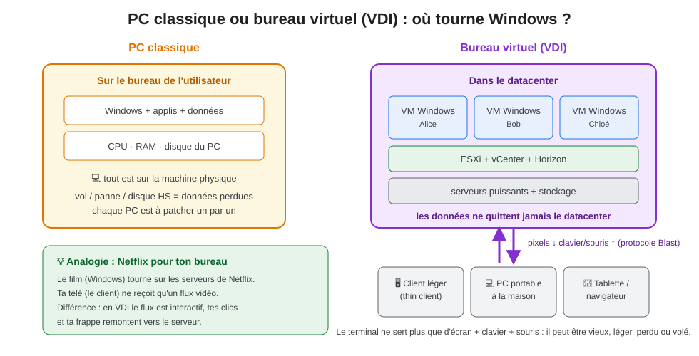
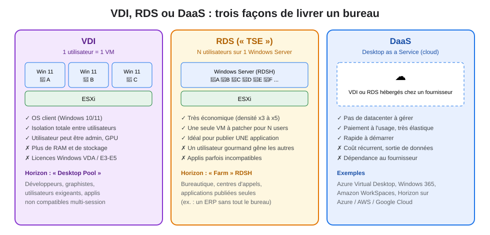
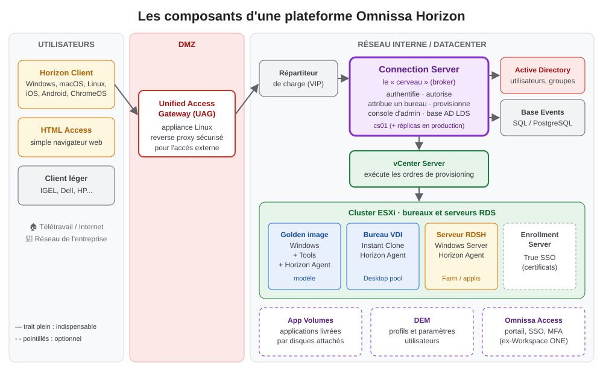
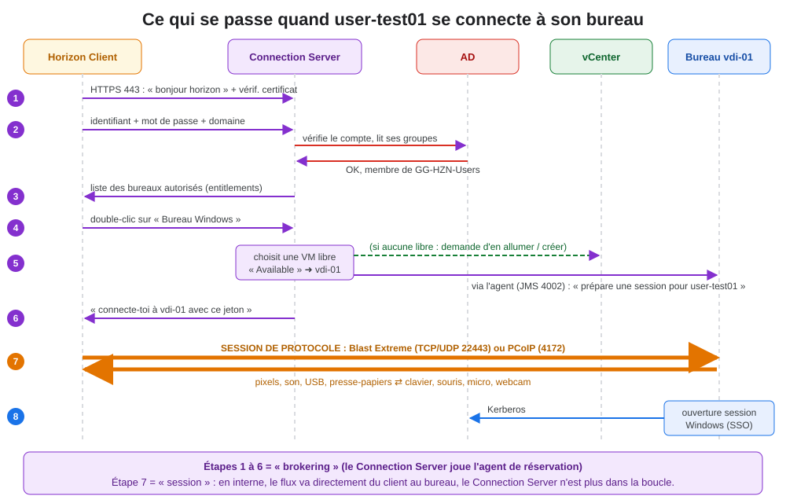
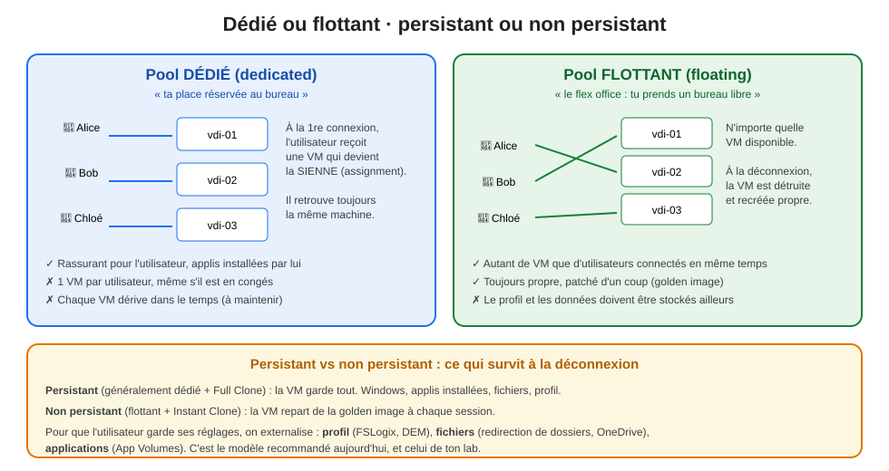
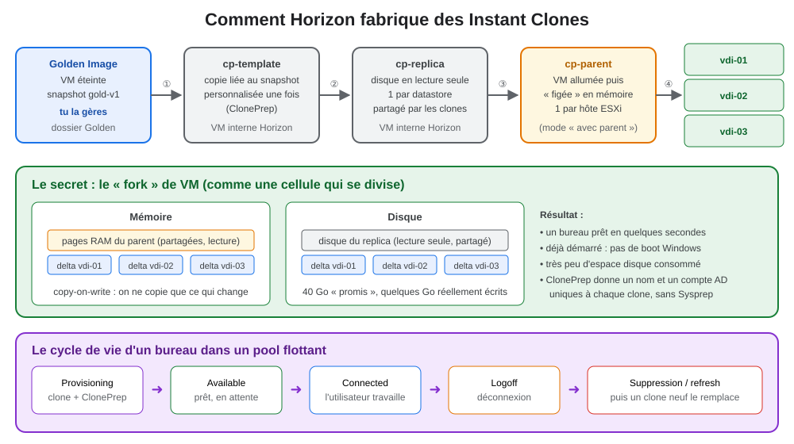

# 02 - La VDI et Omnissa Horizon

> **Objectif de la page :** comprendre ce qu'est la VDI, les composants d'Horizon et ce qui se passe entre le moment où l'utilisateur clique sur son bureau et celui où il le voit s'afficher.

---

## 1. La VDI, c'est quoi ?

La **VDI** (*Virtual Desktop Infrastructure*) consiste à faire tourner les postes de travail **dans le datacenter**, sous forme de VM. L'utilisateur ne reçoit que l'**image** de son bureau, par le réseau, sur n'importe quel appareil : PC, client léger, Mac, tablette, navigateur.

| Avantage | Pourquoi |
|---|---|
| **Sécurité** | Les données ne quittent pas le datacenter. Un portable volé ne contient rien |
| **Gestion centralisée** | On met à jour une image, et tous les bureaux en profitent |
| **Mobilité** | Le même bureau depuis le bureau, la maison ou un hôtel |
| **Reprise rapide** | Un bureau en panne est remplacé en quelques secondes |

| Inconvénient | Pourquoi |
|---|---|
| Dépend du réseau | Sans réseau, pas de bureau |
| Coût de départ | Serveurs, stockage, licences |
| Complexité | AD, DNS, DHCP, certificats, profils : tout doit être propre |

---

## 2. Les trois familles de bureaux à distance

| | VDI | RDS (Remote Desktop Services) | DaaS (*Desktop as a Service*) |
|---|---|---|---|
| Principe | **Une VM par utilisateur** | **Plusieurs utilisateurs** sur un même Windows Server | Bureaux fournis par un cloud |
| Système | Windows 10 / 11 | Windows Server | Variable |
| Isolation | Totale | Partagée : un utilisateur peut ralentir les autres | Variable |
| Densité | Faible | Forte | — |
| Exemples | Horizon (pools de bureaux), Citrix | Horizon (fermes RDS), RDS Microsoft | Azure Virtual Desktop, Horizon Cloud, Windows 365 |

> Horizon sait faire **les deux premiers** : des pools de bureaux VDI et des fermes RDS pour publier des applications. Ce cours commence par la VDI.

---

## 3. Les composants d'Horizon

| Composant | Où | Rôle |
|---|---|---|
| **Connection Server** | Windows Server joint au domaine | Le cœur : authentifie les utilisateurs dans l'AD, vérifie leurs droits, choisit un bureau, pilote le vCenter. Héberge la **Horizon Console** (`https://serveur/admin`) |
| **Horizon Agent** | Dans chaque bureau (golden image) | Reçoit la connexion, encode l'image du bureau, gère la redirection USB, audio, imprimantes |
| **Horizon Client** | Poste de l'utilisateur | Se connecte au Connection Server et affiche le bureau. Il existe aussi **HTML Access**, dans un simple navigateur |
| **vCenter Server** | Infrastructure vSphere | Crée, allume et supprime les bureaux à la demande d'Horizon |
| **Active Directory** | DC | Comptes, groupes, jonction des bureaux au domaine |
| **Unified Access Gateway** (UAG) | Appliance en DMZ | Accès depuis Internet, sans VPN |
| **Base d'événements** | SQL Server ou PostgreSQL | Historique des connexions et des erreurs |
| **App Volumes** | Serveur dédié | Livre des applications à la demande dans les bureaux |
| **Dynamic Environment Manager** (DEM) | Partage de fichiers | Paramètres et profil de l'utilisateur |

Dans le lab : **un Connection Server** (`Horizon.lab.lan`), l'agent dans la golden image, le client sur le PC, le vCenter et l'AD. Le reste viendra plus tard.

---

## 4. Le parcours d'une connexion, étape par étape

1. Le client contacte le Connection Server en **HTTPS (443)**. Le certificat doit être valide : c'est pour ça qu'on lui donne un certificat de LAB-ROOT-CA (pages 08 et 10).
2. 3. L'utilisateur s'authentifie, le Connection Server vérifie son compte dans l'AD.
4. 5. Il lit ses **groupes** et affiche les pools auxquels ils donnent droit (par exemple `GG-HZN-Users`).
6. 7. L'utilisateur choisit un pool. Le Connection Server lui attribue un bureau disponible.
8. Il prévient l'**agent** du bureau qu'une session arrive.
9. Le client ouvre la connexion d'**affichage** avec le bureau, soit directement, soit à travers la **passerelle sécurisée** du Connection Server (*Blast Secure Gateway*).
10. L'agent ouvre la session Windows avec les identifiants déjà saisis : l'utilisateur ne retape pas son mot de passe.

> **Où ça casse le plus souvent :** le certificat (étape 1), le DNS (le client ne résout pas `horizon.lab.lan`), le DHCP ou la jonction au domaine (le bureau n'est jamais « Disponible », étape 7).

---

## 5. Les protocoles d'affichage

| Protocole | Port principal | Ce qu'il faut savoir |
|---|---|---|
| **Blast Extreme** | TCP et UDP **443 / 8443** (passerelle), **22443** (agent) | Le protocole par défaut et recommandé. Basé sur les codecs vidéo H.264 / H.265. Fonctionne aussi dans le navigateur (HTML Access) |
| **PCoIP** | TCP et UDP **4172** | L'ancien protocole d'Horizon, toujours supporté |
| **RDP** | TCP **3389** | Le protocole Microsoft. Dépannage uniquement |

> Dans ce cours, on utilise **Blast**. Pour le lab, tout passe en interne : pas besoin d'ouvrir de port sur la box.

---

## 6. Les types de pools

Un **pool** est un groupe de bureaux identiques, auquel on donne des droits.

| Type | Description |
|---|---|
| **Pool automatisé** | Horizon crée lui-même les bureaux à partir d'une golden image. Deux variantes : **clones instantanés** (recommandé) ou clones complets |
| **Pool manuel** | Horizon distribue des VM ou des PC physiques déjà existants, avec l'agent installé |
| **Pool RDS** | Des bureaux de session sur une ferme Windows Server |

Et deux façons d'**attribuer** un bureau :

| Attribution | Comportement | Usage |
|---|---|---|
| **Flottante** | L'utilisateur prend un bureau libre. À la déconnexion, le bureau est détruit et recréé propre | Accueil, centres d'appels, formation : **le choix du lab** |
| **Dédiée** | L'utilisateur garde toujours le même bureau | Développeurs, utilisateurs qui installent leurs logiciels |

> Avec un pool **flottant non persistant**, l'utilisateur perd tout à la déconnexion. En production, on lui garde son profil avec FSLogix ou DEM (page 14).

---

## 7. Les clones instantanés en détail

Les **clones instantanés** (*Instant Clones*) sont la technologie qui rend la VDI rapide et économe :

| Étape | Ce qui se passe |
|---|---|
| 1. Image | Tu prépares la golden image, tu l'éteins, tu prends un **snapshot** |
| 2. Préparation | Horizon en tire des VM internes (`cp-template`, `cp-replica`), rangées dans le dossier `ClonePrepInternalTemplateFolder` du vCenter. **N'y touche jamais** |
| 3. Clonage | Chaque bureau est créé en quelques secondes. Il **partage** le disque de la réplique et n'écrit que ses modifications |
| 4. Personnalisation | Le bureau reçoit un nom (`VDI-W11-01`), rejoint le domaine dans `OU=Postes` grâce au compte `svc-horizon-ic`, et obtient une IP par **DHCP** |
| 5. Déconnexion | En pool flottant, le bureau est supprimé puis recréé propre |
| 6. Mise à jour | Nouveau snapshot de la golden image, puis **Planifier** une mise à jour du pool (*Push Image*) : les bureaux sont recréés sur la nouvelle version |

**Ce que ça impose :**

- un **DHCP** : un clone ne peut pas avoir d'IP fixe ;
- un compte de jonction au domaine, avec des droits sur une OU (page 04) ;
- un compte vCenter avec un rôle adapté (page 08) ;
- **pas de Sysprep** : la personnalisation d'Horizon (*ClonePrep*) s'en charge.

---

## 8. Le vocabulaire Horizon

| Terme | Définition |
|---|---|
| **Golden image** (image parente) | La VM modèle de tous les bureaux |
| **Pool** | Groupe de bureaux identiques |
| **Droit** (*entitlement*) | Autorisation d'un utilisateur ou d'un groupe sur un pool |
| **Session** | Connexion en cours d'un utilisateur à un bureau |
| **Pod** | Un groupe de Connection Servers qui partagent la même configuration |
| **Push Image** | Remplacer l'image d'un pool par un nouveau snapshot |
| **ClonePrep** | Personnalisation des clones instantanés (nom, domaine) |
| **Blast Secure Gateway** | Passerelle du Connection Server qui relaie l'affichage |
| **HTML Access** | Accès au bureau depuis un navigateur, sans client |

---

## 9. Quiz

<b>1. Quelle est la différence entre la VDI et le RDS ?</b>
 
En VDI, chaque utilisateur a sa propre VM Windows 10 ou 11. En RDS, plusieurs utilisateurs partagent le même Windows Server.

<b>2. Pourquoi les clones instantanés imposent-ils un serveur DHCP ?</b>
 
Les bureaux sont créés et détruits automatiquement à partir de la même image. On ne peut pas leur donner une IP fixe à chacun : ils la reçoivent par DHCP.

<b>3. Quel composant ouvre la session Windows dans le bureau ?</b>
 
L'Horizon Agent, avec les identifiants déjà saisis dans le client : l'utilisateur ne retape pas son mot de passe.

<b>4. Dans un pool flottant, que devient le bureau à la déconnexion ?</b>
 
Il est supprimé puis recréé propre à partir de l'image. L'utilisateur suivant reçoit un bureau neuf.

<b>5. Faut-il lancer Sysprep sur la golden image ?</b>
 
Non. Horizon personnalise lui-même chaque clone instantané (ClonePrep) : nom, jonction au domaine, nouvelle identité.

---

[⬅ 01 - Les bases](/fr/hyperviseur/VDI/01-bases-virtualisation) · [Sommaire](/fr/hyperviseur/VDI/00-sommaire) · Page suivante : [03 - Construire le lab ➜](/fr/hyperviseur/VDI/03-construire-le-lab)
