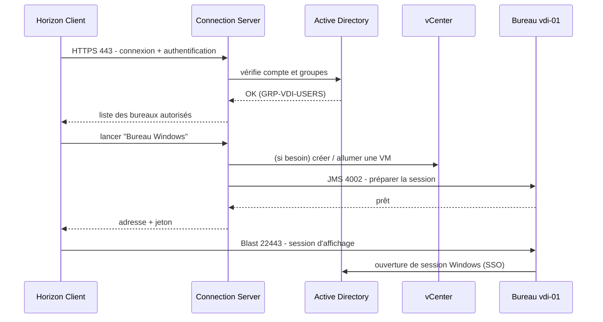

# 03 - La VDI et Omnissa Horizon

> **Objectif de la page :** comprendre ce qu'est un bureau virtuel, à quoi sert chaque composant d'Horizon et ce qui se passe *réellement* entre le double-clic de l'utilisateur et l'apparition de son bureau Windows. Avec cette page, tu dois pouvoir dessiner l'architecture au tableau et l'expliquer à un collègue.
{.is-info}

**Parcours du cours :** [01 Bases](/hyperviseur/VDI/01-bases-virtualisation) ➜ [02 Infrastructure](/hyperviseur/VDI/02-infrastructure-lab) ➜ **03 VDI & Horizon** ➜ [04 Installation](/hyperviseur/VDI/04-installation-horizon) ➜ [05 Administration](/hyperviseur/VDI/05-horizon-administration) ➜ [06 Golden image](/hyperviseur/VDI/06-horizon-golden-image) ➜ [07 Production](/hyperviseur/VDI/07-horizon-production)

---

## 1. La VDI, c'est quoi ?

**VDI = Virtual Desktop Infrastructure**, infrastructure de bureaux virtuels.

Au lieu que Windows tourne sur le PC posé sur le bureau de l'utilisateur, il tourne dans une **VM au datacenter**. L'utilisateur s'y connecte depuis n'importe quel appareil, qui ne fait plus qu'afficher l'image du bureau et transmettre le clavier et la souris.

### Pourquoi les entreprises font de la VDI

| Motivation | Explication |
|---|---|
| **Sécurité des données** | Les fichiers restent au datacenter. Un portable volé ne contient rien. On peut interdire le copier-coller ou l'USB vers le poste local. |
| **Télétravail et mobilité** | Le même bureau depuis le bureau, la maison, un hôtel, une tablette. |
| **Gestion centralisée** | On met à jour **une** golden image au lieu de 500 PC. Déployer un nouveau bureau prend quelques minutes. |
| **Continuité d'activité** | PC en panne ? L'utilisateur prend un autre poste et retrouve sa session exactement là où il l'a laissée. |
| **Prestataires et BYOD** | Donner un accès contrôlé à un consultant sans lui fournir de PC ni ouvrir le réseau. |
| **Durée de vie du matériel** | Des postes anciens ou des clients légers suffisent pour afficher le bureau. |
| **Conformité** | Santé, banque, défense, administrations : traçabilité et contrôle des données. |
| **Postes spécialisés** | Bureaux avec GPU (vGPU NVIDIA) pour la CAO ou la 3D, sans station de travail sous chaque bureau. |

### Ce que la VDI ne règle pas (et ses pièges)

- **Elle dépend du réseau.** Sans réseau, pas de bureau. La latence et la bande passante se ressentent directement dans l'expérience utilisateur.
- **Elle coûte cher au départ** : serveurs puissants, stockage rapide, licences (vSphere, Horizon, Windows).
- **Elle est complexe** : tu le vois déjà avec ton lab. AD, DNS, certificats, stockage, réseau, profils... tout doit fonctionner.
- **La visio** (Teams, Zoom) demande une optimisation spécifique, sinon la vidéo transite deux fois et saccade (voir page 05).

---

## 2. Les trois familles de bureaux à distance

| | **VDI** | **RDS / RDSH** (ex-TSE) | **DaaS** |
|---|---|---|---|
| Principe | 1 VM Windows client par utilisateur | Plusieurs utilisateurs partagent un Windows Server | Bureaux hébergés par un fournisseur cloud |
| OS | Windows 10 / 11 | Windows Server 2019 / 2022 / 2025 | Selon l'offre |
| Densité par serveur | 50 à 150 bureaux par hôte (selon les profils) | 3 à 5 fois plus d'utilisateurs | N/A |
| Isolation | Totale | Partielle (même OS) | Selon l'offre |
| Usage typique | Utilisateurs exigeants, développeurs, GPU, applis incompatibles multi-session | Bureautique, centres d'appels, **publication d'applications** | PME, besoins élastiques, sans datacenter |
| Dans Horizon | **Desktop Pool** | **Farm** + Desktop / Application Pool | Horizon sur Azure / AWS / Google, ou les offres Microsoft / Amazon |
| Licence Windows (en bref) | Droits VDA ou abonnement M365 E3/E5 avec droits VDI | CAL RDS par utilisateur ou par appareil | Inclus ou selon l'offre |

> **Horizon sait faire les deux.** Une même plateforme peut servir des bureaux VDI aux uns, des bureaux RDS aux autres, et publier une simple application (par exemple un vieil ERP) qui s'ouvre comme une fenêtre normale sur le PC de l'utilisateur. On parle alors d'**application publiée** (published app).
{.is-success}

> **Les licences Microsoft en VDI sont un sujet à part entière** et changent régulièrement. Retiens qu'on n'a **pas** le droit d'utiliser n'importe quelle licence Windows en VDI. En entreprise, c'est l'équipe licences/achats qui gère : ne t'aventure pas à affirmer quoi que ce soit sans vérifier.
{.is-warning}

### Et les concurrents ?

| Éditeur | Produit | Remarque |
|---|---|---|
| **Omnissa** | Horizon 8 (sur site), Horizon Cloud | Le sujet de ce cours |
| **Citrix** (Cloud Software Group) | Citrix Virtual Apps and Desktops (ex-XenApp / XenDesktop), DaaS | Le principal concurrent historique, très présent en entreprise |
| **Microsoft** | Azure Virtual Desktop (AVD), Windows 365, RDS | Cloud, Windows 11 multi-session exclusif à Azure |
| **Amazon** | WorkSpaces | Cloud |
| **Autres** | Parallels RAS, Inuvika, Nutanix Frame | Plus marginaux |

Les **concepts** sont les mêmes partout : broker, agent, client, protocole, golden image, pools, profils. Ce que tu apprends ici se transpose facilement.

---

## 3. Les composants d'Horizon

### 3.1 Les indispensables

#### Connection Server : le cerveau

C'est un service Windows installé sur un **Windows Server membre du domaine** (ton `cs01`). On l'appelle aussi le **broker** (courtier) : il met en relation un utilisateur et un bureau.

| Rôle | Détail |
|---|---|
| **Authentification** | Vérifie l'identifiant et le mot de passe auprès de l'AD (ou via SAML, carte à puce, RADIUS / MFA) |
| **Autorisation** | Vérifie les **entitlements** : à quels pools cet utilisateur a-t-il droit ? |
| **Brokering** | Choisit une machine libre dans le pool et l'attribue à l'utilisateur |
| **Provisioning** | Demande à vCenter de créer, allumer, recomposer ou supprimer les bureaux |
| **Console d'administration** | Héberge la **Horizon Console** (`https://cs01.srv-grp3.lan/admin`) |
| **Base de configuration** | Stocke toute la configuration dans une base **AD LDS** (un mini annuaire LDAP local), répliquée entre les Connection Servers d'un même pod |
| **Passerelles (tunnel)** | Peut faire transiter les flux (HTTPS Secure Tunnel, Blast Secure Gateway, PCoIP Secure Gateway) quand le client ne peut pas joindre le bureau directement |

Les rôles possibles à l'installation :
- **Standard Server** : le premier Connection Server d'un environnement (il crée une nouvelle base AD LDS) ;
- **Replica Server** : un Connection Server supplémentaire qui réplique la base d'un existant (haute disponibilité, montée en charge) ;
- **Enrollment Server** : un rôle à part, pour **True SSO** (voir plus bas).

> L'ancien rôle « **Security Server** », placé en DMZ, a été **supprimé**. Il est remplacé par l'**UAG**. Si tu tombes sur une vieille doc qui en parle, elle est obsolète.
{.is-info}

#### Horizon Agent : le représentant dans chaque bureau

Un logiciel installé **dans la golden image** (donc dans chaque bureau) et dans chaque serveur RDSH.

- Il s'enregistre auprès du Connection Server et lui remonte l'état de la machine (disponible, connectée, déconnectée...).
- Il héberge le **serveur du protocole d'affichage** (Blast / PCoIP).
- Il gère les **redirections** : USB, imprimantes, presse-papiers, lecteurs clients, son, webcam, scanners, cartes à puce, géolocalisation...
- Il contient le composant **Instant Clone** qui permet au bureau d'être cloné et personnalisé (ClonePrep).

#### Horizon Client : le côté utilisateur

L'application installée sur le poste de l'utilisateur (Windows, macOS, Linux, iOS, Android, ChromeOS). Elle :
- se connecte au Connection Server (ou à l'UAG depuis l'extérieur) ;
- affiche la liste des bureaux et applications autorisés ;
- ouvre la session de protocole avec le bureau ;
- gère la redirection des périphériques locaux, le multi-écran, la résolution.

**HTML Access** permet aussi de se connecter depuis un simple navigateur, sans rien installer (`https://cs01.srv-grp3.lan` ➜ « Horizon HTML Access »), avec moins de fonctions (pas d'USB, par exemple).

#### vCenter Server

Horizon n'agit jamais directement sur les ESXi : il passe par l'API de vCenter, avec un compte de service (`svc-horizon`). Pas de vCenter, pas de pools automatisés.

### 3.2 Les composants optionnels (très courants en entreprise)

| Composant | Rôle | Quand on en a besoin |
|---|---|---|
| **Unified Access Gateway (UAG)** | Appliance Linux en DMZ. Reverse proxy qui authentifie et relaie les connexions venant d'Internet vers les Connection Servers et les bureaux, sans VPN. | Dès qu'il y a du **télétravail** sans VPN |
| **Répartiteur de charge** | Une adresse unique (VIP, ex. `vdi.entreprise.fr`) devant plusieurs Connection Servers ou UAG. Matériel ou virtuel : F5, Citrix NetScaler, Kemp, HAProxy, NSX Advanced Load Balancer. | Dès qu'il y a 2 Connection Servers ou plus |
| **Base de données Events** | SQL Server ou PostgreSQL. Conserve l'historique des événements (connexions, erreurs) pour l'audit et le dépannage. | Toujours en production (sinon l'historique est très limité) |
| **Enrollment Server + ADCS** | Délivre à la volée des certificats aux utilisateurs pour qu'ils ouvrent leur session Windows sans mot de passe, après une authentification SAML. C'est **True SSO**. | Avec Omnissa Access, Azure AD / Entra ID, ou du MFA moderne |
| **App Volumes** | Livre des applications dans des disques virtuels (VMDK/VHD) attachés à la volée au bureau, au lieu de les installer dans la golden image. | Beaucoup d'applications différentes selon les services |
| **Dynamic Environment Manager (DEM)** | Sauvegarde et restaure les paramètres des utilisateurs et des applications, applique des configurations selon le contexte (lecteurs réseau, imprimantes...). | Bureaux non persistants |
| **FSLogix** (Microsoft) | Stocke le profil Windows complet de l'utilisateur dans un disque virtuel (VHDX) monté à l'ouverture de session. | Très souvent utilisé avec Horizon pour Outlook, OneDrive, Teams |
| **Omnissa Access** (ex-Workspace ONE Access) | Portail d'applications unifié, SSO, intégration MFA / SAML. | Portail unique, accès conditionnel |
| **Horizon Edge Gateway / Cloud** | Connecte un Horizon sur site au plan de contrôle cloud d'Omnissa (licences par abonnement, console cloud, monitoring). | Selon le modèle de licence |
| **NVIDIA vGPU** | Partage une carte graphique physique entre plusieurs bureaux. | CAO, 3D, montage vidéo |

---

## 4. Le parcours d'une connexion, étape par étape

C'est **la** chose à comprendre pour savoir dépanner. Quand quelqu'un te dit « ça ne marche pas », tu dois pouvoir situer à quelle étape ça casse.

| Étape | Ce qui se passe | Port | Si ça casse... |
|---|---|---|---|
| 1 | Le client contacte le Connection Server en HTTPS et vérifie son certificat | TCP 443 | « Impossible de se connecter au serveur », avertissement de certificat ➜ DNS, pare-feu, certificat |
| 2 | L'utilisateur s'authentifie, le Connection Server interroge l'AD | 443, puis LDAP / Kerberos vers le DC | « Nom d'utilisateur ou mot de passe incorrect », heure décalée, compte verrouillé |
| 3 | Le Connection Server renvoie la liste des bureaux autorisés | 443 | Liste vide ➜ entitlement manquant, pool désactivé |
| 4 | L'utilisateur choisit un bureau | 443 | |
| 5 | Le Connection Server choisit une VM disponible et prévient l'agent | TCP 4002 (JMS) vers l'agent | « Aucune machine disponible », « Agent unreachable » ➜ pool plein, agent mal enregistré, pare-feu |
| 6 | Le client reçoit l'adresse de la VM et un jeton de connexion | 443 | |
| 7 | Le client ouvre la session de **protocole** directement avec le bureau | TCP/UDP **22443** (Blast) ou TCP/UDP **4172** (PCoIP) | Écran noir, déconnexion immédiate ➜ pare-feu, routage, protocole |
| 8 | Windows ouvre la session de l'utilisateur (SSO avec les identifiants déjà saisis) | Kerberos vers le DC | Écran « Bienvenue » interminable ➜ profil, GPO, DNS du bureau |

> **Connexion directe ou tunnelisée ?** À l'étape 7, en interne, le client se connecte **directement** au bureau (le Connection Server n'est plus dans le flux). Depuis Internet, le client ne voit pas les bureaux : le flux passe par l'**UAG** (port 8443 pour Blast), qui le relaie vers le bureau. On peut aussi forcer le passage par le Connection Server (Blast Secure Gateway), mais c'est rarement fait en interne.
{.is-info}

Le même flux, version diagramme de séquence :

---

## 5. Les protocoles d'affichage

Le protocole d'affichage est ce qui transporte l'image du bureau vers l'utilisateur, et le clavier, la souris, le son et les périphériques dans l'autre sens. C'est lui qui fait la qualité ressentie.

| | **Blast Extreme** | **PCoIP** | **RDP** |
|---|---|---|---|
| Éditeur | Omnissa | Teradici (licencié) | Microsoft |
| Statut | **Protocole par défaut et recommandé** | Historique, encore supporté | Possible, mais limité |
| Transport | TCP et UDP (BEAT, adaptatif) | UDP principalement | TCP / UDP |
| Port vers le bureau | 22443 | 4172 | 3389 |
| Codecs | H.264, **H.265/HEVC**, **AV1** (selon matériel), Blast Codec, JPG/PNG adaptatif | Propriétaire (pixels) | RemoteFX / AVC |
| Accélération matérielle | Oui (encodage GPU NVIDIA, décodage sur le client) | Limitée | Limitée |
| Navigateur (HTML Access) | Oui | Non | Non |
| Points forts | Faible consommation sur réseaux mobiles, très bon sur liaisons à perte, multi-plateforme | Très bonne qualité d'image sur réseau local | Pratique pour l'admin, pas besoin du client Horizon |

> **BEAT (Blast Extreme Adaptive Transport)** : Blast choisit automatiquement entre UDP et TCP selon la qualité du réseau. UDP est meilleur sur les liaisons avec latence ou perte (Wi-Fi, 4G, Internet). Si UDP est bloqué par un pare-feu, Blast bascule en TCP : ça marche, mais moins bien. Pense à ouvrir **UDP 22443** (et UDP 8443 sur l'UAG).
{.is-info}

### Ordres de grandeur de bande passante (Blast)

| Usage | Bande passante typique |
|---|---|
| Bureautique (Word, Outlook, navigation légère) | 150 à 500 kbit/s |
| Navigation web riche, PDF, défilement intensif | 0,5 à 2 Mbit/s |
| Vidéo plein écran 1080p | 2 à 6 Mbit/s |
| Multi-écran 4K, 3D | 10 Mbit/s et plus |

La **latence** compte souvent plus que le débit : en dessous de 50 ms aller-retour, l'expérience est excellente. Au-delà de 150 ms, l'utilisateur sent un décalage à la frappe et à la souris.

---

## 6. Les types de pools

Un **pool** (desktop pool) est un ensemble de bureaux configurés de la même façon et proposés à un groupe d'utilisateurs. C'est l'objet central de l'administration Horizon.

### 6.1 Automatisé ou manuel

| Type | Description |
|---|---|
| **Automated** | Horizon crée lui-même les VM à partir d'une golden image (Instant Clone) ou d'un template vCenter (Full Clone). Il gère le nombre de VM, leur nommage, leur cycle de vie. **C'est le cas normal.** |
| **Manual** | On ajoute au pool des machines existantes qui ont déjà l'agent (VM créées à la main, voire **PC physiques**). Horizon ne les crée pas, il se contente de les proposer. |
| **RDS** | Le pool est adossé à une **farm** de serveurs RDSH. Chaque utilisateur reçoit une session sur l'un des serveurs. |

### 6.2 Dédié ou flottant, persistant ou non

| | Affectation | Persistance | Clone typique | Exemple |
|---|---|---|---|---|
| **Dédié + persistant** | Une VM attribuée à vie à un utilisateur | Tout est conservé | Full Clone | Développeur qui installe ses outils |
| **Dédié + non persistant** | Toujours la même VM, mais réinitialisée à la déconnexion | Rien n'est conservé dans la VM | Instant Clone | Rare, cas particuliers de nommage |
| **Flottant + non persistant** | N'importe quelle VM libre | Rien n'est conservé dans la VM | **Instant Clone** | **95 % des projets modernes**, ton lab |

### 6.3 Full Clone ou Instant Clone

| | **Full Clone** | **Instant Clone** |
|---|---|---|
| Création | Copie complète d'un template vCenter + Sysprep / personnalisation | « Fork » d'une VM parente en mémoire + ClonePrep |
| Temps de création | Plusieurs minutes par VM | **Quelques secondes** par VM |
| Espace disque | 100 % de la taille du disque (moins le thin) | Une fraction : seuls les changements sont écrits |
| Mise à jour | VM par VM (outils de déploiement, SCCM / MECM...) | **Une seule fois**, sur la golden image, puis « Push Image » |
| Persistance | Oui | Non (sauf profils externalisés) |
| Gestion | Comme des PC classiques | Comme une image unique |

> **Les Linked Clones et View Composer n'existent plus** dans les versions actuelles d'Horizon 8. Tu les croiseras dans de vieilles docs ou de vieux environnements : leur rôle est désormais tenu par les Instant Clones.
{.is-info}

---

## 7. Les Instant Clones en détail

Quand tu crées un pool Instant Clone à partir du snapshot `gold-v1` de la golden image, Horizon (via vCenter) fabrique une chaîne de VM internes, rangées dans un dossier spécial de vCenter (`ClonePrepInternalTemplateFolder` et assimilés) :

| VM interne | Rôle |
|---|---|
| **cp-template-xxx** | Clone de la golden image, personnalisé une fois (jonction au domaine de base) |
| **cp-replica-xxx** | Disque en lecture seule, **un par datastore**, partagé par tous les clones de ce datastore |
| **cp-parent-xxx** | VM allumée puis mise en pause en mémoire, **une par hôte ESXi**. Les clones sont « forkés » à partir d'elle. |

> **À ne jamais faire :** supprimer, déplacer, allumer ou modifier à la main ces VM `cp-*` dans vCenter. C'est Horizon qui les gère. Si tu les casses, le pool ne peut plus provisionner.
{.is-danger}

> **Mode « sans parent » (Smart Provisioning) :** selon la configuration du cluster (notamment avec beaucoup d'hôtes ou certains réglages), Horizon peut créer les clones sans garder de `cp-parent` allumé sur chaque hôte. C'est plus économe en mémoire mais un peu plus lent. Horizon choisit automatiquement le mode, tu n'as généralement rien à faire.
{.is-info}

### ClonePrep : la personnalisation sans Sysprep

Chaque clone a besoin d'une identité unique : nom d'ordinateur (`vdi-01`, `vdi-02`...), compte ordinateur dans l'AD, SID réseau. Avec un Full Clone, on utilise **Sysprep** (lent, plusieurs redémarrages). Les Instant Clones utilisent **ClonePrep** :

1. Horizon crée le compte ordinateur dans l'OU choisie, avec le compte `svc-icdomain` (d'où les droits délégués en page 02).
2. Le clone démarre déjà « chaud » (copie de la mémoire du parent).
3. Le service ClonePrep de l'agent renomme la machine, renouvelle son mot de passe de compte ordinateur, renouvelle l'IP DHCP.
4. Des **scripts** optionnels peuvent être lancés à ce moment (post-synchronisation, avant arrêt).
5. Le bureau passe à l'état **Available**.

### Cycle de vie dans un pool flottant

- **Provisioning ➜ Customizing ➜ Available** : la machine est prête et attend un utilisateur.
- **Connected** : un utilisateur est dessus.
- **Disconnected** : l'utilisateur a fermé la fenêtre sans se déconnecter, sa session tourne encore.
- **Logoff** : l'utilisateur se déconnecte ➜ la VM est **supprimée** (ou remise à zéro) et un clone neuf est créé pour la remplacer.

Conséquence directe : **tout ce qui est écrit dans la VM pendant la session est perdu** à la déconnexion. D'où l'importance des profils externalisés (page 06).

---

## 8. Le vocabulaire Horizon à connaître

| Terme | Définition |
|---|---|
| **Pod** | Un ensemble de Connection Servers qui partagent la même base de configuration (jusqu'à 7 serveurs) |
| **Site** | Regroupement logique de pods (souvent un datacenter) |
| **Cloud Pod Architecture (CPA)** | Fédération de plusieurs pods (multi-sites) avec des droits globaux |
| **Desktop pool** | Ensemble de bureaux identiques |
| **Farm** | Ensemble de serveurs RDSH identiques |
| **Application pool** | Application publiée depuis une farm (ou un pool VDI) |
| **Entitlement** | Droit d'un utilisateur ou d'un groupe AD sur un pool |
| **Global entitlement** | Droit au niveau CPA, valable sur plusieurs pods |
| **Golden image** (ou parent VM, master image) | VM modèle à partir de laquelle on clone les bureaux |
| **Push Image** | Remplacer le snapshot utilisé par un pool (mise à jour de tous les bureaux) |
| **Spare machines** | Nombre de VM disponibles en avance, prêtes pour les prochains utilisateurs |
| **Session** | Connexion active d'un utilisateur sur un bureau ou une application |
| **Global policies** | Règles générales (USB, multimédia, accès à distance) |
| **Horizon Console** | L'interface web d'administration |
| **Blast / PCoIP** | Protocoles d'affichage |
| **UAG** | Passerelle d'accès externe |
| **True SSO** | Ouverture de session Windows par certificat, après une authentification SAML |

---

## 9. Quiz

<b>1. Quelle est la différence entre VDI et RDS ?</b>

En VDI, chaque utilisateur a sa propre VM Windows client. En RDS, plusieurs utilisateurs partagent le même Windows Server, chacun dans sa session.

<b>2. Quel composant est installé dans la golden image ?</b>

Les VMware Tools et l'Horizon Agent.

<b>3. Un utilisateur voit la liste de ses bureaux mais reçoit « aucune machine disponible ». Où regarder ?</b>

Au niveau du pool : nombre maximal de machines atteint, machines en erreur, provisioning bloqué (vCenter, datastore plein, ClonePrep en échec), agent non joignable. Étape 5 du flux.

<b>4. Pourquoi les fichiers enregistrés sur le bureau Windows disparaissent-ils dans un pool flottant Instant Clone ?</b>

Parce qu'à la déconnexion, la VM est supprimée et recréée depuis la golden image. Il faut stocker les profils et les données ailleurs (FSLogix, DEM, redirection de dossiers, OneDrive).

<b>5. Quel port faut-il ouvrir entre le client et le bureau pour Blast, et pourquoi en UDP aussi ?</b>

22443, en TCP et en UDP. UDP donne de meilleures performances sur les réseaux avec latence ou pertes (BEAT).

<b>6. Que remplace l'UAG ?</b>

L'ancien Security Server. C'est la passerelle placée en DMZ pour l'accès depuis Internet.

<b>7. Puis-je supprimer la VM cp-parent qui consomme de la RAM dans vCenter ?</b>

Non. Ce sont des VM internes gérées par Horizon. Les supprimer à la main casse le provisioning du pool.

---

⬅ [02 - Infrastructure](/hyperviseur/VDI/02-infrastructure-lab) · **Page suivante :** [04 - Installation d'Horizon pas à pas](/hyperviseur/VDI/04-installation-horizon) ➜