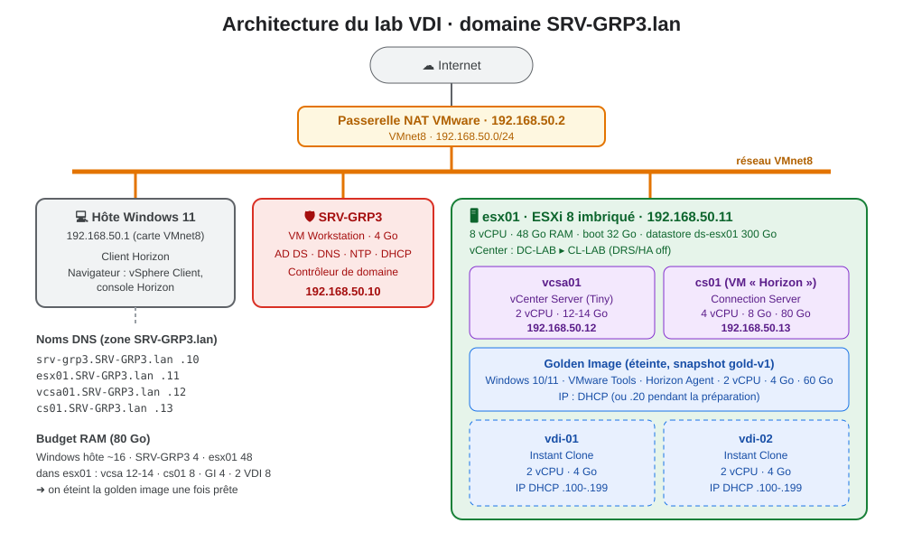
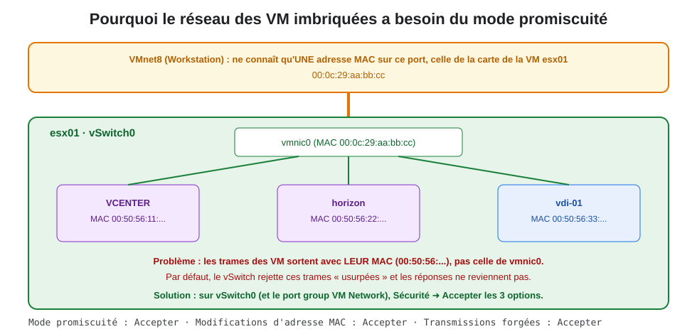
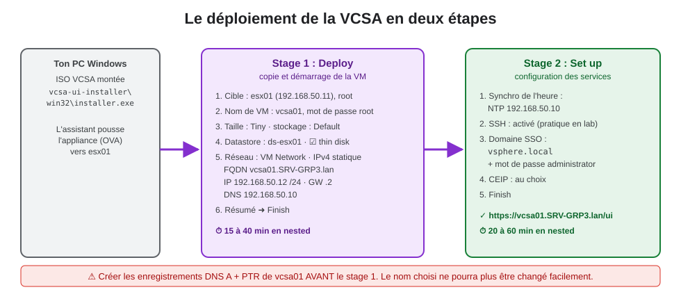

# 03 - Construire le lab

> **Objectif de la page :** monter le socle matériel et vSphere du lab sur un seul PC : le réseau, le contrôleur de domaine DC01, l'ESXi imbriqué, le vCenter et le cluster. L'AD lui-même est configuré en page 04.

---

## 1. L'architecture



> **Pourquoi DC01 n'est pas dans l'ESXi ?** Si l'ESXi ou le vCenter tombe, l'AD et le DNS restent disponibles. Et le DC démarre en premier, avant tout le reste.

### 1.1 Le plan d'adressage

| Machine | Nom | IP | Rôle |
|---|---|---|---|
| Passerelle NAT de Workstation | — | 192.168.50.2 | Sortie Internet |
| Carte VMnet8 du PC | — | 192.168.50.1 | Poste d'administration, client Horizon |
| DC01 | `dc01.lab.lan` | 192.168.50.10 | AD DS, DNS, DHCP, autorité de certification |
| ESXi | `esx01.lab.lan` | 192.168.50.11 | Hyperviseur |
| vCenter | `vcenter.lab.lan` (PNID : **192.168.50.12**) | 192.168.50.12 | Gestion vSphere |
| Horizon | `horizon.lab.lan` | 192.168.50.13 | Connection Server |
| Golden image et bureaux | — | DHCP .100 à .150 | VDI |

### 1.2 Le budget de ressources

Le PC n'a que **32 Go de RAM** : c'est la ressource qui manque. Le vCenter affiche d'ailleurs l'alarme *Memory Exhaustion*.

| VM | vCPU | RAM | Où |
|---|---|---|---|
| DC01 | 2 | 4 Go | Workstation |
| esx01 | 8 | Le maximum possible en laissant 6 à 8 Go à Windows | Workstation |
| VCENTER (Tiny) | 2 | 14 Go | esx01 |
| Horizon | 2 | 6 Go (4 Go minimum) | esx01 |
| GI-W11 | 2 | 3 Go, **éteinte** quand elle ne sert pas | esx01 |
| Bureaux | 2 | 3 Go chacun, **1 seul** au départ | esx01 |

> **Règle du lab :** dimensionner au plus juste, éteindre la golden image, un seul bureau, zéro machine de réserve.

---

## 2. Préparer le PC

### 2.1 La virtualisation matérielle

1. Dans le BIOS : **Advanced > CPU Configuration > SVM Mode = Enabled** (AMD).
2. Dans Windows, **Win + R** > `msinfo32`. En bas de *Résumé système*, *Sécurité basée sur la virtualisation* doit être **Non activée**.
3. Si un hyperviseur est détecté, désactive :
   - **Sécurité Windows > Sécurité de l'appareil > Isolation du noyau > Intégrité de la mémoire** ;
   - dans **Fonctionnalités de Windows** : Hyper-V, Plateforme de machine virtuelle, Plateforme de l'hyperviseur Windows, WSL.
4. Redémarre.

> Avec Hyper-V actif, Workstation tourne lui-même au-dessus d'Hyper-V : l'ESXi imbriqué devient très lent, voire refuse de démarrer ses VM.

### 2.2 Le réseau VMnet8

Workstation > **Edit > Virtual Network Editor** > **Change Settings** (droits administrateur) > sélectionne **VMnet8** :

| Paramètre | Valeur |
|---|---|
| Type | **NAT** |
| Subnet IP / mask | `192.168.50.0` / `255.255.255.0` |
| NAT Settings > Gateway IP | `192.168.50.2` |
| ☐ **Use local DHCP service** | **Décoché** : c'est DC01 qui fera le DHCP (page 04) |

> ⚠️ **Un seul DHCP.** Si celui de VMware reste actif, il répond aussi, avec un DNS qui ne connaît pas `lab.lan` : les bureaux ne pourraient pas joindre le domaine.

Pour que le PC trouve les noms du lab, la carte **VMware Network Adapter VMnet8** du PC reçoit le DNS **192.168.50.10** (uniquement cette carte : ta carte Internet garde son DNS habituel).

---

## 3. DC01

| Réglage | Valeur |
|---|---|
| Système | Windows Server, dans Workstation, carte sur **VMnet8** |
| Nom | `DC01` |
| IP | Fixe `192.168.50.10/24`, passerelle `192.168.50.2` |
| DNS | `127.0.0.1` puis, une fois l'AD installé, lui-même |
| Rôle | AD DS, forêt **`lab.lan`**, NetBIOS **`LAB`** |
| Heure | Workstation > paramètres de la VM > **Options > VMware Tools** > ☐ *Synchronize guest time with host*. Un DC prend l'heure du NTP, pas de l'hôte |

> **Bon à savoir :** le serveur s'appelait d'abord `SRV-DC01`. Choisis le nom définitif **avant** d'installer l'autorité de certification : une CA ne se renomme plus ensuite.

Le DNS, le DHCP et l'organisation de l'AD sont détaillés en page 04.

---

## 4. L'ESXi imbriqué (esx01)

### 4.1 La VM dans Workstation

| Paramètre | Valeur | Pourquoi |
|---|---|---|
| Guest OS | **VMware ESXi 8** | Workstation choisit le bon matériel virtuel |
| Processeurs | 1 socket × 8 cœurs | Laisse 4 threads à Windows |
| ☑ **Virtualize Intel VT-x/EPT or AMD-V/RVI** | Coché | Sans ça, l'ESXi ne peut pas lancer de VM 64 bits |
| Carte réseau | **NAT (VMnet8)**, type VMXNET3 | ESXi 8 n'a plus les pilotes des vieilles cartes |
| Disque 1 | 32 Go | Système ESXi |
| Disque 2 | 300 Go, provisionnement dynamique | Banque de données **ds-esx01** |

### 4.2 Le réseau de management (DCUI)

Sur la console de l'ESXi, **F2** > **Configure Management Network** :

| Menu | Valeur |
|---|---|
| IPv4 Configuration | Static : `192.168.50.11` / `255.255.255.0`, passerelle `192.168.50.2` |
| DNS Configuration | Primary DNS **`192.168.50.10`** uniquement · Hostname **`esx01`** |
| Custom DNS Suffixes | **`lab.lan`** |

**Échap** > **Y** pour redémarrer le réseau de management, puis **Test Management Network** : passerelle, DNS et résolution doivent être OK.

> Le nom de l'ESXi est encore `ESX01.lan`. Avec le hostname `esx01` et le suffixe `lab.lan`, il devient **`esx01.lab.lan`**, ce qui correspond à son enregistrement DNS (page 04).

### 4.3 L'heure

Une fois l'ESXi dans le vCenter : **192.168.50.11 > Configurer > Système > Configuration de l'heure > Modifier** :

- ● **Utiliser le protocole NTP** ;
- serveur `192.168.50.10` ;
- politique : **Démarrer et arrêter avec l'hôte**.

> Kerberos tolère **5 minutes** d'écart. Au-delà, plus d'ouverture de session ni de jonction au domaine pour les bureaux.

### 4.4 Le réglage réseau indispensable en imbriqué

Les VM de l'ESXi (vCenter, Horizon, bureaux) envoient des trames avec **leurs propres adresses MAC**, alors que la carte de l'ESXi dans Workstation n'en a qu'une. Par défaut, le vSwitch les rejette.



**192.168.50.11 > Configurer > Mise en réseau > Commutateurs virtuels** > **vSwitch0** > **Modifier** > **Sécurité** :

| Option | Valeur |
|---|---|
| Mode promiscuité | **Accepter** |
| Modifications d'adresse MAC | **Accepter** |
| Transmissions forgées | **Accepter** |

Vérifie que le groupe de ports **VM Network** hérite bien de ces réglages.

> 🔒 **En production, jamais.** Ces trois options restent sur *Rejeter* sur un ESXi physique. C'est uniquement parce que l'ESXi est lui-même une VM.

### 4.5 L'ESXi n'est pas joint au domaine

Volontairement : un ESXi joint au domaine donne les droits root à **tout groupe AD nommé « ESX Admins »** (faille **CVE-2024-37085**). On l'administre **à travers le vCenter**, où tous les droits viennent de l'AD (page 06). Le compte `root` local reste le compte de secours, mot de passe dans le coffre.

---

## 5. Le vCenter

### 5.1 Le déploiement

L'installeur du vCenter (ISO, `vcsa-ui-installer`) se lance depuis le PC et déploie l'appliance sur esx01 :



| Étape | Choix |
|---|---|
| Stage 1 : déploiement | Cible `192.168.50.11` (root) · taille **Tiny** · banque **ds-esx01**, ☑ mode disque dynamique · réseau : IP fixe `192.168.50.12`, passerelle `.2`, DNS `.10` |
| Stage 2 : configuration | NTP `192.168.50.10` · domaine SSO **`vsphere.local`** · CEIP décoché |

Compte 15 à 40 minutes pour chaque étape en imbriqué. Si le stage 2 s'interrompt, reprends-le sur `https://192.168.50.12:5480`.

### 5.2 Le piège du PNID

Le vCenter a été déployé avec **son IP comme nom système**. Son **PNID** (*Primary Network Identifier*), le nom sous lequel il se présente et pour lequel ses certificats sont émis, est donc **`192.168.50.12`**. Son nom d'hôte Linux est resté `localhost`.

**Les conséquences :**

| Conséquence | Ce qu'on fait |
|---|---|
| Les certificats du vCenter sont émis pour l'IP | On l'ouvre et on l'ajoute dans Horizon **par son IP** |
| La VAMI propose de « corriger » le nom d'hôte | **Ne jamais changer le nom d'hôte dans la VAMI** : ça renomme le PNID, et il faut régénérer tous les certificats |
| Le DNS ne se change pas dans la VAMI | On passe par la console de la VM (**F2**) ou par `appliancesh` |

> **Piège rencontré :** dans la VAMI (`https://192.168.50.12:5480` > *Réseau* > *Modifier*), l'assistant refuse une IP comme nom d'hôte (*« Specified hostname is invalid »*) et pousse à saisir `vcenter.lab.lan`. **Annule.**


Pour changer seulement le DNS, ouvre la **console de la VM vCenter** dans le Host Client, **F2**, puis **DNS Configuration** :


Ou, en SSH sur le vCenter :

```
dns.servers.set --mode is_static --servers 192.168.50.10
```

> Le message *« Setting DNS failed »* vient du nom d'hôte `localhost`, mais le DNS est bien appliqué : vérifie avec `dns.servers.get`.

### 5.3 Les adresses à connaître

| Usage | URL | Compte |
|---|---|---|
| vSphere Client | `https://192.168.50.12/ui` | `adm-vmw-afaye@lab.lan` (page 06), secours `administrator@vsphere.local` |
| VAMI (appliance) | `https://192.168.50.12:5480` | `root` |
| Host Client de l'ESXi | `https://192.168.50.11/ui` | `root` (secours) |

### 5.4 L'inventaire et le cluster

1. Clic droit sur **192.168.50.12** > **Nouveau centre de données** > `DC-LAB`.
2. Clic droit sur **DC-LAB** > **Ajouter un hôte** > `192.168.50.11`, compte `root`, accepte le certificat.
3. Clic droit sur **DC-LAB** > **Nouveau cluster** > `CL-LAB`. Laisse **DRS, HA et vSAN désactivés**, décoche *Gérer tous les hôtes du cluster avec une image unique*.
4. Fais glisser l'hôte dans **CL-LAB** (en mode maintenance si demandé).

Résultat : `192.168.50.12 > DC-LAB > CL-LAB > 192.168.50.11`, avec les VM **VCENTER**, **Horizon** et **Golden Image**.

---

## 6. Démarrer et arrêter le lab

**Démarrage :**

1. **DC01**, et attendre 2 minutes que l'AD et le DNS soient prêts.
2. **esx01** dans Workstation.
3. **VCENTER** (démarrage automatique conseillé : Host Client > **Gérer > Système > Démarrage automatique**). Compte 10 à 15 minutes avant que le vSphere Client réponde.
4. **Horizon**.
5. Les bureaux : Horizon les allume lui-même.

**Arrêt :** dans l'ordre inverse, en arrêtant proprement les systèmes invités. Ne **suspends** pas esx01 : l'horloge des VM imbriquées serait fausse au réveil.

---

## 7. Checklist

| ✓ | Vérification |
|---|---|
| ☐ | Hyper-V et l'intégrité de la mémoire désactivés sur le PC |
| ☐ | VMnet8 en NAT, 192.168.50.0/24, DHCP de VMware **décoché** |
| ☐ | DC01 en IP fixe, heure non synchronisée avec l'hôte |
| ☐ | esx01 : DNS .10 seul, hostname `esx01`, suffixe `lab.lan`, NTP DC01 |
| ☐ | vSwitch0 : promiscuité, modifications MAC et transmissions forgées acceptées |
| ☐ | vCenter accessible sur `https://192.168.50.12/ui`, DNS .10 |
| ☐ | Inventaire DC-LAB > CL-LAB > 192.168.50.11 |

---

## 8. Quiz

<details><summary><b>1. Pourquoi décocher le DHCP de VMnet8 ?</b></summary> <p>Pour n'avoir qu'un seul DHCP, celui de DC01. Sinon, des machines recevraient le DNS de VMware, qui ne connaît pas lab.lan, et la jonction au domaine échouerait.</p></details>

<details><summary><b>2. Qu'est-ce que le PNID du vCenter, et pourquoi ne pas le changer ?</b></summary> <p>C'est le nom sous lequel le vCenter se présente, ici son IP 192.168.50.12. Ses certificats sont émis pour lui. Changer le nom d'hôte dans la VAMI le renomme et casse les certificats et les enregistrements.</p></details>

<details><summary><b>3. Pourquoi l'ESXi n'est-il pas joint au domaine ?</b></summary> <p>À cause de la faille CVE-2024-37085 : tout groupe AD nommé « ESX Admins » deviendrait root sur l'hôte. On l'administre à travers le vCenter.</p></details>

<details><summary><b>4. Pourquoi DC01 tourne-t-il dans Workstation et pas dans l'ESXi ?</b></summary> <p>Pour qu'il démarre en premier et reste disponible même si l'ESXi ou le vCenter est arrêté : tout le reste dépend de son DNS et de son AD.</p></details>

<details><summary><b>5. Quels réglages du vSwitch0 faut-il accepter en imbriqué, et pourquoi ?</b></summary> <p>Le mode promiscuité, les modifications d'adresse MAC et les transmissions forgées, parce que les VM imbriquées envoient des trames avec des MAC que la carte de l'ESXi ne possède pas.</p></details>

---

[⬅ 02 - La VDI et Horizon](/fr/hyperviseur/VDI/02-vdi-et-horizon) · [Sommaire](/fr/hyperviseur/VDI/00-sommaire) · Page suivante : [04 - L'Active Directory ➜](/fr/hyperviseur/VDI/04-active-directory)
