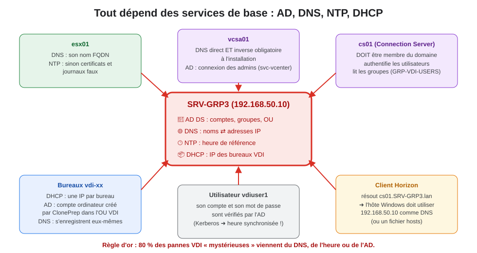
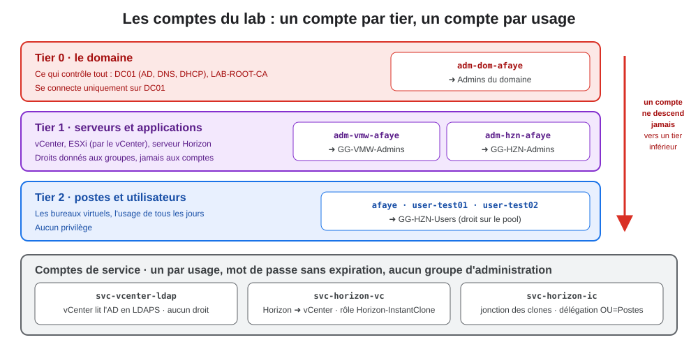

# 04 - L'Active Directory du lab

> **Objectif de la page :** préparer le domaine `lab.lan` comme en entreprise : DNS complet, DHCP pour les bureaux, une arborescence d'OU propre, des comptes séparés par tier, un compte de service par usage et une délégation limitée pour Horizon.
>
> Tout se fait sur **DC01**, connecté avec **`adm-dom-afaye`**.

---

## 1. Pourquoi Horizon a besoin d'un AD propre



| Besoin | Qui l'utilise |
|---|---|
| Authentifier les utilisateurs et lire leurs groupes | Connection Server |
| Joindre chaque bureau au domaine, dans une OU dédiée | Horizon, avec un compte de service limité |
| Résoudre tous les noms, dans les deux sens | vCenter, Horizon, les bureaux |
| Donner une IP à chaque bureau | DHCP |
| Centraliser les droits d'administration du vCenter et d'Horizon | Groupes AD |

---

## 2. Le DNS

### 2.1 La zone inverse

La zone `lab.lan` a été créée avec l'AD. Il manque la **zone inverse**, qui traduit une IP en nom (enregistrements **PTR**). Le vCenter et Horizon vérifient les deux sens.

1. **Outils > DNS** > déplie **DC01** > clic droit sur **Zones de recherche inversée** > **Nouvelle zone…**
2. Remplis l'assistant :

| Écran | Choix |
|---|---|
| Type de zone | **Zone principale** · ☑ Enregistrer la zone dans Active Directory |
| Étendue de réplication | **Vers tous les serveurs DNS exécutés sur des contrôleurs de domaine dans ce domaine** |
| Nom de la zone | **Zone de recherche inversée IPv4** · ID réseau `192.168.50` |
| Mise à jour dynamique | **N'autoriser que les mises à jour dynamiques sécurisées** |

3. **Terminer**. La zone `50.168.192.in-addr.arpa` apparaît.

> 🔒 **Mises à jour sécurisées** : seule une machine authentifiée du domaine peut enregistrer ou modifier son nom. Un poste inconnu ne peut pas se faire passer pour `horizon.lab.lan`.

### 2.2 Les enregistrements de l'ESXi et du vCenter

Ni l'ESXi ni le vCenter ne sont membres du domaine : ils ne s'enregistrent pas tout seuls.

1. Clic droit sur la zone **lab.lan** > **Nouvel hôte (A ou AAAA)…**
2. Nom `esx01`, adresse `192.168.50.11`, ☑ **Créer un pointeur d'enregistrement PTR associé** > **Ajouter un hôte**.
3. Recommence avec `vcenter` → `192.168.50.12`.

| Nom | IP | Enregistré par |
|---|---|---|
| `dc01.lab.lan` | 192.168.50.10 | Automatique (DC) |
| `esx01.lab.lan` | 192.168.50.11 | À la main |
| `vcenter.lab.lan` | 192.168.50.12 | À la main |
| `horizon.lab.lan` | 192.168.50.13 | Automatique, une fois la VM jointe au domaine |

> Si le PTR d'une machine du domaine manque (parce qu'elle a été jointe avant la création de la zone inverse), lance `ipconfig /registerdns` sur elle.

### 2.3 Les redirecteurs

Pour que les machines du lab résolvent aussi les noms Internet (mises à jour Windows, téléchargements) : clic droit sur **DC01** > **Propriétés** > onglet **Redirecteurs** > **Modifier** > `192.168.50.2` (la passerelle NAT de Workstation).

### 2.4 L'heure du domaine

DC01 est la référence de temps de tout le lab (Horizon, bureaux, et l'ESXi par NTP). Il prend lui-même l'heure sur Internet. Dans une invite de commandes administrateur :

```
w32tm /config /manualpeerlist:"0.fr.pool.ntp.org,0x8 1.fr.pool.ntp.org,0x8" /syncfromflags:manual /reliable:yes /update
w32tm /resync
w32tm /query /status
```

La dernière commande doit afficher une **Source** `fr.pool.ntp.org`, et non *Local CMOS Clock*.

---

## 3. Le DHCP

Les clones instantanés **doivent** recevoir leur IP par DHCP.

### 3.1 Installer le rôle

1. **Gestionnaire de serveur > Gérer > Ajouter des rôles et fonctionnalités**.
2. **Rôles de serveurs** : ☑ **Serveur DHCP** > **Ajouter des fonctionnalités** > **Installer**.
3. Drapeau jaune > **Terminer la configuration DHCP** > **Valider** : le serveur est **autorisé dans l'AD**.

> 🔒 Un serveur DHCP Windows non autorisé dans l'AD refuse de distribuer des adresses. Ça évite qu'un serveur pirate s'installe dans le domaine.

### 3.2 Créer l'étendue

**Outils > DHCP** > **dc01.lab.lan > IPv4** > clic droit > **Nouvelle étendue** :

| Écran | Valeur |
|---|---|
| Nom | `192.168.50.0` |
| Plage | `192.168.50.100` à `192.168.50.150`, masque `255.255.255.0` |
| Exclusions | Aucune |
| Durée du bail | **8 heures** : les bureaux sont détruits et recréés souvent, une durée longue remplirait la plage d'adresses fantômes |
| Routeur | `192.168.50.2` |
| Domaine et DNS | Domaine parent `lab.lan`, serveur DNS **`192.168.50.10` uniquement** |
| WINS | Rien |
| Activation | **Oui, je veux activer cette étendue maintenant** |


L'icône verte sur **IPv4** indique que le serveur est autorisé et l'étendue active.

### 3.3 Garder le DNS propre

Clic droit sur **IPv4 > Propriétés** > onglet **DNS** :

- ☑ **Toujours mettre à jour dynamiquement les enregistrements DNS A et PTR** ;
- ☑ **Supprimer les enregistrements A et PTR lorsque le bail est supprimé**.

---

## 4. L'arborescence des OU

On ne range rien dans les conteneurs par défaut (`Users`, `Computers`) : on crée une OU **LAB** qui contient tout le lab, découpée par type d'objet.

```
lab.lan
└── LAB
    ├── Admins            comptes à privilèges, un par périmètre
    ├── Comptes-Service   un compte par application
    ├── Groupes           groupes de sécurité
    ├── Serveurs          serveurs membres (HORIZON)
    ├── Utilisateurs      comptes standards
    └── VDI
        └── Postes        bureaux créés par Horizon
```

1. **Utilisateurs et ordinateurs Active Directory** > clic droit sur **lab.lan** > **Nouveau > Unité d'organisation**.
2. Nom `LAB`, ☑ **Protéger le conteneur contre une suppression accidentelle** > **OK**.
3. Clic droit sur **LAB** > **Nouveau > Unité d'organisation**, et crée de la même façon `Admins`, `Comptes-Service`, `Groupes`, `Serveurs`, `Utilisateurs` et `VDI`.
4. Clic droit sur **VDI** > **Nouveau > Unité d'organisation** > `Postes`.

> **Pourquoi une OU par type ?** On pourra lier des GPO différentes (par exemple pour les bureaux VDI seuls), déléguer des droits précis (partie 7), et retrouver un compte du premier coup.

---

## 5. Les groupes

Les droits sont toujours donnés à des **groupes**, jamais à des comptes un par un. Pour donner ou retirer un droit, il suffit de changer l'appartenance au groupe.

Clic droit sur **LAB > Groupes** > **Nouveau > Groupe**, étendue **Globale**, type **Sécurité** :

| Groupe | Rôle | Utilisé en page |
|---|---|---|
| `GG-VMW-Admins` | vCenter : rôle **Administrateur** | 06 |
| `GG-VMW-ReadOnly` | vCenter : **Lecture seule** | 06 |
| `GG-ESX-Admins` | Groupe admin de l'ESXi si on le joignait un jour au domaine (non utilisé) | 06 |
| `GG-HZN-Admins` | Horizon : administrateurs de la console | 08, 10 |
| `GG-HZN-ReadOnly` | Horizon : administrateurs en lecture seule | 10 |
| `GG-HZN-Users` | Horizon : utilisateurs autorisés sur les pools | 10 |


> `GG` = *Groupe Global*. Le préfixe `VMW`, `ESX` ou `HZN` indique le périmètre : on voit tout de suite à quoi sert le groupe.

---

## 6. Les comptes

### 6.1 Les comptes d'administration : un par tier

Le **modèle de tiers** sépare les privilèges : un compte qui administre l'AD ne sert jamais ailleurs, pour qu'il ne laisse pas son mot de passe ou son ticket Kerberos sur une machine moins protégée.



| Tier | Ce qu'il contient | Compte du lab |
|---|---|---|
| **0** | Ce qui contrôle le domaine : DC, AD, PKI | `adm-dom-afaye` |
| **1** | Serveurs et applications | `adm-vmw-afaye` (vSphere), `adm-hzn-afaye` (Horizon) |
| **2** | Postes et utilisateurs | `afaye` (compte de tous les jours) |

Clic droit sur **LAB > Admins** > **Nouveau > Utilisateur** :

1. Prénom, nom, **nom d'ouverture de session** `adm-dom-afaye` (domaine `@lab.lan`) > **Suivant**.
2. Mot de passe long, ☐ *L'utilisateur doit changer le mot de passe* > **Suivant** > **Terminer**.
3. Double-clic sur le compte > onglet **Compte** > dans **Options du compte**, coche ☑ **Le compte est sensible et ne peut pas être délégué**.
4. Onglet **Membre de** > **Ajouter** :

| Compte | Membre de |
|---|---|
| `adm-dom-afaye` | **Admins du domaine** |
| `adm-vmw-afaye` | `GG-VMW-Admins`, `GG-ESX-Admins` |
| `adm-hzn-afaye` | `GG-HZN-Admins` |


> 🔒 **« Sensible et ne peut pas être délégué »** : aucun serveur ne pourra réutiliser l'identité de ces comptes pour agir ailleurs en leur nom (délégation Kerberos). Une protection gratuite pour tous les comptes à privilèges.

> **Piège rencontré :** sur un Windows en français, le groupe *Domain Admins* s'appelle **« Admins du domaine »**, et *Enterprise Admins* **« Administrateurs de l'entreprise »**. Les tutoriels en anglais ne les trouvent pas tels quels.

### 6.2 Les comptes de service : un par usage

Dans **LAB > Comptes-Service**, crée trois comptes de la même façon, avec dans l'onglet **Compte** :

- ☑ **Le mot de passe n'expire jamais** : sinon le vCenter ou Horizon perdent la connexion le jour de l'expiration ;
- ☑ **L'utilisateur ne peut pas changer de mot de passe**.

| Compte | Sert à | Droits | Page |
|---|---|---|---|
| `svc-vcenter-ldap` | Le vCenter lit l'annuaire (source d'identité LDAPS) | Aucun : un utilisateur du domaine peut déjà lire l'annuaire | 06 |
| `svc-horizon-vc` | Horizon se connecte au vCenter | Un rôle vCenter dédié, rien dans l'AD | 08 |
| `svc-horizon-ic` | Horizon joint les bureaux au domaine | Délégation sur `OU=Postes` uniquement (partie 7) | 10 |


> 🔒 **Un compte par usage :** si l'un fuit, les dégâts restent limités, et dans les journaux on sait immédiatement quel composant a fait quoi. Aucun n'est membre d'un groupe d'administration.

### 6.3 Les utilisateurs

Dans **LAB > Utilisateurs** : `afaye`, `user-test01` et `user-test02`, tous membres de **`GG-HZN-Users`**. Ce sont eux qui ouvriront les bureaux virtuels.

### 6.4 Le serveur Horizon

Une fois la VM Horizon jointe au domaine, son compte ordinateur arrive dans **Computers**. Clic droit sur **HORIZON** > **Déplacer…** > **LAB > Serveurs**.


---

## 7. La délégation pour les clones instantanés

Horizon doit **créer, supprimer et réinitialiser** les comptes ordinateur des bureaux. Plutôt que de lui donner un compte Admin du domaine, on délègue ces seuls droits à `svc-horizon-ic`, **sur la seule OU `Postes`**.

1. Clic droit sur **LAB > VDI > Postes** > **Délégation de contrôle…** > **Suivant**.
2. **Ajouter** > `svc-horizon-ic` > **OK** > **Suivant**.
3. ● **Créer une tâche personnalisée à déléguer** > **Suivant**.
4. ● **Seulement des objets suivants dans le dossier** > coche ☑ **Objets Ordinateur**, puis en bas ☑ **Créer les objets sélectionnés dans ce dossier** et ☑ **Supprimer les objets sélectionnés dans ce dossier** > **Suivant**.
5. Coche ☑ **Générales** et ☑ **Spécifiques des propriétés**, puis :
   - ☑ **Lire toutes les propriétés** ;
   - ☑ **Écrire toutes les propriétés** ;
   - ☑ **Réinitialiser le mot de passe**.
6. **Suivant** > **Terminer**.

**Contrôle :** **Affichage > Fonctionnalités avancées**, puis clic droit sur **Postes** > **Propriétés > Sécurité > Avancé**.


| Ligne | Signification |
|---|---|
| `svc-horizon-ic` · Créer/supprimer les objets ordinateur · cet objet et tous ceux descendants | Créer et supprimer les comptes des bureaux |
| `svc-horizon-ic` · Réinitialiser le mot de passe · Objets Ordinateur descendants | Réinitialiser le compte d'un bureau recréé |
| `svc-horizon-ic` · Spéciale · Objets Ordinateur descendants | Lire et écrire les propriétés (nom DNS, SPN…) |
| **Refuser** · Tout le monde · Supprimer · Cet objet uniquement | La **protection contre la suppression accidentelle** cochée à la création de l'OU |

> 🔒 `svc-horizon-ic` **n'est pas** Admin du domaine et ne doit jamais l'être. Il ne peut rien faire en dehors de `OU=Postes` : c'est ce qui permet de saisir son mot de passe dans la console Horizon sans risque pour le reste du domaine.

---

## 8. Checklist

| ✓ | Vérification |
|---|---|
| ☐ | Zone inverse `50.168.192.in-addr.arpa`, mises à jour sécurisées |
| ☐ | A et PTR de `esx01`, `vcenter`, `dc01` (puis `horizon`) |
| ☐ | DC01 synchronisé sur `fr.pool.ntp.org` (`w32tm /query /status`) |
| ☐ | Étendue DHCP active : .100 à .150, bail 8 h, routeur .2, DNS .10, domaine `lab.lan` |
| ☐ | OU `LAB` et ses sous-OU, protégées contre la suppression |
| ☐ | 6 groupes `GG-*` dans `LAB > Groupes` |
| ☐ | Comptes `adm-*` sensibles, chacun dans son groupe |
| ☐ | Comptes `svc-*` sans expiration, membres d'aucun groupe d'administration |
| ☐ | Utilisateurs de test dans `GG-HZN-Users` |
| ☐ | Délégation de `svc-horizon-ic` visible sur `OU=Postes` |

---

## 9. Quiz

<details><summary><b>1. Pourquoi une zone inverse est-elle nécessaire ?</b></summary> <p>Elle porte les enregistrements PTR, qui traduisent une IP en nom. Le vCenter et Horizon vérifient la résolution dans les deux sens.</p></details>

<details><summary><b>2. Pourquoi un bail DHCP de 8 heures et pas de 8 jours ?</b></summary> <p>Les bureaux non persistants sont détruits et recréés en permanence. Avec un bail long, les adresses des bureaux supprimés restent réservées et la plage se remplit.</p></details>

<details><summary><b>3. Pourquoi adm-dom-afaye ne doit-il jamais se connecter au serveur Horizon ?</b></summary> <p>C'est un compte tier 0. S'il ouvre une session sur un serveur moins protégé, ses identifiants peuvent y être volés, et l'attaquant obtient le domaine entier.</p></details>

<details><summary><b>4. Que peut faire svc-horizon-ic si son mot de passe fuit ?</b></summary> <p>Seulement créer, supprimer et modifier des comptes ordinateur dans OU=Postes. Rien d'autre dans le domaine.</p></details>

<details><summary><b>5. À quoi sert la ligne « Refuser · Tout le monde » sur l'OU Postes ?</b></summary> <p>C'est la protection contre la suppression accidentelle : personne, même un administrateur, ne peut supprimer l'OU sans d'abord décocher cette option.</p></details>

---

[⬅ 03 - Construire le lab](/fr/hyperviseur/VDI/03-construire-le-lab) · [Sommaire](/fr/hyperviseur/VDI/00-sommaire) · Page suivante : [05 - La PKI ➜](/fr/hyperviseur/VDI/05-pki)
