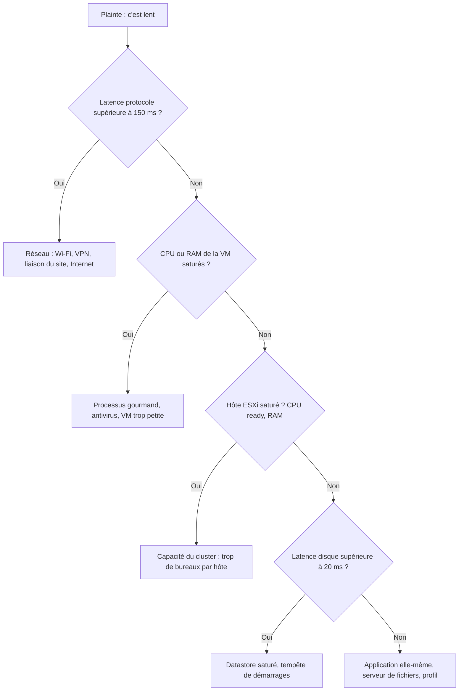

# 05 - Administrer Horizon au quotidien

> **Objectif de la page :** savoir **tout ce qu'on peut faire** dans Horizon une fois installé, et l'avoir pratiqué. C'est ce que tu feras le plus souvent dans ton nouveau poste : gérer des pools, aider des utilisateurs, publier des applications, régler des politiques et surveiller la plateforme.
{.is-info}

**Parcours du cours :** [01 Bases](/hyperviseur/VDI/01-bases-virtualisation) ➜ [02 Infrastructure](/hyperviseur/VDI/02-infrastructure-lab) ➜ [03 VDI & Horizon](/hyperviseur/VDI/03-vdi-et-horizon) ➜ [04 Installation](/hyperviseur/VDI/04-installation-horizon) ➜ **05 Administration** ➜ [06 Golden image](/hyperviseur/VDI/06-horizon-golden-image) ➜ [07 Production](/hyperviseur/VDI/07-horizon-production)

---

## 1. Se repérer dans la Horizon Console


La console (`https://cs01.srv-grp3.lan/admin`) est organisée en quatre grandes zones. Pour t'en souvenir :

| Zone | Question à laquelle elle répond |
|---|---|
| **Monitor** | Que se passe-t-il en ce moment ? Est-ce que tout va bien ? |
| **Inventory** | Qu'est-ce que je propose aux utilisateurs (bureaux, applications) et sur quelles machines ? |
| **Users and Groups** | Qui a droit à quoi ? |
| **Settings** | Comment la plateforme est-elle configurée ? |

> **Bon réflexe :** quand un utilisateur appelle, commence toujours par la **recherche d'utilisateur** (barre de recherche en haut de la console, ou *Users and Groups*). Tu y vois d'un coup ses droits, ses sessions en cours, ses machines et ses dernières erreurs.
{.is-success}

---

## 2. Gérer un desktop pool

### 2.1 Les onglets d'un pool

*Inventory ➜ Desktops ➜ clic sur le pool*

| Onglet | Contenu |
|---|---|
| **Summary** | Paramètres, golden image et snapshot utilisés, état du provisioning, dernière opération d'image |
| **Machines** | La liste des VM, leur état, l'utilisateur connecté, l'hôte, le datastore |
| **Sessions** | Les sessions en cours sur ce pool |
| **Entitlements** | Les groupes et utilisateurs autorisés |
| **Events** | Les événements propres au pool |
| **Policies** | Les politiques qui surchargent les politiques globales pour ce pool |
| **Tasks** (selon version) | Les opérations planifiées (Push Image...) |

### 2.2 Les actions sur un pool

| Action | Où | Effet | Quand l'utiliser |
|---|---|---|---|
| **Edit** | bouton *Edit* | Modifier les paramètres (taille, nommage, protocole, timeouts...) | Ajustements courants |
| **Disable / Enable pool** | *Status* | Désactivé : les utilisateurs ne voient plus le pool. Les sessions en cours continuent. | Maintenance, fermeture d'un service |
| **Disable / Enable provisioning** | *Status* | Horizon arrête de créer ou supprimer des VM. Les VM existantes restent utilisables. | Dépannage : figer la situation pour analyser une erreur |
| **Push Image** | *Maintain ➜ Schedule* | Remplace la golden image ou le snapshot de tout le pool | Mises à jour mensuelles (page 06) |
| **Cancel / Reschedule** | *Maintain* | Annule ou décale un Push Image planifié | Problème découvert sur la nouvelle image |
| **Entitle** | *Entitlements* | Ajouter ou retirer des droits | Nouveau service |
| **Delete** | *Delete* | Supprime le pool **et ses VM** | Fin de vie du pool |

> **Modifier la taille du pool** (*Edit ➜ Provisioning Settings ➜ Maximum machines*) est immédiat : Horizon crée ou supprime des VM pour atteindre la nouvelle cible. Sur un vrai environnement, prévois la capacité (RAM, datastores, adresses DHCP, licences) **avant** d'augmenter.
{.is-warning}

### 2.3 Les actions sur une machine

*Onglet Machines ➜ sélectionner une ou plusieurs VM*

| Action | Effet |
|---|---|
| **Restart** | Redémarrage propre de Windows (via les Tools) |
| **Reset** | Redémarrage brutal (comme un bouton reset). À éviter sauf blocage. |
| **Recover** | Pour un Instant Clone : supprime la VM et en recrée une neuve depuis l'image. **Le remède universel** d'une machine en erreur dans un pool flottant. |
| **Remove** | Supprime la machine du pool (et de vCenter pour un pool automatisé) |
| **Enter / Exit Maintenance Mode** | Plus aucun utilisateur ne peut s'y connecter, pour l'analyser tranquillement |
| **Disconnect Session / Logoff Session** | Agit sur la session de la machine |
| **Assign / Unassign User** | Pools dédiés : attribuer ou retirer une machine à un utilisateur |

### 2.4 Les actions sur une session

*Monitor ➜ Sessions* (ou depuis le pool / la recherche d'utilisateur)

| Action | Effet pour l'utilisateur |
|---|---|
| **Send Message** | Une fenêtre s'affiche dans sa session (« Maintenance dans 15 minutes, enregistrez vos fichiers ») |
| **Disconnect** | La fenêtre se ferme, mais sa session continue de tourner : il la retrouve en se reconnectant |
| **Logoff** | Sa session Windows est fermée. **Le travail non enregistré est perdu.** |
| **Reset / Restart** | La machine redémarre (brutalement ou proprement) |

> **Disconnect ≠ Logoff.** C'est la confusion numéro 1 des utilisateurs (et des débutants). Fermer la fenêtre du client = *disconnect* : la session reste ouverte et occupe une machine et une licence. *Logoff* (Démarrer ➜ Se déconnecter) = la session est fermée et, dans un pool flottant, la machine est recyclée. Le paramètre « Log off after disconnect » du pool permet de fermer automatiquement les sessions abandonnées.
{.is-warning}

### 2.5 Les états d'une machine


Survole l'état d'une machine dans la console : une bulle affiche souvent le **détail de l'erreur**. C'est la première information à lire.

---

## 3. Les paramètres d'un pool en détail

Voici les réglages que tu croiseras dans *Edit* et ce qu'ils changent vraiment.

### 3.1 Provisioning

| Paramètre | Valeurs | À retenir |
|---|---|---|
| Naming pattern | `vdi-{n:fixed=3}` | `{n}` est remplacé par un numéro ; `fixed=3` force 3 chiffres (001). 15 caractères max au total. |
| Maximum machines | nombre | Taille maximale du pool |
| Spare (powered on) machines | nombre | Machines **prêtes d'avance**. Trop peu : les utilisateurs attendent le matin. Trop : RAM gaspillée. |
| Provisioning timing | *Up-front* / *On demand* | Up-front : tout créer d'un coup. On demand : créer au fur et à mesure, en gardant le nombre de spares. |
| Minimum ready machines during maintenance | nombre | Pendant un Push Image, combien de machines restent disponibles |
| Stop provisioning on error | oui / non | Évite une avalanche de VM cassées |

> **Dimensionner les spares :** si 200 personnes se connectent entre 8 h 30 et 9 h, et qu'Horizon crée environ 20 clones par minute dans ton environnement, il te faut assez de spares pour absorber la vague. Les opérations simultanées sont limitées dans les paramètres vCenter d'Horizon (*Advanced settings*).
{.is-info}

### 3.2 Desktop Pool Settings

| Paramètre | Options | Conseil |
|---|---|---|
| State | Enabled / Disabled | |
| Connection Server restrictions | Tags | Réserver un pool à certains Connection Servers (par exemple : seuls ceux derrière l'UAG pour l'accès externe) |
| Category folder | dossier | Ranger les icônes dans le menu Démarrer du poste client |
| Client restrictions | oui / non | Limiter l'accès à certains postes clients (via un groupe AD d'ordinateurs) |
| Session types | Desktop / Application / Both | |
| **Log off after disconnect** | Never / Immediately / After N minutes | Pool flottant : 30 à 120 min en général. *Never* = les machines restent occupées par des sessions abandonnées. |
| Allow users to restart machines | oui / non | Pratique : l'utilisateur se dépanne seul |
| Allow separate desktop sessions from different client devices | oui / non | Un utilisateur sur deux appareils obtient deux sessions distinctes |
| Empty session timeout (applications) | minutes | Pour les applications publiées : fermer la session quand plus aucune appli n'est ouverte |

### 3.3 Remote Display Settings

| Paramètre | Conseil |
|---|---|
| Default display protocol | Blast |
| Allow users to choose protocol | Oui en test, souvent Non en production (pour standardiser) |
| 3D Renderer | *NVIDIA GRID vGPU* avec GPU, sinon *Manage using vSphere Client* ou désactivé |
| Max number of monitors / résolution | Limiter la RAM vidéo réservée |
| HTML Access | Oui si on veut l'accès navigateur |
| Allow session collaboration | Permet à l'utilisateur d'**inviter** quelqu'un dans sa session (formation, support) |

---

## 4. RDS : farms et applications publiées

C'est souvent la partie que les débutants ne connaissent pas, alors qu'elle est très utilisée en entreprise : **publier une application** (un ERP, un logiciel métier ancien) sans donner un bureau entier.


### 4.1 Les objets

| Objet | Rôle |
|---|---|
| **Serveur RDSH** | Un Windows Server avec le rôle *Remote Desktop Session Host* + l'Horizon Agent |
| **Farm** | Un groupe de serveurs RDSH identiques (Instant Clones automatisés ou serveurs ajoutés à la main). Horizon y répartit la charge. |
| **Desktop pool RDS** | Propose un bureau Windows Server partagé, servi par une farm |
| **Application pool** | Propose une application (un `.exe`) installée sur les serveurs de la farm |

### 4.2 TP : publier le Bloc-notes et la Calculatrice depuis une farm

> **Attention à la RAM de ton lab.** Une golden image serveur + 1 serveur RDS = environ 8 Go de plus. Éteins la golden image Windows 11 et réduis le pool VDI à 1 machine pendant ce TP.
{.is-warning}

1. **Golden image RDS :** nouvelle VM *Windows Server 2022*, 2 vCPU, 6 Go, 64 Go. Installe Windows, les Tools, joins-la au domaine (OU `VDI-Ordinateurs` ou une OU `RDS` dédiée).
2. **Rôle RDSH :**
   ```powershell
   Install-WindowsFeature RDS-RD-Server -IncludeManagementTools -Restart
   ```
   > Sans serveur de licences RDS, le rôle fonctionne en période de grâce (environ 120 jours). C'est suffisant pour un lab, pas pour la production.
3. **Installe les applications** à publier, puis l'**Horizon Agent** (avec l'option Instant Clone). L'installeur détecte le rôle RDSH et adapte l'installation.
4. Optimise, arrête proprement, snapshot `rds-gold-v1`.
5. **Créer la farm :** *Inventory ➜ Farms ➜ Add* ➜ *Automated Farm* ➜ *Instant Clone* ➜ ID `farm-ws22` ➜ nommage `rds-{n:fixed=2}`, 1 serveur ➜ golden image `rds-gold-v1` ➜ domaine et OU ➜ paramètres :
   - *Load balancing* : répartit les sessions selon la charge CPU / RAM / sessions ;
   - *Max sessions per RDS host* : nombre maximal d'utilisateurs par serveur ;
   - *Log off disconnected sessions* : comme pour les pools.
6. **Créer les applications :** *Inventory ➜ Applications ➜ Add ➜ Add from Installed Applications* ➜ choisis la farm ➜ coche *Notepad* et *Calculator* (Horizon liste les applications du menu Démarrer des serveurs) ➜ ☑ *Entitle users* ➜ `GRP-VDI-USERS`.
   - *Add Manually* permet de publier n'importe quel exécutable avec ses arguments (par exemple `C:\ERP\client.exe /server:prod`).
7. **Tester :** reconnecte-toi dans le client Horizon. Tu vois maintenant les icônes **Bloc-notes** et **Calculatrice** à côté du bureau. Lance-les : elles s'ouvrent comme des fenêtres locales.

### 4.3 VDI ou RDS ? Grille de décision

| Question | Plutôt VDI | Plutôt RDS |
|---|---|---|
| L'utilisateur a besoin d'un bureau complet personnalisé ? | ✅ | |
| Une seule application métier suffit ? | | ✅ |
| Application gourmande, ou incompatible avec plusieurs utilisateurs simultanés ? | ✅ | |
| Coût par utilisateur à minimiser ? | | ✅ |
| Besoin de droits admin locaux ? | ✅ | |
| Utilisateurs très nombreux, usage simple (centre d'appels) ? | | ✅ |

---

## 5. Les droits (entitlements)

### 5.1 Principes

- Un **entitlement** relie un utilisateur ou un **groupe AD** à un pool (bureau ou application).
- Sans entitlement, le pool est invisible pour l'utilisateur.
- On donne des droits à des **groupes**, toujours. Les groupes sont gérés dans l'AD (souvent par le service RH / IAM via des processus d'arrivée et de départ).
- Un utilisateur peut avoir des droits sur plusieurs pools : il verra plusieurs icônes.

### 5.2 Où les poser

| Méthode | Chemin |
|---|---|
| Depuis le pool | *Inventory ➜ Desktops (ou Applications) ➜ pool ➜ Entitlements ➜ Add* |
| Depuis la vue globale | *Users and Groups ➜ Entitlements ➜ Add* |
| Multi-pods (CPA) | *Inventory ➜ Global Entitlements* (page 07) |

### 5.3 Vérifier les droits d'un utilisateur

*Users and Groups* (ou recherche) ➜ `vdiuser1` ➜ onglets *Desktop Pools*, *Application Pools*, *Sessions*. Tu vois **d'où vient** chaque droit (quel groupe).

### 5.4 Nommer ses groupes

Une convention claire évite les erreurs. Exemple :

| Groupe | Usage |
|---|---|
| `GRP-VDI-W11-STANDARD` | Bureau Windows 11 standard |
| `GRP-VDI-W11-DEV` | Bureau développeur |
| `GRP-APP-ERP` | Application ERP publiée |
| `GRP-HZ-ADMINS` | Administrateurs Horizon |
| `GRP-HZ-HELPDESK` | Support niveau 1 |

---

## 6. Les rôles d'administration et la délégation


*Settings ➜ Administrators*

Une permission Horizon = **qui** (utilisateur ou groupe AD) × **rôle** (ensemble de privilèges) × **access group** (sur quels objets).

### 6.1 Les rôles prédéfinis

| Rôle | Peut faire |
|---|---|
| **Administrators** | Tout |
| **Administrators (Read only)** | Tout voir, rien modifier (auditeurs) |
| **Help Desk Administrators** | Outil Helpdesk : voir les sessions, déconnecter, fermer, redémarrer, envoyer un message, assistance à distance |
| **Help Desk Administrators (Read only)** | Voir uniquement |
| **Inventory Administrators** | Gérer les pools, machines, sessions, droits (dans leur access group) |
| **Inventory Administrators (Read only)** | Voir l'inventaire |
| **Global Configuration and Policy Administrators** | Paramètres et politiques globaux |
| **Agent Registration Administrators** | Enregistrer des machines non gérées |
| **Local / Global Administrators (CPA)** | Administration en architecture multi-pods |

Tu peux aussi **créer tes propres rôles** en cochant des privilèges.

### 6.2 Les access groups

*Settings ➜ Administrators ➜ Access Groups*. Un access group est un **dossier logique** dans lequel on range des pools et des farms. Exemple : `/Compta`, `/Production`, `/Tests`. Ensuite, on donne à l'équipe locale de la compta le rôle *Inventory Administrators* sur `/Compta` seulement.

> **TP :** crée un groupe AD `GRP-HZ-HELPDESK`, mets-y `vdiuser2`, donne-lui le rôle *Help Desk Administrators* sur `/`. Connecte-toi à la console avec `vdiuser2` : observe ce que tu vois et ce qui est grisé.
{.is-success}

---

## 7. Les paramètres globaux

*Settings ➜ Global Settings*

### 7.1 Paramètres généraux (General Settings)

| Paramètre | Rôle | Valeur courante |
|---|---|---|
| **Horizon Console session timeout** | Déconnexion de la console d'admin après inactivité | 30 min |
| **Forcibly disconnect users** | Durée max d'une session client avant déconnexion forcée | 10 h (600 min) |
| **Single sign-on (SSO)** | Durée pendant laquelle les identifiants saisis restent utilisables pour lancer d'autres bureaux / applis | 15 min |
| **For clients that support applications** : *If the user stops using the keyboard and mouse...* | Déconnexion des applications publiées après inactivité | Selon la politique de sécurité |
| **Client session timeout** (selon version) | Durée de validité de la session côté client | |
| **Pre-login message** | Message affiché **avant** la connexion (charte informatique, avertissement légal) | Souvent exigé par la sécurité |
| **Display warning before forced logoff** | Prévenir l'utilisateur avant une déconnexion forcée | Oui, 5 min |
| **Enable Windows Server desktops** | Autoriser Windows Server comme bureau VDI | Selon besoin |

### 7.2 Paramètres de sécurité (Security Settings)

| Paramètre | Rôle |
|---|---|
| **Reauthenticate secure tunnel connections after network interruption** | Redemander le mot de passe après une coupure réseau |
| **Message security mode** | Chiffrement des messages JMS entre composants (Enhanced par défaut) |
| **Enable IPSec for Security Server pairing** | Historique (Security Server supprimé) |
| **Hide server information / domain list in client** | Ne pas afficher la liste des domaines sur l'écran de connexion (sécurité) |
| **Accept logon as current user** | SSO avec la session Windows du poste client (si le poste est dans le domaine) |

### 7.3 Paramètres des Connection Servers

*Settings ➜ Servers ➜ Connection Servers ➜ cs01 ➜ Edit* :

| Onglet | Paramètre | Rôle |
|---|---|---|
| General | **Tags** | Étiquettes utilisées par les restrictions de pool |
| General | **HTTP(S) Secure Tunnel** | Faire transiter le trafic HTTPS par le serveur (ou en direct) |
| General | **Blast Secure Gateway** | Faire transiter Blast par le serveur (port 8443), ou connexion directe au bureau |
| General | **PCoIP Secure Gateway** | Idem pour PCoIP |
| Authentication | **SAML / Smart card / RADIUS / RSA SecurID** | Méthodes d'authentification (MFA, carte à puce, fédération) |
| Backup | Fréquence de sauvegarde de la configuration (AD LDS) | Par défaut : tous les jours, vers un dossier local à exporter |

> **Quand l'accès externe passe par l'UAG**, on désactive généralement les passerelles (tunnel, Blast, PCoIP) sur les Connection Servers : c'est l'UAG qui joue ce rôle, et en interne les clients vont directement aux bureaux.
{.is-info}

---

## 8. Les politiques : console, GPO et contexte

Il existe **trois niveaux** pour contrôler l'expérience utilisateur.

### 8.1 Global Policies (dans la console)

*Settings ➜ Global Policies* (surchargées par pool ou par utilisateur) :

| Politique | Rôle |
|---|---|
| **USB Access** | Autoriser ou interdire la redirection USB |
| **Multimedia redirection (MMR)** | Lire certains flux multimédias sur le poste client |
| **PCoIP hardware acceleration** | Accélération matérielle PCoIP |

C'est assez limité : le vrai contrôle se fait par GPO.

### 8.2 Les GPO Horizon (les ADMX)

Omnissa fournit un paquet de **modèles d'administration** (« Horizon GPO Bundle », fichiers `.admx` / `.adml`) à télécharger avec les installeurs. Copie-les dans le **magasin central** du domaine :

```powershell
# Sur SRV-GRP3, après extraction du bundle :
$store = "\\SRV-GRP3.lan\SYSVOL\SRV-GRP3.lan\Policies\PolicyDefinitions"
New-Item -ItemType Directory -Path $store -Force          # si le magasin central n'existe pas
Copy-Item .\*.admx $store
Copy-Item .\fr-FR\*.adml "$store\fr-FR"                   # ou en-US selon les langues fournies
```

Crée ensuite une GPO **`GPO-VDI-Ordinateurs`** liée à l'OU `VDI-Ordinateurs`. Les paramètres les plus utilisés :

| Catégorie | Paramètre | Exemple d'usage |
|---|---|---|
| Blast | **Max frame rate**, **Max session bandwidth**, H.264 / HEVC / AV1 | Limiter la bande passante sur des sites distants |
| Blast | **Configure clipboard redirection** | Interdire le copier-coller du bureau vers le poste (fuite de données) ou l'autoriser dans un seul sens |
| Agent Configuration | **Client drive redirection** | Interdire l'accès aux disques du poste |
| Agent Configuration | **USB filtering** (include / exclude par classe ou VID/PID) | N'autoriser que les clés chiffrées de l'entreprise |
| Agent Configuration | **Idle time until disconnect** | Déconnecter une session inactive |
| Printing | **Integrated printing** : filtres d'imprimantes, pilote universel | Imprimer sur l'imprimante locale du domicile |
| Real-Time Audio-Video | Résolution et fréquence de la webcam | |
| Horizon Client (GPO poste client) | Serveur par défaut, certificat, comportement | Préconfigurer les clients des postes de l'entreprise |

> **Les GPO Windows classiques** s'appliquent aussi, bien sûr : en VDI, on active souvent le **mode de traitement en boucle de rappel (loopback) en mode Fusion** sur l'OU des bureaux, pour appliquer des paramètres utilisateur spécifiques à la VDI quel que soit l'utilisateur.
{.is-info}

### 8.3 Les politiques contextuelles (Smart Policies, DEM)

Avec **Dynamic Environment Manager**, on peut appliquer des règles selon le **contexte** : par exemple, « si l'utilisateur se connecte depuis l'extérieur (via UAG), interdire l'USB et le presse-papiers ; depuis le réseau interne, tout autoriser ». C'est la façon moderne de concilier sécurité et confort (détails en page 06).

---

## 9. L'expérience utilisateur : Teams, visio, multimédia

La visio est le cas le plus difficile en VDI. Sans optimisation, la vidéo de la webcam monte au datacenter, est traitée par le CPU de la VM, puis redescend en pixels : saccades et CPU saturé.

| Solution | Principe |
|---|---|
| **Optimisation Microsoft Teams** (Horizon Media Optimization) | Teams dans le bureau sert de « télécommande » : l'audio et la vidéo sont traités **par le poste client** et circulent directement entre clients. Nécessite les composants côté agent et côté client, et un client Horizon à jour. |
| Optimisation Zoom / Webex | Plugins des éditeurs, sur le même principe |
| **Real-Time Audio-Video (RTAV)** | Redirection webcam / micro compressée, quand l'optimisation n'est pas possible |
| **Browser Content Redirection** | Certains contenus web (vidéos) sont rendus sur le poste client |

> En production, c'est **la** source de tickets des premiers mois d'un projet VDI. Retiens : « Teams ne marche pas bien » ➜ vérifier d'abord que l'optimisation est active (dans Teams : *Paramètres ➜ À propos*, mention « optimisé pour Horizon » ou équivalent).
{.is-warning}

---

## 10. Le support utilisateur : l'outil Helpdesk

Cherche un utilisateur dans la console ➜ clic sur sa session. L'outil Helpdesk affiche :

| Information | Utilité |
|---|---|
| Machine, pool, protocole, client (version, OS, IP) | Contexte |
| **Latence** et **bande passante** du protocole | « C'est lent » ➜ réseau ou pas réseau ? |
| CPU, RAM, disque de la VM | « C'est lent » ➜ la VM est-elle saturée ? |
| **Durée d'ouverture de session** (logon breakdown) | « L'ouverture de session prend 3 minutes » ➜ profil ? GPO ? scripts ? |
| **Processus** en cours | Tuer un processus bloqué sans toucher à la session |
| Applications ouvertes | |
| **Remote Assistance** | Prendre la main (avec l'accord de l'utilisateur) |
| Actions | Envoyer un message, déconnecter, fermer la session, redémarrer, reset |

### Méthode de diagnostic d'une plainte « c'est lent »



---

## 11. Superviser la plateforme

### 11.1 Les indicateurs à suivre

| Où | Indicateur | Seuil d'alerte (ordre de grandeur) |
|---|---|---|
| vCenter ➜ hôte | **CPU Ready** des VM | > 5 % (ou > 1 000 ms en temps réel sur un intervalle de 20 s) : les VM attendent le CPU |
| vCenter ➜ hôte | RAM : *ballooning*, *swapping* | Tout swapping est mauvais signe |
| vCenter ➜ datastore | Latence lecture / écriture | > 20 ms de façon soutenue |
| vCenter ➜ datastore | Espace libre | < 20 % |
| Horizon ➜ Dashboard | Santé des composants | Tout doit être vert |
| Horizon ➜ Pools | Machines *Available* aux heures de pointe | > 0, toujours |
| Horizon ➜ Licences | Sessions simultanées max | Proche de la licence achetée |
| DHCP | Taux d'occupation de la plage VDI | > 80 % |
| Session | Durée d'ouverture de session | > 30-60 s ➜ à investiguer |

### 11.2 Les outils

| Outil | Description |
|---|---|
| **Horizon Console** (Dashboard, Events, Helpdesk) | Inclus, le point de départ |
| **Horizon Performance Tracker** | Dans le bureau, pour l'utilisateur ou le support |
| **vSphere Client** (graphiques de performance, alarmes) | Couche infrastructure |
| **Omnissa Intelligence** (DEX) | Analyse de l'expérience utilisateur en SaaS |
| **Outils tiers** | ControlUp, Liquidware Stratusphere, Lakeside SysTrack, eG Innovations : très répandus en entreprise |
| **Syslog / SIEM** | *Settings ➜ Event Configuration* : envoyer les événements Horizon vers un serveur syslog |

---

## 12. Automatiser avec PowerShell et l'API

Les tâches répétitives (créer 30 pools, exporter la liste des sessions, faire un rapport) s'automatisent.

| Outil | Description |
|---|---|
| **API REST Horizon** | `https://cs01.srv-grp3.lan/rest/swagger-ui.html` (selon version) : documentation interactive de l'API |
| **PowerCLI** (Broadcom) + modules Horizon | Module `VMware.VimAutomation.HorizonView` et module communautaire `VMware.Hv.Helper` pour vSphere et Horizon |
| **Modules communautaires** | Scripts publiés par la communauté sur GitHub |

Exemple d'appel REST (authentification puis liste des sessions) :

```powershell
$cs = "https://cs01.srv-grp3.lan"
$cred = Get-Credential   # compte admin Horizon
$body = @{ domain = "SRV-GRP3"; username = $cred.UserName; password = $cred.GetNetworkCredential().Password } | ConvertTo-Json

# En lab avec certificat auto-signé, PowerShell 7 : ajoute -SkipCertificateCheck
$tok = Invoke-RestMethod -Method Post -Uri "$cs/rest/login" -Body $body -ContentType "application/json"
$hdr = @{ Authorization = "Bearer $($tok.access_token)" }

Invoke-RestMethod -Uri "$cs/rest/inventory/v1/sessions" -Headers $hdr | Select-Object -First 5
Invoke-RestMethod -Method Post -Uri "$cs/rest/logout" -Headers $hdr -Body (@{ refresh_token = $tok.refresh_token } | ConvertTo-Json) -ContentType "application/json"
```

> Les chemins exacts de l'API (`/rest/inventory/v1/...`, `v2`...) varient selon les versions : vérifie dans le Swagger de ton Connection Server.
{.is-info}

---

## 13. Travaux pratiques récapitulatifs

| # | Exercice | Ce que tu apprends |
|---|---|---|
| 1 | Passer `pool-w11-ic` de 2 à 3 machines, puis revenir à 2 | Le provisioning et le recyclage |
| 2 | Connecter `vdiuser1`, fermer la fenêtre, observer *Disconnected*, attendre le *Log off after disconnect* | Disconnect vs logoff |
| 3 | Envoyer un message à une session depuis la console | Les actions helpdesk |
| 4 | Mettre une machine en maintenance, puis faire un *Recover* | Les actions sur machine |
| 5 | Désactiver le pool : que voit l'utilisateur ? | Enable / disable |
| 6 | Créer une GPO qui interdit le presse-papiers du bureau vers le client, tester | Les ADMX Horizon |
| 7 | Créer un rôle helpdesk pour `vdiuser2` | La délégation |
| 8 | Publier une application depuis une farm RDS | RDS / applications publiées |
| 9 | Ajouter un message de pré-connexion | Global settings |
| 10 | Appeler l'API REST pour lister les sessions | L'automatisation |

---

## 14. Quiz

<details>
<summary><b>1. Quelle différence entre « Disable pool » et « Disable provisioning » ?</b></summary>

Disable pool : le pool n'est plus proposé aux utilisateurs. Disable provisioning : le pool reste utilisable, mais Horizon ne crée ni ne supprime plus de VM (utile pour figer et analyser une erreur).
</details>

<details>
<summary><b>2. Une machine d'un pool flottant Instant Clone est en erreur. Quelle action simple ?</b></summary>

*Recover* (ou *Remove*) : Horizon supprime la VM et en recrée une neuve depuis l'image.
</details>

<details>
<summary><b>3. Qu'est-ce qu'une farm, et peut-on y donner des droits directement ?</b></summary>

Un groupe de serveurs RDSH identiques. Non : on crée sur la farm des desktop pools RDS ou des application pools, et ce sont eux qui reçoivent les droits.
</details>

<details>
<summary><b>4. Comment interdire le copier-coller du bureau virtuel vers le PC de l'utilisateur ?</b></summary>

Par GPO, avec les ADMX Horizon : paramètre de redirection du presse-papiers (Blast / Agent configuration), appliqué à l'OU des bureaux. Ou de façon contextuelle avec les Smart Policies DEM.
</details>

<details>
<summary><b>5. Un utilisateur dit que Teams saccade. Première vérification ?</b></summary>

Vérifier que l'optimisation multimédia de Teams pour Horizon est active (composant agent + client Horizon à jour + Teams qui indique qu'il est optimisé).
</details>

<details>
<summary><b>6. Comment donner au support le droit de fermer les sessions, mais pas de modifier les pools ?</b></summary>

Rôle *Help Desk Administrators* sur l'access group `/` pour le groupe AD du support.
</details>

<details>
<summary><b>7. Qu'indique un CPU Ready élevé dans vCenter ?</b></summary>

Que les VM attendent qu'un processeur physique se libère : l'hôte est surchargé (trop de vCPU par rapport aux cœurs), ce qui ralentit tous les bureaux.
</details>

---

⬅ [04 - Installation](/hyperviseur/VDI/04-installation-horizon) · **Page suivante :** [06 - Golden image, cycle de vie et profils](/hyperviseur/VDI/06-horizon-golden-image) ➜
