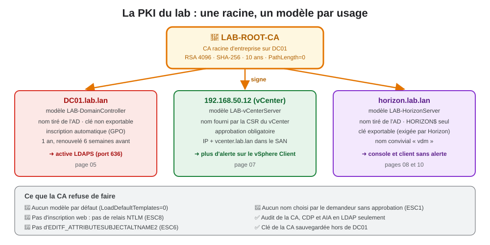
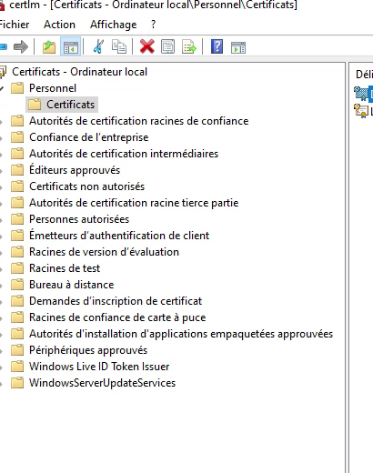
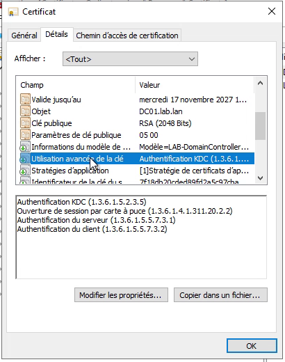
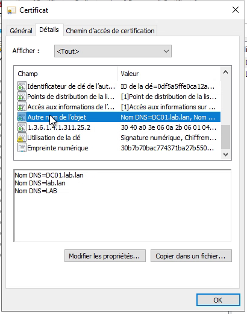
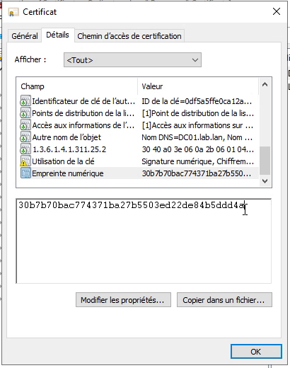

# 05 - La PKI du lab : LAB-ROOT-CA

> **Objectif de la page :** installer une autorité de certification interne, **LAB-ROOT-CA**, et délivrer un certificat à DC01. Ce certificat active **LDAPS** (page 06). La même CA signera ensuite les certificats du vCenter (page 07) et d'Horizon (pages 08 et 10).

---

## 1. Comprendre avant de faire

### 1.1 À quoi sert une PKI

Un **certificat** prouve l'identité d'un serveur : « je suis bien `dc01.lab.lan` ». Il est signé par une **autorité de certification** (CA). Une machine qui fait confiance à la CA fait confiance à tous les certificats qu'elle signe.



### 1.2 Ce que le lab accepte

La version « production » met la racine **hors ligne** et une CA émettrice sur un serveur dédié. Faute de ressources, le lab installe une seule CA, directement sur DC01.

| Compromis | Conséquence | Pourquoi c'est acceptable ici |
|---|---|---|
| CA sur le DC | Si DC01 est compromis, la PKI l'est aussi | Si DC01 est compromis, le domaine l'est déjà |
| Un seul niveau, racine en ligne | Pas de racine hors ligne à protéger | Lab, aucune donnée réelle |
| Listes de révocation publiées en LDAP seulement | Les machines hors domaine ne peuvent pas vérifier la révocation | Le vCenter **épingle** le certificat du DC (page 06) |

**Ce qu'on garde, parce que c'est gratuit :** RSA 4096 et SHA-256, aucun modèle publié par défaut, pas d'inscription web, audit de la CA, sauvegarde de la clé hors du DC.

### 1.3 Les trois attaques à éviter

Les PKI Windows mal réglées sont une cible classique (recherche « Certified Pre-Owned »).

| Attaque | Principe | Parade dans le lab |
|---|---|---|
| **ESC1** | Un modèle laisse le demandeur **choisir le nom** du certificat : il demande un certificat au nom d'un admin | Les modèles prennent le nom **dans l'AD**. Exception unique et protégée en page 07 |
| **ESC6** | Le réglage `EDITF_ATTRIBUTESUBJECTALTNAME2` laisse ajouter n'importe quel nom à n'importe quelle demande | Vérifié désactivé (partie 3.7) |
| **ESC8** | La page web d'inscription accepte des authentifications NTLM relayées | **Inscription web non installée** |

---

## 2. Installer la CA

### 2.1 Les droits nécessaires

Installer une CA **d'entreprise** demande d'être membre de **Administrateurs de l'entreprise**.

1. **Utilisateurs et ordinateurs Active Directory** > **lab.lan > Users** > double-clic sur **Administrateurs de l'entreprise**.
2. Onglet **Membres** > **Ajouter** > `adm-dom-afaye` > **OK**.
3. **Déconnecte-toi et reconnecte-toi** pour que le nouveau groupe soit pris en compte.

> On le retire de ce groupe dès la CA installée (partie 4.6). Ce groupe doit rester vide au quotidien.

### 2.2 Le fichier CAPolicy.inf

Ce fichier est lu **pendant** l'installation et fixe ce que l'assistant ne propose pas.

1. Ouvre le **Bloc-notes en tant qu'administrateur** et colle :

```ini
[Version]
Signature="$Windows NT$"

[Certsrv_Server]
RenewalKeyLength=4096
RenewalValidityPeriod=Years
RenewalValidityPeriodUnits=10
LoadDefaultTemplates=0
AlternateSignatureAlgorithm=0

[BasicConstraintsExtension]
PathLength=0
Critical=Yes
```

2. Enregistre sous `C:\Windows\CAPolicy.inf`, avec **Type : Tous les fichiers** (sinon tu obtiens `CAPolicy.inf.txt`).

| Ligne | Rôle |
|---|---|
| `LoadDefaultTemplates=0` | ⚠️ **Le plus important.** Sans lui, la CA publie d'office une dizaine de modèles (Utilisateur, Ordinateur, Serveur Web, Administrateur…). Chaque usage aura son modèle dédié |
| `PathLength=0` | La CA ne peut pas créer d'autre CA en dessous d'elle |
| `RenewalKeyLength=4096` | Au renouvellement, nouvelle clé RSA 4096 |

### 2.3 Ajouter le rôle

1. **Gestionnaire de serveur > Gérer > Ajouter des rôles et fonctionnalités** > serveur **DC01**.
2. ☑ **Services de certificats Active Directory** > **Ajouter des fonctionnalités**.
3. **Services de rôle** : ☑ **Autorité de certification** uniquement.
   > ❌ Ne coche pas *Inscription de l'autorité de certification via le Web* : c'est la cible de l'attaque ESC8, et on n'en a pas besoin.
4. **Installer**.

### 2.4 Configurer la CA

Drapeau jaune > **Configurer les services de certificats Active Directory** :

| Écran | Choix |
|---|---|
| Informations d'identification | `LAB\adm-dom-afaye` |
| Services de rôle | ☑ Autorité de certification |
| Type d'installation | **Autorité de certification d'entreprise** : intégrée à l'AD, toutes les machines du domaine lui font confiance automatiquement |
| Type d'AC | **Autorité de certification racine** |
| Clé privée | **Créer une clé privée** |
| Chiffrement | **RSA#Microsoft Software Key Storage Provider**, **4096**, **SHA256** |
| Nom de l'AC | **`LAB-ROOT-CA`** |
| Période de validité | **10 ans** |
| Base de données | Emplacements par défaut |

**Configurer** > **Fermer**.

---

## 3. Régler la CA

Ouvre **Autorité de certification** (`certsrv.msc`) > clic droit sur **LAB-ROOT-CA** > **Propriétés**.

### 3.1 Les extensions CDP et AIA

Chaque certificat émis contient deux adresses :

- **CDP** : où télécharger la **liste des certificats révoqués** ;
- **AIA** : où télécharger le **certificat de la CA**, pour reconstruire la chaîne.

Par défaut, Windows y met une adresse `http://dc01.lab.lan/CertEnroll/…` que **rien ne sert** (pas d'IIS) : elle provoque des délais et des erreurs de vérification. On ne garde que LDAP.

1. Onglet **Extensions** > **Point de distribution de la liste de révocation des certificats (CDP)** :
   - sélectionne la ligne `http://…` > **Supprimer** ;
   - sélectionne la ligne `file://…` > **Supprimer** ;
   - garde `C:\Windows\system32\CertSrv\CertEnroll\…` et `ldap:///CN=…`.
2. **Accès aux informations de l'autorité (AIA)** : supprime de même `http://…` et `file://…`.
3. **Appliquer** > **Oui** pour redémarrer les services de certificats.

### 3.2 L'audit

1. Onglet **Audit** : coche **toutes** les cases > **OK**.
2. **Stratégie de sécurité locale** (`secpol.msc`) > **Configuration avancée de la stratégie d'audit > Stratégies d'audit système > Accès à l'objet** > **Auditer les services de certification** : ☑ Succès, ☑ Échec.

> Chaque émission, révocation ou modification de la CA est tracée dans le journal **Sécurité**.

### 3.3 Vérifier les réglages dangereux

Dans une invite de commandes administrateur :

```
certutil -getreg policy\EditFlags
```

La sortie ne doit **pas** contenir `EDITF_ATTRIBUTESUBJECTALTNAME2` (attaque ESC6).

Dans `certsrv.msc`, **LAB-ROOT-CA > Modèles de certificats** doit être **vide**, grâce au `CAPolicy.inf`.

### 3.4 Sauvegarder la clé de la CA

Si DC01 meurt sans sauvegarde, tous les certificats deviennent orphelins.

1. Clic droit sur **LAB-ROOT-CA** > **Toutes les tâches > Sauvegarder l'autorité de certification…**
2. ☑ **Clé privée et certificat d'AC**, ☑ **Base de données de certificats et journal** > dossier `C:\CA-Backup` > mot de passe fort.
3. Copie `C:\CA-Backup` **hors de DC01**, puis supprime-le du DC. Range le mot de passe dans ton coffre.

---

## 4. Délivrer un certificat à DC01

### 4.1 Créer le modèle LAB-DomainController

1. Clic droit sur **Modèles de certificats** > **Gérer** (`certtmpl.msc`).
2. Clic droit sur **Authentification Kerberos** > **Dupliquer le modèle**.

| Onglet | Réglage |
|---|---|
| **Compatibilité** | Autorité **Windows Server 2016** · destinataire **Windows 10 / Windows Server 2016** |
| **Général** | Nom `LAB-DomainController` · validité **1 an** · renouvellement **6 semaines** |
| **Traitement de la demande** | ☐ *Autoriser l'exportation de la clé privée* : **décoché** |
| **Chiffrement** | **Fournisseur de stockage de clés**, RSA, taille min. **2048**, hachage **SHA256** |
| **Nom du sujet** | ● **Construire à partir des informations Active Directory** · format **Nom DNS** · ☑ **Nom DNS** |
| **Sécurité** | **Contrôleurs de domaine** et **Contrôleurs de domaine d'entreprise** : ☑ Lecture, ☑ Inscription, ☑ **Inscription automatique** |
| **Modèles obsolètes** | **Ajouter** : *Contrôleur de domaine*, *Authentification du contrôleur de domaine*, *Authentification Kerberos* |

3. **OK**.

**Pourquoi ces choix :**

- *Authentification Kerberos* contient déjà l'usage **Authentification du serveur** (indispensable pour LDAPS) et les usages Kerberos du DC.
- **Clé non exportable** : elle ne quittera jamais DC01, même pour un administrateur.
- **Modèles obsolètes** : le DC n'aura qu'**un seul** certificat serveur, et LDAPS n'aura pas à choisir.

### 4.2 Publier le modèle

1. Dans `certsrv.msc`, clic droit sur **Modèles de certificats** > **Nouveau > Modèle de certificat à délivrer**.
2. **LAB-DomainController** > **OK**.

> **Piège rencontré :** si le modèle n'apparaît pas dans la fenêtre, regarde la liste derrière : **il est probablement déjà publié**. La fenêtre ne propose que les modèles qui ne le sont pas encore.


### 4.3 L'inscription automatique par GPO

C'est elle qui renouvellera le certificat de DC01 chaque année sans intervention.

1. **Gestion des stratégies de groupe** > clic droit sur **lab.lan** > **Créer un objet GPO dans ce domaine et le lier ici** > `GPO-PKI-AutoEnrollment`.
2. Clic droit > **Modifier** > **Configuration ordinateur > Stratégies > Paramètres Windows > Paramètres de sécurité > Stratégies de clé publique**.
3. Double-clic sur **Client des services de certificats – Inscription automatique** :
   - Modèle de configuration : **Activé** ;
   - ☑ Renouveler les certificats expirés, mettre à jour les certificats en attente et supprimer les certificats révoqués ;
   - ☑ Mettre à jour les certificats qui utilisent les modèles de certificats.

### 4.4 Demander le certificat sans attendre

1. **Win + R** > `certlm.msc` (certificats de l'**ordinateur**, à ne pas confondre avec `certmgr.msc`).
2. **Personnel > Certificats** > clic droit > **Toutes les tâches > Demander un nouveau certificat…**
3. **Suivant** deux fois, ☑ **LAB-DomainController** > **Inscrire** : **État : Réussite**.

> **Piège rencontré :** au début, seul le certificat de la CA était dans le magasin, celui du DC n'avait pas encore été inscrit. Si le modèle n'apparaît pas, coche **Afficher tous les modèles** : la raison du blocage s'affiche (le plus souvent l'onglet Sécurité du modèle).

### 4.5 Contrôler le certificat

Dans **Personnel > Certificats**, il y a **deux** certificats :

| Délivré à | Délivré par | Rôle |
|---|---|---|
| **DC01.lab.lan** | LAB-ROOT-CA | Le certificat du DC : **celui qu'on veut** |
| LAB-ROOT-CA | LAB-ROOT-CA | Le certificat de la CA elle-même. **On n'y touche pas** |


Double-clic sur **DC01.lab.lan** :

**Général** : validité d'un an, *« Vous avez une clé privée qui correspond à ce certificat »*.



**Détails > Utilisation avancée de la clé** : **Authentification du serveur (1.3.6.1.5.5.7.3.1)**, l'usage qui active LDAPS.



**Détails > Autre nom de l'objet** : `Nom DNS=DC01.lab.lan`. C'est **ce nom** qu'on utilisera dans l'URL LDAPS du vCenter. `lab.lan` et `LAB` sont ajoutés par le modèle Kerberos.


**Chemin d'accès de certification** : LAB-ROOT-CA puis DC01.lab.lan, *« Ce certificat est valide. »*



**Détails > Empreinte numérique** : 📝 note-la, elle permet de savoir si le certificat a été renouvelé.



> Empreinte du certificat actuel : `________________________________` (valable jusqu'au **17/11/2027**)

### 4.6 Retirer les droits temporaires

**Utilisateurs et ordinateurs AD** > **lab.lan > Users > Administrateurs de l'entreprise** > onglet **Membres** > `adm-dom-afaye` > **Supprimer** > **OK**.

---

## 5. LDAPS est actif

Il n'y a rien à « activer » : **dès qu'un DC possède un certificat valide pour l'authentification du serveur, il ouvre le port 636**. Le test et le raccordement du vCenter sont en page 06.

---

## 6. Maintenance

| Quand | Quoi |
|---|---|
| Chaque année (fin septembre 2027 pour le premier) | Renouveler le certificat de DC01 et le réimporter dans le vCenter (page 06, partie 8) |
| Après toute modification de la CA | Nouvelle sauvegarde (partie 3.4), copiée hors du DC |
| Rien à faire | Les listes de révocation sont republiées automatiquement chaque semaine (et la delta chaque jour) |

---

## 7. Quiz

<details><summary><b>1. Que fait LoadDefaultTemplates=0, et pourquoi est-ce important ?</b></summary> <p>La CA ne publie aucun modèle par défaut. Les modèles mal réglés sont la première faille des PKI Windows : on ne publie que des modèles dédiés et vérifiés.</p></details>

<details><summary><b>2. Qu'est-ce que l'attaque ESC1, et comment le modèle LAB-DomainController l'évite-t-il ?</b></summary> <p>Le demandeur choisit le nom du certificat et en obtient un au nom d'un administrateur. Le modèle construit le nom à partir de l'AD : le demandeur ne peut pas le choisir.</p></details>

<details><summary><b>3. Pourquoi supprimer les adresses http des extensions CDP et AIA ?</b></summary> <p>Aucun serveur web ne les sert. Les vérifications de révocation attendraient un délai d'expiration et pourraient échouer.</p></details>

<details><summary><b>4. Pourquoi ne pas installer l'inscription web ?</b></summary> <p>Elle est la cible de l'attaque ESC8 (relais NTLM vers la page web), et rien dans le lab n'en a besoin.</p></details>

<details><summary><b>5. Comment DC01 active-t-il LDAPS ?</b></summary> <p>Automatiquement, dès qu'il possède un certificat valide avec l'usage Authentification du serveur : il ouvre alors le port 636.</p></details>

---

[⬅ 04 - L'Active Directory](/fr/hyperviseur/VDI/04-active-directory) · [Sommaire](/fr/hyperviseur/VDI/00-sommaire) · Page suivante : [06 - vCenter en LDAPS ➜](/fr/hyperviseur/VDI/06-vcenter-ldaps)
