# 06 - vCenter : authentification Active Directory en LDAPS

> **Objectif de la page :** se connecter au vCenter (et donc administrer l'ESXi) avec un compte AD comme `adm-vmw-afaye`, au lieu de `administrator@vsphere.local`, à travers une liaison **chiffrée (LDAPS)**.
>
> Prérequis : le certificat de DC01 délivré par LAB-ROOT-CA (page 05).

---

## 1. Comprendre avant de faire

### 1.1 Comment le vCenter vérifie un compte AD

Quand tu tapes `adm-vmw-afaye` et ton mot de passe, le vCenter ne connaît pas ce compte. Il pose la question au DC : *« ce compte, avec ce mot de passe, est-il valide ? »*. Cette demande s'appelle un **bind LDAP**.

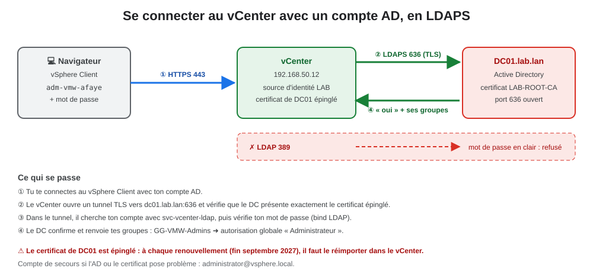

### 1.2 Pourquoi LDAP simple ne suffit pas

| | LDAP | LDAPS |
|---|---|---|
| Port | 389 | **636** |
| Chiffrement | ❌ Le mot de passe passe **en clair** | ✅ Tunnel **TLS**, comme HTTPS |
| Vérification du serveur | ❌ Le vCenter ne sait pas s'il parle au vrai DC | ✅ Le DC présente un **certificat** |
| Risque | Une machine qui écoute le réseau récupère le mot de passe de chaque admin | Aucun mot de passe lisible |

Ces mots de passe sont ceux des administrateurs vSphere, qui ont la main sur **toutes les VM**. Il faut chiffrer.

### 1.3 L'épinglage

Le vCenter n'est pas membre du domaine : il ne connaît pas LAB-ROOT-CA. On lui donne **le certificat de DC01 lui-même**, et il ne fera confiance qu'à celui-là, même pas à un autre certificat de la CA. C'est l'**épinglage** : le plus strict, mais il faut réimporter le certificat à chaque renouvellement (partie 8).

---

## 2. Prérequis

| Élément | Valeur | Vérification |
|---|---|---|
| Certificat de DC01 | Délivré par LAB-ROOT-CA, nom `DC01.lab.lan` | Page 05 |
| Comptes et groupes | `svc-vcenter-ldap`, `GG-VMW-Admins`, `GG-VMW-ReadOnly`, `adm-vmw-afaye` | Page 04 |
| DNS du vCenter | **192.168.50.10 uniquement** | Console de la VM vCenter (F2), page 03 |
| Enregistrements DNS | `vcenter`, `esx01`, `dc01`, avec PTR | Page 04 |

---

## 3. Tester LDAPS depuis DC01

On utilise **ldp.exe**, l'outil graphique de test LDAP de Windows (menu Démarrer : tape `ldp`).

1. **Connexion > Se connecter…**
2. Serveur **`dc01.lab.lan`** (le nom et non l'IP : le certificat est émis pour ce nom), port **`636`**, ☑ **SSL** > **OK**.

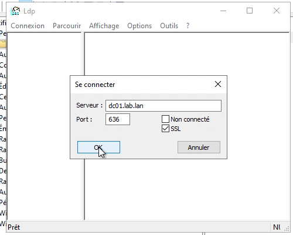

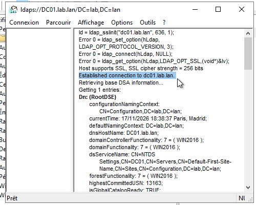

| Ligne affichée | Signification |
|---|---|
| `ldap_sslinit("dc01.lab.lan", 636, 1)` | Connexion sur le port 636, SSL activé |
| `Host supports SSL, SSL cipher strength = 256 bits` | Le tunnel TLS est établi |
| `Established connection to dc01.lab.lan` | Le certificat est accepté : nom correct, chaîne de confiance |
| `dnsHostName: DC01.lab.lan` | Le DC répond **à l'intérieur** du tunnel |

✅ **LDAPS fonctionne.**

---

## 4. Exporter le certificat du DC

1. **certlm.msc > Personnel > Certificats** > clic droit sur **DC01.lab.lan** (⚠️ pas sur LAB-ROOT-CA) > **Toutes les tâches > Exporter…** > **Suivant**.
2. **Non, ne pas exporter la clé privée** > **Suivant**. La clé privée ne quitte jamais le DC.
3. **Codé à base 64 X.509 (.CER)** > **Suivant**.
4. Fichier **`C:\Temp\dc01.cer`** > **Suivant**.

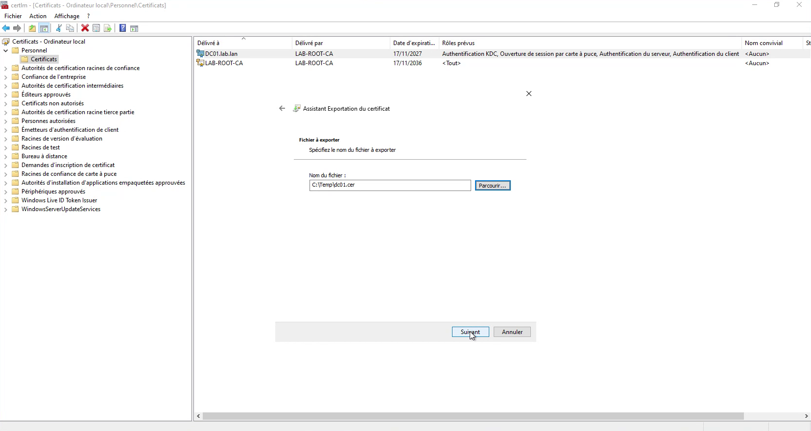

5. Vérifie le résumé (*Exporter les clés : Non*, *X.509 encodé en base 64*) > **Terminer**.

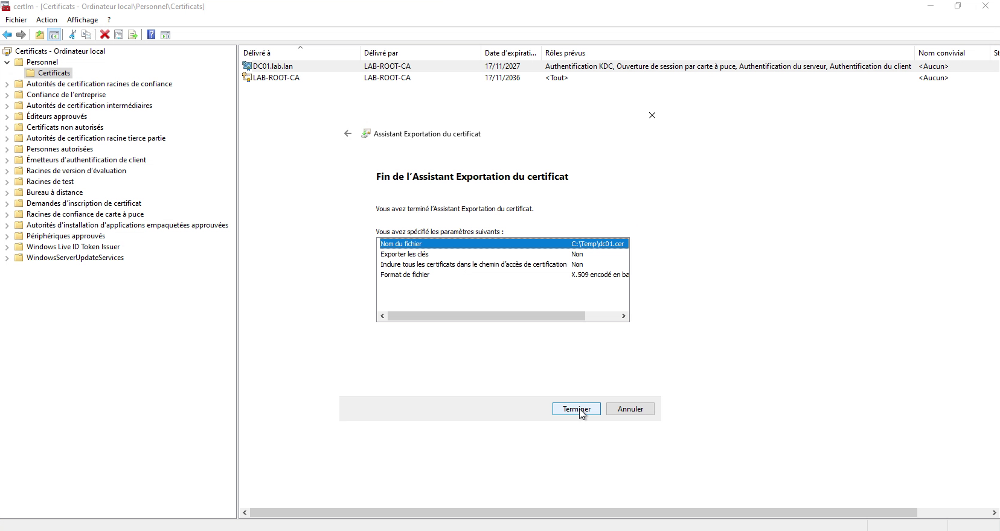

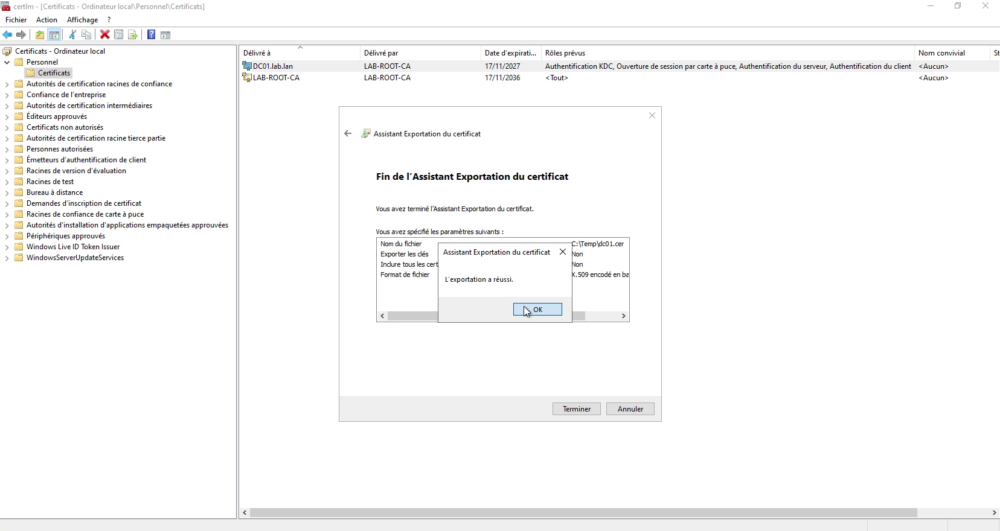

6. Copie `dc01.cer` sur le PC depuis lequel tu ouvres le vSphere Client.

---

## 5. Déclarer l'AD dans le vCenter

### 5.1 Ajouter la source d'identité

1. Connecte-toi sur `https://192.168.50.12/ui` avec **administrator@vsphere.local**.
2. **Menu ☰ > Administration > Single Sign-On > Configuration** > onglet **Fournisseur d'identité** > **Sources d'identité** > **AJOUTER**.

| Champ | Valeur | Explication |
|---|---|---|
| Type | **Active Directory sur LDAP** | « Authentification Windows intégrée » est dépréciée et oblige à joindre le vCenter au domaine |
| Nom | `LAB` | |
| DN de base utilisateurs | `DC=LAB,DC=lan` | |
| DN de base groupes | `DC=LAB,DC=lan` | |
| Nom de domaine | `LAB.lan` | |
| Alias de domaine | `LAB` | Permet aussi `LAB\adm-vmw-afaye` |
| Nom d'utilisateur | `svc-vcenter-ldap@LAB.lan` | Compte de service **sans privilège** |
| Connexion à | **Contrôleurs de domaine spécifiques** | Voir l'encadré |
| URL du serveur principal | **`ldaps://dc01.lab.lan:636`** | `ldaps` avec un **s**, et le **nom** du DC |
| URL secondaire | vide | Plus tard `ldaps://dc02.lab.lan:636` |
| Certificats (pour LDAPS) | **PARCOURIR** > `dc01.cer` | |

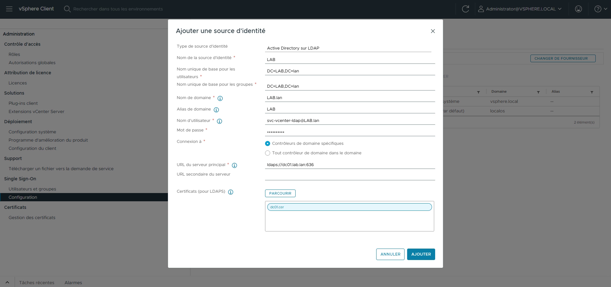

3. Le bandeau jaune *« Cette connexion LDAP n'est pas sécurisée »* disparaît. **AJOUTER**.

> **« Contrôleurs spécifiques » ou « tout contrôleur du domaine » ?** Avec « tout contrôleur », le vCenter trouve les DC par le DNS et il faudrait le certificat de chacun. Avec un seul DC, « spécifiques » est plus prévisible et plus lisible en dépannage. C'est aussi le choix courant en production, avec deux DC en principal et secondaire.

### 5.2 LAB par défaut

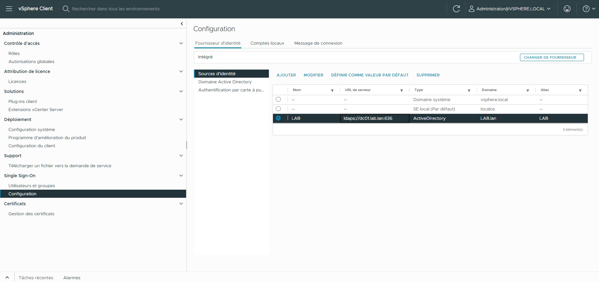

Sélectionne **LAB** > **DÉFINIR COMME VALEUR PAR DÉFAUT** > **OK**.

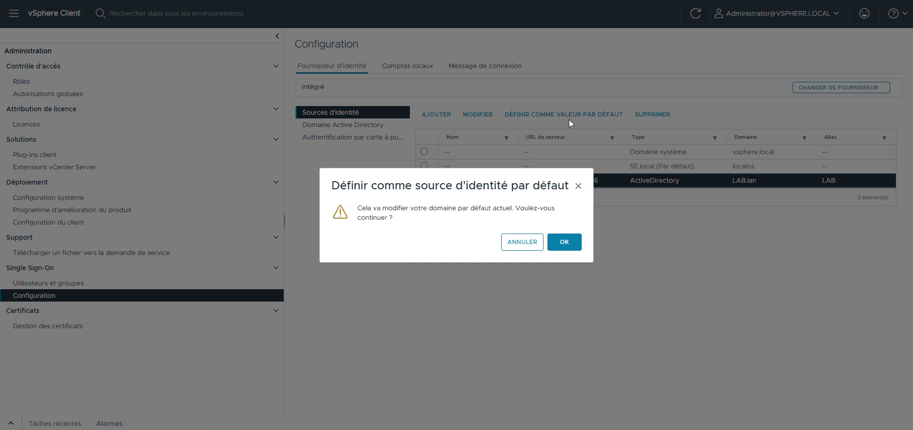

Le type affiche **ActiveDirectory (Par défaut)** : tu peux te connecter en tapant simplement `adm-vmw-afaye`.

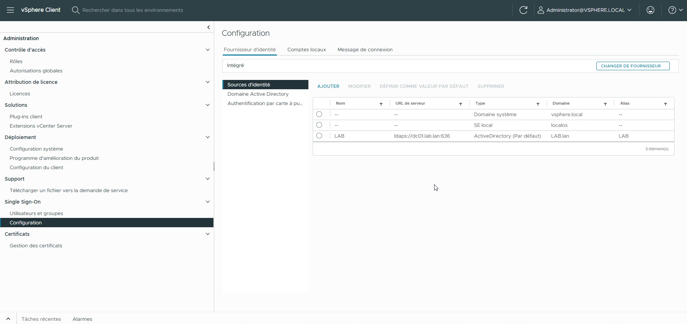

---

## 6. Donner les droits aux groupes AD

### 6.1 Les autorisations globales

1. **Menu ☰ > Administration > Contrôle d'accès > Autorisations globales** > **AJOUTER**.
2. Domaine **LAB.lan**, groupe **GG-VMW-Admins**, rôle **Administrateur**, ☑ **Propager vers les enfants** > **OK**.

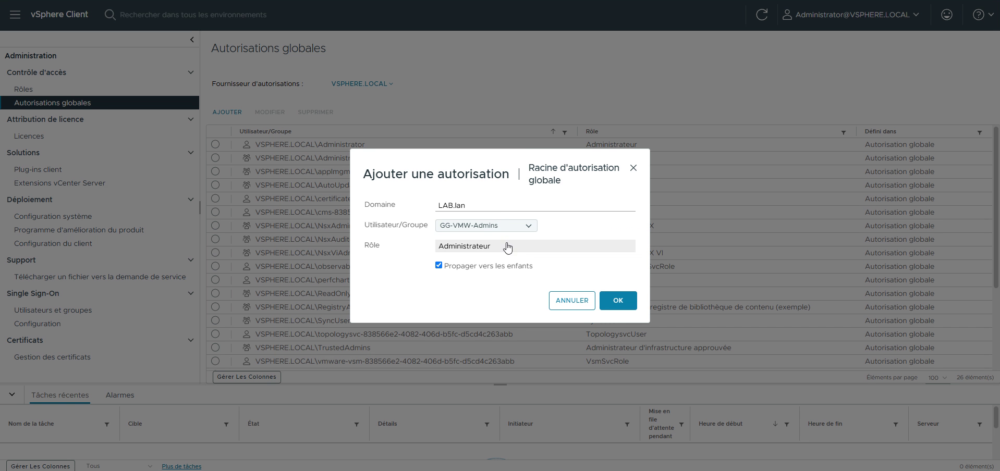

> Si la recherche trouve tes groupes, c'est la preuve que le vCenter lit bien l'AD **en LDAPS**.

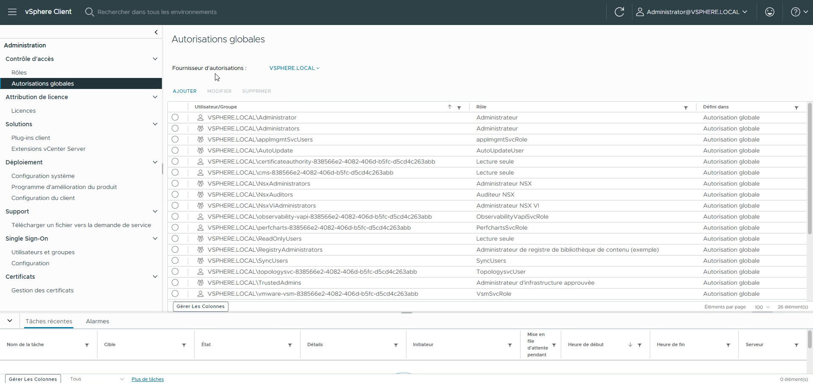

3. Recommence avec **GG-VMW-ReadOnly**, rôle **Lecture seule**, ☑ Propager.

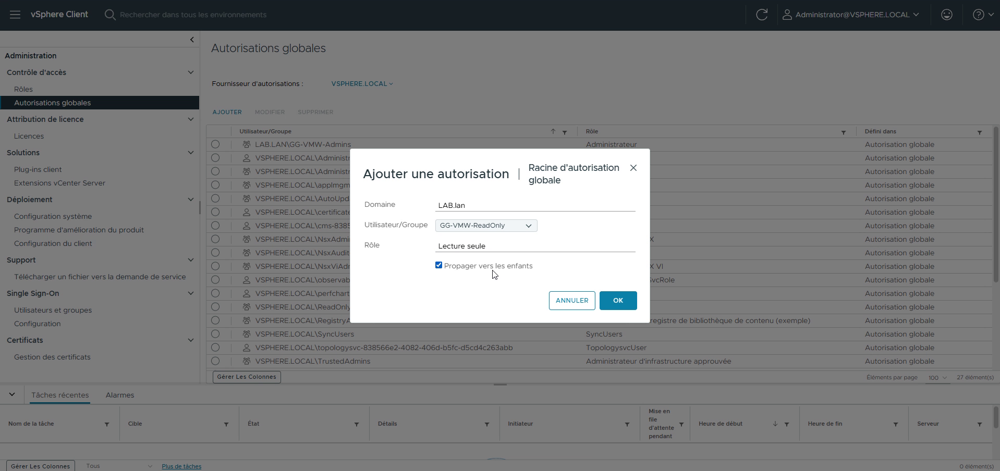

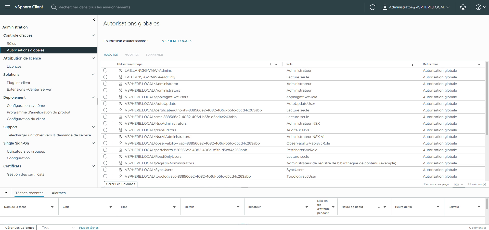

> **Globale ou sur l'inventaire ?** Une autorisation **globale** couvre tout, y compris étiquettes, licences, bibliothèques de contenu et vCenter liés. Une autorisation **sur l'objet vCenter** couvre seulement son inventaire. Pour Horizon, on utilisera la seconde (page 08).

> **Piège rencontré :** la page *Autorisations globales* s'est affichée **vide**, sans bouton. C'est un bug d'affichage : **Ctrl + F5**, dézoome, ou ouvre une fenêtre privée.


### 6.2 (Facultatif) Administrer aussi le SSO

Pour qu'un admin AD gère aussi les sources d'identité et les comptes `vsphere.local` : **Single Sign-On > Utilisateurs et groupes > Groupes > Administrators > AJOUTER DES MEMBRES** > domaine `LAB.lan`, groupe `GG-VMW-Admins`.

---

## 7. Tester

1. Déconnecte-toi, puis connecte-toi avec **`adm-vmw-afaye`**.

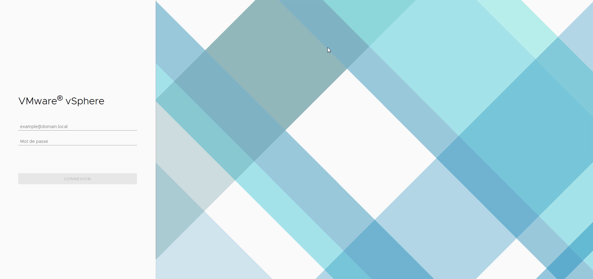

2. **adm-vmw-afaye@lab.lan** s'affiche en haut à droite, avec tout l'inventaire.

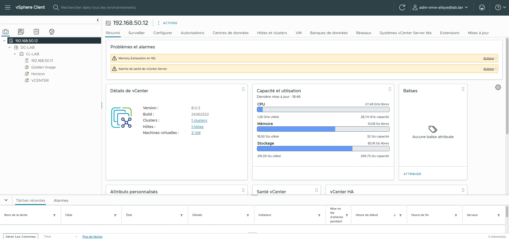

**Le vCenter est administré avec un compte AD, à travers une liaison LDAPS chiffrée.** L'ESXi aussi : l'autorisation donnée au vCenter descend jusqu'à l'hôte. C'est pour ça qu'on ne joint pas l'ESXi au domaine (page 03, partie 4.5).

> Garde le mot de passe de **`administrator@vsphere.local`** dans ton coffre : c'est le compte de secours si l'AD ou le certificat pose problème.

---

## 8. Renouveler le certificat de DC01 chaque année

### 8.1 Le problème

Le certificat de DC01 expire le **17/11/2027**. L'inscription automatique en demande un nouveau **6 semaines avant**, vers le 6 octobre 2027. Or :

```
DC01 reçoit son nouveau certificat ──► LDAPS l'utilise immédiatement
                                             │
vCenter n'épingle que l'ANCIEN ──────────────┴──► ❌ plus aucune connexion AD
```

**La solution : renouveler toi-même avant**, au moment que tu choisis, et réimporter dans la foulée.

> 📅 **Rappel dans ton agenda : fin septembre 2027.**

### 8.2 La procédure

1. **Renouveler :** sur DC01, `certlm.msc` > clic droit sur **DC01.lab.lan** > **Toutes les tâches > Opérations avancées > Renouveler ce certificat avec une nouvelle clé…** > **Inscrire**. **F5** : le certificat expire maintenant en 2028. Note la nouvelle empreinte.
2. **Tester :** `ldp.exe`, `dc01.lab.lan`, 636, SSL : **Established connection**.
3. **Exporter :** comme en partie 4, vers `C:\Temp\dc01-2028.cer`.
4. **Remplacer dans le vCenter** (connecté en **administrator@vsphere.local**, car la connexion AD est peut-être déjà coupée) : **Sources d'identité** > **LAB** > **MODIFIER** > supprime l'ancien certificat > **PARCOURIR** > `dc01-2028.cer` > ressaisis le mot de passe de `svc-vcenter-ldap` si demandé > **ENREGISTRER**.
5. **Vérifier :** reconnecte-toi en `adm-vmw-afaye`.

> **Si tu as oublié :** un matin, `adm-vmw-afaye` échoue mais `administrator@vsphere.local` marche. DC01 a déjà son nouveau certificat : fais simplement les étapes 3 à 5.

---

## 9. Dépannage

| Symptôme | Cause probable | Solution |
|---|---|---|
| *« Cannot connect to one or more of the provided external server URLs »* | `ldap://` au lieu de `ldaps://`, IP au lieu du nom, ou mauvais certificat | `ldaps://dc01.lab.lan:636` avec le certificat **DC01.lab.lan** |
| Même erreur, URL correcte | Le vCenter ne résout pas `dc01.lab.lan` | DNS du vCenter = `192.168.50.10` (console F2) |
| ldp : *« Cannot open connection »* sur 636 | DC01 n'a pas de certificat serveur | Page 05, partie 4.4 |
| Groupe AD introuvable dans « Ajouter une autorisation » | Mauvais domaine sélectionné, ou source en panne | Domaine **LAB.lan** |
| Plus aucune connexion AD du jour au lendemain | Le certificat de DC01 a été renouvelé | Partie 8.2, étapes 3 à 5 |

---

## 10. Quiz

<details><summary><b>1. Pourquoi LDAPS plutôt que LDAP ?</b></summary> <p>En LDAP sur le port 389, le mot de passe des administrateurs vSphere passe en clair sur le réseau. LDAPS chiffre la liaison et vérifie l'identité du DC par son certificat.</p></details>

<details><summary><b>2. Pourquoi mettre dc01.lab.lan et pas 192.168.50.10 dans l'URL ?</b></summary> <p>Le certificat est émis pour le nom DC01.lab.lan. Avec l'IP, le nom ne correspond pas et la connexion TLS est refusée.</p></details>

<details><summary><b>3. Qu'est-ce que l'épinglage, et quel est son inconvénient ?</b></summary> <p>Le vCenter ne fait confiance qu'à ce certificat précis. C'est très strict, mais il faut le réimporter à chaque renouvellement du certificat de DC01.</p></details>

<details><summary><b>4. Quels droits a svc-vcenter-ldap dans l'AD ?</b></summary> <p>Aucun en particulier : il lit l'annuaire, ce que n'importe quel utilisateur du domaine peut faire.</p></details>

<details><summary><b>5. Pourquoi donner les droits à GG-VMW-Admins plutôt qu'à adm-vmw-afaye ?</b></summary> <p>Pour gérer les accès depuis l'AD : on ajoute ou retire quelqu'un du groupe, sans toucher au vCenter.</p></details>

---

[⬅ 05 - La PKI](/fr/hyperviseur/VDI/05-pki) · [Sommaire](/fr/hyperviseur/VDI/00-sommaire) · Page suivante : [07 - Sécuriser vCenter et l'AD ➜](/fr/hyperviseur/VDI/07-securiser-vcenter-ad)
