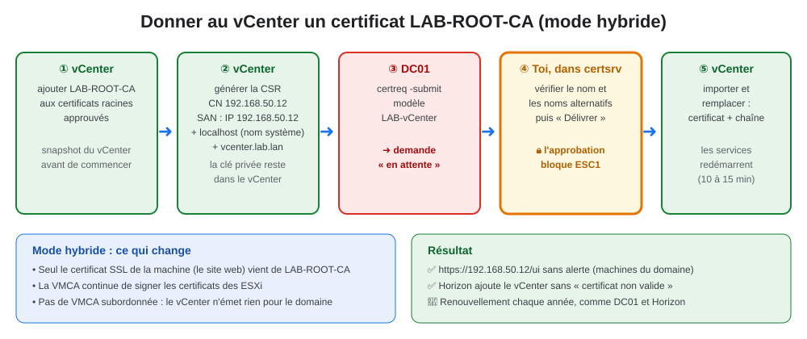

# 07 - Sécuriser le vCenter et l'Active Directory

> **Objectif de la page :**
> 1. donner au vCenter un **certificat émis par LAB-ROOT-CA** : plus d'alerte dans le navigateur, et Horizon lui fera confiance sans exception ;
> 2. **durcir** le vCenter, l'ESXi et l'AD, maintenant que tout passe en LDAPS.
>
> 📸 *Page à illustrer avec tes captures au moment où tu la réalises.*

---

## 1. Un certificat LAB-ROOT-CA pour le vCenter

### 1.1 Pourquoi

Aujourd'hui, l'interface web du vCenter présente un certificat signé par la **VMCA**, l'autorité interne du vCenter. Aucune machine ne la connaît :

- le navigateur affiche *« Non sécurisé »* ;
- Horizon affichera *« Certificat non valide détecté »* à l'ajout du vCenter (page 10) ;
- on prend l'habitude de cliquer sur « Accepter », ce qui est exactement ce qu'un attaquant espère.

Les machines du domaine font déjà confiance à LAB-ROOT-CA. Si elle signe le certificat du vCenter, l'alerte disparaît **pour de bonnes raisons**.

### 1.2 Le choix : le mode hybride



| Mode | Principe | Choix |
|---|---|---|
| VMCA seule (défaut) | La VMCA signe tout | Situation actuelle |
| **Hybride** | On remplace **seulement le certificat SSL de la machine** (celui du site web) par un certificat LAB-ROOT-CA. La VMCA continue de signer les certificats des ESXi et des services internes | ✅ **Recommandé par VMware, retenu ici** |
| VMCA subordonnée | La VMCA devient une sous-CA de LAB-ROOT-CA | ❌ Lourd, et donne au vCenter le pouvoir d'émettre des certificats reconnus par tout le domaine |

### 1.3 Le piège du PNID

Le PNID du vCenter est son IP (page 03). Le certificat doit donc contenir, dans ses noms alternatifs :

| Nom alternatif | Valeur |
|---|---|
| **Adresse IP** | **`192.168.50.12`** (obligatoire : c'est le PNID) |
| Nom DNS | `vcenter.lab.lan` (pour l'ouvrir aussi par son nom) |

> Si le PNID n'est pas dans le certificat, le vCenter refuse le remplacement.

### 1.4 Le modèle LAB-vCenterServer

Ici, le nom vient **de la demande** générée par le vCenter (une CSR), puisque le vCenter n'est pas dans l'AD. C'est exactement la situation de l'attaque **ESC1**. On la neutralise par trois verrous :

| Verrou | Effet |
|---|---|
| **Approbation obligatoire** par le gestionnaire de la CA | Aucune demande n'est délivrée sans que tu l'aies vue et acceptée |
| Droit *Inscrire* réservé aux **Admins du domaine** | Un utilisateur ordinaire ne peut même pas soumettre de demande |
| Usage limité à **Authentification du serveur** | Le certificat ne permet pas d'ouvrir une session dans le domaine |

Sur DC01, `certtmpl.msc` > clic droit sur **Serveur Web** > **Dupliquer le modèle** :

| Onglet | Réglage |
|---|---|
| **Compatibilité** | Windows Server 2016 / Windows 10 – Windows Server 2016 |
| **Général** | Nom `LAB-vCenterServer` · validité **1 an** · renouvellement 6 semaines · ☐ Publier dans AD |
| **Traitement de la demande** | ☐ Autoriser l'exportation de la clé privée (la clé est générée **dans le vCenter** et n'en sort pas) |
| **Chiffrement** | Fournisseur de stockage de clés, RSA, **2048** minimum |
| **Nom du sujet** | ● **Fournir dans la demande** (l'avertissement sur la sécurité est normal : les deux verrous suivants y répondent) |
| **Conditions d'émission** | ☑ **Approbation du gestionnaire de certificat de l'autorité de certification** |
| **Extensions > Stratégies d'application** | Seulement **Authentification du serveur** |
| **Sécurité** | **Admins du domaine** : Lecture + Inscrire · **Utilisateurs authentifiés** : Lecture seulement · supprime tout autre droit *Inscrire* |

**OK**, puis `certsrv.msc` > **Modèles de certificats** > **Nouveau > Modèle de certificat à délivrer** > **LAB-vCenterServer**.

### 1.5 Préparer le vCenter

1. 📸 **Snapshot de la VM VCENTER** (éteinte de préférence, ou sans la mémoire), pour pouvoir revenir en arrière.
2. Exporte le certificat **LAB-ROOT-CA** : `certsrv.msc` > clic droit sur **LAB-ROOT-CA** > **Propriétés** > **Afficher le certificat** > **Détails** > **Copier dans un fichier** > **X.509 encodé en base 64** > `C:\Temp\lab-root-ca.cer`.
3. Dans le vSphere Client (en **administrator@vsphere.local**) : **Menu ☰ > Administration > Certificats > Gestion des certificats**.
4. Section **Certificats racines approuvés** > **Ajouter** > `lab-root-ca.cer` > **Ajouter**.

> Le vCenter fait maintenant confiance à LAB-ROOT-CA. Sans cette étape, il refuserait le futur certificat, faute de pouvoir vérifier sa chaîne.

### 1.6 Générer la demande (CSR)

**Gestion des certificats** > section **Certificat SSL de la machine** > **Actions > Générer une demande de signature de certificat (CSR)** :

| Champ | Valeur |
|---|---|
| Nom commun | `192.168.50.12` |
| Organisation / Unité / Pays / Ville | `LAB` / `vSphere` / `FR` / ta ville |
| Nom d'hôte / Autre nom de l'objet | `192.168.50.12`, `vcenter.lab.lan` |
| Taille de la clé | **2048** (ou 3072) |

**Suivant** > **Télécharger** le fichier (ou **Copier**) > enregistre-le sous `vcenter.csr` et copie-le dans `C:\Temp` sur DC01.

> Le vCenter garde la clé privée. Ne génère pas une seconde CSR avant d'avoir importé le certificat : la première deviendrait inutilisable.

### 1.7 Faire signer la demande

Sur DC01, en **adm-dom-afaye**, invite de commandes administrateur :

```
certreq -submit -attrib "CertificateTemplate:LAB-vCenterServer" C:\Temp\vcenter.csr
```

Choisis **LAB-ROOT-CA**. La réponse est *« Le certificat demandé est en attente »*, avec un **numéro de requête** (RequestId).

1. `certsrv.msc` > **Demandes en attente** > double-clic sur la demande : vérifie le nom et les noms alternatifs (**l'IP 192.168.50.12**).
2. Clic droit > **Toutes les tâches > Délivrer**.
3. Récupère le certificat :

```
certreq -retrieve <RequestId> C:\Temp\vcenter.cer
```

> 🔒 **C'est ici que joue l'approbation :** une demande au nom de `dc01.lab.lan` ou d'un administrateur ne passerait jamais cette étape.

### 1.8 Importer et remplacer

**Gestion des certificats** > **Certificat SSL de la machine** > **Actions > Importer et remplacer le certificat** > **Remplacer par un certificat externe (via CSR)** :

| Champ | Fichier |
|---|---|
| Certificat SSL de la machine | `vcenter.cer` |
| Chaîne de certificats | `lab-root-ca.cer` |

**Remplacer**. Les services du vCenter redémarrent : compte **10 à 15 minutes** en imbriqué.

### 1.9 Contrôler

1. Depuis la VM Horizon ou un poste du domaine, ouvre `https://192.168.50.12/ui` : **cadenas**, certificat **délivré par LAB-ROOT-CA**, aucune alerte.
2. Depuis ton PC (hors domaine) : l'alerte disparaît une fois LAB-ROOT-CA importé dans ses **Autorités de certification racines de confiance** (page 10, partie 7).
3. L'ESXi reste « Connecté » dans l'inventaire.
4. Tout fonctionne ? **Supprime le snapshot** du vCenter.

> **Retour arrière :** si le vCenter ne revient pas, rétablis le snapshot. Le compte `administrator@vsphere.local` reste disponible tout du long.

> 🔁 **Renouvellement :** ce certificat expire dans **1 an**. Refais 1.6 à 1.8 un mois avant. Note la date à côté de celle de DC01.

---

## 2. Durcir le vCenter

### 2.1 Le SSO

**Menu ☰ > Administration > Single Sign-On > Configuration** > onglet **Comptes locaux** :

| Stratégie | Réglage conseillé |
|---|---|
| Mot de passe | 15 caractères minimum, durée de vie 90 jours (les comptes AD suivent la stratégie de l'AD) |
| Verrouillage | **5** tentatives, déverrouillage après **15 minutes** |
| Jeton | Laisse les valeurs par défaut |

> `administrator@vsphere.local` devient un **compte de secours** : mot de passe long dans le coffre, utilisé seulement si l'AD est indisponible ou pour les certificats.

### 2.2 L'appliance (VAMI)

`https://192.168.50.12:5480`, compte `root` :

| Menu | Réglage |
|---|---|
| **Accès** | ☐ Connexion SSH · ☑ Connexion DCUI · ☐ Shell de console. Réactive SSH seulement le temps d'une opération |
| **Heure** | Mode **NTP**, serveur `192.168.50.10` |
| **Administration** | Expiration du mot de passe root activée, avec un e-mail ou un rappel |
| **Sauvegarde** | Planifie une **sauvegarde fichier** quotidienne vers un partage SMB (sur le PC par exemple), avec chiffrement par mot de passe |
| **Syslog** | Optionnel : envoyer les journaux vers un serveur de logs |

> ⚠️ **Jamais de modification du nom d'hôte** dans *Réseau* (page 03).

### 2.3 Le vSphere Client

- **Administration > Déploiement > Configuration du client** : délai d'expiration de session **15 à 30 minutes**.
- **Administration > Déploiement > Programme d'amélioration du produit** : **quitter** le programme.
- Les droits restent donnés **à des groupes AD**, jamais à des comptes nominatifs (page 06).

### 2.4 L'ESXi

| Réglage | Où | Valeur |
|---|---|---|
| **Mode de verrouillage** | **192.168.50.11 > Configurer > Système > Profil de sécurité > Mode de verrouillage > Modifier** | **Normal** : l'ESXi ne s'administre plus que par le vCenter. La DCUI reste accessible en secours |
| Services | **Configurer > Système > Services** | SSH et ESXi Shell **arrêtés**, démarrage **manuel** |
| Mot de passe root | Coffre | Long et unique |

> En mode verrouillage normal, si le vCenter est perdu, on désactive le verrouillage depuis la **DCUI** de l'ESXi (console de la VM dans Workstation). Teste-le une fois pour savoir le faire.

---

## 3. Durcir l'Active Directory

Tous ces réglages se font sur DC01, en **adm-dom-afaye**.

### 3.1 Signature LDAP et liaison de canal

Maintenant que le vCenter est en LDAPS, on peut **interdire le LDAP non signé**.

**Étape 1 : observer.** Vérifie que plus personne ne fait de LDAP en clair.

1. **Win + R** > `regedit` > `HKLM\SYSTEM\CurrentControlSet\Services\NTDS\Diagnostics` > **16 LDAP Interface Events** = `2`.
2. Utilise le lab normalement pendant quelques heures.
3. **Observateur d'événements > Journaux des applications et des services > Directory Service** > **Filtrer** sur l'ID **2889**. Chaque événement nomme une IP et un compte qui font du LDAP non signé. **La liste doit être vide.**
4. Remets la valeur à `0`.

**Étape 2 : exiger.** **Gestion des stratégies de groupe** > clic droit sur l'OU **Domain Controllers** > **Créer un objet GPO… et le lier ici** > `GPO-DC-Hardening` > **Modifier** > **Configuration ordinateur > Stratégies > Paramètres Windows > Paramètres de sécurité > Stratégies locales > Options de sécurité** :

| Paramètre | Valeur |
|---|---|
| Contrôleur de domaine : conditions requises pour la signature de serveur LDAP | **Exiger la signature** |
| Contrôleur de domaine : conditions requises pour le jeton de liaison de canal LDAP du serveur | **Lorsque pris en charge** |
| Sécurité réseau : niveau d'authentification LAN Manager | **Envoyer uniquement des réponses NTLM version 2. Refuser LM et NTLM** |
| Serveur réseau Microsoft : communications signées numériquement (toujours) | **Activé** |

`gpupdate /force`, puis reconnecte-toi au vCenter en `adm-vmw-afaye` pour vérifier.

> **Liaison de canal :** empêche de relayer une authentification NTLM volée vers LDAPS. « Lorsque pris en charge » est sans risque. Tu peux tester « Toujours » ensuite, et revenir en arrière si le vCenter ne se connecte plus.

### 3.2 TLS 1.2 minimum

SSL 2.0 et 3.0, TLS 1.0 et 1.1 sont obsolètes. Le plus simple en interface graphique est l'outil gratuit **IIS Crypto** (Nartac) : bouton **Best Practices**, décoche TLS 1.0 et 1.1 dans *Server Protocols* et *Client Protocols*, **Apply**, redémarre DC01.

Après le redémarrage, refais le test `ldp.exe` (page 06, partie 3) et une connexion au vCenter.

### 3.3 Protéger les comptes d'administration

| Mesure | Comment |
|---|---|
| **Utilisateurs protégés** | Ajoute `adm-dom-afaye` au groupe **Protected Users** (`lab.lan > Users`) : plus de NTLM, pas de mise en cache du mot de passe, tickets Kerberos de 4 heures. Teste ensuite tes connexions. Pour `adm-vmw` et `adm-hzn`, teste un par un : un service qui exige NTLM ne les accepterait plus |
| **Tiering par GPO** | GPO liée à `LAB > Serveurs` : **Attribution des droits utilisateur > Interdire l'ouverture d'une session locale** et **… par les services Bureau à distance** pour **Admins du domaine**. Le tier 0 ne se connecte plus aux serveurs |
| **Comptes de service** | Groupe `GG-SVC-DenyInteractive` (dans `LAB > Groupes`) avec `svc-vcenter-ldap`, `svc-horizon-vc`, `svc-horizon-ic`. GPO liée au domaine : **Interdire l'ouverture d'une session locale**, **… par les services Bureau à distance**, **… en tant que tâche**, **… en tant que service**. ⚠️ **Pas** *Interdire l'accès à cet ordinateur à partir du réseau* : ça bloquerait le bind LDAP |
| **Mots de passe longs** | Donne aux comptes de service un mot de passe de **32 caractères** généré par ton coffre, puis mets-le à jour dans la source d'identité du vCenter (page 06) et dans Horizon (page 10) |

### 3.4 Windows LAPS

Le mot de passe de l'**administrateur local** des serveurs membres doit être unique et changer tout seul. **Windows LAPS** est intégré à Windows Server 2022 et 2025 (à jour).

1. Une seule fois, dans PowerShell administrateur sur DC01 :
   ```
   Update-LapsADSchema
   Set-LapsADComputerSelfPermission -Identity "OU=Serveurs,OU=LAB,DC=lab,DC=lan"
   ```
2. GPO liée à `LAB > Serveurs` > **Configuration ordinateur > Stratégies > Modèles d'administration > Système > LAPS** :
   - **Configurer le répertoire de sauvegarde des mots de passe** : **Activé**, *Active Directory* ;
   - **Paramètres de mot de passe** : 20 caractères, 30 jours.
3. Sur HORIZON, `gpupdate /force`. Le mot de passe apparaît dans **Utilisateurs et ordinateurs AD** > HORIZON > **Propriétés** > onglet **LAPS**.

### 3.5 Petits réglages qui comptent

| Réglage | Où | Pourquoi |
|---|---|---|
| Service **Spouleur d'impression** arrêté et désactivé sur DC01 | `services.msc` | Évite les attaques de type PrintNightmare et la coercition d'authentification |
| Audit avancé | `GPO-DC-Hardening` > **Configuration avancée de la stratégie d'audit** : Ouverture de session de compte, Gestion des comptes, Accès DS, Changement de stratégie | Tracer qui fait quoi sur le domaine |
| Sauvegarde de la CA à jour | Page 05, partie 3.4 | Après tout nouveau modèle |
| Corbeille AD | **Centre d'administration Active Directory** > clic droit sur `lab` > **Activer la Corbeille** | Restaurer un compte supprimé par erreur |

---

## 4. Checklist

| ✓ | Vérification |
|---|---|
| ☐ | Modèle `LAB-vCenterServer` avec approbation, publié |
| ☐ | LAB-ROOT-CA dans les racines approuvées du vCenter |
| ☐ | Certificat SSL du vCenter délivré par LAB-ROOT-CA, IP 192.168.50.12 dans les noms alternatifs |
| ☐ | Snapshot du vCenter supprimé après validation |
| ☐ | SSO : verrouillage 5 tentatives, compte `administrator@vsphere.local` dans le coffre |
| ☐ | VAMI : SSH coupé, NTP DC01, sauvegarde planifiée |
| ☐ | ESXi : mode de verrouillage normal, SSH arrêté |
| ☐ | Aucun événement 2889, signature LDAP exigée, liaison de canal « lorsque pris en charge » |
| ☐ | TLS 1.0 et 1.1 désactivés, LDAPS et vCenter testés |
| ☐ | `adm-dom-afaye` dans Protected Users, GPO de tiering, comptes de service bloqués en interactif |
| ☐ | Windows LAPS sur OU=Serveurs |
| ☐ | Spouleur arrêté sur DC01, corbeille AD activée |

---

## 5. Quiz

<details><summary><b>1. Pourquoi le modèle LAB-vCenterServer utilise-t-il « Fournir dans la demande », et comment évite-t-on ESC1 ?</b></summary> <p>Le vCenter n'est pas dans l'AD : son nom doit venir de sa CSR. On neutralise ESC1 par l'approbation obligatoire du gestionnaire de la CA et par un droit d'inscription réservé aux Admins du domaine.</p></details>

<details><summary><b>2. Pourquoi l'IP 192.168.50.12 doit-elle figurer dans le certificat du vCenter ?</b></summary> <p>C'est son PNID. Le vCenter refuse un certificat qui ne contient pas son PNID, et Horizon s'y connecte par cette IP.</p></details>

<details><summary><b>3. Pourquoi le mode hybride plutôt qu'une VMCA subordonnée ?</b></summary> <p>On ne remplace que le certificat visible par les utilisateurs. Une VMCA subordonnée pourrait émettre des certificats reconnus par tout le domaine : c'est trop de pouvoir pour une appliance.</p></details>

<details><summary><b>4. Pourquoi observer l'événement 2889 avant d'exiger la signature LDAP ?</b></summary> <p>Pour repérer les machines qui font encore du LDAP non signé. Exiger la signature sans vérifier pourrait couper l'une d'elles, par exemple le vCenter s'il était resté en LDAP simple.</p></details>

<details><summary><b>5. Pourquoi ne pas interdire l'accès réseau aux comptes de service ?</b></summary> <p>Le bind LDAP de svc-vcenter-ldap et les connexions d'Horizon sont des accès réseau. Les interdire couperait le vCenter et Horizon de l'AD.</p></details>

---

[⬅ 06 - vCenter en LDAPS](/fr/hyperviseur/VDI/06-vcenter-ldaps) · [Sommaire](/fr/hyperviseur/VDI/00-sommaire) · Page suivante : [08 - Préparer Horizon ➜](/fr/hyperviseur/VDI/08-preparation-horizon)
