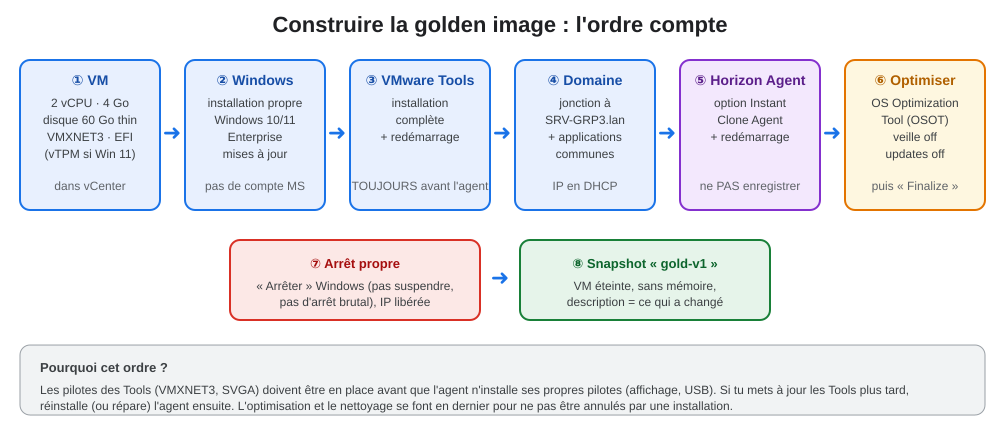
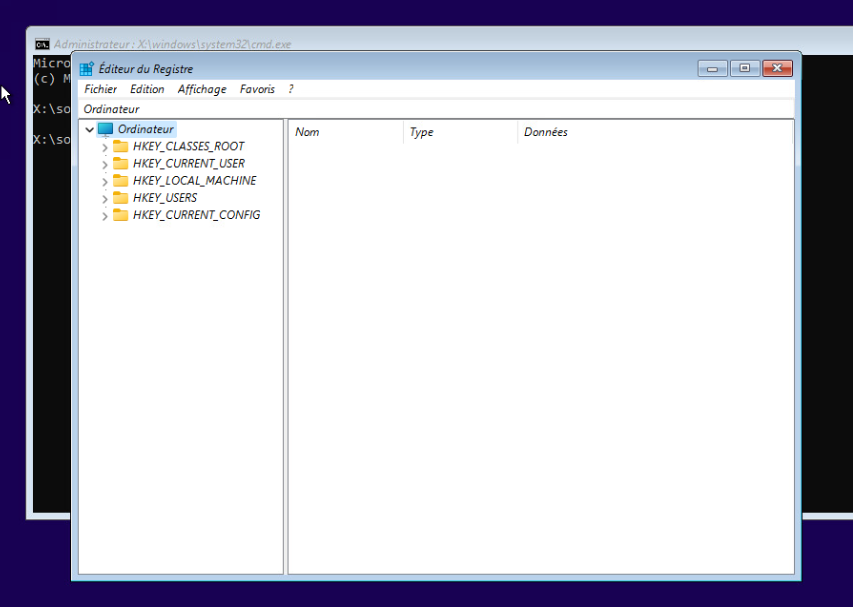
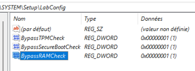
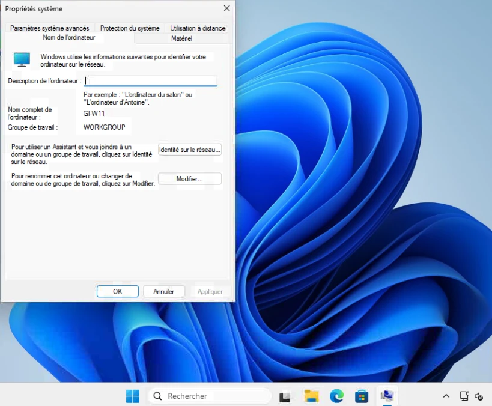
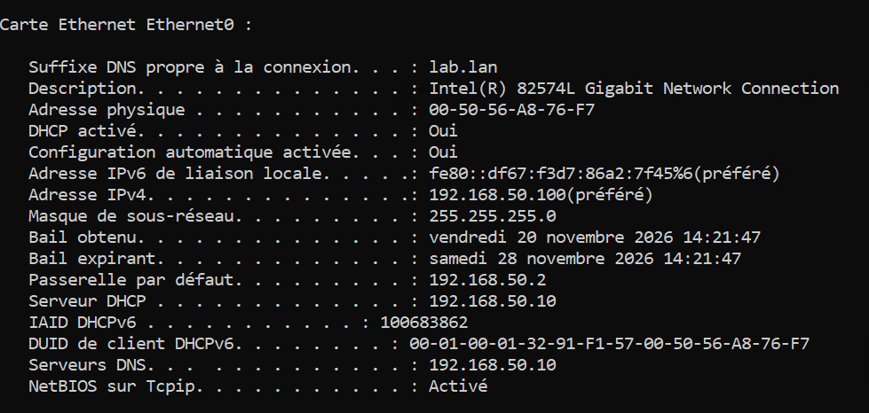
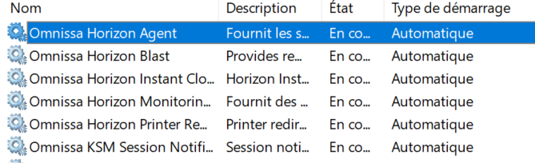
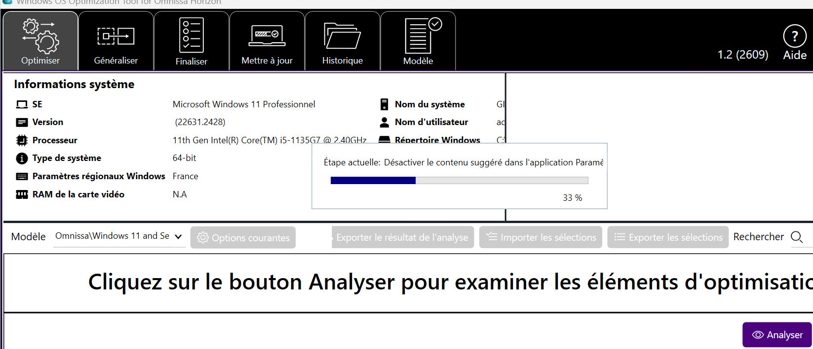

# 09 - La golden image Windows 11

> **Objectif de la page :** construire la **golden image**, le modèle de tous les bureaux : une VM Windows 11 **sans vTPM**, à jour, avec les VMware Tools, l'Horizon Agent et les optimisations VDI, terminée par un **snapshot**.
>
> 📸 *Page à illustrer avec tes captures au moment où tu la réalises.*

---

## 1. Comprendre avant de faire

Tout ce qui est installé dans la golden image se retrouve dans **chaque bureau**. Elle se traite comme un produit : propre, minimale, à jour, versionnée.



| Règle | Pourquoi |
|---|---|
| **Pas jointe au domaine** | Horizon joint chaque clone lui-même, avec `svc-horizon-ic` |
| **Pas de Sysprep** | Les clones instantanés sont personnalisés par Horizon (ClonePrep) |
| **VMware Tools avant l'Horizon Agent** | L'agent s'appuie sur les pilotes des Tools. Après une mise à jour des Tools, on réinstalle l'agent |
| **Éteinte et un snapshot par version** | Le pool est construit à partir d'un snapshot précis : `v1-…`, `v2-…` |
| **Éteinte quand elle ne sert pas** | 3 Go de RAM rendus à l'ESXi |

**Le compromis du lab :** pas de vTPM (page 08, partie 4.2). On garde le **démarrage sécurisé**, qui n'en a pas besoin. On perd BitLocker et Credential Guard dans les bureaux.

---

## 2. Préparer l'ISO

1. Télécharge l'ISO **Windows 11 Entreprise** (évaluation de 90 jours, sur le *Microsoft Evaluation Center*) ou **Windows 11 Pro**.
   > Pour la VDI, **Entreprise** est l'édition prévue par Microsoft. L'évaluation suffit au lab.
2. Dans le vSphere Client : **Banques de données** > **ds-esx01** > onglet **Fichiers** > **Nouveau dossier** `ISO` > **Charger des fichiers** > l'ISO.

---

## 3. Créer la VM

### 3.1 Repartir d'une VM propre

La VM **Golden Image** existante affiche **60 Go utilisés sur 64 Go provisionnés** alors que Windows n'y est pas installé : son disque semble en **provisionnement statique**. Vérifie dans **Modifier les paramètres > Disque dur 1 > Provisionnement du disque**. Si c'est « statique », supprime-la (clic droit > **Supprimer du disque**) et recrée-la.

### 3.2 L'assistant Nouvelle machine virtuelle

Clic droit sur **VDI > Golden-Image** > **Nouvelle machine virtuelle** :

| Écran | Valeur |
|---|---|
| Type de création | **Créer une machine virtuelle** |
| Nom et dossier | `GI-W11`, dossier **VDI > Golden-Image** |
| Ressource de calcul | **CL-LAB** |
| Stockage | **ds-esx01** |
| Compatibilité | **ESXi 8.0 U1 et versions ultérieures** |
| SE invité | **Windows**, **Microsoft Windows 11 (64 bits)** · ☐ **Activer la sécurité basée sur la virtualisation Windows** (économise de la RAM) |

> **Si l'assistant bloque à cause du TPM :** pour Windows 11, vSphere ajoute d'office un *Module de plateforme sécurisée virtuel* et refuse de continuer sans fournisseur de clés. Reviens à **SE invité** et choisis **Microsoft Windows 10 (64 bits)**. Ce choix ne règle que les valeurs par défaut de la VM : tu installes bien Windows 11, et Horizon ne fait pas la différence.

**Personnaliser le matériel > Matériel virtuel :**

| Élément | Valeur |
|---|---|
| CPU | **2** |
| Mémoire | **3 Go** (4 Go si l'ESXi le permet) |
| Nouveau disque dur | **64 Go** (le minimum de Windows 11) · *Provisionnement du disque* = **Provisionnement dynamique** |
| Contrôleur de stockage | Celui proposé (**NVMe** ou **LSI Logic SAS**). Pas *VMware Paravirtual* : Windows n'a pas son pilote à l'installation |
| Nouveau réseau | **VM Network** · type **VMXNET3** · ☑ Connecter à la mise sous tension |
| Nouveau lecteur CD/DVD | **Fichier ISO de la banque de données** > `ISO/…Win11….iso` · ☑ **Connecter à la mise sous tension** |
| Module de plateforme sécurisée virtuel | **Absent.** S'il apparaît, supprime-le avec la croix ✕ |

**Options VM :**

| Élément | Valeur |
|---|---|
| Options de démarrage > Microprogramme | **EFI** |
| Options de démarrage > Démarrage sécurisé | ☑ **Activé** |
| Options de démarrage > Retard de démarrage | `3000` ms, pour avoir le temps d'appuyer sur une touche |

**Suivant** > **Terminer**.

---

## 4. Installer Windows 11 sans TPM

### 4.1 La clé LabConfig

1. Allume la VM > **Lancer la console Web**. À « Press any key to boot from CD or DVD », clique dans la console et appuie sur une touche.
   > Raté ? La VM affiche le menu EFI : **Actions > Alimentation > Réinitialiser** et recommence.
2. Sur le **premier écran** (langue), **Maj + F10** : une invite de commandes s'ouvre.
   > Si la console Web ne transmet pas le raccourci, utilise **Lancer Remote Console** (VMRC).
3. Tape `regedit` > **Entrée** > va dans **HKEY_LOCAL_MACHINE > SYSTEM > Setup**.



4. Clic droit sur **Setup** > **Nouveau > Clé** > `LabConfig`.
5. Dans **LabConfig**, clic droit > **Nouveau > Valeur DWORD (32 bits)**, trois fois, chacune avec la donnée `1` :

| Nom | Pourquoi |
|---|---|
| `BypassTPMCheck` | Pas de vTPM |
| `BypassSecureBootCheck` | Par précaution |
| `BypassRAMCheck` | La VM a 3 Go, Windows 11 en demande 4 |



> **Plus rapide**, dans l'invite de commandes au lieu de regedit :
> ```
> reg add HKLM\SYSTEM\Setup\LabConfig /v BypassTPMCheck /t REG_DWORD /d 1 /f
> reg add HKLM\SYSTEM\Setup\LabConfig /v BypassSecureBootCheck /t REG_DWORD /d 1 /f
> reg add HKLM\SYSTEM\Setup\LabConfig /v BypassRAMCheck /t REG_DWORD /d 1 /f
> ```

6. Ferme regedit et l'invite de commandes.

### 4.2 L'installation

| Écran | Choix |
|---|---|
| Langue, clavier | Français |
| Option d'installation | **Installer Windows 11** · ☑ J'accepte que tout soit supprimé |
| Clé de produit | **Je n'ai pas de clé de produit** |
| Édition | **Windows 11 Entreprise** (ou Pro) |
| Emplacement | Le disque de 64 Go, non alloué > **Suivant** |

> **« Ce PC ne peut pas exécuter Windows 11 » ?** La clé LabConfig est mal nommée ou mal placée : vérifie `HKLM\SYSTEM\Setup\LabConfig` et les trois DWORD. Sur les ISO récentes, le lien **Version précédente du programme d'installation** de l'écran *Option d'installation* ouvre l'ancien assistant, qui respecte LabConfig.

### 4.3 Le compte local

Avec une carte **VMXNET3**, Windows n'a pas encore de pilote : il démarre **sans réseau**, ce qui facilite la création d'un **compte local**. Avec une carte **E1000E** (*Intel 82574L*), Windows a son pilote et le réseau fonctionne tout de suite : utilise alors les commandes ci-dessous pour rester en compte local.

1. Région, clavier : **Oui**, ignore la deuxième disposition.
2. Écran **Connectons-nous à un réseau** :
   - si **Je n'ai pas Internet** apparaît : clique, puis **Continuer avec une configuration limitée** ;
   - sinon, **Maj + F10** > `start ms-cxh:localonly` : une fenêtre de création de compte local s'ouvre ;
   - si rien ne se passe :
     ```
     reg add HKLM\SOFTWARE\Microsoft\Windows\CurrentVersion\OOBE /v BypassNRO /t REG_DWORD /d 1 /f
     shutdown /r /t 0
     ```
     Après le redémarrage, **Je n'ai pas Internet** apparaît.
3. Compte `admin-gi`, mot de passe dans le coffre, questions de sécurité.
4. **Confidentialité :** désactive tout.

> **Ne joins pas** la golden image au domaine. **Win + R** > `sysdm.cpl` : *Nom complet de l'ordinateur* `GI-W11`, *Groupe de travail* `WORKGROUP`.



---

## 5. VMware Tools, réseau et mises à jour

1. vSphere Client : **GI-W11** > **Actions > SE invité > Installer VMware Tools** > **Monter**.
2. Dans la VM : **Explorateur > Lecteur DVD** > `setup64.exe` > **Standard** > redémarre. La carte VMXNET3 fonctionne.
3. **Vérifie la carte réseau** : si `ipconfig /all` affiche *Intel(R) 82574L Gigabit Network Connection*, la VM a une carte **E1000E** et pas VMXNET3. Elle fonctionne, mais VMXNET3 est plus rapide et consomme moins de processeur, ce qui compte pour l'affichage Blast. Pour changer :
   1. éteins la VM ;
   2. **Modifier les paramètres** > **Ajouter un nouveau périphérique > Adaptateur réseau** > **VM Network**, type **VMXNET3** ;
   3. supprime l'ancienne carte (croix ✕) > **OK** ;
   4. rallume : Windows installe le pilote VMXNET3 fourni par les Tools, et l'IP est de nouveau attribuée par le DHCP.
4. **Test du DHCP** (page 04) : `ipconfig /all` doit afficher
   - une adresse entre **192.168.50.100 et .150** ;
   - **Serveurs DNS : 192.168.50.10** ;
   - **Suffixe DNS : lab.lan**.



   > Regarde aussi *Bail obtenu* et *Bail expirant* : l'écart doit être de **8 heures** (page 04, partie 3.2). S'il est de 8 jours, c'est la valeur par défaut de Windows : **DHCP > IPv4 > Étendue** > clic droit > **Propriétés** > **Durée du bail pour les clients DHCP** > 8 heures.

5. **Les mises à jour :** **Paramètres > Windows Update** : tout installer, redémarrer, recommencer jusqu'à ce qu'il n'y ait plus rien.
   > **Dans un lab, est-ce vraiment utile ?** Oui, une fois, **avant le premier snapshot** :
   > - les failles corrigées le sont dans **tous** les bureaux d'un coup ;
   > - l'Horizon Agent exige une version de Windows 11 supportée : une ISO ancienne peut ne pas l'être ;
   > - dans un bureau cloné, une mise à jour est perdue à chaque déconnexion. C'est donc dans la golden image qu'il faut la faire.
   >
   > **Astuces pour un lab qui manque de ressources :** donne temporairement **4 Go et 4 vCPU** à la VM pendant les mises à jour, puis redescends à 3 Go et 2 vCPU. Les mises à jour suivantes se feront à chaque nouvelle version de l'image (`v2`, `v3`…), pas en continu. OSOT désactivera ensuite Windows Update dans les bureaux (partie 7).
6. **Contrôles :** `winver` = Windows 11 · `msinfo32` > *État du démarrage sécurisé* = **Activé** · `tpm.msc` = « Impossible de trouver un module de plateforme sécurisée compatible » (normal).
7. Installe les **applications** communes à tous les bureaux (navigateur, Notepad++…). Rien de personnel.

---

## 6. L'Horizon Agent

Copie l'installeur **Omnissa Horizon Agent** (x64), **de la même version que le Connection Server**, dans la VM. Clic droit > **Exécuter en tant qu'administrateur** :

| Écran | Choix |
|---|---|
| Protocole réseau | **IPv4** |
| Fonctionnalités | Laisse les choix par défaut. Vérifie que **Horizon Instant Clone Agent** est **coché** |
| Bureau à distance | ● **Enable the Remote Desktop capability on this computer** |
| Fin | **Install**, puis redémarre |

> **L'ordre compte : VMware Tools d'abord, Horizon Agent ensuite.** À chaque mise à jour des Tools, réinstalle l'agent.

**Contrôle :** `services.msc`. Les services **Omnissa Horizon Agent**, **Blast**, **Instant Clone Agent**, **Monitoring**, **Printer Redirection** et **KSM Session Notification** sont *En cours d'exécution*, en démarrage *Automatique*.



---

## 7. Optimiser avec OSOT

L'**Omnissa OS Optimization Tool** désactive ce qui ne sert à rien dans un bureau virtuel (indexation, tâches planifiées, services, applications du Store…). Les bureaux démarrent plus vite et consomment moins.

0. **Télécharge OSOT** : il n'est **pas** inclus dans l'Horizon Agent. C'est un téléchargement à part, gratuit, sur le portail Omnissa (là où tu as pris l'Agent), dans les téléchargements d'Horizon 8 : *Omnissa OS Optimization Tool*. C'est un simple `.exe` (par exemple `Omnissa_OSOT_….exe`) : rien à installer. Copie-le dans la VM, par exemple sur le Bureau.
1. Clic droit sur l'exe > **Exécuter en tant qu'administrateur**. En haut, *Informations système* indique l'édition et la **version** de Windows : vérifie qu'elle est à jour (voir l'encadré ci-dessous).
2. Onglet **Optimiser** : garde le modèle proposé (*Omnissa\Windows 11 and Server…*) > **Analyser**, puis **Optimiser** > redémarre.



3. Onglet **Finaliser** : coche tout sauf *Nettoyer Windows Update* si c'est trop long > **Finaliser**. La VM s'éteint.

> ⚠️ **OSOT désactive Windows Update.** Fais donc les mises à jour (partie 5) **avant** l'optimisation. Si tu as optimisé trop tôt, onglet **Mettre à jour** d'OSOT : il réactive Windows Update le temps d'installer les mises à jour, puis le désactive de nouveau. Relance ensuite **Optimiser**, car une grosse mise à jour remet certains réglages par défaut.

> **Vérifier la version :** `22631.xxxx` correspond à Windows 11 **23H2**, dont le support a pris fin en novembre 2025 pour les éditions Pro et Famille. Windows Update proposera de passer en **24H2** ou **25H2** (numéros `26100` ou `26200`). Accepte : c'est long, donne temporairement 4 Go et 4 vCPU à la VM. Après cette mise à niveau, **répare l'Horizon Agent** (**Paramètres > Applications** > *Omnissa Horizon Agent* > **Modifier** > **Réparer**), puis relance l'optimisation.

> ❌ **Ne fais pas l'étape *Generalize*** (Sysprep) : les clones instantanés n'en ont pas besoin.

---

## 8. Le snapshot

1. Si la VM n'est pas éteinte : `ipconfig /release`, puis **Démarrer > Arrêter** (pas *Redémarrer*).
2. vSphere Client : clic droit sur **GI-W11** > **Snapshots > Prendre un snapshot**.
3. Nom `v1-AAAA-MM-JJ`, description « Win11 + Tools + Agent + OSOT », ☐ **Inclure la mémoire** > **Créer**.

> **Mise à jour de l'image :** allume, mets à jour, éteins, nouveau snapshot `v2-…`, puis dans Horizon **Pool > Maintenance > Planifier** (page 11). Garde un ou deux anciens snapshots pour revenir en arrière.

La VM reste **éteinte** : elle ne se rallume que pour une mise à jour.

---

## 9. Checklist

| ✓ | Vérification |
|---|---|
| ☐ | `GI-W11` dans VDI/Golden-Image, disque 64 Go **dynamique**, EFI, démarrage sécurisé, **pas de vTPM** |
| ☐ | Windows 11 installé, compte local `admin-gi`, **hors domaine** |
| ☐ | VMware Tools installés, IP DHCP en .100–.150 avec DNS .10 |
| ☐ | Windows Update à jour |
| ☐ | Horizon Agent installé **après** les Tools, Instant Clone Agent coché |
| ☐ | OSOT : Analyze, Optimize, Finalize (sans Generalize) |
| ☐ | VM éteinte, snapshot `v1-…` sans mémoire |

---

## 10. Dépannage

| Symptôme | Cause probable | Solution |
|---|---|---|
| L'assistant refuse de continuer sans TPM | SE invité Windows 11 | SE invité **Windows 10 (64 bits)** (3.2) |
| « Ce PC ne peut pas exécuter Windows 11 » | LabConfig absente ou mal placée | Partie 4.1, sur le **premier** écran |
| Maj + F10 ne fait rien | Raccourci non transmis par la console Web | **Lancer Remote Console** (VMRC) |
| Aucun disque proposé | Contrôleur VMware Paravirtual | Le remplacer par LSI Logic SAS ou NVMe |
| Bloqué sur l'écran réseau | Windows exige Internet | `start ms-cxh:localonly` ou la clé `BypassNRO` (4.3) |
| Pas d'IP en .100–.150 | Étendue inactive, autre DHCP, Tools absents | Page 04, partie 3, puis les Tools |
| Disque de la VM à 60 Go utilisés dès la création | Provisionnement statique | Recréer la VM en dynamique (3.1) |

---

## 11. Quiz

<details><summary><b>1. Pourquoi ne pas joindre la golden image au domaine ?</b></summary> <p>Horizon joint lui-même chaque clone, avec un nom unique, grâce à svc-horizon-ic. Une image jointe au domaine créerait des conflits de compte ordinateur.</p></details>

<details><summary><b>2. Dans quel ordre installer les VMware Tools et l'Horizon Agent ?</b></summary> <p>Les Tools d'abord, l'agent ensuite. Après une mise à jour des Tools, on réinstalle l'agent.</p></details>

<details><summary><b>3. À quoi sert la clé LabConfig ?</b></summary> <p>Elle fait sauter les vérifications de l'installation de Windows 11 : TPM, démarrage sécurisé et mémoire minimale.</p></details>

<details><summary><b>4. Pourquoi ne pas faire l'étape Generalize d'OSOT ?</b></summary> <p>C'est un Sysprep. Les clones instantanés n'en ont pas besoin : Horizon les personnalise avec ClonePrep.</p></details>

<details><summary><b>5. Pourquoi le snapshot se prend-il VM éteinte et sans mémoire ?</b></summary> <p>Horizon construit le pool à partir de l'état du disque. Une image éteinte proprement donne des clones cohérents, et sans mémoire le snapshot reste petit.</p></details>

---

[⬅ 08 - Préparer Horizon](/fr/hyperviseur/VDI/08-preparation-horizon) · [Sommaire](/fr/hyperviseur/VDI/00-sommaire) · Page suivante : [10 - Installer Horizon ➜](/fr/hyperviseur/VDI/10-installation-horizon)
