# 10 - Installer et configurer le Connection Server

> **Objectif de la page :** installer **Omnissa Horizon Connection Server** sur `horizon.lab.lan`, lui donner un certificat LAB-ROOT-CA, puis le relier à l'AD et au vCenter. À la fin, la console Horizon est prête à créer le premier pool (page 11).
>
> 📸 *Captures : installation (partie 3) et demande de licence (5.1). Le reste est à illustrer au fur et à mesure.*

---

## 1. Comprendre avant de faire

Le Connection Server est le **cœur** d'Horizon. Une fois installé, on lui donne :

| Élément | Pourquoi | Partie |
|---|---|---|
| Un certificat **LAB-ROOT-CA** au nom convivial `vdm` | Plus d'alerte dans le navigateur ni dans le client | 4 |
| Une **licence** | Sans licence, pas de pool | 5.1 |
| Le **vCenter**, avec `svc-horizon-vc` | Pour créer les bureaux | 5.2 |
| Le compte de jonction **`svc-horizon-ic`** | Pour joindre les clones au domaine | 5.3 |
| Les **administrateurs** par groupe AD | Gérer l'accès depuis l'AD | 3 et 5.4 |

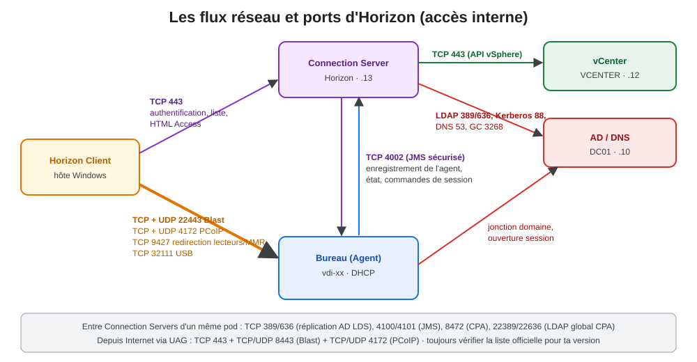

---

## 2. Avant de commencer

| ✓ | Prérequis | Page |
|---|---|---|
| ☐ | VM Horizon à jour, IP fixe .13, DNS .10, dans OU=Serveurs, A et PTR OK | 08 |
| ☐ | Session ouverte en **LAB\adm-hzn-afaye**, administrateur local via `GG-HZN-Admins` | 08 |
| ☐ | Modèle **LAB-HorizonServer** créé et publié, VM Horizon **redémarrée** depuis : [page 08, partie 3](/fr/hyperviseur/VDI/08-preparation-horizon) (3.1 créer le modèle, 3.2 le publier) | 08 |
| ☐ | Installeur Connection Server copié, **même version que l'Agent** de la golden image | 08, 09 |
| ☐ | Licence d'évaluation **demandée** à Omnissa (partie 5.1). Compte quelques jours : tout le reste de la page se fait sans elle | 5.1 |
| ☐ | Mot de passe de `svc-horizon-vc` et de `svc-horizon-ic` à portée (coffre) | 04 |

> ⚠️ **La même version partout.** Le Connection Server et l'Agent de la golden image doivent avoir **la même version**. Dans le lab, c'est la **2412** (8.14.0) pour les deux : `Omnissa-Horizon-Connection-Server-x86_64-2412-…exe` et `Omnissa-Horizon-Agent-x86_64-2412-8.14.0-…exe`. Regarde le nom des deux installeurs avant de commencer. Si tu as déjà installé une autre version du Connection Server, relance l'installeur de la bonne version : il fait la mise à niveau sur place.

### 2.1 Vérifier le serveur

Sur la VM Horizon, en session `LAB\adm-hzn-afaye`, ouvre PowerShell avec un **clic droit > Exécuter en tant qu'administrateur**. Si Windows demande un mot de passe au lieu d'un simple **Oui**, `GG-HZN-Admins` n'est pas administrateur local : reviens à la page 08, partie 2.3.

| Ce qu'on vérifie | Commande | Attendu |
|---|---|---|
| Le compte et ses droits | `whoami /groups \| findstr /i "GG-HZN-Admins"` puis `Get-LocalGroupMember -SID S-1-5-32-544` | `LAB\GG-HZN-Admins` dans les deux |
| La relation avec le domaine | `Test-ComputerSecureChannel` | `True` |
| L'OU | `([adsisearcher]"(&(objectClass=computer)(name=$env:COMPUTERNAME))").FindOne().Path` | contient `OU=Serveurs` |
| L'IP | `Get-NetIPConfiguration` | IP **.13**, passerelle **.2**, DNS **.10** seulement |
| Le DNS | `nslookup horizon.lab.lan` puis `nslookup 192.168.50.13` | les deux répondent (A et PTR) |
| L'heure | `w32tm /stripchart /computer:dc01.lab.lan /samples:3 /dataonly` | écart de moins d'une seconde |
| Les flux | `Test-NetConnection 192.168.50.12 -Port 443`, puis vers `dc01.lab.lan` les ports **389** et **88** | `TcpTestSucceeded : True` |
| La racine de confiance | `Get-ChildItem Cert:\LocalMachine\Root \| Where-Object Subject -like "*LAB-ROOT-CA*"` | LAB-ROOT-CA présente |
| Le modèle publié | `certutil -CATemplates -config "DC01.lab.lan\LAB-ROOT-CA" \| findstr /i "LAB-HorizonServer"` | la ligne apparaît, avec **Accès refusé** |
| Redémarrage en attente | `Test-Path 'HKLM:\SOFTWARE\Microsoft\Windows\CurrentVersion\Component Based Servicing\RebootPending'` | `False` |
| L'installeur | `Get-AuthenticodeSignature <chemin du .exe>` | `Valid`, signé par **Omnissa** |

> 🔒 **« Accès refusé » sur le modèle, c'est bon signe.** `certutil` teste les droits de l'utilisateur connecté. Seul le compte ordinateur **HORIZON$** a le droit *Inscrire* sur LAB-HorizonServer : un administrateur ne peut pas obtenir ce certificat à la place du serveur. Le vrai test se fait en 4.1, au nom de la machine.

Tout est bon ? **Éteins la VM** et prends un **snapshot** `avant-connection-server`.

---

## 3. L'assistant d'installation

Clic droit sur `Omnissa-Horizon-Connection-Server-x86_64-….exe` > **Exécuter en tant qu'administrateur** :

L'assistant s'affiche dans la langue de Windows :

| Écran | Choix |
|---|---|
| Bienvenue | **Suivant** |
| Contrat de licence | **J'accepte** > **Suivant** |
| Dossier de destination | Par défaut > **Suivant** |
| **Options d'installation** | **Serveur standard Horizon** · ☑ **Installer Web Client** · protocole **IPv4** > **Suivant** |
| **Récupération de données** | Un **mot de passe de récupération**, deux fois. Il sert à restaurer la configuration Horizon : **range-le dans ton coffre**. Laisse le rappel vide : il serait lisible par d'autres administrateurs |
| **Configuration du pare-feu** | ● **Configurer automatiquement le pare-feu Windows** |
| **Instances initiales d'Horizon Administrator** | ● **Autoriser un utilisateur ou un groupe de domaine spécifique** > `LAB\GG-HZN-Admins` |
| Programme d'amélioration de l'expérience client | **Décoche** la participation |
| Prêt à installer | **Installer** (5 à 10 minutes) |

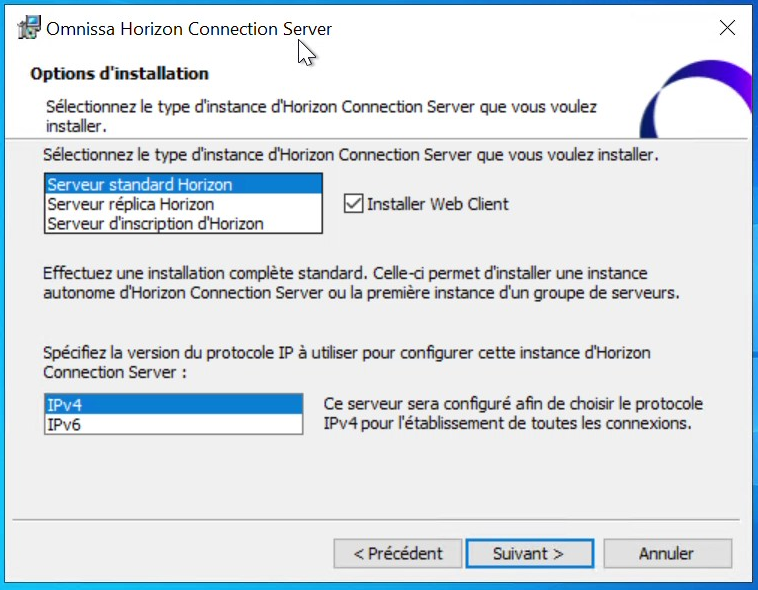

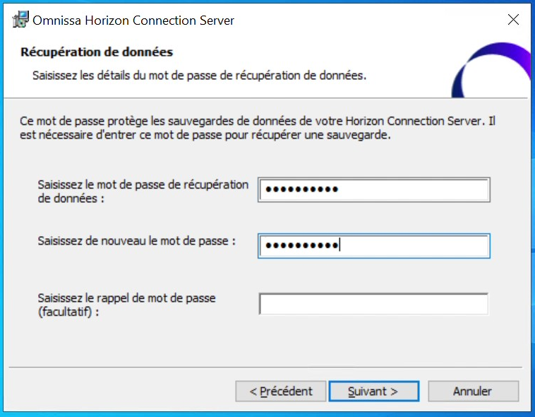

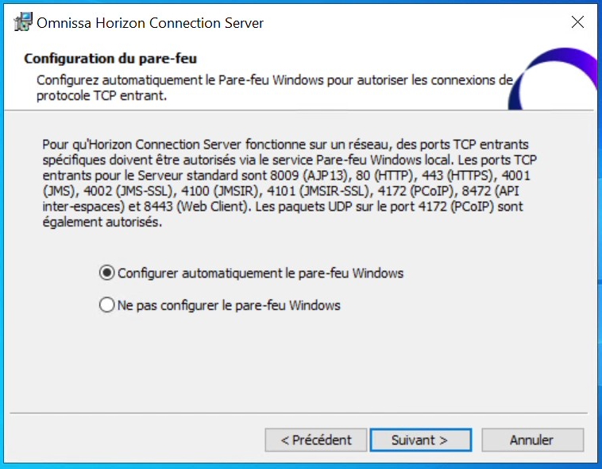

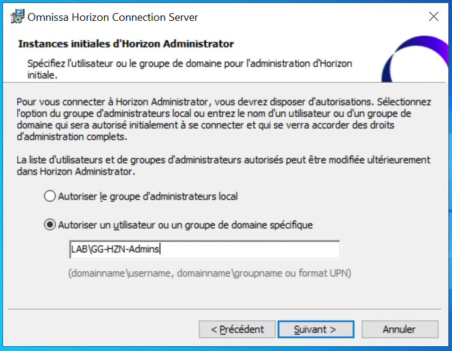

> 🔒 **Pourquoi un groupe ?** Par défaut, Horizon donne la console à tous les administrateurs locaux du serveur. Avec `GG-HZN-Admins`, l'accès se gère dans l'AD.

L'écran **Fin du programme d'installation** indique la **version du produit** en bas à gauche : vérifie qu'elle est la même que celle de l'Agent. **Terminer**. Pas de redémarrage nécessaire.

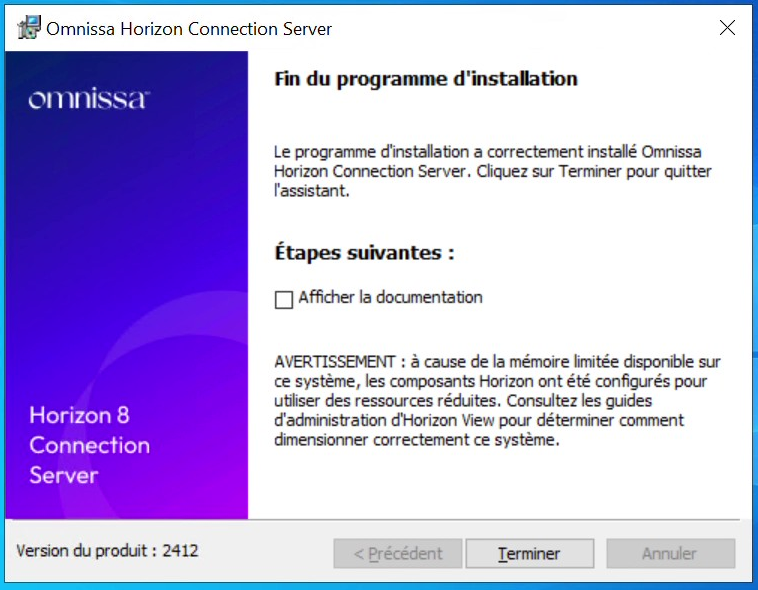

> ℹ️ **« Mémoire limitée disponible » :** Horizon recommande 10 Go de RAM pour un serveur de production. Avec moins (5 Go dans le lab), il se configure pour consommer moins de ressources. C'est **normal et suffisant** pour quelques bureaux.

**Contrôle :**

1. `services.msc` : **Omnissa Horizon Connection Server** est **En cours d'exécution**, démarrage **Automatique**. Les services *Blast Secure Gateway*, *Framework Manager* et *Passerelle sécurisée* tournent aussi.

   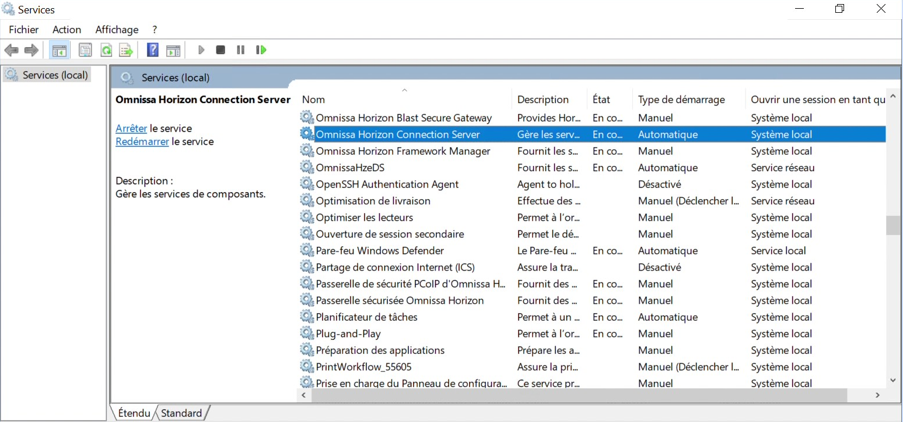

2. **Sur la VM Horizon**, icône **Horizon Administrator** du bureau, ou `https://horizon.lab.lan/admin` : la page de connexion s'ouvre, avec une **alerte de certificat**. C'est normal à ce stade.

> ⚠️ **Ouvre la console par son nom, jamais par son IP.** Avec `https://192.168.50.13/admin`, la page affiche **« Échec du chargement de la page »** : Horizon refuse les connexions à la console qui n'arrivent pas par son nom. Depuis ton PC, il faut d'abord qu'il résolve `horizon.lab.lan` (partie 7).
>
> 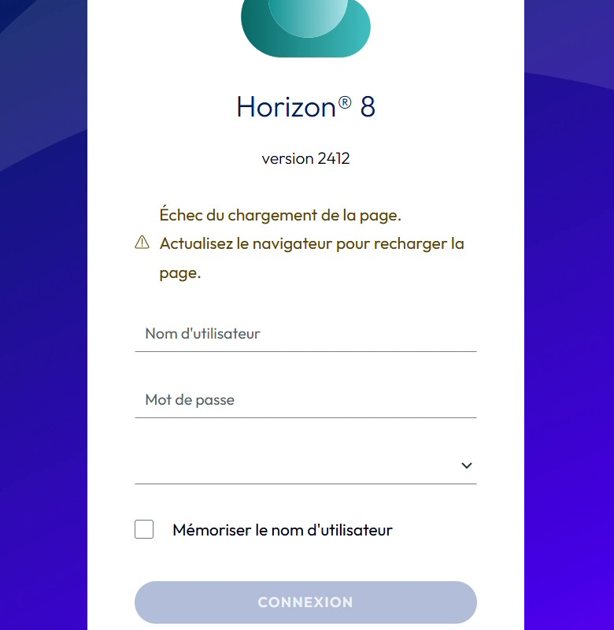

---

## 4. Remplacer le certificat auto-signé

Horizon utilise le certificat dont le **nom convivial** est exactement **`vdm`**. On en installe un nouveau, on lui donne ce nom, et on le retire à l'ancien.

### 4.1 Demander le certificat

1. **Win + R** > `certlm.msc` > **Personnel > Certificats** > clic droit > **Toutes les tâches > Demander un nouveau certificat…**
2. **Suivant** > **Stratégie d'inscription Active Directory** > **Suivant**.
3. ☑ **LAB-HorizonServer** (statut **Disponible**) > **Inscription** > **Terminer**.

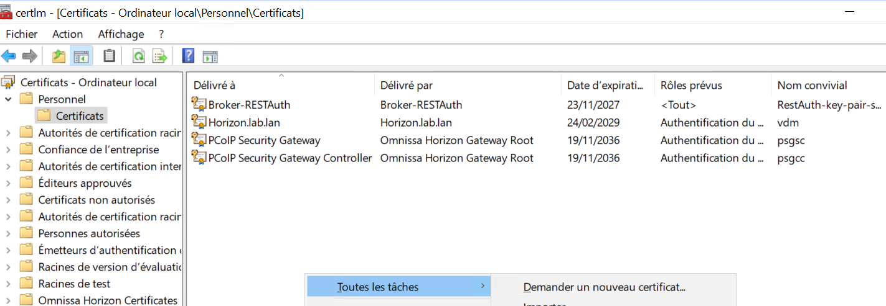

> Le magasin contient déjà des certificats créés par Horizon : **Broker-RESTAuth**, **PCoIP Security Gateway** (`psgsc`) et **PCoIP Security Gateway Controller** (`psgcc`). Ils servent aux composants internes : **n'y touche pas**. Seul le certificat `vdm` nous intéresse.

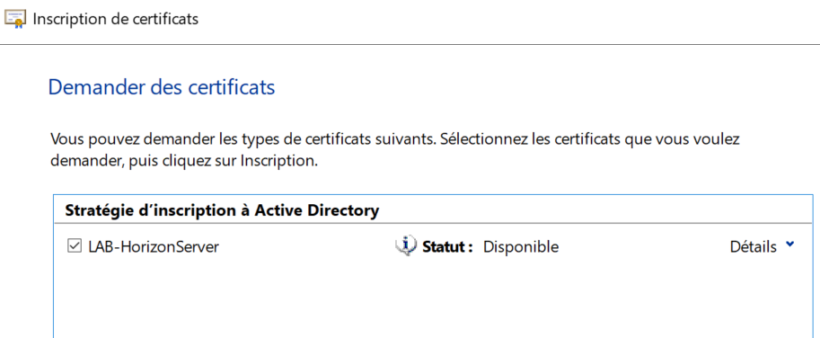

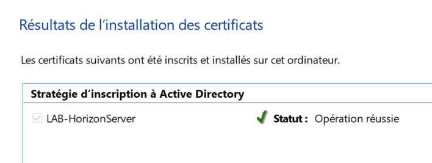

> **Le modèle n'apparaît pas ?** Coche **Afficher tous les modèles** : la raison s'affiche. Le plus souvent, c'est le droit *Inscrire* de HORIZON$ ou la VM non redémarrée : revois l'onglet **Sécurité** du modèle en [page 08, partie 3.1](/fr/hyperviseur/VDI/08-preparation-horizon).

### 4.2 Les noms conviviaux

Il y a maintenant deux certificats `horizon.lab.lan` :

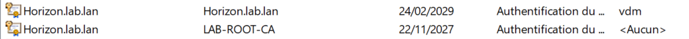

| Certificat | Comment le reconnaître | Action |
|---|---|---|
| Ancien, auto-signé | **Délivré par** : horizon.lab.lan · nom convivial `vdm` | Clic droit > **Propriétés** > nom convivial **`vdm-old`** > **OK** |
| Nouveau | **Délivré par** : **LAB-ROOT-CA** | Clic droit > **Propriétés** > nom convivial **`vdm`** > **OK** |

Sur le nouveau, onglet **Détails** > *Autre nom de l'objet* : `Nom DNS=Horizon.lab.lan`.

### 4.3 Redémarrer le service

`services.msc` > **Omnissa Horizon Connection Server** > **Redémarrer** (les services associés suivent).

**Attends 3 à 5 minutes** avec une VM à 5 Go de RAM. Le port 443 est ouvert en dernier, par la **Passerelle sécurisée Omnissa Horizon** (service `wstunnel`). Tant qu'elle n'a pas fini de démarrer, le navigateur affiche **ERR_CONNECTION_TIMED_OUT** alors que tous les services sont « En cours d'exécution ». Pour savoir si c'est prêt, sur la VM :

```powershell
netstat -ano | findstr LISTENING | findstr ":443"
```

Une ligne `0.0.0.0:443 … LISTENING` : c'est prêt.

### 4.4 Contrôle

Ferme et rouvre le navigateur > `https://horizon.lab.lan/admin` : **cadenas**, certificat délivré par **LAB-ROOT-CA**, aucune alerte. Depuis ton PC, l'alerte ne disparaît qu'une fois LAB-ROOT-CA importée (partie 7).

| Avant : certificat auto-signé | Après : certificat LAB-ROOT-CA |
|---|---|
| 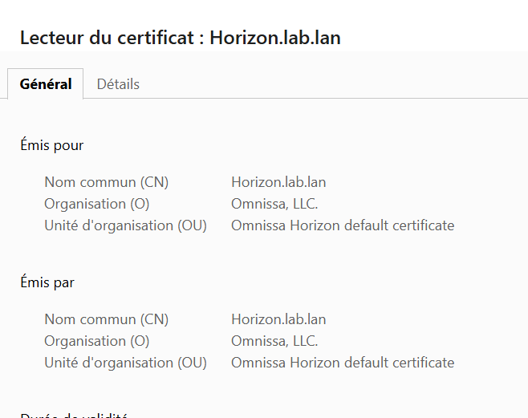 | 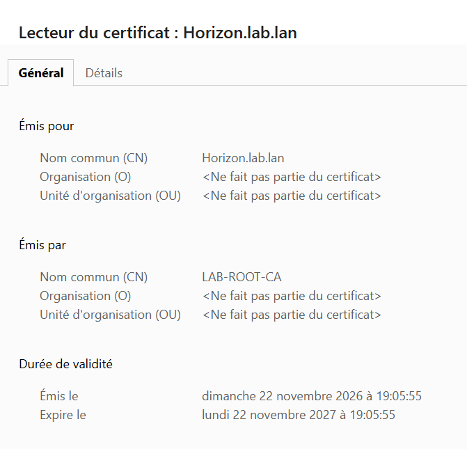 |

**Avant**, le certificat est émis **par lui-même** (*Omnissa Horizon default certificate*) : aucun navigateur ne peut lui faire confiance. **Après**, il est émis par **LAB-ROOT-CA**, que tout le domaine connaît déjà. Organisation et unité sont vides : le modèle LAB-HorizonServer ne reprend que le nom DNS tiré de l'AD, et c'est tout ce qu'il faut.

> 🔁 **Renouvellement :** ce certificat expire dans **1 an**. Refais 4.1 à 4.3 un mois avant : un seul certificat doit porter le nom `vdm`. Note la date.

---

## 5. Configurer Horizon dans la console

`https://horizon.lab.lan/admin`, connecté en **adm-hzn-afaye**, domaine **LAB**. Tant que la partie 7 n'est pas faite, ouvre-la **depuis la VM Horizon**.

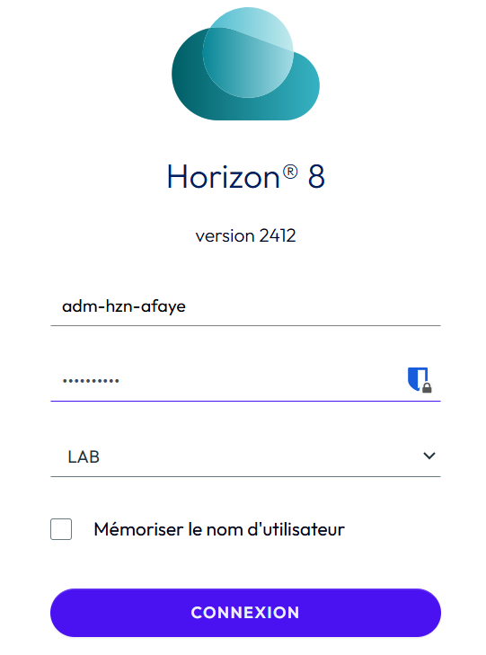

### 5.1 La licence

Sans licence, la **console d'administration** (`/admin`) fonctionne et tout le reste de la partie 5 se configure. Une alerte « licence » s'affiche en haut de la console en attendant.

Côté **utilisateurs**, en revanche, rien ne passe. Le portail `https://horizon.lab.lan` avec **Web Client** (ou Horizon Client) refuse la connexion : *« La clé de licence d'Horizon Connection Server n'est pas valide »*. C'est normal tant que la clé n'est pas saisie. La licence est indispensable pour le premier bureau (page 11).

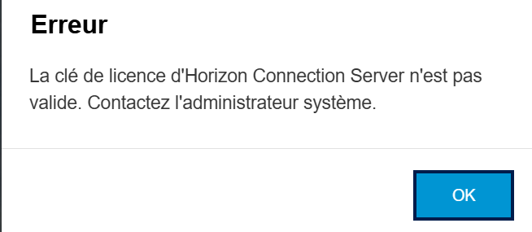

#### Demander une licence d'évaluation

Omnissa ne propose **pas de clé en libre-service** : il faut la demander.

1. Ouvre le forum de la communauté Omnissa : **https://community.omnissa.com/forums/** et connecte-toi avec ton compte Omnissa (celui qui sert aux téléchargements).
2. Va dans la section **Horizon 8** > **Trial Licenses** > **Start new topic**.
3. Un titre clair, par exemple *Horizon 8 evaluation license request - personal training lab*, et un message en anglais qui décrit le lab :

   ```
   Hello,

   I am building a personal training lab to learn Omnissa Horizon 8 and
   document it for a technical course (non-production use).

   Lab details:
   - Horizon 8 version 2412 (8.14), 1 Connection Server
   - vSphere 8.0.3 (vCenter + 1 nested ESXi host)
   - Instant clone pool, Windows 11 desktops
   - Expected size: 2 to 5 concurrent desktops

   Could you please provide a 60-day evaluation license key for Horizon 8?

   Thank you
   ```

4. **Submit**. Le sujet attend la validation d'un **modérateur** : c'est normal pour un nouveau compte.

   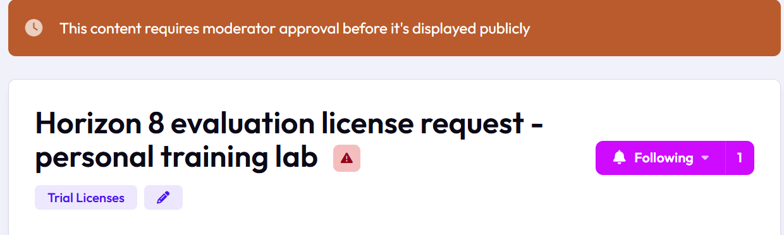

5. La réponse arrive en général par **message privé** sur le forum : surveille la cloche des notifications et ta boîte mail. Compte **quelques jours ouvrés** avant de relancer.

> **Autre voie :** le formulaire de contact d'Omnissa, **https://www.omnissa.com/contact**, c'est celui qu'indique le guide d'évaluation officiel. Colle le même texte dans le message.
>
> 🔒 **Méfie-toi des « clés gratuites » trouvées sur le web.** Ce sont des clés volées ou fausses, souvent accompagnées d'un téléchargement piégé (lien camouflé, fichier sur un Drive anonyme). N'installe jamais un Horizon qui ne vient pas du portail Omnissa, et n'entre jamais une clé qui ne vient pas d'Omnissa.

#### Saisir la licence

Sans licence, une bannière rouge s'affiche en haut de la console : *« Aucune licence Horizon trouvée »*.

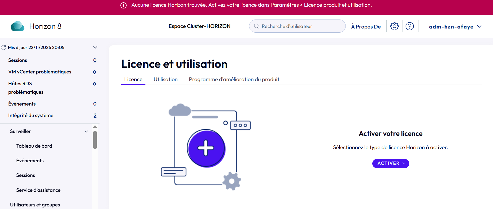

1. **Paramètres > Licence produit et utilisation** > onglet **Licence** > **ACTIVER** (menu déroulant).
2. Choisis l'activation par **clé de licence**, et non par abonnement en ligne : la clé d'évaluation est une clé classique.
3. Colle la clé > **OK**.
4. **Contrôle :** date d'expiration et fonctions affichées (*Clone instantané*…). **Note la date d'expiration** : à la fin de l'évaluation, les bureaux ne démarrent plus.

### 5.2 Le vCenter

1. **Paramètres > Serveurs** > onglet **vCenter Server** > **Ajouter**.

| Champ | Valeur |
|---|---|
| Adresse du serveur | **`192.168.50.12`** |
| Nom d'utilisateur | `svc-horizon-vc@lab.lan` |
| Mot de passe | Celui du compte |
| Port | **443** (par défaut) |
| Type de déploiement | **Général** |
| Paramètres avancés | Par défaut (20 opérations de provisionnement simultanées, etc.) |

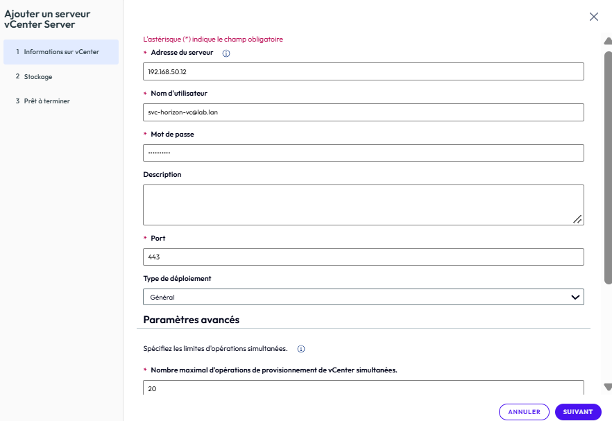

> ⚠️ **L'IP, pas un nom :** c'est le PNID du vCenter, et son certificat est émis pour elle (pages 03 et 07).

2. **Suivant**.
   - Si tu as fait la page 07, le certificat du vCenter est **émis par LAB-ROOT-CA** : aucune alerte.
   - Sinon, la fenêtre **Certificat non valide détecté** s'ouvre (certificat de la VMCA) : **Afficher le certificat**, vérifie que c'est bien le vCenter, **Accepter**.
3. **Stockage** : laisse ☑ **Récupérer l'espace disque de machine virtuelle** et ☑ **Activer View Storage Accelerator** (cache de l'hôte **1024 Mo**). L'hôte `/DC-LAB/host/CL-LAB/192.168.50.11` apparaît avec la valeur par défaut > **Suivant** > **Envoyer**.

   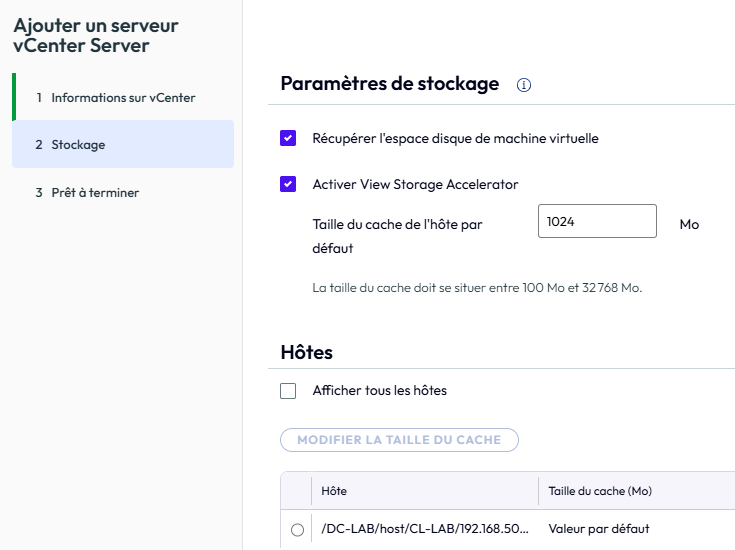

4. **Contrôle :** **Paramètres > Serveurs** > onglet **Instances de vCenter Server** : `192.168.50.12(svc-horizon-vc@lab.lan)` avec des coches vertes partout, y compris **Provisionnement** et **VM parentes d'Instant Clone**. Dans **Surveiller > Tableau de bord**, le vCenter est **vert**.

   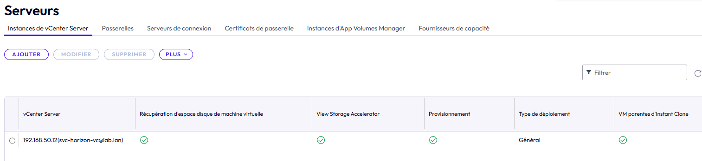

> **Erreur de privilège ?** Revois le rôle et l'autorisation **sur l'objet vCenter** (page 08, partie 4).

### 5.3 Le compte de jonction au domaine

1. **Paramètres > Domaines** > onglet **Comptes de domaine** > **Ajouter**. Dans les anciennes versions, ce menu s'appelait *Administrateurs de domaine Instant Clone*.
2. **Nom de domaine complet** : **lab.lan** · **Nom d'utilisateur** : `svc-horizon-ic` (sans `LAB\` ni `@lab.lan`, le domaine est déjà choisi) · **Mot de passe** > **OK**.

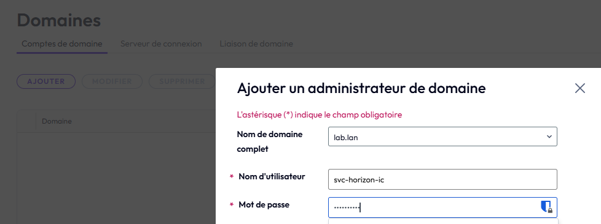

3. **Contrôle :** la ligne `lab.lan` / `svc-horizon-ic` apparaît dans **Comptes de domaine**.

> Ce compte ne peut agir que dans `OU=Postes` (page 04, partie 7). C'est pour ça qu'on peut le confier à Horizon.

### 5.4 Les administrateurs en lecture seule

1. **Paramètres > Administrateurs** > onglet **Utilisateurs et groupes administrateurs** > **Ajouter un utilisateur ou un groupe**.
2. **Ajouter** > `GG-HZN-ReadOnly` > **OK**.
3. Rôle **Administrateurs (lecture seule)**, groupe d'accès **/ (Racine)** > **Terminer**.
4. **Contrôle :** `GG-HZN-Admins` (Administrateurs) et `GG-HZN-ReadOnly` (lecture seule).

### 5.5 Les paramètres globaux

**Paramètres > Paramètres globaux** > **Modifier** :

| Onglet | Réglage |
|---|---|
| Général | **Délai d'expiration de la session Horizon Console** : 30 min |
| Général | **Délai d'expiration de la session de client** : 10 h |
| Sécurité | ☑ **Réauthentifier les connexions sécurisées après interruption réseau** |
| Sécurité | ☑ **Forcer la déconnexion des utilisateurs lors du retrait de la carte à puce** (sans effet ici, bonne habitude) |

### 5.6 La base d'événements

Horizon affiche un avertissement tant qu'aucune **base d'événements** (SQL Server ou PostgreSQL) n'est configurée. Dans le lab, **ignore-le**. Elle servira plus tard à garder l'historique des connexions.

---

## 6. Contrôle de santé

**Surveiller > Tableau de bord > État du système** :

| Composant | Attendu |
|---|---|
| Connection Server | Vert |
| vCenter Server | Vert |
| Domaines | `lab.lan` vert |
| Base d'événements | Avertissement (normal) |

Tout est vert ? **Supprime le snapshot** de la VM Horizon.

---

## 7. Depuis ton PC (hors domaine)

Ton PC doit **résoudre** `horizon.lab.lan` et **faire confiance** à LAB-ROOT-CA.

1. **DNS :** la carte **VMnet8** du PC utilise `192.168.50.10` (page 03). À défaut, ajoute `192.168.50.13  horizon.lab.lan` dans `C:\Windows\System32\drivers\etc\hosts` (Bloc-notes en administrateur).
2. **Certificat racine :** copie `lab-root-ca.cer` (exporté dans `C:\PKI\vcenter\` en page 07, partie 1.5, étape 2) sur le PC.
   - Double-clic > **Installer le certificat** > **Ordinateur local** > **Placer tous les certificats dans le magasin suivant** > **Autorités de certification racines de confiance** > **Terminer**.
3. Ouvre `https://horizon.lab.lan/admin` : plus d'alerte. Le vSphere Client (`https://192.168.50.12/ui`) non plus, si la page 07 est faite.

> 🔒 On n'importe **que le certificat racine**, jamais une clé privée. Ton PC fait désormais confiance à tout ce que signe LAB-ROOT-CA : c'est une raison de plus pour garder la CA verrouillée (page 05).

Le client Horizon et la première connexion à un bureau sont en page 11.

---

## 8. Checklist

| ✓ | Vérification |
|---|---|
| ☐ | Service Connection Server démarré, automatique |
| ☐ | Mot de passe de récupération rangé dans le coffre |
| ☐ | Console réservée à `GG-HZN-Admins`, lecture seule pour `GG-HZN-ReadOnly` |
| ☐ | Un seul certificat `vdm`, délivré par LAB-ROOT-CA, date de renouvellement notée |
| ☐ | Licence active |
| ☐ | vCenter ajouté **par son IP** avec `svc-horizon-vc`, état vert |
| ☐ | `svc-horizon-ic` déclaré comme administrateur de domaine Instant Clone |
| ☐ | Paramètres globaux de sécurité appliqués |
| ☐ | PC : `horizon.lab.lan` résolu, LAB-ROOT-CA de confiance |
| ☐ | Snapshot de la VM Horizon supprimé |

---

## 9. Dépannage

| Symptôme | Cause probable | Solution |
|---|---|---|
| L'ajout du vCenter échoue (« permission ») | Rôle mal posé | Rôle **sur l'objet vCenter**, propagé (page 08, partie 4) |
| L'ajout échoue (« le nom ne correspond pas ») | Ajouté par son nom | Ajoute-le par **192.168.50.12** |
| LAB-HorizonServer absent de certlm | Droit *Inscrire* ou VM non redémarrée | Page 08, partie 3, puis redémarre |
| Toujours l'ancien certificat | Nom convivial | Un seul certificat `vdm`, puis redémarre le service |
| Connexion à la console refusée pour adm-hzn-afaye | Pas dans `GG-HZN-Admins`, ou groupe mal saisi à l'installation | **Paramètres > Administrateurs** avec un autre compte admin, ou vérifie le groupe dans l'AD |
| Avertissement « base d'événements » | Non configurée | Normal (5.6) |
| `ERR_CONNECTION_TIMED_OUT` juste après un redémarrage | La passerelle (`wstunnel`) n'a pas fini de démarrer, rien n'écoute encore sur 443 | Attends 3 à 5 minutes, contrôle avec `netstat` (4.3) |
| Console : « Échec du chargement de la page » | Ouverte par l'IP `192.168.50.13` | Ouvre `https://horizon.lab.lan/admin` (partie 7 pour le PC) |
| Fin d'installation : « mémoire limitée disponible » | Moins de 10 Go de RAM | Normal dans le lab (partie 3) |
| Web Client ou Horizon Client : « La clé de licence d'Horizon Connection Server n'est pas valide » | Pas de licence, ou évaluation expirée | Normal avant la 5.1. Pour administrer, utilise `/admin` |
**Journaux :** `C:\ProgramData\Omnissa\Horizon\logs\debug-….txt` (anciennes versions : `C:\ProgramData\VMware\VDM\logs`).

---

## 10. Quiz

<details><summary><b>1. Comment Horizon sait-il quel certificat utiliser ?</b></summary> <p>Il prend le certificat de l'ordinateur dont le nom convivial est exactement vdm. Il ne doit y en avoir qu'un.</p></details>

<details><summary><b>2. Pourquoi ajouter le vCenter par 192.168.50.12 et pas vcenter.lab.lan ?</b></summary> <p>C'est son PNID : ses certificats sont émis pour cette IP. Avec le nom, la vérification du certificat échouerait.</p></details>

<details><summary><b>3. À quoi sert le mot de passe de récupération demandé à l'installation ?</b></summary> <p>À restaurer la configuration Horizon depuis une sauvegarde. Sans lui, la sauvegarde est inutilisable.</p></details>

<details><summary><b>4. Pourquoi choisir GG-HZN-Admins comme administrateurs initiaux ?</b></summary> <p>Pour que l'accès à la console se gère dans l'AD, au lieu de le donner à tous les administrateurs locaux du serveur.</p></details>

<details><summary><b>5. Pourquoi importer LAB-ROOT-CA sur ton PC, et pas sur la VM Horizon ?</b></summary> <p>La VM Horizon est dans le domaine : elle fait déjà confiance à LAB-ROOT-CA par l'AD. Ton PC n'est pas dans le domaine, il faut lui ajouter la racine à la main.</p></details>

---

[⬅ 09 - La golden image](/fr/hyperviseur/VDI/09-golden-image) · [Sommaire](/fr/hyperviseur/VDI/00-sommaire) · Page suivante : *11 - Premier pool et premier bureau (à venir)*
