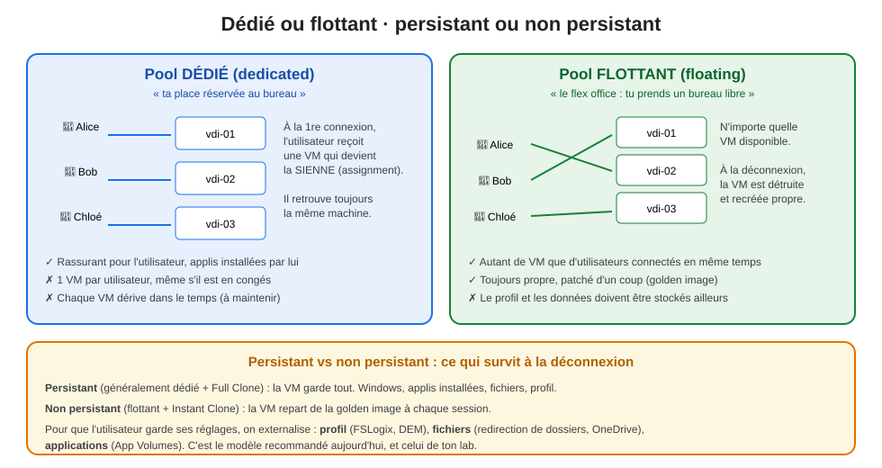
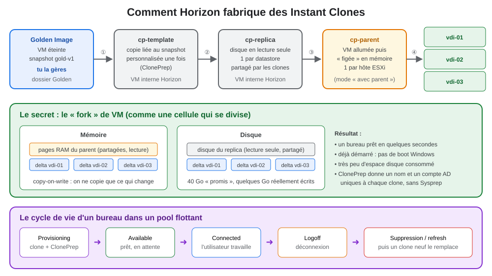
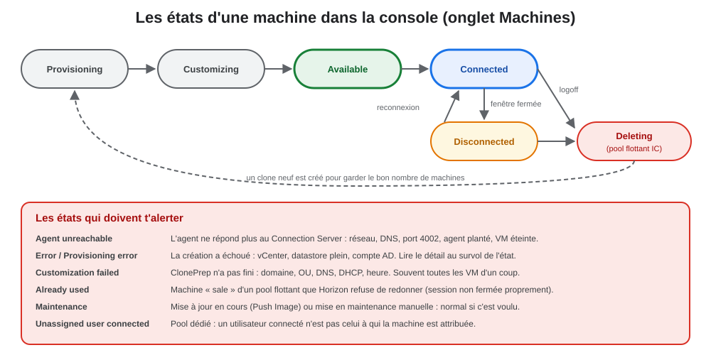

# 11 - Premier pool et premier bureau

> **Objectif de la page :** créer le premier **pool de bureaux en clones instantanés** à partir de la golden image `GI-W11`, donner le droit au groupe `GG-HZN-Users`, puis ouvrir un bureau Windows 11 depuis ton PC, avec Horizon Client et avec le navigateur.
>
> ⏸ *Cette page demande la **licence** (page 10, partie 5.1). Elle est écrite avant sa réalisation : les intitulés seront vérifiés et illustrés avec tes captures.*

---

## 1. Comprendre avant de faire

### 1.1 Le pool qu'on va créer

| Choix | Valeur | Pourquoi |
|---|---|---|
| Type | **Automatisé** | Horizon crée et détruit les VM lui-même |
| Technique | **Clones instantanés** | Création en quelques secondes, très peu de disque |
| Attribution | **Flottante** | L'utilisateur prend un bureau libre. À la déconnexion, le bureau est détruit puis recréé, propre |
| Taille | **1 bureau**, 0 en réserve | L'ESXi du lab manque de RAM |
| Droits | Groupe **`GG-HZN-Users`** | Les accès se gèrent dans l'AD |

### 1.2 Ce qu'Horizon fabrique dans le vCenter

À la création du pool, Horizon prépare des VM **internes** à partir du snapshot `v1` :

| VM interne | Rôle |
|---|---|
| `cp-template-…` | Copie de la golden image, personnalisée une fois |
| `cp-replica-…` | Disque en lecture seule, partagé par tous les clones d'une banque de données |
| `cp-parent-…` | VM allumée puis « figée » en mémoire, une par hôte. Les clones naissent d'elle |

Elles sont rangées dans le dossier **ClonePrepInternalTemplateFolder**. **N'y touche jamais** : c'est Horizon qui les gère.

> 💾 **Prévois de la place.** Le réplica fait la taille utilisée de la golden image, et chaque bureau ajoute un disque delta. La banque de données est déjà à environ 78 % (page 10, partie 6) : fais le ménage dans les snapshots et les ISO **avant** de créer le pool.

---

## 2. Avant de commencer

| ✓ | Prérequis | Page |
|---|---|---|
| ☐ | **Licence** saisie, plus de bannière rouge dans la console | 10 (5.1) |
| ☐ | `GI-W11` **éteinte**, OSOT *Finaliser* passé, snapshot **`v1-…`** pris VM éteinte | 09 |
| ☐ | Agent de la golden image dans **la même version** que le Connection Server (2412) | 10 (2) |
| ☐ | vCenter ajouté dans Horizon, tout vert | 10 (5.2) |
| ☐ | `svc-horizon-ic` déclaré dans **Paramètres > Domaines > Comptes de domaine** | 10 (5.3) |
| ☐ | Étendue DHCP active (.100 à .150, bail de 8 h, DNS 192.168.50.10) | 04 |
| ☐ | Délégation de `svc-horizon-ic` sur `OU=Postes,OU=VDI,OU=LAB` | 04 |
| ☐ | `GG-HZN-Users` contient `afaye`, `user-test01`, `user-test02` | 04 |
| ☐ | Au moins **4 Go de RAM libres** sur esx01 (vSphere Client > esx01 > **Résumé**) | — |
| ☐ | Banque de données sous **80 %** | — |

---

## 3. Créer le pool

Console Horizon (`https://horizon.lab.lan/admin`, **adm-hzn-afaye**) > **Inventaire > Postes de travail** > **Ajouter**.

| Écran | Choix |
|---|---|
| **Type** | ● **Pool de postes de travail automatisé** |
| **vCenter Server** | ● **Clones instantanés** · vCenter **192.168.50.12** |
| **Attribution d'utilisateur** | ● **Flottante** |
| **Stockage** | Laisse **vSAN décoché** (pas de vSAN dans le lab) |
| **Identification du poste de travail** | ID : **`POOL-W11`** · Nom d'affichage : **`Bureau Windows 11`** · Groupe d'accès : **/** |
| **Paramètres de provisionnement** | ☑ Activer le provisionnement · Modèle de nommage : **`VDI-W11-{n:fixed=2}`** · **Nombre maximal de machines : 1** · **Machines de réserve : 0** · ● Provisionner toutes les machines au départ |
| **Paramètres vCenter** | voir le tableau 3.1 |
| **Paramètres du pool** | voir le tableau 3.2 |
| **Personnalisation d'invité** | voir le tableau 3.3 |
| **Prêt à terminer** | ☑ **Accorder des droits aux utilisateurs une fois l'assistant terminé** > **Envoyer** |

> **`{n:fixed=2}`** numérote sur 2 chiffres : `VDI-W11-01`, `VDI-W11-02`… Un nom Windows ne dépasse pas **15 caractères** : garde le préfixe court.

### 3.1 Paramètres vCenter

| Champ | Valeur |
|---|---|
| Image parente | **GI-W11** |
| Snapshot | **`v1-…`** (celui de la page 09) |
| Dossier de VM | **DC-LAB > VDI > Pools** |
| Cluster | **CL-LAB** |
| Pool de ressources | **CL-LAB** (celui du cluster) |
| Banques de données | La banque de données d'esx01. Un avertissement « un seul hôte » ou « non recommandé » peut apparaître : normal dans le lab |
| Réseau | ● **Utiliser le réseau de l'image parente** (VM Network) |

### 3.2 Paramètres du pool

| Réglage | Valeur | Pourquoi |
|---|---|---|
| État | **Activé** | |
| Protocole d'affichage par défaut | **VMware Blast** | Le protocole moderne d'Horizon (page 02) |
| Autoriser les utilisateurs à choisir le protocole | **Non** | Un seul protocole à sécuriser et à dépanner |
| HTML Access (Web Client) | ☑ **Activé** | Pour ouvrir le bureau dans le navigateur |
| Fermer la session après une déconnexion | **Après 60 minutes** | Une session oubliée libère le bureau, qui est recréé propre |
| Redémarrage / actualisation à la fermeture de session | Par défaut (le clone est **supprimé** à la fermeture de session) | Le principe du non persistant |

### 3.3 Personnalisation d'invité

| Champ | Valeur |
|---|---|
| Domaine | **lab.lan** (compte **svc-horizon-ic**) |
| Conteneur AD | **`OU=Postes,OU=VDI,OU=LAB`** (bouton **Parcourir**) |
| Autoriser la réutilisation de comptes d'ordinateur existants | ☐ Non coché |
| Scripts de personnalisation | Aucun |

> 🔒 **Pourquoi ce conteneur ?** `svc-horizon-ic` n'a de droits que sur `OU=Postes` (page 04). Avec un autre conteneur, la jonction échoue : c'est voulu. Les bureaux reçoivent aussi les GPO de cette OU (page 12).

### 3.4 Donner le droit au groupe

La fenêtre **Ajouter des droits** s'ouvre après **Envoyer** :

1. **Ajouter** > ☑ **Groupes**, domaine **lab.lan**, nom *Commence par* `GG-HZN-Users` > **Rechercher**.
2. Coche **GG-HZN-Users** > **OK** > **OK**.

> 🔒 Donne toujours les droits à un **groupe**, jamais à des utilisateurs un par un. Pour retirer l'accès à quelqu'un, il suffit de le sortir du groupe dans l'AD.

Pour revoir les droits plus tard : **Utilisateurs et groupes** > **Droits**, ou **Inventaire > Postes de travail > POOL-W11** > onglet **Droits**.

---

## 4. Suivre la création

1. **Inventaire > Postes de travail > POOL-W11** > onglet **Machines**.
2. L'état défile : **Provisionnement** > **Personnalisation** > **Disponible**. La première fois, compte **10 à 20 minutes** : Horizon prépare d'abord les VM internes.
3. Dans le **vSphere Client** :
   - le dossier **ClonePrepInternalTemplateFolder** apparaît avec `cp-template`, `cp-replica` et `cp-parent` ;
   - `VDI-W11-01` apparaît dans **VDI > Pools** ;
   - les tâches sont lancées par **`svc-horizon-vc@lab.lan`**, jamais par ton compte : c'est la preuve que le moindre privilège fonctionne.
4. Sur **DC01** :
   - *Utilisateurs et ordinateurs Active Directory* : l'ordinateur **VDI-W11-01** est dans **LAB > VDI > Postes** ;
   - console **DHCP** > **Baux d'adresses** : `VDI-W11-01.lab.lan` a une adresse entre .100 et .150.

---

## 5. Ouvrir le premier bureau

### 5.1 Avec Horizon Client

Sur ton PC (la partie 7 de la page 10 est faite : il résout `horizon.lab.lan` et fait confiance à LAB-ROOT-CA).

1. Télécharge **Omnissa Horizon Client pour Windows** sur le portail Omnissa, ou depuis `https://horizon.lab.lan` > **Installer Omnissa Horizon Client**.
2. Installe-le avec les options par défaut, puis redémarre si demandé.
3. Ouvre Horizon Client > **+ Ajouter un serveur** > `horizon.lab.lan` > **Connexion**.
4. **Aucun avertissement de certificat** ne doit apparaître. S'il y en a un, la racine LAB-ROOT-CA manque sur le PC, ou le nom saisi n'est pas `horizon.lab.lan`.
5. Utilisateur **`user-test01`**, domaine **LAB** > **Connexion**.
6. Double-clic sur **Bureau Windows 11** : le bureau s'ouvre.

**Dans le bureau, vérifie :**

| Commande ou écran | Attendu |
|---|---|
| `hostname` | `VDI-W11-01` |
| `whoami` | `lab\user-test01` |
| `ipconfig` | une IP entre .100 et .150, DNS 192.168.50.10 |
| `gpresult /r` | l'ordinateur est dans `OU=Postes,OU=VDI,OU=LAB` |

### 5.2 Avec le navigateur (Web Client)

`https://horizon.lab.lan` > **Omnissa Horizon Web Client** > mêmes identifiants > **Bureau Windows 11**. Pratique depuis un poste où l'on ne peut rien installer.

### 5.3 Côté console

- **Surveiller > Sessions** : la session de `user-test01` apparaît, avec la machine, le protocole **BLAST** et l'heure de début.
- Ferme la session dans le bureau (**Démarrer > user-test01 > Se déconnecter**). Dans l'onglet **Machines**, `VDI-W11-01` passe en **Suppression**, puis un nouveau clone est créé et redevient **Disponible** en moins d'une minute.

> C'est tout l'intérêt du non persistant : chaque utilisateur reçoit un bureau **neuf**, identique à la golden image. Un logiciel malveillant installé pendant la session disparaît avec le clone. Les données et les réglages de l'utilisateur seront conservés à part (page 13).

---

## 6. Checklist

| ✓ | Vérification |
|---|---|
| ☐ | `POOL-W11` créé : clones instantanés, flottant, 1 machine, 0 en réserve |
| ☐ | Snapshot `v1-…` utilisé, dossier VDI/Pools, conteneur `OU=Postes` |
| ☐ | Droits donnés au groupe `GG-HZN-Users` uniquement |
| ☐ | `VDI-W11-01` **Disponible**, présent dans l'AD (OU=Postes) et dans le DHCP |
| ☐ | Bureau ouvert depuis le PC avec Horizon Client, **sans alerte de certificat** |
| ☐ | Bureau ouvert avec le Web Client |
| ☐ | À la fermeture de session, le clone est détruit et recréé |

---

## 7. Dépannage

| Symptôme | Cause probable | Solution |
|---|---|---|
| Le pool reste en **Provisionnement**, erreur « espace disque » | Banque de données pleine | Supprime des snapshots et des ISO, puis **Récupérer** sur la machine |
| Machine en **Erreur de personnalisation** | DHCP ou DNS | Étendue DHCP active, DNS 192.168.50.10 donné aux clients (page 04) |
| « Impossible de joindre le domaine » | Compte ou conteneur | `svc-horizon-ic` dans *Comptes de domaine*, conteneur `OU=Postes,OU=VDI,OU=LAB`, délégation (page 04) |
| Machine en **Agent injoignable** | Agent absent, mal installé, ou pare-feu | Réinstalle l'Agent après les Tools, nouveau snapshot, puis nouvelle image sur le pool (page 13) |
| Le snapshot n'apparaît pas dans l'assistant | VM allumée, ou snapshot avec mémoire | Éteins GI-W11, reprends un snapshot sans mémoire |
| Alarme **mémoire de l'hôte** dans vSphere | RAM d'esx01 | GI-W11 éteinte, 1 seul bureau, 0 en réserve |
| Horizon Client : « certificat non approuvé » | Racine absente du PC ou mauvais nom | Page 10, partie 7, et `horizon.lab.lan` exactement |
| « Aucun poste de travail disponible » | Droits ou pool désactivé | Onglet **Droits** du pool : `GG-HZN-Users`. Pool **Activé** |
| Écran noir à l'ouverture du bureau | Pilote vidéo ou VRAM | Essaie le Web Client. Vérifie que les Tools sont installés avant l'Agent |

**Journaux :**
- Connection Server : `C:\ProgramData\Omnissa\Horizon\logs` ;
- dans un clone : même chemin ;
- vCenter : **Tâches récentes** et **Surveiller > Événements**, filtrés sur `svc-horizon-vc`.

---

## 8. Quiz

<b>1. Pourquoi un pool flottant non persistant est-il plus sûr qu'un pool dédié ?</b>
 
Chaque session commence sur un clone neuf, identique à la golden image. Ce qui a été installé ou modifié pendant la session disparaît avec le clone à la fermeture de session.

<b>2. À quoi sert la VM cp-replica ?</b>
 
C'est le disque en lecture seule partagé par tous les clones d'une banque de données. Chaque clone n'écrit que dans son propre disque delta.

<b>3. Pourquoi le conteneur AD du pool doit-il être OU=Postes ?</b>
 
C'est la seule OU où svc-horizon-ic a le droit de créer des comptes ordinateurs. Les bureaux y reçoivent aussi les GPO prévues pour eux.

<b>4. Dans vSphere, quel compte doit apparaître dans les tâches de création des clones ?</b>
 
svc-horizon-vc@lab.lan, le compte de service doté du rôle Horizon-InstantClone. Jamais un compte d'administrateur.

<b>5. Pourquoi donner le droit au pool à un groupe plutôt qu'à des utilisateurs ?</b>
 
L'accès se gère alors dans l'AD : on ajoute ou on retire un membre du groupe, sans toucher à Horizon. C'est plus simple et plus traçable.

---

[⬅ 10 - Installer Horizon](/fr/hyperviseur/VDI/10-installation-horizon) · [Sommaire](/fr/hyperviseur/VDI/00-sommaire) · [12 - Administrer Horizon au quotidien ➡](/fr/hyperviseur/VDI/12-administrer-horizon)
