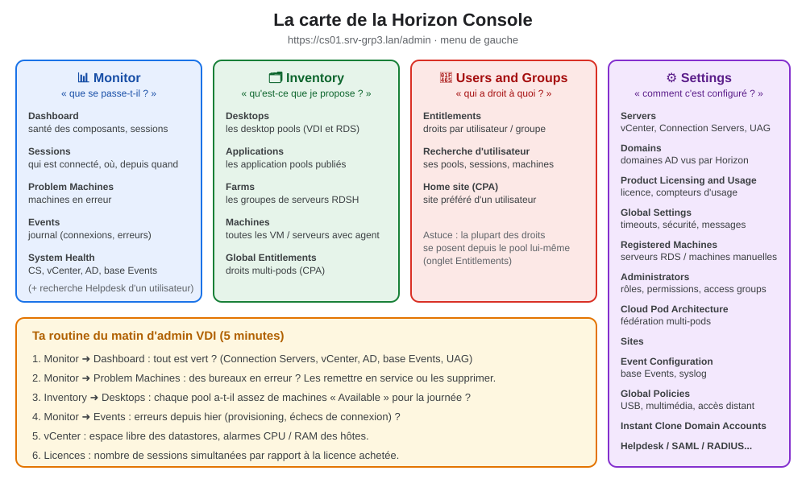
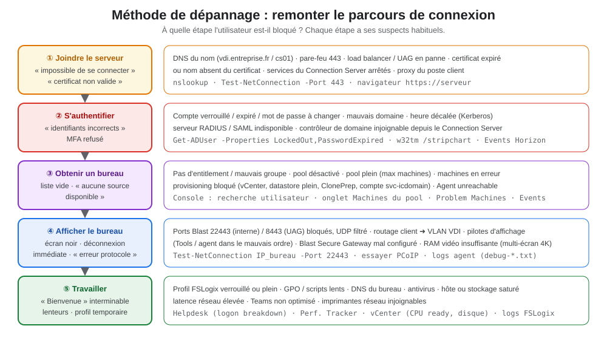
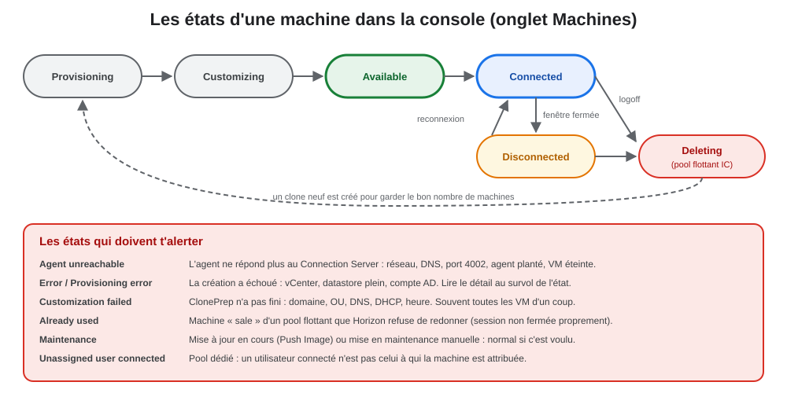
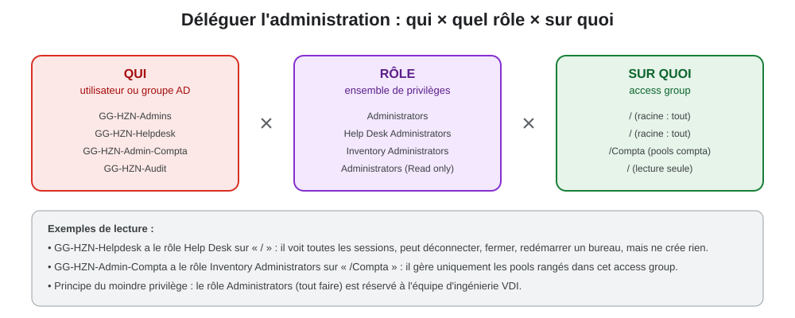

# 12 - Administrer Horizon au quotidien

> **Objectif de la page :** savoir se repérer dans la console, aider un utilisateur, gérer les sessions et les machines, déléguer le support à un groupe AD, régler l'expérience des bureaux par **GPO** de façon sécurisée, et sauvegarder la configuration.
>
> ⏸ *Les parties 3 et 4 demandent un pool qui tourne (page 11, donc la licence). Les parties 5 à 7 peuvent se faire dès maintenant.*

---

## 1. La carte de la console

| Menu | La question qu'il règle | À regarder |
|---|---|---|
| **Surveiller** | Que se passe-t-il ? | **Tableau de bord** (intégrité du système), **Sessions**, **Événements**, **Service d'assistance** |
| **Utilisateurs et groupes** | Qui a droit à quoi ? | **Droits** sur les pools |
| **Inventaire** | Qu'est-ce que je propose ? | **Postes de travail** (pools), **Applications**, **Batteries de serveurs** (RDS), **Machines** |
| **Paramètres** | Comment c'est configuré ? | **Serveurs**, **Domaines**, **Administrateurs**, **Paramètres globaux**, **Licence produit et utilisation** |

Le bandeau à gauche (**Sessions**, **VM vCenter problématiques**, **Intégrité du système**…) donne l'essentiel en un coup d'œil. Un chiffre souligné est un lien : un clic ouvre le détail.

---

## 2. La routine d'administration

| Quand | Quoi | Où |
|---|---|---|
| **Chaque jour** | Intégrité du système : seuls les 2 problèmes connus (base d'événements, et licence tant qu'elle manque) | **Surveiller > Tableau de bord** |
| Chaque jour | Aucune machine en erreur | Bandeau **VM vCenter problématiques** |
| **Chaque semaine** | Remplissage de la banque de données, sous 80 % | vSphere Client > **Banques de données** |
| Chaque semaine | Événements d'erreur et d'avertissement | **Surveiller > Événements** |
| **Chaque mois** | Mise à jour de la golden image et nouvelle image sur le pool | Page 13 |
| Chaque mois | Vérifier qu'une sauvegarde récente de la configuration existe | Partie 6 |
| **Avant échéance** | Certificats : `vdm` (22/11/2027), vCenter, DC01 | Sommaire, « Dates à ne pas oublier » |
| Avant échéance | Fin de la licence d'évaluation | **Paramètres > Licence produit et utilisation** |

---

## 3. Aider un utilisateur

### 3.1 Le Service d'assistance

**Surveiller > Service d'assistance**, ou la barre **Recherche d'utilisateur** en haut de la console : tape `user-test01`.

La fiche de l'utilisateur montre ses sessions, son bureau, son adresse IP, la durée de la session et les indicateurs de performance (latence, bande passante, processeur). C'est le premier écran à ouvrir quand quelqu'un se plaint d'un bureau lent.

### 3.2 Agir sur une session

**Surveiller > Sessions** > sélectionne la session :

| Action | Effet | Quand l'utiliser |
|---|---|---|
| **Envoyer un message** | Une fenêtre s'affiche dans le bureau de l'utilisateur | Prévenir avant une intervention |
| **Déconnecter la session** | La fenêtre se ferme, la session reste ouverte dans le bureau | L'utilisateur pourra la retrouver |
| **Fermer la session** | Fermeture de session Windows. Dans un pool flottant, le clone est détruit et recréé | Session bloquée, poste à libérer |
| **Réinitialiser / Redémarrer** | Redémarrage de la machine (forcé pour *Réinitialiser*) | Bureau figé |

> ⚠️ **Fermer la session** fait perdre ce qui n'est pas enregistré. Préviens toujours avec **Envoyer un message** d'abord.

### 3.3 La méthode de dépannage

Demande toujours **à quelle étape** l'utilisateur est bloqué :

| Étape | Ce que voit l'utilisateur | Premiers contrôles |
|---|---|---|
| ① Joindre le serveur | « Impossible de se connecter », alerte de certificat | `Test-NetConnection horizon.lab.lan -Port 443`, certificat `vdm`, service `wstunnel` (page 10, 4.3) |
| ② S'authentifier | « Identifiants incorrects », compte verrouillé | Compte dans l'AD, membre de `GG-HZN-Users` |
| ③ Voir ses bureaux | « Aucun poste de travail disponible » | Droits du pool, pool activé, licence valide |
| ④ Obtenir une machine | Attente, puis erreur | Onglet **Machines** du pool : machines **Disponibles**, banque de données |
| ⑤ Afficher le bureau | Écran noir, déconnexion immédiate | Ports Blast 8443 TCP/UDP, Agent, Tools |

---

## 4. Gérer les machines et le pool

### 4.1 Les états à surveiller

**Inventaire > Machines**, ou l'onglet **Machines** du pool :

| État | Signification | Action |
|---|---|---|
| **Disponible** | Prête, personne dessus | Rien |
| **Connecté** / **Déconnecté** | Session en cours ou fenêtre fermée | Rien |
| **Agent injoignable** | L'Agent ne répond plus au Connection Server (réseau, DNS, port 4002, VM éteinte) | **Supprimer** la machine : Horizon en recrée une |
| **Erreur de provisionnement** | La création a échoué (vCenter, banque de données pleine, compte AD) | Lire le détail au survol, corriger, puis **Récupérer** |
| **Échec de la personnalisation** | ClonePrep n'a pas fini (domaine, OU, DHCP) | Page 11, partie 7 |

> Dans un pool de clones instantanés, **on ne répare pas une machine** : on la supprime, et Horizon en recrée une neuve à partir de l'image. Les machines se gèrent toujours depuis Horizon, **jamais** directement dans le vCenter.

### 4.2 Agir sur le pool

**Inventaire > Postes de travail** > sélectionne **POOL-W11** :

| Action | Où | Quand |
|---|---|---|
| Changer le nombre de machines | **Modifier** > **Paramètres de provisionnement** | Plus d'utilisateurs, ou besoin de RAM |
| Bloquer les nouvelles connexions | **Plus > Désactiver le pool** | Intervention, panne de l'image |
| Arrêter la création de machines | **Plus > Désactiver le provisionnement** | Banque de données pleine, golden image en cours de correction |
| Changer l'image | **Maintenance > Planifier** | Chaque mois (page 13) |
| Gérer les droits | Onglet **Droits** | Nouveau groupe d'utilisateurs |

---

## 5. Déléguer le support

Une délégation Horizon associe toujours trois éléments : **un groupe AD**, **un rôle** et **un groupe d'accès**. Tu l'as déjà fait pour `GG-HZN-ReadOnly` (page 10, partie 5.4). Pour une équipe de support :

1. **Sur DC01**, en `adm-dom-afaye` : crée le groupe global **`GG-HZN-Helpdesk`** dans l'OU des groupes (page 04), avec la description *Horizon : support aux utilisateurs*.
2. **Dans la console**, en `adm-hzn-afaye` : **Paramètres > Administrateurs** > **Ajouter**.
3. Cherche **GG-HZN-Helpdesk** > **Suivant**.
4. Rôle : **Administrateurs du service d'assistance** > **Suivant**.
5. Groupe d'accès : **/ (Root)** > **Terminer**.

| Groupe | Rôle | Il peut | Il ne peut pas |
|---|---|---|---|
| `GG-HZN-Admins` | Administrateurs | Tout | — |
| `GG-HZN-Helpdesk` | Administrateurs du service d'assistance | Voir les sessions, envoyer un message, déconnecter, fermer une session, redémarrer un bureau | Créer ou modifier un pool, toucher aux paramètres |
| `GG-HZN-ReadOnly` | Administrateurs (lecture seule) | Tout voir | Rien modifier |

> 🔒 **Moindre privilège.** Le support n'a pas besoin de créer des pools. Avec un **groupe d'accès** dédié (par exemple `/Compta`), on peut même limiter une équipe à ses propres pools.

---

## 6. Sauvegarder la configuration

Toute la configuration d'Horizon (pools, droits, paramètres) est stockée dans la base **AD LDS** du Connection Server (service `OmnissaHzeDS`). Horizon la sauvegarde **automatiquement**, une fois par jour par défaut.

1. **Paramètres > Serveurs** > onglet **Serveurs de connexion** > sélectionne **HORIZON** > **Modifier** > onglet **Sauvegarde** : note la **fréquence**, le **nombre de sauvegardes conservées** et le **dossier**.
2. Pour une sauvegarde immédiate, avant une grosse modification : sélectionne **HORIZON** > **Plus > Sauvegarder maintenant**.
3. **Contrôle :** dans le dossier de sauvegarde, un fichier `.LDF` récent est présent.

> 🔒 **Une sauvegarde sur le serveur lui-même ne protège pas d'une panne du serveur.** En production, on la copie ailleurs. Pour la restaurer, il faut le **mot de passe de récupération** saisi à l'installation (page 10, partie 3) : c'est pour ça qu'il est dans ton coffre.

---

## 7. Régler les bureaux par GPO

Les bureaux sont dans `OU=Postes,OU=VDI,OU=LAB`. On leur applique **une GPO dédiée**, qui ne touche ni les serveurs ni les autres postes.

### 7.1 Installer les modèles Horizon

1. Sur le portail Omnissa, dans les téléchargements d'Horizon **2412**, prends le **Horizon GPO Bundle** (fichier `.zip`). Prends **la même version** que l'Agent.
2. Sur DC01, en `adm-dom-afaye`, copie les fichiers `.admx` (et le dossier `fr-FR` ou `en-US` de leurs `.adml`) dans le **magasin central** : `\\lab.lan\SYSVOL\lab.lan\Policies\PolicyDefinitions`.
3. S'il n'existe pas encore, crée le magasin central en copiant `C:\Windows\PolicyDefinitions` de DC01 à cet endroit.

### 7.2 La GPO des bureaux

1. `gpmc.msc` > **LAB > VDI > Postes** > clic droit > **Créer un objet GPO dans ce domaine, et le lier ici** > **`GPO-VDI-Postes`**.
2. Clic droit > **Modifier** :

| Où (Configuration ordinateur > Stratégies) | Réglage | Valeur | Pourquoi |
|---|---|---|---|
| Paramètres Windows > Paramètres de sécurité > Stratégies locales > Options de sécurité | *Ouverture de session interactive : limite d'inactivité de l'ordinateur* | **900** secondes | Verrouillage automatique après 15 minutes |
| Modèles d'administration > **VMware Blast** | Redirection du presse-papiers | **Activée du client vers l'agent uniquement** | On colle dans le bureau, mais les données du bureau ne sortent pas |
| Modèles d'administration > **VMware Blast** | Redirection des lecteurs clients | **Désactivée** | Pas de copie de fichiers du PC personnel vers le bureau |
| Modèles d'administration > Composants Horizon (USB) | Redirection USB | **Exclure tous les périphériques** | Pas de clé USB personnelle dans le bureau |

3. Ferme l'éditeur. Les nouveaux clones prennent la GPO à leur création. Pour tester tout de suite, ferme la session (le clone est recréé) et rouvre un bureau.
4. **Contrôle :** dans le bureau, `gpresult /r` > **Objets Stratégie de groupe appliqués** : `GPO-VDI-Postes`.

> Les intitulés des réglages Horizon viennent du **GPO Bundle** : ils sont en anglais si le pack ne contient pas de `.adml` français. Le principe reste le même. On **ouvre** ensuite au cas par cas (par exemple le presse-papiers dans les deux sens pour un groupe qui en a besoin), jamais l'inverse.

---

## 8. Checklist

| ✓ | Vérification |
|---|---|
| ☐ | Je sais trouver un utilisateur dans le **Service d'assistance** |
| ☐ | Je sais envoyer un message, déconnecter et fermer une session |
| ☐ | Je supprime une machine en erreur au lieu de la réparer |
| ☐ | `GG-HZN-Helpdesk` créé, rôle *Administrateurs du service d'assistance* sur `/` |
| ☐ | Une sauvegarde de la configuration existe (`.LDF` récent) |
| ☐ | Modèles Horizon 2412 dans le magasin central |
| ☐ | `GPO-VDI-Postes` liée à `OU=Postes` : verrouillage 15 min, presse-papiers client vers agent, pas de lecteurs ni d'USB |

---

## 9. Quiz

<b>1. Une machine d'un pool de clones instantanés est en « Agent injoignable ». Que fais-tu ?</b>
 
Je la supprime depuis Horizon : il en recrée une neuve à partir de l'image. On ne répare pas un clone non persistant, et on n'agit jamais sur les machines directement dans le vCenter.

<b>2. Quelle différence entre « Déconnecter » et « Fermer la session » ?</b>
 
Déconnecter ferme la fenêtre mais laisse la session ouverte dans le bureau. Fermer la session ferme la session Windows, et dans un pool flottant le clone est détruit puis recréé.

<b>3. Quels sont les trois éléments d'une délégation Horizon ?</b>
 
Un groupe AD, un rôle (un ensemble de privilèges) et un groupe d'accès (le périmètre, par exemple la racine /).

<b>4. Pourquoi limiter le presse-papiers au sens client vers agent ?</b>
 
L'utilisateur peut coller du texte dans son bureau, mais les données de l'entreprise ne peuvent pas être copiées vers son PC personnel.

<b>5. Que faut-il pour restaurer une sauvegarde de la configuration Horizon ?</b>
 
Le fichier de sauvegarde et le mot de passe de récupération saisi à l'installation du Connection Server.

---

[⬅ 11 - Premier pool](/fr/hyperviseur/VDI/11-premier-pool) · [Sommaire](/fr/hyperviseur/VDI/00-sommaire) · [13 - Profils, applications et cycle de vie ➡](/fr/hyperviseur/VDI/13-profils-applications-image)
