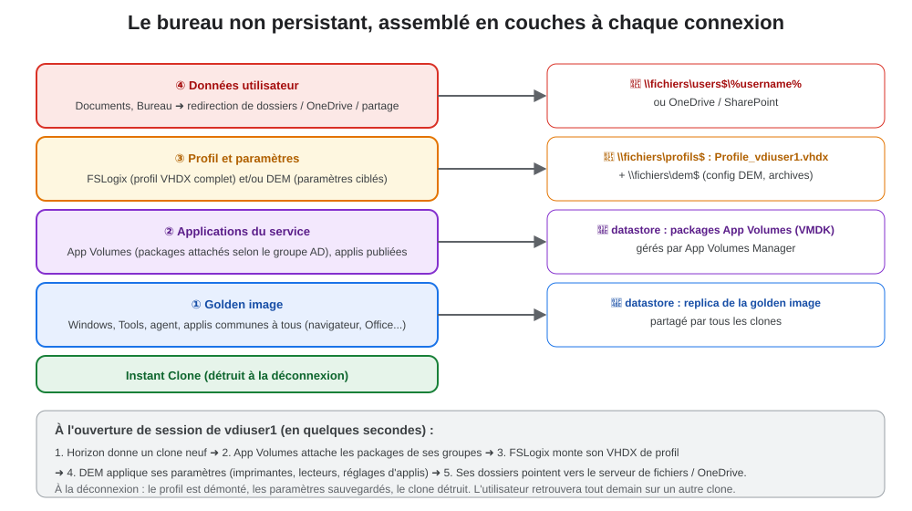
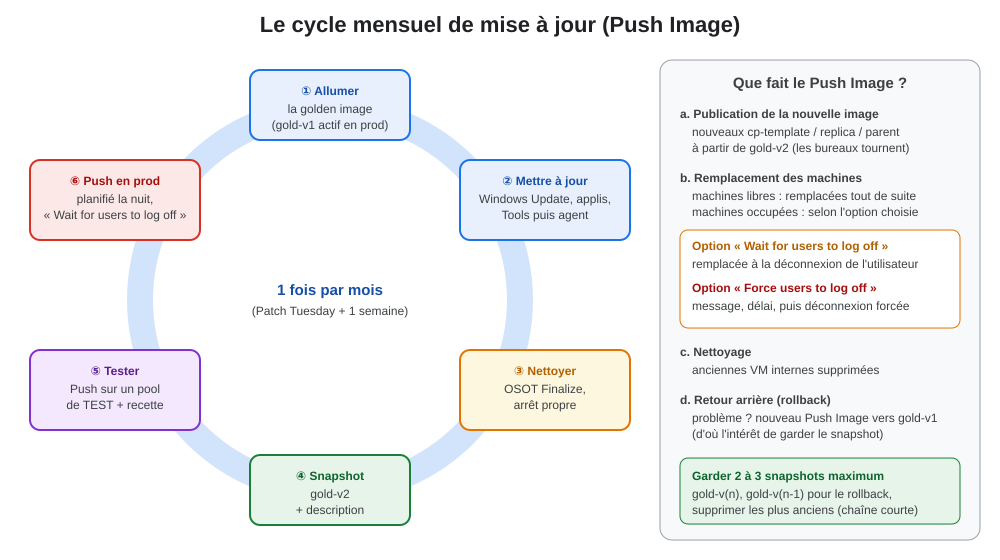
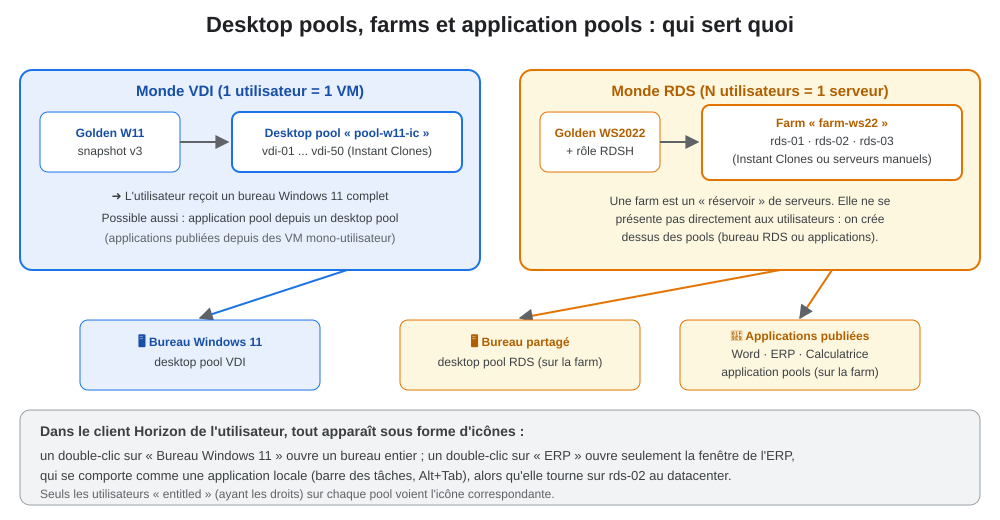

# 13 - Profils, applications et cycle de vie de l'image

> **Objectif de la page :** garder les réglages et les fichiers des utilisateurs alors que leur bureau est détruit à chaque fermeture de session (**FSLogix**), choisir comment distribuer les applications, puis maîtriser le **cycle de vie de la golden image** : mise à jour, nouvelle image sur le pool, retour arrière, et mise à jour d'Horizon lui-même.
>
> ⏸ *Demande un pool qui tourne (page 11, donc la licence). Les parties 2 et 3 (partage et GPO) peuvent se préparer dès maintenant.*

---

## 1. Comprendre avant de faire

Dans un pool flottant, le clone est **détruit** à chaque fermeture de session (page 11). Sans rien de plus, l'utilisateur perd à chaque fois son fond d'écran, ses favoris et ses documents. On assemble donc le bureau en **couches**, et seule la dernière, l'image, est jetable :

| Couche | Contenu | Dans le lab |
|---|---|---|
| ① Golden image | Windows, Tools, Agent, applications communes | `GI-W11` (page 09) |
| ② Applications du service | Applications ajoutées selon le groupe AD | Dans l'image (partie 5) |
| ③ Profil | Réglages, favoris, fichiers du profil | **FSLogix**, un disque VHDX par utilisateur |
| ④ Données | Documents | Dans le profil FSLogix (lab). En production : partage ou OneDrive |

**Comment marche FSLogix :** le profil de chaque utilisateur est un fichier **`Profile_user-test01.vhdx`** sur un partage réseau. À l'ouverture de session, FSLogix monte ce disque dans le bureau, et Windows croit que le profil est local. À la fermeture, le disque est démonté, le clone peut être détruit, et le profil reste sur le partage.

---

## 2. Le partage des profils

> **Le compromis du lab :** faute de RAM pour un serveur de fichiers, le partage est créé sur **DC01**. C'est un compromis, comme l'absence de vTPM. En production, les profils vont sur un **serveur de fichiers dédié**, jamais sur un contrôleur de domaine : on n'expose pas un serveur du tier 0 aux sessions de tous les utilisateurs.

Sur DC01, en `adm-dom-afaye` :

1. Crée le dossier `C:\Partages\Profils`.
2. Clic droit > **Propriétés** > onglet **Sécurité** > **Avancé** > **Désactiver l'héritage** > *Supprimer toutes les autorisations héritées*. Ajoute ensuite :

| Principal | Autorisation | S'applique à |
|---|---|---|
| **SYSTEM** | Contrôle total | Ce dossier, les sous-dossiers et les fichiers |
| **Administrateurs** | Contrôle total | Ce dossier, les sous-dossiers et les fichiers |
| **CREATEUR PROPRIETAIRE** | Modification | Les sous-dossiers et les fichiers seulement |
| **GG-HZN-Users** | Modification | **Ce dossier seulement** |

3. Onglet **Partage** > **Partage avancé** > ☑ **Partager ce dossier**, nom **`Profils$`** (le `$` le cache dans le voisinage réseau) > **Autorisations** : retire *Tout le monde*, ajoute **Utilisateurs authentifiés : Modifier** et **Administrateurs : Contrôle total**.
4. `fsmgmt.msc` (Dossiers partagés) > **Partages** > `Profils$` > **Propriétés** > ☑ **Activer l'énumération basée sur l'accès**.

> 🔒 **Pourquoi ces droits ?** Chaque utilisateur peut créer **son** dossier (droit sur *ce dossier seulement*), dont il devient propriétaire (*CREATEUR PROPRIETAIRE*). Il ne voit ni ne lit les profils des autres. C'est la configuration recommandée par Microsoft pour FSLogix.

---

## 3. Installer FSLogix : la première mise à jour de l'image

Ajouter FSLogix, c'est modifier la golden image. C'est donc l'occasion de dérouler **le cycle de vie complet**, qu'on refera chaque mois.

### 3.1 Mettre à jour la golden image

1. vSphere Client : allume **GI-W11** et ouvre sa console. La VM n'est pas dans le domaine : connecte-toi avec le compte local.
2. Télécharge **FSLogix** sur le site de Microsoft (`aka.ms/fslogix-latest`). Dans l'archive, lance `x64\Release\FSLogixAppsSetup.exe` en administrateur > **Install** > redémarre.
3. Profite de l'arrêt pour faire les **mises à jour** : Windows Update (onglet *Mettre à jour* d'OSOT pour le réactiver, page 09), puis les applications.
4. Relance **OSOT** > **Optimiser**, puis **Finaliser**. Ne lance jamais *Généraliser*.
5. **Arrête** la VM depuis Windows (Démarrer > Arrêter).
6. vSphere Client : clic droit > **Snapshots > Prendre un snapshot** :
   - nom **`v2-AAAA-MM-JJ`** ;
   - description *FSLogix + mises à jour de novembre* ;
   - ☐ **Inclure la mémoire** décoché.

### 3.2 La GPO FSLogix

1. Dans l'archive FSLogix, copie `fslogix.admx` et `fslogix.adml` dans le magasin central (`\\lab.lan\SYSVOL\lab.lan\Policies\PolicyDefinitions`, et son dossier `en-US`).
2. `gpmc.msc` > modifie **`GPO-VDI-Postes`** (page 12) > **Configuration ordinateur > Stratégies > Modèles d'administration > FSLogix > Profile Containers** :

| Réglage | Valeur | Pourquoi |
|---|---|---|
| **Enabled** | Activé | Active les conteneurs de profil |
| **VHD Locations** | `\\DC01.lab.lan\Profils$` | L'emplacement des disques |
| **Delete Local Profile When VHD Should Apply** | Activé | Évite un profil local qui masquerait le VHDX |
| **Volume Type (VHD or VHDX)** | VHDX | Le format moderne |
| **Size In MBs** | 10240 | 10 Go par utilisateur maximum, disque dynamique |
| **Swap directory name components** (*Flip Flop*) | Activé | Dossiers nommés `user-test01_SID` : lisibles par l'administrateur |

3. Toujours dans la GPO : **Configuration ordinateur > Préférences > Paramètres du Panneau de configuration > Utilisateurs et groupes locaux** > **Nouveau > Groupe local** :
   - groupe **`FSLogix Profile Include List`**, action **Mettre à jour** ;
   - ☑ **Supprimer tous les utilisateurs membres** ;
   - **Ajouter** > `LAB\GG-HZN-Users`.

> 🔒 Par défaut, FSLogix s'applique à **Tout le monde**. Avec la liste d'inclusion, seuls les utilisateurs VDI reçoivent un profil sur le partage. Les comptes d'administration gardent un profil local, jeté avec le clone.

### 3.3 Pousser la nouvelle image sur le pool

Console Horizon > **Inventaire > Postes de travail** > **POOL-W11** > **Maintenance > Planifier** :

| Écran | Choix |
|---|---|
| Image | Image parente **GI-W11** > snapshot **`v2-…`** |
| Planification | **Démarrer maintenant** (en production : la nuit) |
| Fermeture des sessions | ● **Attendre que les utilisateurs se déconnectent** (en production). Dans le lab : **Forcer** pour aller vite |
| ☑ Arrêter en cas d'erreur | Oui : si l'image est cassée, le pool garde l'ancienne |

Horizon prépare de nouvelles VM internes à partir de `v2`, puis remplace les bureaux un par un. Suis l'avancement dans l'onglet **Résumé** du pool (opération en attente) et dans l'onglet **Machines**.

**Contrôle :** l'onglet **Résumé** du pool affiche le snapshot **`v2-…`**.

### 3.4 Tester le profil

1. Ouvre un bureau en **`user-test01`**. Change le fond d'écran, ajoute un favori dans Edge, crée un fichier sur le Bureau.
2. **Ferme la session** : le clone est détruit et recréé.
3. Rouvre un bureau : le fond d'écran, le favori et le fichier sont toujours là.
4. Sur DC01, `C:\Partages\Profils\user-test01_S-1-5-21-…\Profile_user-test01.vhdx` existe.
5. Ouvre un bureau en **`user-test02`** : son profil est vierge, et il ne peut pas ouvrir le dossier de `user-test01`.

### 3.5 Revenir en arrière

Si `v2` pose problème : **Maintenance > Planifier** > snapshot **`v1-…`**. On garde donc **un ou deux anciens snapshots** de la golden image. Au-delà, supprime les plus vieux : un snapshot garde du disque et ralentit la VM.

> **La règle de la production :** une nouvelle image va d'abord sur un **pool de test** (quelques testeurs), puis sur le pool de production la semaine suivante.

---

## 4. Les mises à jour des composants de l'image

L'ordre compte, comme à l'installation (page 09) :

| Composant mis à jour | Ce qu'il faut faire ensuite |
|---|---|
| Windows, applications | OSOT *Optimiser* et *Finaliser*, puis snapshot |
| **VMware Tools** (après une mise à jour de l'ESXi) | **Réparer ou réinstaller l'Horizon Agent**, qui s'appuie sur les pilotes des Tools, puis OSOT et snapshot |
| **Horizon Agent** | Uniquement **après** les Connection Servers (partie 6). Puis OSOT et snapshot |
| Mise à niveau de version de Windows (23H2 ➜ 24H2) | Réparer l'Agent, relancer OSOT *Optimiser*, vérifier la compatibilité de l'Agent avec cette version |

---

## 5. Distribuer les applications

| Méthode | Principe | Quand | Dans le lab |
|---|---|---|---|
| **Dans la golden image** | Installée une fois, présente dans tous les bureaux | Applications communes à tous (navigateur, lecteur PDF, Office) | ✅ La méthode du lab |
| **App Volumes** | Applications empaquetées dans des disques attachés à l'ouverture de session, selon le groupe AD | Applications par service, sans multiplier les images | ❌ Édition Enterprise, base SQL et serveur dédié |
| **Applications publiées (RDS)** | Une **batterie** de serveurs Windows Server avec le rôle RDSH publie des applications. L'utilisateur ne voit que la fenêtre de l'application | Une application lourde ou sensible, pour beaucoup d'utilisateurs | ❌ Licences RDS et RAM supplémentaires |
| **Applications publiées depuis un pool de bureaux** | Une application lancée depuis des VM mono-utilisateur | Application incompatible avec RDS | Possible, mais sans grand intérêt dans le lab |

> 🔒 **Une image, peu d'applications.** Chaque application ajoutée dans l'image est présente chez tous les utilisateurs, et doit être tenue à jour. On n'y met que ce qui sert à tous.

---

## 6. Mettre à jour Horizon lui-même

Quand une nouvelle version sort (par exemple 2412 ➜ 2609), l'ordre est imposé :

| Ordre | Quoi | Comment |
|---|---|---|
| 1 | **Lire** les notes de version et la matrice de compatibilité Omnissa | Versions de vSphere et de Windows supportées, chemins de mise à niveau directs |
| 2 | **Sauvegarder** | *Sauvegarder maintenant* (page 12, partie 6). Dans le lab : snapshot de la VM Horizon, **éteinte** |
| 3 | **Connection Servers** | Lancer l'installeur de la nouvelle version sur chaque serveur, l'un après l'autre : il met à niveau sur place |
| 4 | **Horizon Agent** dans la golden image | Nouvelle version de l'Agent, OSOT, snapshot `v3-…`, puis **Maintenance > Planifier** (partie 3.3) |
| 5 | **Horizon Client** sur les postes | En dernier |
| 6 | **GPO Bundle** | Nouveaux `.admx` dans le magasin central |

> ⚠️ **Toujours les serveurs avant les agents.** Un Connection Server récent sait parler à un Agent plus ancien, pas l'inverse. En production avec plusieurs Connection Servers, on **ne revient jamais** à un snapshot d'un seul serveur : leurs bases AD LDS sont répliquées entre elles, et un retour arrière isolé les désynchronise.

---

## 7. Checklist

| ✓ | Vérification |
|---|---|
| ☐ | Partage `Profils$` : droits FSLogix recommandés, énumération basée sur l'accès |
| ☐ | FSLogix installé dans l'image, snapshot `v2-…` sans mémoire |
| ☐ | `GPO-VDI-Postes` : réglages FSLogix et liste d'inclusion limitée à `GG-HZN-Users` |
| ☐ | Image `v2` poussée sur `POOL-W11`, visible dans le résumé du pool |
| ☐ | Le profil de `user-test01` survit à la fermeture de session |
| ☐ | `user-test02` ne voit pas le profil de `user-test01` |
| ☐ | Snapshot `v1-…` conservé pour le retour arrière |

---

## 8. Dépannage

| Symptôme | Cause probable | Solution |
|---|---|---|
| Profil vierge à chaque session | FSLogix pas appliqué | Dans le bureau : `gpresult /r`, et `"C:\Program Files\FSLogix\Apps\frx.exe" version`. GPO bien liée à `OU=Postes` |
| « Profil temporaire » à l'ouverture de session | Le partage est injoignable ou les droits sont faux | `\\DC01.lab.lan\Profils$` depuis le bureau, droits de la partie 2 |
| Aucun VHDX créé | Utilisateur absent de `GG-HZN-Users`, ou liste d'inclusion vide | Partie 3.2, étape 3 |
| L'opération d'image reste en attente | Sessions ouvertes et option *Attendre* | Normal : elle se termine à la fermeture des sessions. Sinon, relance avec *Forcer* |
| Machines en erreur après la nouvelle image | Image cassée | **Maintenance > Planifier** sur le snapshot précédent (partie 3.5) |
| Agent injoignable après une mise à jour des Tools | Agent non réparé | Réparer l'Agent dans l'image, puis nouveau snapshot (partie 4) |

**Journaux FSLogix**, dans le bureau : `C:\ProgramData\FSLogix\Logs\Profile`.

---

## 9. Quiz

<b>1. Comment FSLogix conserve-t-il le profil d'un utilisateur alors que son bureau est détruit ?</b>
 
Le profil est un disque VHDX sur un partage. Il est monté à l'ouverture de session et démonté à la fermeture : il survit au clone.

<b>2. Pourquoi GG-HZN-Users n'a-t-il le droit Modification que sur « ce dossier seulement » ?</b>
 
Pour que chaque utilisateur puisse créer son propre dossier, dont il devient propriétaire, sans pouvoir lire ni modifier ceux des autres.

<b>3. Pourquoi choisir « Attendre que les utilisateurs se déconnectent » en production ?</b>
 
Pour ne pas couper le travail en cours : chaque bureau passe sur la nouvelle image à la fermeture de sa session.

<b>4. Après une mise à jour des VMware Tools dans l'image, que faut-il faire ?</b>
 
Réparer ou réinstaller l'Horizon Agent, qui dépend des pilotes des Tools, puis relancer OSOT et prendre un nouveau snapshot.

<b>5. Dans quel ordre met-on Horizon à jour ?</b>
 
Les Connection Servers d'abord, puis l'Agent dans la golden image, puis les clients. Un serveur récent sait gérer un agent plus ancien, pas l'inverse.

---

[⬅ 12 - Administrer Horizon](/fr/hyperviseur/VDI/12-administrer-horizon) · [Sommaire](/fr/hyperviseur/VDI/00-sommaire) · [14 - Production et aller plus loin ➡](/fr/hyperviseur/VDI/14-production)
