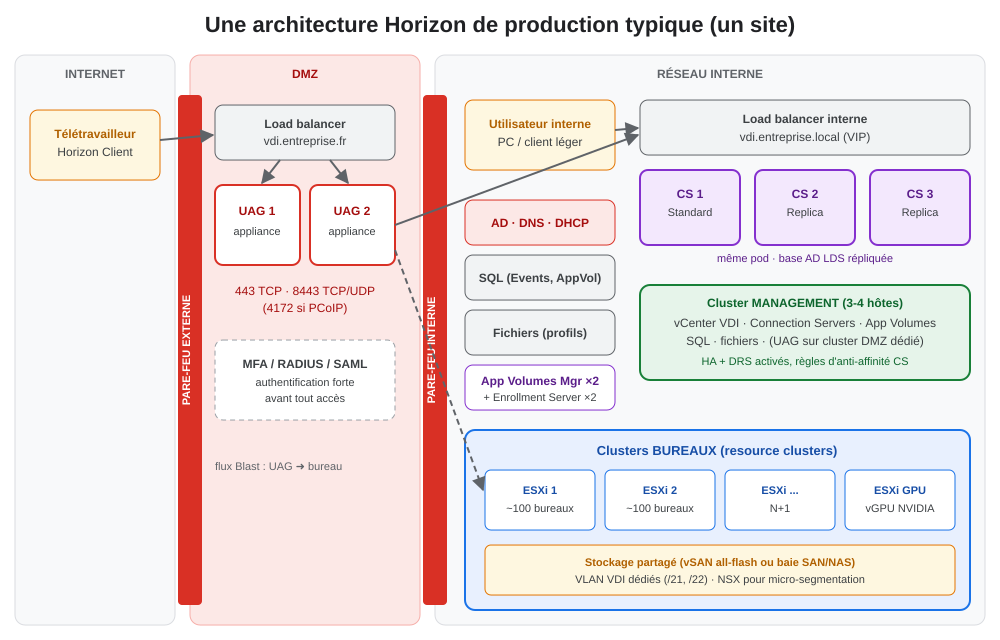
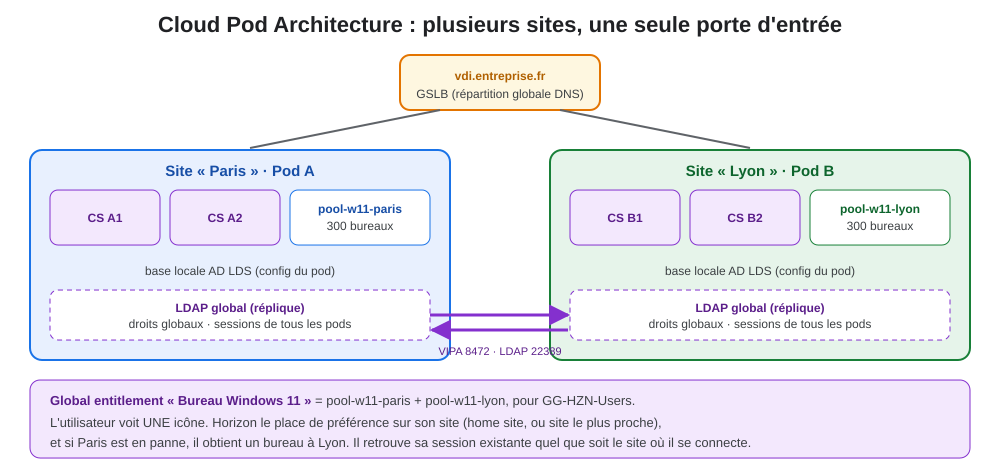

# 14 - Production et aller plus loin

> **Objectif de la page :** voir ce qui sépare le lab d'une plateforme Horizon de production : haute disponibilité, accès depuis l'extérieur avec **Unified Access Gateway** et authentification forte, plusieurs sites, base d'événements, journalisation, dimensionnement. La page se termine par le récapitulatif sécurité de tout le cours et des idées pour prolonger le lab.
>
> *Page de synthèse : la plupart de ces éléments ne tiennent pas dans les ressources du lab. La partie 9 propose ceux que tu peux y ajouter.*

---

## 1. Du lab à la production

| Sujet | Dans le lab | En production |
|---|---|---|
| Connection Servers | 1 | **Au moins 2** (un standard + des réplicas), derrière un répartiteur de charge |
| Accès extérieur | Aucun | **Unified Access Gateway** (UAG) en DMZ, jamais le Connection Server exposé |
| Authentification | Mot de passe AD | **MFA** (RADIUS ou SAML), et souvent True SSO |
| Golden image | Sans vTPM | **Avec vTPM** : fournisseur de clés sauvegardé, BitLocker, Credential Guard |
| Profils | Partage sur DC01 | **Serveurs de fichiers dédiés**, redondants et sauvegardés |
| Base d'événements | Aucune | **SQL Server ou PostgreSQL** |
| Journaux | Sur le serveur | Envoyés à un **SIEM** (syslog) |
| Hôtes ESXi | 1, imbriqué | Un cluster avec HA et DRS, stockage partagé |
| Mise à jour de l'image | Directement sur le pool | **Pool de test**, puis production |
| Sauvegarde | Snapshots | Sauvegarde de la configuration hors du serveur, plan de reprise testé |

---

## 2. L'architecture d'un site

**Le chemin d'un télétravailleur :**
1. Horizon Client se connecte à `vdi.entreprise.fr`, qui pointe vers le répartiteur de charge de la **DMZ**.
2. L'**UAG** authentifie l'utilisateur (MFA), puis relaie la demande au Connection Server interne.
3. Le flux d'affichage **Blast** (443 TCP et 8443 TCP/UDP) passe par l'UAG jusqu'au bureau. Le poste distant ne touche jamais directement le réseau interne.

**Les règles :**
- **Deux pare-feux** : Internet ➜ DMZ (seulement 443 et 8443 vers les UAG), et DMZ ➜ interne (seulement les flux de l'UAG vers les Connection Servers et les bureaux).
- **Un Connection Server n'est jamais exposé sur Internet.** C'est le rôle de l'UAG, une appliance Linux durcie conçue pour la DMZ.
- **Les utilisateurs internes** passent par un répartiteur de charge interne, directement vers les Connection Servers.

---

## 3. La haute disponibilité

| Élément | Comment le rendre redondant |
|---|---|
| Connection Server | Installe un **serveur réplica** (option *Serveur réplica Horizon* de l'installeur, page 10 partie 3). Les serveurs d'un même **pod** partagent la configuration par réplication AD LDS |
| Accès | Un **répartiteur de charge** devant les Connection Servers, et un autre devant les UAG |
| UAG | Au moins **deux**, derrière le répartiteur de la DMZ |
| Hôtes | Cluster vSphere avec **HA** : si un hôte tombe, Horizon recrée les clones ailleurs |
| Stockage | Banques de données partagées, réplica par banque de données |
| AD, DNS, DHCP | Au moins deux contrôleurs de domaine, DHCP en basculement |

**Plusieurs sites : Cloud Pod Architecture (CPA)**

Avec la CPA, plusieurs pods (un par site) partagent des **droits globaux**. L'utilisateur voit **une seule icône**, et Horizon le place de préférence sur son site. Si un site tombe, les bureaux de l'autre prennent le relais.

---

## 4. Sécuriser l'accès

### 4.1 L'authentification forte

| Méthode | Principe |
|---|---|
| **RADIUS** | L'UAG (ou le Connection Server) demande un second facteur à un serveur RADIUS (par exemple NPS avec une extension MFA) |
| **SAML** | L'authentification est confiée à un fournisseur d'identité (Entra ID, Omnissa Access…) |
| **True SSO** | Après une authentification SAML, Horizon ouvre la session Windows avec un **certificat** émis à la volée par la PKI : l'utilisateur ne retape pas son mot de passe |

> 🔒 **True SSO et la PKI.** True SSO s'appuie sur un modèle de certificat d'**ouverture de session**, servi par un *Enrollment Server* agissant pour le compte des utilisateurs. Ce modèle doit être aussi verrouillé que ceux de la page 05 : inscription réservée à l'Enrollment Server, approbation pensée. C'est le terrain des attaques ESC sur ADCS.

### 4.2 Restreindre l'accès selon l'origine

- **Les étiquettes (tags) de Connection Server** permettent de réserver un pool aux connexions qui arrivent par un serveur donné : par exemple les pools d'administration uniquement en interne, jamais par l'UAG.
- **La console d'administration** n'est accessible que depuis le réseau d'administration (pare-feu), et jamais par l'UAG.
- Avec **Dynamic Environment Manager**, les *Smart Policies* adaptent le bureau à l'origine : presse-papiers, USB et impression bloqués depuis l'extérieur, autorisés au bureau.

---

## 5. Base d'événements et journalisation

### 5.1 La base d'événements

Elle garde l'historique des connexions, des erreurs et des actions des administrateurs. Sans elle, la console n'affiche que les événements récents.

1. Crée une base sur **SQL Server** ou **PostgreSQL**, avec un **compte SQL dédié** propriétaire de cette seule base.
2. Console > **Paramètres > Configuration des événements** > **Modifier** dans *Base de données d'événements* : serveur, type, port, nom de la base, compte, préfixe des tables.
3. Règle la **durée de conservation** dans la console : 3 mois pour l'affichage, 6 à 12 mois dans la base (selon la politique de l'entreprise).

### 5.2 Le SIEM

Dans le même écran, **Syslog** : envoie les événements Horizon vers le serveur syslog ou le SIEM de l'entreprise, avec les journaux de l'AD et du vCenter. C'est là qu'on détecte une connexion anormale (pays inhabituel, horaires, échecs en série).

---

## 6. Dimensionner

| Élément | Ordre de grandeur | À retenir |
|---|---|---|
| Bureau Windows 11 de bureautique | **2 vCPU, 4 à 8 Go** de RAM | Mesure sur un pilote avant de généraliser |
| Connection Server | **4 vCPU, 10 Go** de RAM ou plus | Sous 10 Go, l'installeur réduit les ressources (page 10, partie 3) |
| Hôte ESXi | Rapport vCPU/cœurs de 4 à 8 pour de la bureautique | La **RAM** est presque toujours la première limite |
| Stockage | La performance (IOPS, latence) compte plus que la capacité | Les tempêtes d'ouvertures de session à 9 h sont le moment critique |
| Réserve | Prévoir la perte d'un hôte (N+1) | Le HA doit pouvoir relancer tous les bureaux |

Les limites exactes (sessions par Connection Server, par pod, par site) changent selon la version : prends-les dans la documentation **Omnissa** de la version installée, rubrique *Configuration Maximums*.

---

## 7. Versions et licences

- **Les versions** : Omnissa publie plusieurs versions d'Horizon 8 par an (2412, 2503, 2609…). Certaines sont des **branches à support étendu (ESB)**, prévues pour rester plus longtemps en production. Vérifie sur le site Omnissa laquelle l'est, et sa date de fin de support, avant de choisir.
- **Les licences** : l'édition détermine les fonctions disponibles (App Volumes, DEM, applications publiées…). Une clé d'évaluation se **demande** à Omnissa (page 10, partie 5.1), et sa date de fin se surveille.
- **Les clés trouvées sur le web** sont volées ou fausses, et souvent piégées. Une plateforme de production repose sur un contrat et un support.

---

## 8. Le récapitulatif sécurité du cours

| Mesure | Contre quoi | Page |
|---|---|---|
| Comptes séparés par tier (`adm-dom`, `adm-vmw`, `adm-hzn`) | Un compte volé ne donne la main que sur son périmètre | 04 |
| Un compte de service par usage, droits minimaux | Moindre privilège, traçabilité | 04, 08 |
| PKI interne sans modèle par défaut, sans inscription web | ESC1, ESC6, ESC8 | 05 |
| vCenter relié à l'AD **en LDAPS**, certificat épinglé | Mots de passe en clair sur le réseau | 06 |
| ESXi non joint au domaine, administré par le vCenter | CVE-2024-37085 (« ESX Admins ») | 03, 07 |
| Certificats LAB-ROOT-CA pour le vCenter et Horizon | Alertes de certificat, attaque de l'intercepteur | 07, 10 |
| Rôle vCenter dédié à Horizon | Horizon n'est pas administrateur du vCenter | 08 |
| `svc-horizon-ic` limité à `OU=Postes` | Un compte de jonction volé ne touche pas au reste de l'AD | 04, 10 |
| Console Horizon par groupes AD, lecture seule et support séparés | Moindre privilège | 10, 12 |
| Bureaux non persistants | Persistance d'un logiciel malveillant | 11 |
| GPO des bureaux : verrouillage, presse-papiers à sens unique, pas d'USB ni de lecteurs | Fuite de données | 12 |
| Profils FSLogix cloisonnés par utilisateur | Lecture du profil d'un autre | 13 |
| Image mise à jour chaque mois, pool de test, retour arrière prévu | Failles non corrigées, panne générale | 13 |
| UAG, MFA, pas de Connection Server exposé | Attaques depuis Internet | 14 |

> **Les compromis du lab**, à ne pas reproduire en production : pas de vTPM, partage de profils sur un DC, un seul Connection Server, pas de base d'événements.

---

## 9. Aller plus loin dans le lab

Des projets possibles, du plus simple au plus gourmand en RAM :

| Projet | Ce que tu apprends | Ressources |
|---|---|---|
| Groupe **GG-HZN-Helpdesk** et test de chaque rôle | La délégation (page 12) | Aucune |
| **Base d'événements PostgreSQL** sur une petite VM Linux | La partie 5 | 1 à 2 Go de RAM |
| **Remettre un vTPM** avec un fournisseur de clés natif sauvegardé | BitLocker et Credential Guard dans les bureaux | Aucune, si la sauvegarde du NKP fonctionne |
| **Unified Access Gateway** devant le Connection Server | L'accès externe, la DMZ | 4 Go de RAM |
| Une **batterie RDS** et des applications publiées | La partie 5 de la page 13 | Une VM Windows Server, 4 Go ou plus |
| Un **second Connection Server** (réplica) | La haute disponibilité | 10 Go de RAM |
| **Passage en 2609** de toute la plateforme | La mise à jour d'Horizon (page 13, partie 6) | Aucune |

---

## 10. Quiz

<b>1. Pourquoi ne jamais exposer un Connection Server directement sur Internet ?</b>
 
Il est dans le domaine et dans le réseau interne. C'est le rôle de l'Unified Access Gateway, une appliance durcie placée en DMZ, qui authentifie et relaie les connexions.

<b>2. Qu'apporte un serveur réplica ?</b>
 
La haute disponibilité : il partage la configuration du pod par réplication AD LDS. Si un Connection Server tombe, l'autre continue de servir les utilisateurs derrière le répartiteur de charge.

<b>3. Pourquoi le modèle de certificat de True SSO est-il sensible ?</b>
 
Il permet d'ouvrir une session Windows au nom de n'importe quel utilisateur. Mal protégé, il offre une attaque de type ESC sur ADCS : son inscription doit être réservée à l'Enrollment Server.

<b>4. Quelle ressource limite le plus souvent le nombre de bureaux par hôte ?</b>
 
La mémoire vive, bien avant le processeur.

<b>5. Cite deux compromis du lab qu'on ne garde pas en production.</b>
 
Au choix : pas de vTPM dans la golden image, partage des profils sur un contrôleur de domaine, un seul Connection Server, pas de base d'événements.

---

[⬅ 13 - Profils, applications et cycle de vie](/fr/hyperviseur/VDI/13-profils-applications-image) · [Sommaire](/fr/hyperviseur/VDI/00-sommaire)
