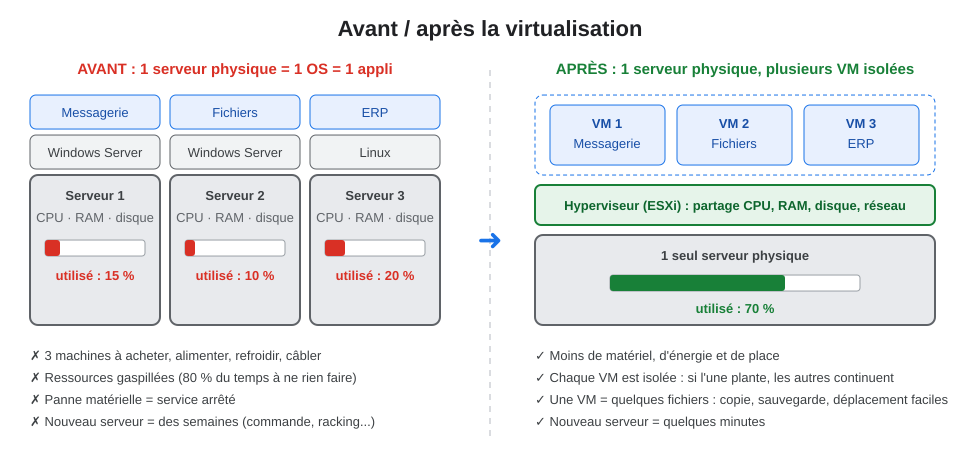
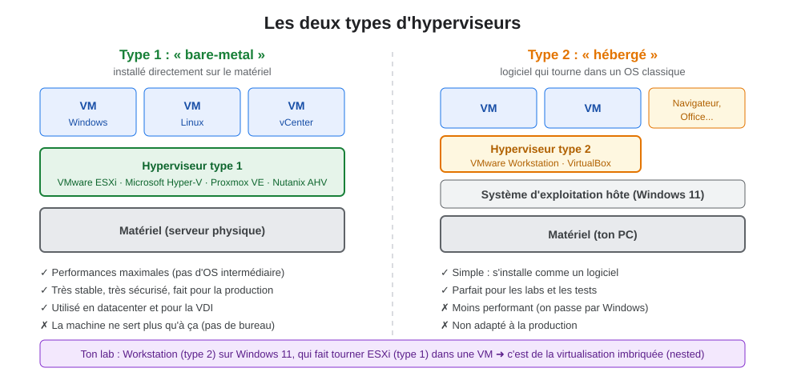
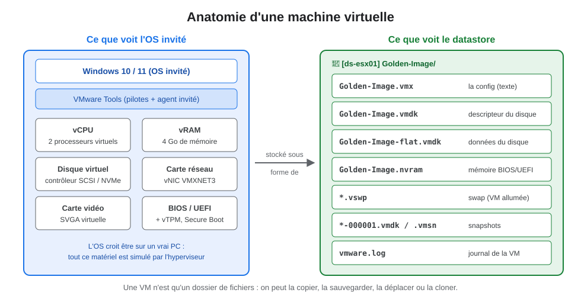
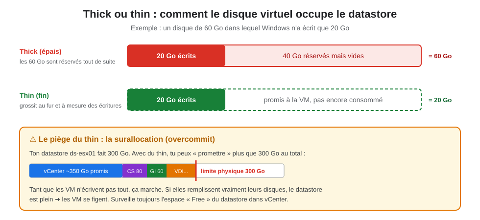
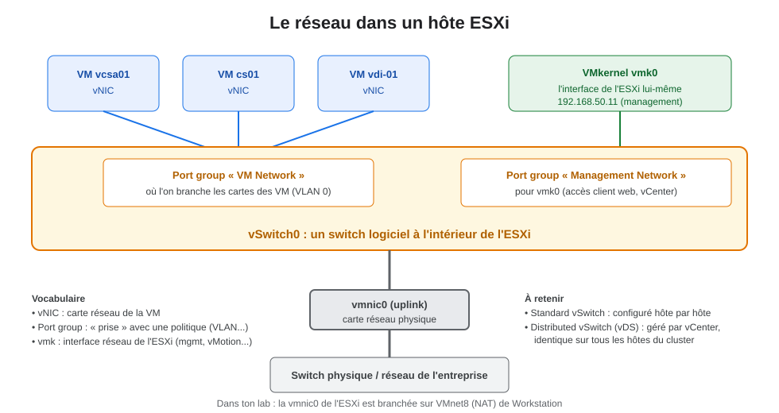
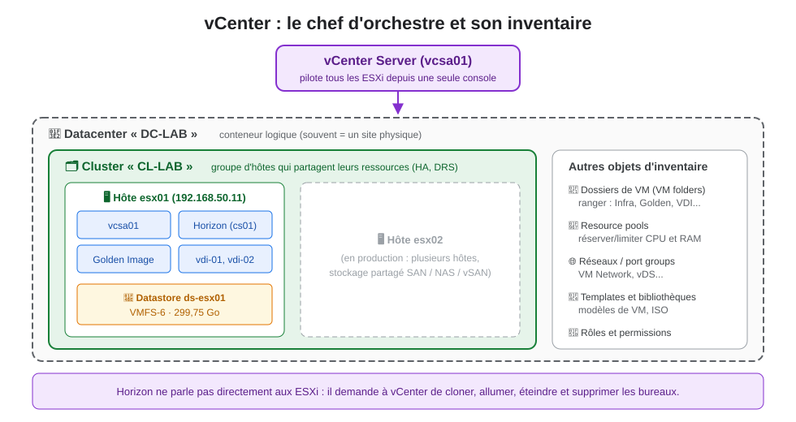
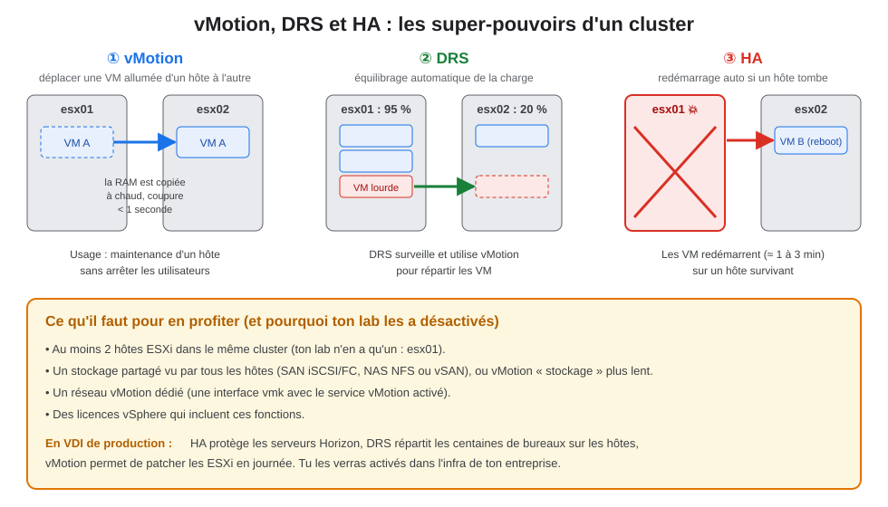
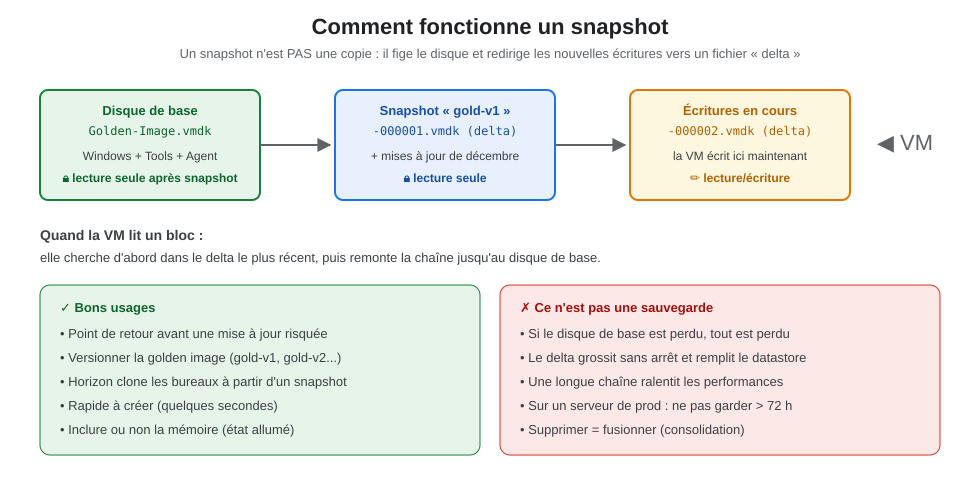
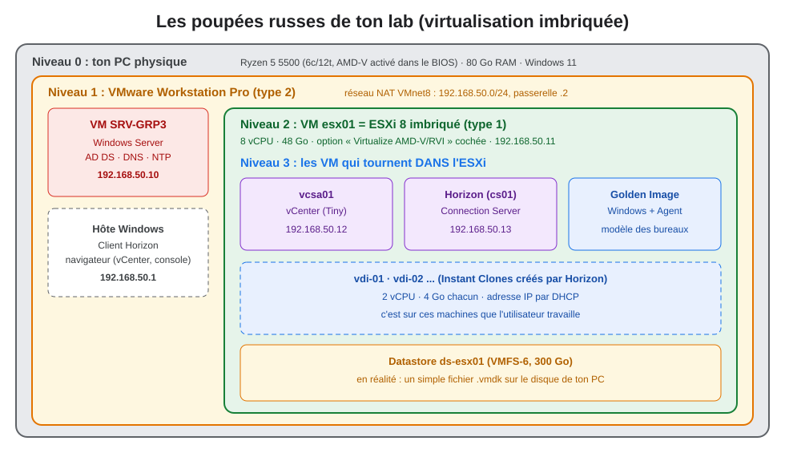

# 01 - Les bases de la virtualisation

> **Objectif de la page :** comprendre *pourquoi* et *comment* on virtualise, et maîtriser le vocabulaire vSphere (ESXi, vCenter, datastore, vSwitch, cluster...) **avant** de toucher à la VDI. Tout ce qui suit dans le cours repose sur ces notions.
{.is-info}

**Parcours du cours :** **01 Bases** ➜ [02 Infrastructure](/hyperviseur/VDI/02-infrastructure-lab) ➜ [03 VDI & Horizon](/hyperviseur/VDI/03-vdi-et-horizon) ➜ [04 Installation](/hyperviseur/VDI/04-installation-horizon) ➜ [05 Administration](/hyperviseur/VDI/05-horizon-administration) ➜ [06 Golden image](/hyperviseur/VDI/06-horizon-golden-image) ➜ [07 Production](/hyperviseur/VDI/07-horizon-production)

---

## 1. Le problème de départ : des serveurs qui s'ennuient

Imagine une entreprise dans les années 2000. Chaque application a **son** serveur physique : un pour la messagerie, un pour les fichiers, un pour l'ERP... On ne mélange pas, parce que si une application fait planter Windows, elle emporte les autres avec elle.

Résultat : des dizaines de serveurs qui utilisent **10 à 20 % de leur puissance**, mais qu'il faut acheter, alimenter, refroidir, câbler et réparer.



La **virtualisation** résout ça : on installe sur le serveur physique un logiciel très léger, l'**hyperviseur**, qui découpe le matériel en plusieurs **machines virtuelles (VM)**. Chaque VM croit avoir son propre ordinateur, avec son processeur, sa mémoire, son disque et sa carte réseau. En réalité, elles se partagent le même matériel, mais restent **totalement isolées** les unes des autres.

> **Analogie de l'immeuble**
> - Le **terrain** = le serveur physique (CPU, RAM, disques, cartes réseau).
> - L'**immeuble** = l'hyperviseur, qui découpe le terrain en appartements et gère l'eau, l'électricité, les ascenseurs.
> - Les **appartements** = les VM. Chacun a sa porte, ses clés, ses meubles (son OS et ses applis). Si un locataire met le feu à sa cuisine, les voisins ne sont pas touchés.
> - Le **syndic** = vCenter, qui gère plusieurs immeubles à la fois.
{.is-success}

### Ce que la virtualisation apporte

| Bénéfice | Concrètement |
|---|---|
| **Consolidation** | 10 à 30 VM sur un seul serveur physique, donc moins de matériel et d'énergie. |
| **Isolation** | Une VM qui plante n'affecte pas les autres. |
| **Encapsulation** | Une VM = un dossier de fichiers : on la copie, la sauvegarde ou la déplace facilement. |
| **Indépendance du matériel** | La VM voit toujours le même matériel virtuel, quel que soit le serveur réel. |
| **Rapidité** | Déployer un serveur prend quelques minutes au lieu de quelques semaines. |
| **Haute disponibilité** | Si un serveur tombe, ses VM redémarrent ailleurs (HA, voir §7). |

---

## 2. L'hyperviseur : type 1 et type 2

Il existe deux familles d'hyperviseurs. Ton lab utilise **les deux en même temps**, c'est pour ça que c'est important de bien les distinguer.



| | Type 1 (bare-metal) | Type 2 (hébergé) |
|---|---|---|
| Où il s'installe | Directement sur le serveur, à la place de Windows | Comme un logiciel, dans Windows / macOS / Linux |
| Exemples | **VMware ESXi**, Microsoft Hyper-V, Proxmox VE, Nutanix AHV, Citrix Hypervisor | **VMware Workstation**, VirtualBox, Parallels |
| Performances | Maximales | Bonnes, mais l'OS hôte consomme des ressources |
| Usage | Production, datacenter, **VDI** | Lab, tests, développement |
| Dans ton lab | `esx01` | Workstation Pro sur ton Windows 11 |

> **Les mots à retenir :** l'**hôte** (host) est la machine qui fait tourner l'hyperviseur. L'**invité** (guest) est la VM et son système d'exploitation (le « guest OS »).
{.is-info}

### Comment l'hyperviseur partage le matériel

- **CPU** : l'hyperviseur distribue des tranches de temps processeur aux VM. Un **vCPU** n'est pas un cœur réservé : c'est un « droit » à utiliser un cœur (ou un thread) physique pendant un instant. On peut donc donner au total plus de vCPU qu'il n'y a de cœurs : c'est l'**overcommit CPU**. En VDI, on a couramment 4 à 8 vCPU par cœur physique, car les utilisateurs bureautiques ne sollicitent pas le CPU en continu.
- **RAM** : chaque VM reçoit une quantité de mémoire. ESXi sait récupérer de la RAM inutilisée (ballooning via VMware Tools, compression, swap), mais **la RAM est la ressource qui manque en premier** en VDI. C'est aussi la limite de ton lab (80 Go).
- **Disque** : chaque VM a un ou plusieurs disques virtuels, qui sont des fichiers `.vmdk` posés sur un **datastore** (§4).
- **Réseau** : chaque VM a une ou plusieurs cartes réseau virtuelles branchées sur un **switch virtuel** (§5).

Pour que tout ça marche bien, le processeur doit proposer des **extensions de virtualisation matérielle** : **Intel VT-x / EPT** ou **AMD-V / RVI** (appelé **SVM Mode** dans le BIOS des cartes mères AMD, comme la tienne).

---

## 3. Anatomie d'une machine virtuelle



Une VM, c'est deux choses en même temps :

1. **Un ordinateur virtuel** : processeurs (vCPU), mémoire (vRAM), contrôleur de disque, carte réseau, carte vidéo, BIOS/UEFI, et éventuellement une puce TPM virtuelle (vTPM, nécessaire pour Windows 11).
2. **Un dossier de fichiers** sur un datastore.

| Fichier | Rôle |
|---|---|
| `.vmx` | La configuration de la VM (fichier texte : CPU, RAM, cartes...) |
| `.vmdk` | Le descripteur du disque virtuel (petit fichier texte) |
| `-flat.vmdk` | Les données réelles du disque (le gros fichier) |
| `.nvram` | Les paramètres du BIOS/UEFI |
| `.vswp` | Le fichier de swap, créé à l'allumage (taille = RAM non réservée) |
| `-00000X.vmdk`, `.vmsn` | Les snapshots (§8) |
| `vmware.log` | Le journal de la VM, très utile en dépannage |

### Le matériel virtuel qui compte

| Composant | Choix recommandé | Pourquoi |
|---|---|---|
| Carte réseau | **VMXNET3** | Carte « paravirtualisée » : très performante, mais nécessite les VMware Tools. L'alternative E1000E émule une carte Intel réelle, plus compatible mais plus lente. |
| Contrôleur disque | **VMware Paravirtual (PVSCSI)** ou **NVMe** | Plus performant que LSI Logic SAS. Windows a besoin du pilote (fourni par les Tools ou intégré pour NVMe). |
| Firmware | **UEFI** + Secure Boot | Obligatoire pour Windows 11, recommandé pour tout. |
| Version matérielle | La plus récente supportée par tes ESXi | Débloque les nouvelles fonctions (vTPM, etc.). |

### Les VMware Tools

C'est un paquet de **pilotes et de services** installé *dans* la VM. Sans les Tools :
- la carte VMXNET3 n'a pas de pilote, donc pas de réseau ;
- l'affichage est lent, la souris saccade ;
- vCenter ne voit pas l'adresse IP ni le nom de la VM ;
- impossible d'arrêter proprement la VM depuis vCenter ;
- **Horizon ne fonctionne pas** : l'agent Horizon et les Instant Clones s'appuient sur les Tools.

> C'est pour ça que, dans ton résumé, la golden image affichait « VMware Tools inactif » : c'est la **première chose** à corriger sur cette VM (voir page 04).
{.is-warning}

---

## 4. Le stockage : datastores, VMFS, thin et thick

### Le datastore

Un **datastore** est un espace de stockage vu par ESXi, dans lequel il range les dossiers des VM. Il peut être de plusieurs types :

| Type | Description | Exemple |
|---|---|---|
| **VMFS** | Système de fichiers VMware posé sur un disque local ou un LUN de baie (SAN iSCSI / Fibre Channel). Plusieurs ESXi peuvent l'utiliser en même temps. | Ton `ds-esx01` (VMFS-6) |
| **NFS** | Un partage réseau d'un NAS, monté par ESXi. | NetApp, Synology |
| **vSAN** | Les disques locaux de plusieurs ESXi sont agrégés en un datastore partagé (stockage « hyperconvergé »). Minimum 2 hôtes + un witness, ou 3 hôtes. | Clusters VDI modernes |
| **vVols** | La baie de stockage gère chaque disque de VM individuellement. | Baies Pure, Dell... |

> Dans ton résumé, tu as noté que le **witness** et le second hôte n'étaient pas nécessaires. C'est exact : le witness ne sert qu'à **vSAN** en configuration 2 nœuds, pour arbitrer si les deux hôtes ne se voient plus.
{.is-info}

### Thin ou thick ?



| Format | Allocation | Avantage | Inconvénient |
|---|---|---|---|
| **Thick Provision Lazy Zeroed** | Tout l'espace est réservé, mis à zéro à la première écriture | Espace garanti | Consomme tout de suite |
| **Thick Provision Eager Zeroed** | Tout l'espace est réservé et mis à zéro dès la création | Meilleures performances à la première écriture, requis pour certains clusters Windows | Création lente |
| **Thin Provision** | L'espace est consommé au fur et à mesure | Économise énormément d'espace | Risque de saturer le datastore (surallocation) |

En VDI, on utilise presque toujours le **thin** : des centaines de bureaux de 40 Go qui n'utilisent chacun que 15 Go, ça fait une énorme différence. Les Instant Clones vont même plus loin en partageant les blocs du disque de la golden image (page 03).

---

## 5. Le réseau virtuel



À l'intérieur de chaque ESXi, il y a un **switch logiciel** qui relie les VM entre elles et au réseau physique.

| Élément | Définition | Dans ton lab |
|---|---|---|
| **vNIC** | Carte réseau d'une VM | La carte VMXNET3 de cs01 |
| **vSwitch** (standard) | Switch virtuel configuré sur un hôte | `vSwitch0` |
| **Port group** | Groupe de ports avec les mêmes réglages (VLAN, sécurité). On y branche les vNIC. | `VM Network` |
| **VMkernel (vmk)** | Interface réseau utilisée par l'ESXi lui-même (management, vMotion, stockage iSCSI/NFS, vSAN) | `vmk0` = 192.168.50.11 |
| **Uplink (vmnic)** | Carte réseau physique de l'hôte, qui relie le vSwitch au réseau réel | `vmnic0` branchée sur VMnet8 |
| **Distributed vSwitch (vDS)** | Switch virtuel géré par vCenter, identique sur tous les hôtes | Pas dans ton lab, très courant en entreprise |

### Les VLAN

En entreprise, on sépare les flux en **VLAN** : un VLAN « management » pour les ESXi et vCenter, un VLAN « serveurs », un ou plusieurs VLAN « VDI » pour les bureaux (souvent de grande taille, en /22 ou /21, car il faut une adresse par bureau), un VLAN « vMotion », un VLAN « stockage ». Chaque port group porte un numéro de VLAN.

> **Point clé pour la VDI :** chaque bureau virtuel a besoin d'une **adresse IP** fournie par **DHCP**. Prévoir une plage suffisante est un classique des projets VDI. Avec 500 bureaux, un /24 (254 adresses) ne suffit pas.
{.is-warning}

---

## 6. vCenter : gérer tout ça depuis un seul endroit

Un ESXi seul se gère avec son **Host Client** (`https://192.168.50.11/ui`). Ça suffit pour un hôte, mais pas pour 20. **vCenter Server** est une VM (une appliance Linux appelée **VCSA**) qui centralise la gestion de tous les ESXi.



### La hiérarchie de l'inventaire

```
vCenter (vcsa01)
└── Datacenter        DC-LAB        conteneur de plus haut niveau
    └── Cluster       CL-LAB        groupe d'hôtes qui partagent leurs ressources
        ├── Hôte      esx01         un serveur ESXi
        │   └── VM    vcsa01, Horizon, Golden Image, vdi-01...
        └── Resource pool (optionnel) pour réserver / limiter CPU et RAM
    ├── Datastores    ds-esx01
    ├── Réseaux       VM Network
    └── Dossiers VM   Infra / Golden / VDI (pour ranger)
```

### Ce que vCenter apporte

- Une **console web unique** (vSphere Client : `https://vcsa01.srv-grp3.lan/ui`).
- Les fonctions de cluster : **vMotion, DRS, HA** (§7).
- Les **templates**, le **clonage** et la personnalisation automatique des VM.
- Les **rôles et permissions** (intégration à l'Active Directory).
- Les **alarmes**, les graphiques de performance, les tâches et événements.
- Une **API** : c'est elle qu'utilise **Horizon** pour créer et gérer les bureaux virtuels.

> **Sans vCenter, pas d'Horizon.** Le Connection Server Horizon se connecte à vCenter avec un compte de service (`svc-horizon`) et lui demande de cloner, allumer, éteindre et supprimer les bureaux. C'est pour ça qu'on monte vCenter **avant** Horizon.
{.is-danger}

### Les tailles de la VCSA

À l'installation, on choisit une taille selon le nombre d'hôtes et de VM. Les valeurs exactes varient selon la version (consulte la doc Broadcom), mais l'ordre de grandeur est :

| Taille | Hôtes / VM (env.) | vCPU | RAM |
|---|---|---|---|
| **Tiny** | 10 / 100 | 2 | 12 à 14 Go |
| Small | 100 / 1 000 | 4 | 19 à 21 Go |
| Medium | 400 / 4 000 | 8 | 28 à 30 Go |
| Large | 1 000 / 10 000 | 16 | 37 à 39 Go |
| X-Large | 2 000 / 35 000 | 24 | 56 à 58 Go |

Tiny suffit largement pour ton lab.

---

## 7. Le cluster : vMotion, DRS et HA

Quand plusieurs ESXi sont regroupés dans un **cluster** et partagent le même stockage, vCenter débloque trois fonctions majeures :



| Fonction | Ce qu'elle fait | Interruption |
|---|---|---|
| **vMotion** | Déplace une VM *allumée* d'un hôte à un autre en copiant sa mémoire à chaud | Aucune visible (moins d'une seconde) |
| **Storage vMotion** | Déplace les disques d'une VM allumée d'un datastore à un autre | Aucune |
| **DRS** (Distributed Resource Scheduler) | Place les VM au démarrage et les déplace avec vMotion pour équilibrer la charge | Aucune |
| **HA** (High Availability) | Si un hôte tombe, ses VM **redémarrent** automatiquement sur les autres | Oui : le temps du redémarrage |
| **FT** (Fault Tolerance) | Une copie « miroir » de la VM tourne en permanence sur un autre hôte | Aucune, mais coûteux, rare en VDI |
| **Mode maintenance** | Vide un hôte de ses VM (via DRS / vMotion) avant de le patcher ou de l'éteindre | Aucune si DRS est actif |

> Dans ton lab, le cluster `CL-LAB` a **DRS et HA désactivés** : c'est normal avec un seul hôte. Le cluster sert quand même à quelque chose : Horizon a besoin d'un **cluster** (ou d'un hôte) comme cible pour placer ses bureaux.
{.is-info}

---

## 8. Snapshots, clones et templates

### Le snapshot



Un **snapshot** fige l'état d'une VM à un instant T. Techniquement, le disque d'origine passe en **lecture seule** et toutes les nouvelles écritures vont dans un fichier **delta**. On peut ensuite :
- **revenir** au snapshot (« Revert ») : on jette le delta ;
- **supprimer** le snapshot : le delta est **fusionné** dans le disque (consolidation).

> **Le snapshot est le cœur de la VDI Horizon.** Les pools d'Instant Clones sont créés à partir d'un **snapshot de la golden image** (`gold-v1`). Pour mettre à jour tous les bureaux, on met à jour la golden image, on prend un nouveau snapshot (`gold-v2`) et on demande à Horizon de l'appliquer (« Push Image »). Tu verras ça en détail en page 06.
{.is-success}

### Clone et template

| Notion | Définition | Usage |
|---|---|---|
| **Clone complet** (full clone) | Copie intégrale et indépendante d'une VM | Créer un serveur à partir d'un autre |
| **Template** | VM « figée » qui ne peut pas être allumée, sert de modèle | Déployer des serveurs standard |
| **Customization spec** | Paramètres appliqués au clone : nom, IP, jonction au domaine (Sysprep sous Windows) | Automatiser le déploiement |
| **Linked clone** | Clone qui partage le disque de son parent et n'écrit que ses différences | Ancienne technologie VDI (View Composer), **supprimée** des versions récentes d'Horizon |
| **Instant clone** | Clone créé en quelques secondes en partageant le disque **et la mémoire** du parent | La technologie VDI actuelle d'Horizon |

---

## 9. La virtualisation imbriquée (nested) : pourquoi ton lab fonctionne

En entreprise, ESXi est installé sur de vrais serveurs (Dell, HPE, Lenovo, Cisco). Chez toi, tu n'as qu'un PC, donc tu fais tourner ESXi **dans une VM** Workstation. Les VM de l'ESXi sont donc des VM *dans* une VM.



Pour que ça marche :

1. **BIOS :** `SVM Mode` (AMD-V) activé. Sans ça, aucune virtualisation matérielle.
2. **Workstation :** dans les paramètres processeur de la VM `esx01`, cocher **« Virtualize Intel VT-x/EPT or AMD-V/RVI »**. Sinon, ESXi refuse de démarrer des VM 64 bits.
3. **Windows 11 :** attention à **Hyper-V, VBS et l'intégrité de la mémoire** (Sécurité Windows ➜ Sécurité de l'appareil ➜ Isolation du noyau). Quand ces fonctions sont actives, Windows prend la main sur la virtualisation matérielle et Workstation passe par l'API Hyper-V, qui **ne transmet pas** AMD-V à l'ESXi imbriqué. Symptôme : erreur « Virtualized Intel VT-x/EPT is not supported on this platform » au démarrage d'esx01. Il faut alors désactiver ces fonctions (et vérifier avec `msinfo32` que « Sécurité basée sur la virtualisation » est « Non activée »).
4. **Réseau :** le vSwitch de l'ESXi imbriqué doit accepter des adresses MAC qui ne sont pas la sienne (mode promiscuité, voir page 02).

> **Limites d'un lab nested :** les performances disques et réseau sont moins bonnes qu'en vrai, le GPU n'est pas utilisable dans les bureaux, et ce n'est **pas supporté** par VMware/Omnissa. Mais pour apprendre, c'est parfait : tu manipules exactement les mêmes consoles qu'en entreprise.
{.is-warning}

---

## 10. Les produits VMware et Omnissa : qui fait quoi ?

Un peu d'histoire récente, utile pour comprendre les noms que tu vas croiser :

- **2023 :** Broadcom rachète VMware. vSphere (ESXi, vCenter), vSAN et NSX restent chez **Broadcom**.
- **2024 :** la division « End-User Computing » (Horizon, Workspace ONE, App Volumes...) est vendue et devient une société indépendante : **Omnissa**. « VMware Horizon » devient « **Omnissa Horizon** ».
- Les numéros de version d'Horizon suivent le format **AAMM** : `2412` = décembre 2024 (version technique 8.14). Tu verras encore beaucoup de documentation et de chemins de fichiers qui disent « VMware ».

| Produit | Éditeur | Rôle |
|---|---|---|
| ESXi | Broadcom | Hyperviseur |
| vCenter Server | Broadcom | Gestion centralisée |
| vSAN | Broadcom | Stockage hyperconvergé |
| NSX | Broadcom | Réseau et sécurité virtuels (micro-segmentation des bureaux) |
| Horizon | Omnissa | VDI et publication d'applications |
| App Volumes | Omnissa | Livraison d'applications par disques virtuels |
| Dynamic Environment Manager (DEM) | Omnissa | Gestion des profils et paramètres utilisateurs |
| Unified Access Gateway (UAG) | Omnissa | Passerelle d'accès externe sécurisée |
| Workspace ONE | Omnissa | Gestion des terminaux (UEM) et portail d'accès |

---

## 11. Glossaire de la page

| Terme | Définition courte |
|---|---|
| Hyperviseur | Logiciel qui crée et fait tourner des VM |
| Hôte | Machine physique (ou VM en nested) qui exécute l'hyperviseur |
| Invité (guest) | VM et son OS |
| vCPU / vRAM | Processeur et mémoire virtuels |
| VMDK | Fichier disque virtuel |
| Datastore | Espace de stockage des VM |
| VMFS | Système de fichiers en cluster de VMware |
| vSwitch / port group | Switch virtuel / groupe de ports configuré |
| VMkernel (vmk) | Interface réseau de l'ESXi |
| vCenter / VCSA | Serveur de gestion centralisée / son appliance |
| Cluster | Groupe d'hôtes partageant les ressources |
| vMotion / DRS / HA | Migration à chaud / équilibrage / redémarrage auto |
| Snapshot | État figé d'une VM via disque delta |
| Template | Modèle de VM |
| Nested | Hyperviseur qui tourne dans une VM |
| VMware Tools | Pilotes et services installés dans la VM |

---

## 12. Quiz : vérifie que tu as compris

<details>
<summary><b>1. Pourquoi ESXi est-il un hyperviseur de type 1 et Workstation de type 2 ?</b></summary>

ESXi s'installe directement sur le matériel (pas d'OS en dessous). Workstation est un logiciel qui tourne au-dessus de Windows.
</details>

<details>
<summary><b>2. J'ai un datastore de 300 Go et 10 VM thin de 60 Go. Est-ce possible ? Quel est le risque ?</b></summary>

Oui, c'est possible (600 Go promis pour 300 Go réels). Le risque : si les VM écrivent réellement leurs données, le datastore se remplit et les VM se figent. Il faut surveiller l'espace libre.
</details>

<details>
<summary><b>3. Pourquoi la golden image doit-elle avoir les VMware Tools ?</b></summary>

Pour le pilote réseau VMXNET3, l'affichage, l'arrêt propre, la remontée d'IP vers vCenter, et surtout parce que l'agent Horizon et les Instant Clones en dépendent.
</details>

<details>
<summary><b>4. Quelle est la différence entre HA et vMotion ?</b></summary>

vMotion déplace une VM allumée sans interruption (opération planifiée). HA redémarre les VM d'un hôte tombé en panne (incident imprévu) : il y a une coupure le temps du reboot.
</details>

<details>
<summary><b>5. Un snapshot est-il une sauvegarde ?</b></summary>

Non. Il dépend du disque de base : si celui-ci est perdu ou corrompu, le snapshot ne sert à rien. Une sauvegarde est une copie indépendante, stockée ailleurs.
</details>

<details>
<summary><b>6. Qui crée les bureaux virtuels : Horizon ou vCenter ?</b></summary>

Les deux : Horizon décide (combien, quand, à partir de quel snapshot) et donne les ordres à vCenter via son API. vCenter exécute les opérations sur les ESXi.
</details>

<details>
<summary><b>7. Mon ESXi imbriqué refuse d'allumer une VM 64 bits. Quelles sont les trois pistes ?</b></summary>

SVM/AMD-V désactivé dans le BIOS ; case « Virtualize AMD-V/RVI » non cochée dans Workstation ; Hyper-V / VBS / intégrité de la mémoire actifs sur Windows 11.
</details>

---

**Page suivante :** [02 - Mise en place de l'infrastructure du lab](/hyperviseur/VDI/02-infrastructure-lab) ➜