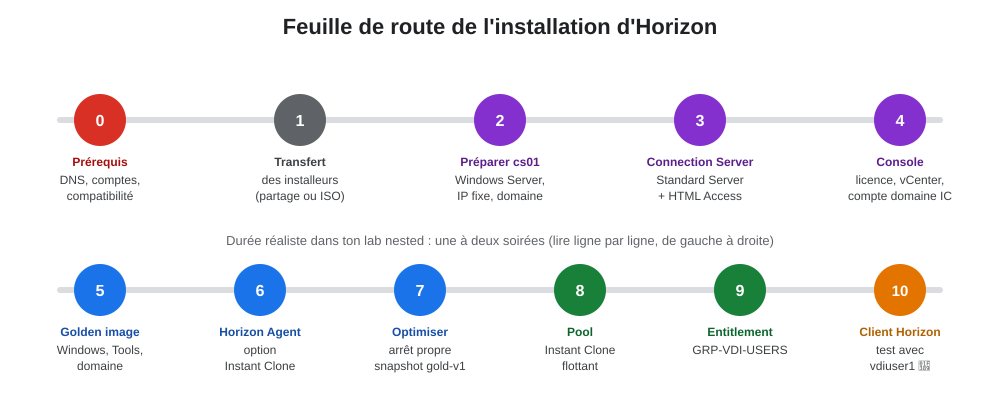

# 08 - Préparer l'infrastructure pour Horizon

> **Objectif de la page :** tout ce qu'il faut avant d'installer le Connection Server : le serveur Horizon dans l'AD, son modèle de certificat, et le vCenter (dossiers, absence de vTPM, rôle dédié au compte d'Horizon). La golden image fait l'objet de la page 09.

---

## 1. Ce dont Horizon a besoin

```
                 ┌──────────── AD (DC01) ────────────┐
                 │  comptes, groupes, OU=Postes      │
                 │  DNS, DHCP, autorité LAB-ROOT-CA  │
                 └──────────────┬────────────────────┘
                                │
 Utilisateur ──► Connection Server (horizon.lab.lan) ──svc-horizon-vc──► vCenter ──► ESXi
                                │                                         clone la golden image
                                └──svc-horizon-ic──► joint chaque clone au domaine (OU=Postes)
```

| Brique | Ce qu'Horizon lui demande | Prêt depuis |
|---|---|---|
| AD | Vérifier les utilisateurs, joindre les bureaux | Page 04 |
| DHCP | Une IP par bureau | Page 04 |
| PKI | Un certificat de confiance pour le Connection Server | Partie 3 |
| vCenter | Créer, allumer, supprimer les bureaux, **au moindre privilège** | Partie 4 |
| Golden image | Le modèle des bureaux | Page 09 |



---

## 2. Le serveur Horizon dans l'AD

### 2.1 La VM


| Point | Attendu | Chez toi |
|---|---|---|
| OS | Windows Server 2019, 2022 ou 2025, à jour | Windows Server 2022 ✅ |
| IP | **Fixe**, DNS = `192.168.50.10` **uniquement** | 192.168.50.13 ✅ |
| Nom | `Horizon.lab.lan`, joint au domaine | ✅ |
| OU | `LAB > Serveurs` | ✅ (page 04) |
| Processeur | 2 vCPU | ✅ |
| Mémoire | 4 Go minimum selon Omnissa (10 Go au-delà de 50 bureaux). **6 Go** suffisent au lab | À ajuster |
| Rôles | Aucun autre rôle, pas d'IIS | — |

### 2.2 Le DNS

1. **DNS > lab.lan** : `Horizon` → `192.168.50.13`.
2. **50.168.192.in-addr.arpa** : le pointeur `13` → `Horizon.lab.lan`.
3. S'il en manque un : `ipconfig /registerdns` sur la VM Horizon, puis **F5**.

> Ce nom est celui que les utilisateurs taperont dans le client, et celui que portera le certificat. Il doit se résoudre dans les deux sens.

### 2.3 `GG-HZN-Admins` administrateur local

Sur la VM Horizon, avec un compte déjà administrateur (le compte local `Administrateur`). **Pas `adm-dom-afaye`** : tier 0, uniquement sur les DC.

1. Clic droit sur **Démarrer > Gestion de l'ordinateur**.
2. **Utilisateurs et groupes locaux > Groupes > Administrateurs** > **Ajouter…** > `GG-HZN-Admins` > **Vérifier les noms** > **OK**.
3. Déconnecte-toi et reconnecte-toi en **LAB\adm-hzn-afaye**. Toute la suite sur la VM Horizon se fait avec ce compte.

---

## 3. Le modèle de certificat LAB-HorizonServer

Par défaut, Horizon génère un certificat **auto-signé** : alerte dans le navigateur et dans le client. On fait délivrer un vrai certificat par LAB-ROOT-CA, avec un **modèle dédié** (la CA n'en publie aucun par défaut, page 05).

### 3.1 Créer le modèle

Sur DC01 : `certtmpl.msc` > clic droit sur **Serveur Web** > **Dupliquer le modèle**.

**Compatibilité :** Windows Server 2016 / Windows 10 – Windows Server 2016.

**Général :** nom `LAB-HorizonServer`, validité **1 an**, renouvellement **6 semaines**, ☐ **Publier le certificat dans Active Directory**.


**Traitement de la demande :** ☑ **Autoriser l'exportation de la clé privée**. Horizon l'exige.


**Chiffrement :** **Services de chiffrement hérités**, taille **2048**, ● *Les demandes doivent utiliser l'un des fournisseurs suivants* : ☑ **Microsoft RSA SChannel Cryptographic Provider** seulement.


> **Pourquoi un fournisseur « hérité » ?** Le Connection Server est une application Java : il lit plus facilement une clé stockée par l'ancien fournisseur SChannel que par le fournisseur moderne (KSP).

**Nom du sujet :** ● **Construire à partir des informations de cet annuaire Active Directory**, format **Nom DNS**, ☑ **Nom DNS**. Décoche le reste.


> 🔒 **Le réglage le plus important.** Le nom vient de l'AD (`Horizon.lab.lan`), le demandeur ne peut pas le choisir : pas d'attaque **ESC1**.

**Sécurité :** **Ajouter…** > **Types d'objets** > ☑ **Ordinateurs** > `HORIZON` > **OK**. Pour **HORIZON (LAB\HORIZON$)** : ☑ **Lecture**, ☑ **Inscrire**. Pas d'inscription automatique.


> 🔒 Seule la machine **HORIZON$** peut demander ce certificat. Les *Utilisateurs authentifiés* n'ont que la **Lecture**.

**OK**.

### 3.2 Publier le modèle

`certsrv.msc` > **LAB-ROOT-CA** > clic droit sur **Modèles de certificats** > **Nouveau > Modèle de certificat à délivrer** > **LAB-HorizonServer** > **OK**.


> ⚠️ **Redémarre la VM Horizon** après la publication. HORIZON$ ne voit son nouveau droit qu'avec un nouveau ticket Kerberos. Sinon, le modèle n'apparaîtra pas lors de la demande (page 10).

---

## 4. Préparer le vCenter

Dans le vSphere Client, connecté en **adm-vmw-afaye@lab.lan**.

### 4.1 Les dossiers de VM

1. Onglet **VM et modèles** > clic droit sur **DC-LAB** > **Nouveau dossier > Nouveau dossier de VM et de modèles**.
2. Crée **VDI**, puis dedans **Golden-Image** et **Pools**.


> Horizon rangera ses bureaux dans **Pools**. On pourra plus tard restreindre les droits d'Horizon à ce seul dossier.

### 4.2 Pas de fournisseur de clés ni de vTPM

Windows 11 réclame une puce **TPM**. En VM, c'est un **vTPM**, qui exige un **fournisseur de clés** dans le vCenter. Le fournisseur natif (NKP) est intégré au vCenter, mais il n'est **utilisable qu'une fois sauvegardé**. Dans le lab, la sauvegarde échoue :


> **Piège rencontré :** la sauvegarde échoue avec ou sans mot de passe. La cause la plus probable est le nom d'hôte système du vCenter, resté `localhost` (page 03). Le corriger renommerait le PNID. **On renonce donc au vTPM** dans le lab.

**Supprime NKP-LAB** (jamais sauvegardé, utilisé par aucune VM) :

1. **192.168.50.12 > Configurer > Sécurité > Fournisseurs de clés**.
2. **NKP-LAB** > **⋯** > **Supprimer** > confirme. La liste doit être vide.

> On contournera la vérification du TPM à l'installation de Windows 11 (page 09). **En production, on garde le vTPM**, avec un fournisseur de clés sauvegardé.

### 4.3 Le rôle Horizon-InstantClone

`svc-horizon-vc` reçoit **seulement** les privilèges nécessaires aux clones instantanés (documentation Omnissa *Privileges Required for the vCenter Server User With Instant Clones*), **sans les opérations de chiffrement** puisqu'il n'y a pas de fournisseur de clés.

**Menu ☰ > Administration > Contrôle d'accès > Rôles** > **Nouveau** > nom `Horizon-InstantClone`. Choisis chaque catégorie dans la colonne de gauche et coche :

| Catégorie | Privilèges |
|---|---|
| **Banque de données** | Allouer espace · Opérations de fichier de niveau inférieur · Parcourir banque de données |
| **Dossier** | Créer dossier · Supprimer dossier |
| **Global** | Activer des méthodes · Agir en tant que vCenter Server · Balise système · Désactiver des méthodes |
| **Hôte** | Configuration > Paramètres avancés · Inventaire > Modifier cluster |
| **Réseau** | Assigner réseau |
| **Ressource** | Attribuer une machine virtuelle au pool de ressources · Migrer la machine virtuelle hors tension |
| **Stratégies de stockage de machine virtuelle** | Afficher les stratégies de stockage VM · Mettre à jour les stratégies de stockage de VM |
| **Machine virtuelle > Gestion des snapshots** | Créer un snapshot · Restaurer un snapshot · Supprimer le snapshot |
| **Machine virtuelle > Interaction** | Connecter des périphériques · Exécuter des opérations d'effacement ou de réduction · Interaction avec une console · Mettre hors tension · Mettre sous tension · Réinitialiser |
| **Machine virtuelle > Modifier l'inventaire** | Créer · Créer à partir d'un modèle existant · Déplacer · Supprimer |
| **Machine virtuelle > Modifier la configuration** | **Tout** (coche la case *Modifier la configuration* elle-même) |
| **Machine virtuelle > Provisionnement** | Autoriser l'accès au disque · Cloner machine virtuelle · Cloner modèle · Déployer modèle · Lire les spécifications de personnalisation · Personnaliser l'invité |

**Créer**. Une capture par catégorie :

**Banque de données**


**Dossier**


**Global** (*Désactiver des méthodes* est plus bas dans la liste)


**Hôte** (*Paramètres avancés* est plus haut, dans *Configuration*)


**Réseau**


**Ressource**


**Stratégies de stockage de machine virtuelle**


**Machine virtuelle** (ici *Modifier la configuration*, entièrement cochée ; les autres sous-catégories suivent le tableau)


> **Contrôle :** **Rôles** > **Horizon-InstantClone** > onglet **Privilèges** : compare l'arborescence au tableau.
>
> Si plus tard une tâche Horizon échoue avec « permission refusée », le message des **Tâches récentes** du vCenter **nomme le privilège manquant**. Le premier candidat est *Machine virtuelle > Interaction > Interrompre*, cité dans certaines versions de la liste Omnissa.

### 4.4 Donner le rôle à `svc-horizon-vc`

La documentation Omnissa demande une autorisation **sur l'objet vCenter Server**, ni globale, ni sur un dossier.

1. **Hôtes et clusters** > **192.168.50.12** (tout en haut) > onglet **Autorisations** > **Ajouter**.
2. Domaine **LAB.lan**, utilisateur **svc-horizon-vc**, rôle **Horizon-InstantClone**, ☑ **Propager vers les enfants** > **OK**.


**Contrôle :** `LAB\svc-horizon-vc`, rôle **Horizon-InstantClone**, défini dans **Cet objet et ses enfants**.


> 🔒 `svc-horizon-vc` **ne doit pas** être dans `GG-VMW-Admins`. S'il fuit, l'attaquant peut manipuler des VM, mais pas reconfigurer le vCenter, l'ESXi ni le SSO.

---

## 5. Juste avant l'installation

1. Copie l'installeur **Omnissa Horizon Connection Server** (x86_64) sur la VM Horizon.
2. Windows Update à jour, VM redémarrée (depuis la partie 3.2).
3. 📸 **Snapshot de la VM Horizon**, sans la mémoire. Supprime-le dès que l'installation fonctionne.

---

## 6. Checklist

| # | Point | Où | ✓ |
|---|---|---|---|
| 1 | A et PTR de `horizon.lab.lan` → .13 | 2.2 | ☐ |
| 2 | HORIZON dans `OU=Serveurs` | Page 04 | ✅ |
| 3 | `GG-HZN-Admins` administrateur local, session `adm-hzn-afaye` | 2.3 | ☐ |
| 4 | Modèle **LAB-HorizonServer** créé et publié | 3 | ✅ |
| 5 | VM Horizon redémarrée après la publication | 3.2 | ☐ |
| 6 | Dossiers VDI/Golden-Image et VDI/Pools | 4.1 | ✅ |
| 7 | **NKP-LAB supprimé** | 4.2 | ☐ |
| 8 | Rôle **Horizon-InstantClone** | 4.3 | ✅ |
| 9 | `svc-horizon-vc` → rôle sur 192.168.50.12, propagé | 4.4 | ✅ |
| 10 | Certificat du vCenter émis par LAB-ROOT-CA (conseillé) | Page 07 | ☐ |
| 11 | Installeur copié, snapshot pris | 5 | ☐ |

---

## 7. Quiz

<details><summary><b>1. Pourquoi le modèle LAB-HorizonServer autorise-t-il l'exportation de la clé privée, alors que celui des DC l'interdit ?</b></summary> <p>Le Connection Server l'exige pour utiliser le certificat. Le risque reste limité : seul HORIZON$ peut obtenir ce certificat.</p></details>

<details><summary><b>2. Pourquoi faut-il redémarrer la VM Horizon après la publication du modèle ?</b></summary> <p>Le compte ordinateur HORIZON$ ne voit son nouveau droit d'inscription qu'avec un nouveau ticket Kerberos, obtenu au redémarrage.</p></details>

<details><summary><b>3. Pourquoi le lab se passe-t-il du vTPM ?</b></summary> <p>Le vTPM exige un fournisseur de clés sauvegardé, et la sauvegarde du fournisseur natif échoue dans ce vCenter. On contourne la vérification du TPM à l'installation de Windows 11.</p></details>

<details><summary><b>4. Où donne-t-on le rôle Horizon-InstantClone, et pourquoi pas en autorisation globale ?</b></summary> <p>Sur l'objet vCenter 192.168.50.12, propagé, comme le demande Omnissa. Une autorisation globale couvrirait aussi les licences, étiquettes et vCenter liés, ce dont Horizon n'a pas besoin.</p></details>

<details><summary><b>5. Pourquoi ne pas utiliser le rôle Administrateur pour svc-horizon-vc ?</b></summary> <p>Moindre privilège : si son mot de passe fuit, l'attaquant ne pourrait que manipuler des VM, pas prendre le contrôle du vCenter ni de l'ESXi.</p></details>

---

[⬅ 07 - Sécuriser vCenter et l'AD](/fr/hyperviseur/VDI/07-securiser-vcenter-ad) · [Sommaire](/fr/hyperviseur/VDI/00-sommaire) · Page suivante : [09 - La golden image ➜](/fr/hyperviseur/VDI/09-golden-image)
