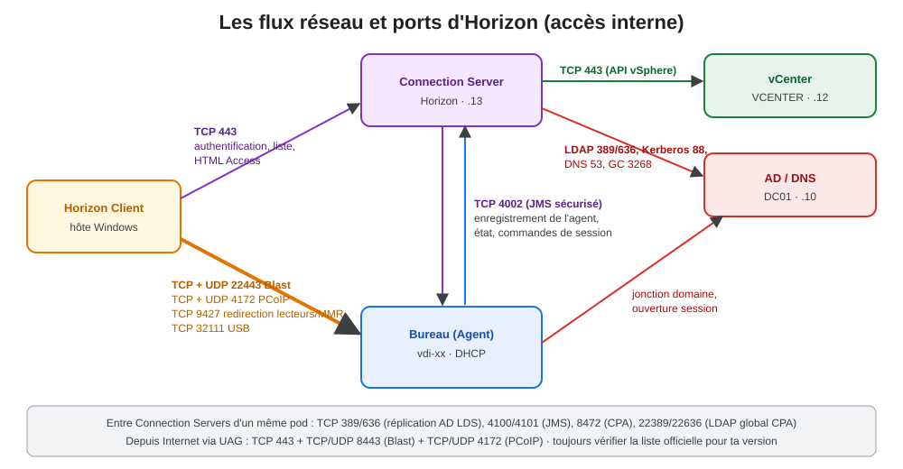

# 10 - Installer et configurer le Connection Server

> **Objectif de la page :** installer **Omnissa Horizon Connection Server** sur `horizon.lab.lan`, lui donner un certificat LAB-ROOT-CA, puis le relier à l'AD et au vCenter. À la fin, la console Horizon est prête à créer le premier pool (page 11).
>
> 📸 *Page à illustrer avec tes captures au moment où tu la réalises.*

---

## 1. Comprendre avant de faire

Le Connection Server est le **cœur** d'Horizon. Une fois installé, on lui donne :

| Élément | Pourquoi | Partie |
|---|---|---|
| Un certificat **LAB-ROOT-CA** au nom convivial `vdm` | Plus d'alerte dans le navigateur ni dans le client | 4 |
| Une **licence** | Sans licence, pas de pool | 5.1 |
| Le **vCenter**, avec `svc-horizon-vc` | Pour créer les bureaux | 5.2 |
| Le compte de jonction **`svc-horizon-ic`** | Pour joindre les clones au domaine | 5.3 |
| Les **administrateurs** par groupe AD | Gérer l'accès depuis l'AD | 3 et 5.4 |

---

## 2. Avant de commencer

| ✓ | Prérequis | Page |
|---|---|---|
| ☐ | VM Horizon à jour, IP fixe .13, DNS .10, dans OU=Serveurs, A et PTR OK | 08 |
| ☐ | Session ouverte en **LAB\adm-hzn-afaye**, administrateur local via `GG-HZN-Admins` | 08 |
| ☐ | Modèle LAB-HorizonServer publié, VM **redémarrée** depuis | 08 |
| ☐ | Installeur Connection Server copié, **snapshot** de la VM pris | 08 |
| ☐ | Une clé de licence Horizon (évaluation) | — |
| ☐ | Mot de passe de `svc-horizon-vc` et de `svc-horizon-ic` à portée (coffre) | 04 |

> Garde **la même version** pour le Connection Server et l'Agent de la golden image.

---

## 3. L'assistant d'installation

Clic droit sur `Omnissa-Horizon-Connection-Server-x86_64-….exe` > **Exécuter en tant qu'administrateur** :

| Écran | Choix |
|---|---|
| Welcome | **Next** |
| License Agreement | **I accept** > **Next** |
| Destination Folder | Par défaut > **Next** |
| **Installation Options** | **Horizon Standard Server** · ☑ **Install HTML Access** · IP : **IPv4** > **Next** |
| **Data Recovery** | Un **mot de passe de récupération** et un indice. Il sert à restaurer la configuration Horizon : **range-le dans ton coffre** |
| **Firewall Configuration** | ● **Configure Windows Firewall automatically** |
| **Initial Horizon Administrators** | ● **Authorize a specific domain user or domain group** > `LAB\GG-HZN-Admins` |
| User Experience Improvement Program | **Décoche** la participation |
| **Deployment type** | **General** |
| Ready to Install | **Install** |

**Finish**. Pas de redémarrage nécessaire.

> 🔒 **Pourquoi un groupe ?** Par défaut, Horizon donne la console à tous les administrateurs locaux du serveur. Avec `GG-HZN-Admins`, l'accès se gère dans l'AD.

**Contrôle :**

1. `services.msc` : **Omnissa Horizon Connection Server** est **En cours d'exécution**, démarrage **Automatique**.
2. Sur la VM, `https://horizon.lab.lan/admin` : la page s'ouvre, avec une **alerte de certificat**. C'est normal à ce stade.

---

## 4. Remplacer le certificat auto-signé

Horizon utilise le certificat dont le **nom convivial** est exactement **`vdm`**. On en installe un nouveau, on lui donne ce nom, et on le retire à l'ancien.

### 4.1 Demander le certificat

1. **Win + R** > `certlm.msc` > **Personnel > Certificats** > clic droit > **Toutes les tâches > Demander un nouveau certificat…**
2. **Suivant** > **Stratégie d'inscription Active Directory** > **Suivant**.
3. ☑ **LAB-HorizonServer** > **Inscription** > **Terminer**.

> **Le modèle n'apparaît pas ?** Coche **Afficher tous les modèles** : la raison s'affiche. Le plus souvent, c'est le droit *Inscrire* de HORIZON$ ou la VM non redémarrée (page 08, partie 3).

### 4.2 Les noms conviviaux

Il y a maintenant deux certificats `horizon.lab.lan` :

| Certificat | Comment le reconnaître | Action |
|---|---|---|
| Ancien, auto-signé | **Délivré par** : horizon.lab.lan · nom convivial `vdm` | Clic droit > **Propriétés** > nom convivial **`vdm-old`** > **OK** |
| Nouveau | **Délivré par** : **LAB-ROOT-CA** | Clic droit > **Propriétés** > nom convivial **`vdm`** > **OK** |

Sur le nouveau, onglet **Détails** > *Autre nom de l'objet* : `Nom DNS=Horizon.lab.lan`.

### 4.3 Redémarrer le service

`services.msc` > **Omnissa Horizon Connection Server** > **Redémarrer** (les services associés suivent). Attends 1 à 2 minutes.

### 4.4 Contrôle

Ferme et rouvre le navigateur > `https://horizon.lab.lan/admin` : **cadenas**, certificat délivré par **LAB-ROOT-CA**, aucune alerte.

> 🔁 **Renouvellement :** ce certificat expire dans **1 an**. Refais 4.1 à 4.3 un mois avant : un seul certificat doit porter le nom `vdm`. Note la date.

---

## 5. Configurer Horizon dans la console

`https://horizon.lab.lan/admin`, connecté en **adm-hzn-afaye**, domaine **LAB**.

### 5.1 La licence

1. **Paramètres > Licence et utilisation** > **Modifier la licence**.
2. Colle la clé > **OK**.
3. **Contrôle :** date d'expiration et fonctions affichées (*Clone instantané*…).

### 5.2 Le vCenter

1. **Paramètres > Serveurs** > onglet **vCenter Server** > **Ajouter**.

| Champ | Valeur |
|---|---|
| Adresse du serveur | **`192.168.50.12`** |
| Nom d'utilisateur | `svc-horizon-vc@lab.lan` |
| Mot de passe | Celui du compte |
| Paramètres avancés | Par défaut |

> ⚠️ **L'IP, pas un nom :** c'est le PNID du vCenter, et son certificat est émis pour elle (pages 03 et 07).

2. **Suivant**.
   - Si tu as fait la page 07, le certificat du vCenter est **émis par LAB-ROOT-CA** : aucune alerte.
   - Sinon, la fenêtre **Certificat non valide détecté** s'ouvre (certificat de la VMCA) : **Afficher le certificat**, vérifie que c'est bien le vCenter, **Accepter**.
3. **Paramètres de stockage** : laisse ☑ **Récupérer l'espace disque de la VM** et ☑ **Activer View Storage Accelerator** (cache 1024 Mo) > **Suivant** > **Envoyer**.
4. **Contrôle :** **Surveiller > Tableau de bord** : le vCenter est **vert**.

> **Erreur de privilège ?** Revois le rôle et l'autorisation **sur l'objet vCenter** (page 08, partie 4).

### 5.3 Le compte de jonction au domaine

1. **Paramètres > Administrateurs de domaine Instant Clone** > **Ajouter**.
2. Domaine **lab.lan** · utilisateur `svc-horizon-ic` · mot de passe > **OK**.

> Ce compte ne peut agir que dans `OU=Postes` (page 04, partie 7). C'est pour ça qu'on peut le confier à Horizon.

### 5.4 Les administrateurs en lecture seule

1. **Paramètres > Administrateurs** > onglet **Utilisateurs et groupes administrateurs** > **Ajouter un utilisateur ou un groupe**.
2. **Ajouter** > `GG-HZN-ReadOnly` > **OK**.
3. Rôle **Administrateurs (lecture seule)**, groupe d'accès **/ (Racine)** > **Terminer**.
4. **Contrôle :** `GG-HZN-Admins` (Administrateurs) et `GG-HZN-ReadOnly` (lecture seule).

### 5.5 Les paramètres globaux

**Paramètres > Paramètres globaux** > **Modifier** :

| Onglet | Réglage |
|---|---|
| Général | **Délai d'expiration de la session Horizon Console** : 30 min |
| Général | **Délai d'expiration de la session de client** : 10 h |
| Sécurité | ☑ **Réauthentifier les connexions sécurisées après interruption réseau** |
| Sécurité | ☑ **Forcer la déconnexion des utilisateurs lors du retrait de la carte à puce** (sans effet ici, bonne habitude) |

### 5.6 La base d'événements

Horizon affiche un avertissement tant qu'aucune **base d'événements** (SQL Server ou PostgreSQL) n'est configurée. Dans le lab, **ignore-le**. Elle servira plus tard à garder l'historique des connexions.

---

## 6. Contrôle de santé

**Surveiller > Tableau de bord > État du système** :

| Composant | Attendu |
|---|---|
| Connection Server | Vert |
| vCenter Server | Vert |
| Domaines | `lab.lan` vert |
| Base d'événements | Avertissement (normal) |

Tout est vert ? **Supprime le snapshot** de la VM Horizon.

---

## 7. Depuis ton PC (hors domaine)

Ton PC doit **résoudre** `horizon.lab.lan` et **faire confiance** à LAB-ROOT-CA.

1. **DNS :** la carte **VMnet8** du PC utilise `192.168.50.10` (page 03). À défaut, ajoute `192.168.50.13  horizon.lab.lan` dans `C:\Windows\System32\drivers\etc\hosts` (Bloc-notes en administrateur).
2. **Certificat racine :** copie `lab-root-ca.cer` (exporté en page 07, partie 1.5) sur le PC.
   - Double-clic > **Installer le certificat** > **Ordinateur local** > **Placer tous les certificats dans le magasin suivant** > **Autorités de certification racines de confiance** > **Terminer**.
3. Ouvre `https://horizon.lab.lan/admin` : plus d'alerte. Le vSphere Client (`https://192.168.50.12/ui`) non plus, si la page 07 est faite.

> 🔒 On n'importe **que le certificat racine**, jamais une clé privée. Ton PC fait désormais confiance à tout ce que signe LAB-ROOT-CA : c'est une raison de plus pour garder la CA verrouillée (page 05).

Le client Horizon et la première connexion à un bureau sont en page 11.

---

## 8. Checklist

| ✓ | Vérification |
|---|---|
| ☐ | Service Connection Server démarré, automatique |
| ☐ | Mot de passe de récupération rangé dans le coffre |
| ☐ | Console réservée à `GG-HZN-Admins`, lecture seule pour `GG-HZN-ReadOnly` |
| ☐ | Un seul certificat `vdm`, délivré par LAB-ROOT-CA, date de renouvellement notée |
| ☐ | Licence active |
| ☐ | vCenter ajouté **par son IP** avec `svc-horizon-vc`, état vert |
| ☐ | `svc-horizon-ic` déclaré comme administrateur de domaine Instant Clone |
| ☐ | Paramètres globaux de sécurité appliqués |
| ☐ | PC : `horizon.lab.lan` résolu, LAB-ROOT-CA de confiance |
| ☐ | Snapshot de la VM Horizon supprimé |

---

## 9. Dépannage

| Symptôme | Cause probable | Solution |
|---|---|---|
| L'ajout du vCenter échoue (« permission ») | Rôle mal posé | Rôle **sur l'objet vCenter**, propagé (page 08, partie 4) |
| L'ajout échoue (« le nom ne correspond pas ») | Ajouté par son nom | Ajoute-le par **192.168.50.12** |
| LAB-HorizonServer absent de certlm | Droit *Inscrire* ou VM non redémarrée | Page 08, partie 3, puis redémarre |
| Toujours l'ancien certificat | Nom convivial | Un seul certificat `vdm`, puis redémarre le service |
| Connexion à la console refusée pour adm-hzn-afaye | Pas dans `GG-HZN-Admins`, ou groupe mal saisi à l'installation | **Paramètres > Administrateurs** avec un autre compte admin, ou vérifie le groupe dans l'AD |
| Avertissement « base d'événements » | Non configurée | Normal (5.6) |

**Journaux :** `C:\ProgramData\Omnissa\VDM\logs` (anciennes versions : `C:\ProgramData\VMware\VDM\logs`).

---

## 10. Quiz

<b>1. Comment Horizon sait-il quel certificat utiliser ?</b>
 
Il prend le certificat de l'ordinateur dont le nom convivial est exactement vdm. Il ne doit y en avoir qu'un.

<b>2. Pourquoi ajouter le vCenter par 192.168.50.12 et pas vcenter.lab.lan ?</b>
 
C'est son PNID : ses certificats sont émis pour cette IP. Avec le nom, la vérification du certificat échouerait.

<b>3. À quoi sert le mot de passe de récupération demandé à l'installation ?</b>
 
À restaurer la configuration Horizon depuis une sauvegarde. Sans lui, la sauvegarde est inutilisable.

<b>4. Pourquoi choisir GG-HZN-Admins comme administrateurs initiaux ?</b>
 
Pour que l'accès à la console se gère dans l'AD, au lieu de le donner à tous les administrateurs locaux du serveur.

<b>5. Pourquoi importer LAB-ROOT-CA sur ton PC, et pas sur la VM Horizon ?</b>
 
La VM Horizon est dans le domaine : elle fait déjà confiance à LAB-ROOT-CA par l'AD. Ton PC n'est pas dans le domaine, il faut lui ajouter la racine à la main.

---

[⬅ 09 - La golden image](/fr/hyperviseur/VDI/09-golden-image) · [Sommaire](/fr/hyperviseur/VDI/00-sommaire) · Page suivante : *11 - Premier pool et premier bureau (à venir)*
