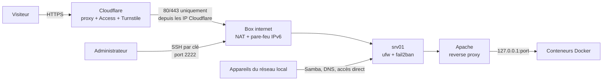

# Sécuriser un serveur Ubuntu auto-hébergé derrière Cloudflare

> Guide pas à pas, avec **le pourquoi** de chaque étape et **le retour arrière**.
> Exemple de départ : un serveur Ubuntu 24.04 à la maison, derrière une box internet, qui
> héberge un site web, quelques applications Docker et un partage de fichiers Samba.

---

## Sommaire

0. [Le contexte de l'exemple](#0-le-contexte-de-lexemple)
1. [Les règles d'or avant de commencer](#1-les-règles-dor-avant-de-commencer)
2. [Faire l'état des lieux](#2-faire-létat-des-lieux)
3. [Mettre le système à jour](#3-mettre-le-système-à-jour)
4. [SSH : connexion par clés uniquement](#4-ssh--connexion-par-clés-uniquement)
5. [fail2ban : bannir les attaques par force brute](#5-fail2ban--bannir-les-attaques-par-force-brute)
6. [Le pare-feu ufw](#6-le-pare-feu-ufw)
7. [La box internet : ports, UPnP, IPv6](#7-la-box-internet--ports-upnp-ipv6)
8. [Docker : ne pas exposer les ports des conteneurs](#8-docker--ne-pas-exposer-les-ports-des-conteneurs)
9. [Apache : masquer les versions et faire le ménage](#9-apache--masquer-les-versions-et-faire-le-ménage)
10. [Cloudflare : proxy, TLS, redirection www](#10-cloudflare--proxy-tls-redirection-www)
11. [Cloudflare Access (Zero Trust) pour les outils d'admin](#11-cloudflare-access-zero-trust-pour-les-outils-dadmin)
12. [Cloudflare Turnstile sur un formulaire de contact](#12-cloudflare-turnstile-sur-un-formulaire-de-contact)
13. [DNSSEC](#13-dnssec)
14. [Des scripts de sauvegarde sûrs](#14-des-scripts-de-sauvegarde-sûrs)
15. [Une procédure de restauration fiable](#15-une-procédure-de-restauration-fiable)
16. [Les erreurs classiques (et comment s'en remettre)](#16-les-erreurs-classiques-et-comment-sen-remettre)
17. [Récapitulatif, retours arrière et entretien](#17-récapitulatif-retours-arrière-et-entretien)

---

## 0. Le contexte de l'exemple

Toutes les valeurs sont **fictives**. Remplace-les par les tiennes.

| Élément | Valeur d'exemple |
|---|---|
| Système | Ubuntu Server 24.04 LTS |
| Nom du serveur | `srv01` |
| Utilisateur | `admin` |
| Réseau local | `192.168.1.0/24` |
| Adresse du serveur sur le réseau local | `192.168.1.10` |
| Adresse de la box | `192.168.1.254` |
| IP publique | `203.0.113.10` |
| Domaine | `example.com` (DNS chez Cloudflare, enregistré chez un registrar) |
| Port SSH | `2222` |
| Serveur web | Apache, en reverse proxy vers les applications |
| Applications Docker | un gestionnaire Docker (Portainer), un client torrent, un indexeur, un cloud de fichiers, un gestionnaire de mots de passe, un wiki… |
| Partage de fichiers | Samba, dossier `/home/admin/Partage` |

### Le modèle visé



**L'idée :** depuis Internet, il ne reste que **deux portes**.
- Le **web (80/443)**, qui n'accepte que Cloudflare. Cloudflare filtre, protège les outils
  d'administration par une connexion, et cache l'IP réelle.
- Le **SSH**, qui n'accepte que des clés, et dont fail2ban surveille les échecs.

Tout le reste n'est joignable que depuis le réseau local.

---

## 1. Les règles d'or avant de commencer

1. **Une commande à la fois.** Lis ce qu'elle fait, tape-la, regarde le résultat avant de
   passer à la suivante.
2. **Garde toujours une session SSH ouverte** pendant que tu touches au SSH ou au pare-feu,
   et teste dans une **deuxième** session. Une session déjà ouverte n'est pas coupée : c'est
   ton filet de sécurité.
3. **N'édite pas les fichiers d'origine** des paquets (`sshd_config`, `jail.conf`,
   `security.conf`…). Ajoute **tes** fichiers dans les dossiers `.d/` prévus pour ça. Les
   mises à jour ne les écrasent pas, et le retour arrière consiste à supprimer un fichier.
4. **Vérifie la syntaxe avant d'appliquer** (`sshd -t`, `apache2ctl configtest`,
   `fail2ban-client -t`).
5. **Préfère `reload` à `restart`** quand c'est possible : la configuration est relue sans
   couper le service.
6. **Note tout** : ce que tu as changé, où, et comment revenir en arrière. Ce guide sert
   aussi à ça.
7. **Utilise des chemins complets** pour tout ce qui supprime (`rm`, `find -delete`). Voir la
   [section 16](#16-les-erreurs-classiques-et-comment-sen-remettre).

---

## 2. Faire l'état des lieux

On ne sécurise bien que ce qu'on connaît. Ces commandes **ne modifient rien**.

### 2.1 Quels services écoutent sur le serveur ?
```bash
sudo ss -tulpn
```
- `t` / `u` : TCP et UDP ; `l` : les ports en écoute ; `p` : le programme ; `n` : les
  numéros plutôt que les noms.
- Regarde la colonne d'adresse :
  - `127.0.0.1:port` : joignable **uniquement depuis le serveur lui-même**. C'est bien.
  - `0.0.0.0:port` ou `[::]:port` : joignable **depuis toutes les interfaces**, donc
    potentiellement depuis Internet.

### 2.2 Quels ports publient les conteneurs Docker ?
```bash
sudo docker ps --format "table {{.Names}}\t{{.Ports}}"
```
- `0.0.0.0:9443->9443/tcp` : le port est ouvert sur toutes les interfaces.
- `127.0.0.1:9998->80/tcp` : le port n'est ouvert qu'en local. C'est le bon modèle.
- Colonne vide : soit le conteneur n'expose rien, soit il est en mode `network_mode: host`
  ou `service:…` (voir la [section 6.4](#64-docker-et-ufw--ce-quil-faut-comprendre)).

### 2.3 Où Apache renvoie-t-il le trafic ?
```bash
sudo grep -RiE "ServerName|ProxyPass " /etc/apache2/sites-enabled/
```
Le `-R` **majuscule** est important. Les fichiers de `sites-enabled/` sont des liens
symboliques, et `grep -r` en minuscule ne les suit pas : il ne trouverait rien.

### 2.4 Le serveur a-t-il une adresse IPv6 publique ?
```bash
ip -6 addr show scope global
```
Si une adresse `2xxx:…` apparaît, le serveur est **directement adressable depuis Internet
en IPv6** : il n'y a pas de NAT pour le cacher. Le pare-feu IPv6 de la box devient alors
indispensable ([section 7.3](#73-le-pare-feu-ipv6)).

### 2.5 D'où viennent les connexions SSH ?
```bash
sudo journalctl -u ssh --since "-7 days" | grep -E "Accepted|Failed" | tail -n 30
```

### 2.6 Tester depuis l'extérieur
Fais ces tests **depuis un téléphone en 4G, Wi-Fi coupé**. Depuis chez toi, tu sortirais
avec ta propre IP publique, et la box te répondrait « de l'intérieur » : le résultat ne
voudrait rien dire.
- Ouvre `https://example.com` et les sous-domaines.
- Essaie `http://203.0.113.10:9443`, ou tout autre port d'application. Ça **ne doit pas**
  répondre.

### 2.7 Ce que le site révèle
```bash
curl -sI https://example.com
```
Regarde les en-têtes `Server:` et `X-Powered-By:`. Ils ne doivent donner **aucune version**.

---

## 3. Mettre le système à jour

```bash
sudo apt update
```
```bash
sudo apt upgrade
```
- `update` rafraîchit la liste des paquets disponibles.
- `upgrade` installe les mises à jour.

**Pourquoi :** la plupart des intrusions exploitent des failles **déjà corrigées** dans des
logiciels qui n'ont pas été mis à jour.

Pour les correctifs de sécurité automatiques :
```bash
sudo apt install unattended-upgrades
```
```bash
sudo dpkg-reconfigure -plow unattended-upgrades
```

---

## 4. SSH : connexion par clés uniquement

### Pourquoi
Un mot de passe peut être deviné, volé ou réutilisé. Une **clé SSH ed25519** est
pratiquement impossible à forcer. Une fois les clés en place, on **interdit** les mots de
passe : les robots qui testent des mots de passe toute la journée n'ont plus aucune chance.

### 4.1 Voir les clés déjà autorisées *(sur le serveur)*
```bash
cat ~/.ssh/authorized_keys
```
Chaque ligne est une **clé publique** autorisée à se connecter.

### 4.2 Créer une clé *(sur ton ordinateur)*
```bash
ssh-keygen -t ed25519 -C "pc-admin"
```
- `id_ed25519` : la clé **privée**. Elle ne quitte **jamais** ton ordinateur.
- `id_ed25519.pub` : la clé **publique**, celle qu'on envoie au serveur.
- Une **phrase de passe** est conseillée : elle protège la clé si l'ordinateur est volé.

### 4.3 Envoyer la clé publique au serveur
Linux et macOS :
```bash
ssh-copy-id -p 2222 admin@192.168.1.10
```
Windows (PowerShell), où `ssh-copy-id` n'existe pas :
```powershell
type $env:USERPROFILE\.ssh\id_ed25519.pub | ssh -p 2222 admin@192.168.1.10 "mkdir -p ~/.ssh && chmod 700 ~/.ssh && cat >> ~/.ssh/authorized_keys && chmod 600 ~/.ssh/authorized_keys"
```
Les droits `700` sur `~/.ssh` et `600` sur `authorized_keys` sont **obligatoires**. Sinon,
SSH refuse la clé par sécurité.

Fais pareil pour chaque appareil : téléphone, autre ordinateur… Les applications SSH mobiles
ont en général une fonction « exporter la clé vers l'hôte ».

### 4.4 Tester la connexion par clé seule
```bash
ssh -p 2222 -o PreferredAuthentications=publickey -o PasswordAuthentication=no admin@192.168.1.10
```
Cette commande **interdit** le mot de passe. Si tu entres, la clé fonctionne.

> ⛔ **Ne passe pas à la suite tant que TOUS tes appareils entrent par clé.**

### 4.5 Le fichier de durcissement
```bash
sudo vi /etc/ssh/sshd_config.d/00-securisation.conf
```
```
PasswordAuthentication no
KbdInteractiveAuthentication no
PermitRootLogin no
PubkeyAuthentication yes
MaxAuthTries 3
LoginGraceTime 30
X11Forwarding no
AllowUsers admin
```

| Ligne | Rôle |
|---|---|
| `PasswordAuthentication no` | Interdit les mots de passe |
| `KbdInteractiveAuthentication no` | Ferme l'autre porte « mot de passe » (le mode clavier interactif, via PAM) |
| `PermitRootLogin no` | `root` ne peut jamais se connecter directement : on passe par son compte, puis `sudo` |
| `PubkeyAuthentication yes` | Autorise les clés |
| `MaxAuthTries 3` | Coupe la connexion après 3 essais ratés |
| `LoginGraceTime 30` | 30 secondes au maximum pour s'identifier |
| `X11Forwarding no` | Pas d'affichage graphique à distance, inutile sur un serveur |
| `AllowUsers admin` | Seul ce compte peut se connecter. Liste plusieurs comptes séparés par des espaces si besoin. |

**Pourquoi `sshd_config.d/` et le préfixe `00-` ?** Ubuntu place
`Include /etc/ssh/sshd_config.d/*.conf` **en haut** de `sshd_config`. Pour SSH, **c'est la
première valeur lue qui gagne**. `00-` est lu avant tout autre fichier, comme le
`50-cloud-init.conf` qui réactive parfois les mots de passe. Et les mises à jour ne touchent
jamais à ton fichier.

### 4.6 Vérifier, puis appliquer
```bash
sudo sshd -t
```
**Aucun message** veut dire que la syntaxe est bonne.
```bash
sudo systemctl restart ssh
```
Sur Ubuntu 24.04, le service s'appelle `ssh`. Les sessions déjà ouvertes restent actives.

Si tu changes aussi le **port**, Ubuntu 24.04 utilise l'activation par socket (`ssh.socket`).
Après modification, il faut lancer `sudo systemctl daemon-reload`, puis
`sudo systemctl restart ssh.socket`.

### 4.7 Tester dans une nouvelle fenêtre
- Avec la clé : tu dois entrer.
- En forçant le mot de passe :
  ```bash
  ssh -p 2222 -o PubkeyAuthentication=no admin@192.168.1.10
  ```
  Attendu : **`Permission denied (publickey)`**.

### 4.8 Voir la configuration réellement appliquée
```bash
sudo sshd -T | grep -E "passwordauthentication|permitrootlogin|maxauthtries|allowusers"
```

### Retour arrière
```bash
sudo rm /etc/ssh/sshd_config.d/00-securisation.conf
```
```bash
sudo systemctl restart ssh
```

---

## 5. fail2ban : bannir les attaques par force brute

### Pourquoi
fail2ban lit les journaux, repère les IP qui ratent leur connexion plusieurs fois, et les
**bannit** pour un temps en ajoutant une règle de pare-feu. Même avec les clés obligatoires,
il réduit le bruit et freine les scanners.

### 5.1 Voir ce qui existe
```bash
sudo fail2ban-client status
```
```bash
sudo grep -vE '^\s*(#|$)' /etc/fail2ban/jail.local /etc/fail2ban/jail.d/*.conf
```
La deuxième commande affiche la configuration sans les commentaires.

**Piège courant :** la prison `sshd` d'Ubuntu surveille bien les échecs, mais elle bannit
sur le **port 22**. Si ton SSH écoute sur un autre port, le ban ne sert à rien.

### 5.2 Ton fichier de configuration
```bash
sudo vi /etc/fail2ban/jail.d/zz-securisation.conf
```
```
[DEFAULT]
ignoreip = 127.0.0.1/8 ::1 192.168.1.0/24
bantime = 1h
findtime = 10m
maxretry = 5

[sshd]
enabled = true
port = 2222
backend = systemd
```

| Ligne | Rôle |
|---|---|
| `ignoreip` | Ne jamais bannir le serveur lui-même ni le réseau local. Voir l'encadré ci-dessous. |
| `bantime = 1h` | Une IP bannie est bloquée 1 heure |
| `findtime` + `maxretry` | 5 échecs en 10 minutes déclenchent le ban |
| `port = 2222` | Le ban s'applique sur **le vrai port SSH** |
| `backend = systemd` | Lit le journal systemd. Sur Ubuntu récent, il n'y a plus de `/var/log/auth.log` par défaut. |

> **Le piège du « NAT en épingle » (hairpin NAT).** Depuis le réseau local, si tu te
> connectes à ton propre domaine ou à ton IP publique, la box renvoie la connexion vers le
> serveur, et elle apparaît comme venant **de la box** (`192.168.1.254`). Sans `ignoreip`,
> une erreur de mot de passe depuis chez toi bannirait la box… donc toute la maison.

**Pourquoi `zz-` ?** Pour fail2ban, c'est l'inverse de SSH : **le dernier fichier lu
gagne**. `zz-` passe après `defaults-debian.conf`.

### 5.3 Neutraliser une prison en double
Si `status` liste aussi une prison `ssh` (en plus de `sshd`), trouve d'où elle vient :
```bash
sudo grep -rn "^\[ssh\]" /etc/fail2ban/
```
Si elle vient d'un `jail.conf` modifié à la main (une ancienne habitude de tutoriel), ne
touche pas à ce fichier. Désactive-la dans **ton** fichier en ajoutant :
```
[ssh]
enabled = false
```

### 5.4 Vérifier et appliquer
```bash
sudo fail2ban-client -t
```
```bash
sudo systemctl restart fail2ban
```
```bash
sudo fail2ban-client status
```
Pour vérifier que le ban vise le bon port :
```bash
sudo fail2ban-client -d | grep "'sshd'" | grep -i port
```
Le résultat doit contenir `2222`.

Le message `WARNING 'allowipv6' not defined` est **sans conséquence**. Pour le faire
disparaître, crée `/etc/fail2ban/fail2ban.local` avec :
```
[Definition]
allowipv6 = auto
```

### Retour arrière
```bash
sudo rm /etc/fail2ban/jail.d/zz-securisation.conf
```
```bash
sudo systemctl restart fail2ban
```

---

## 6. Le pare-feu ufw

### Pourquoi
Par défaut, Ubuntu accepte toutes les connexions entrantes vers les services qui écoutent.
Avec ufw, on **refuse tout par défaut**, puis on n'ouvre que le nécessaire. Le web (80/443)
n'est ouvert **qu'aux adresses de Cloudflare** : personne ne peut contourner Cloudflare en
visant directement l'IP publique.

### 6.1 Préparer les règles
Tant qu'on n'a pas lancé `ufw enable`, **rien n'est bloqué**.

```bash
sudo ufw status verbose
```
Ça doit afficher `Status: inactive`.

```bash
sudo ufw default deny incoming
```
Refuse tout ce qui entre par défaut.

```bash
sudo ufw default allow outgoing
```
Le serveur garde le droit de sortir : mises à jour, mails, appels à Cloudflare.

```bash
sudo ufw allow 2222/tcp comment 'SSH'
```
**La règle qui t'évite de t'enfermer dehors.** Tape-la en premier.

```bash
sudo ufw allow from 192.168.1.0/24 comment 'Reseau local'
```
Les appareils de la maison gardent accès à tout : Samba, DNS local, applications.

```bash
sudo ufw allow from 172.16.0.0/12 comment 'Docker'
```
Les conteneurs doivent pouvoir joindre les services du serveur hôte. Les réseaux Docker
utilisent la plage `172.17.x` à `172.31.x`. Cette plage ne recouvre pas les adresses
Cloudflare en `172.64.x`.

```bash
for ip in $(curl -fsS https://www.cloudflare.com/ips-v4) $(curl -fsS https://www.cloudflare.com/ips-v6); do sudo ufw allow proto tcp from "$ip" to any port 80,443 comment 'Cloudflare'; done
```
Télécharge la liste officielle des adresses Cloudflare (IPv4 et IPv6), puis crée une règle
« 80/443 autorisés depuis cette adresse » pour chacune.

### 6.2 Relire, puis activer
```bash
sudo ufw show added
```
Relis chaque ligne. S'il reste d'anciennes règles que tu ne reconnais pas, renseigne-toi
avant de les supprimer : elles servent peut-être à un VPN ou à un bureau à distance.

```bash
sudo ufw enable
```

### 6.3 Tester tout de suite
| Test | Attendu |
|---|---|
| Nouvelle session SSH depuis le réseau local | ✅ |
| SSH depuis un téléphone en 4G | ✅ |
| Site et sous-domaines en 4G | ✅ |
| Partage Samba, DNS local depuis la maison | ✅ |

**Retour arrière immédiat :**
```bash
sudo ufw disable
```
Les règles restent enregistrées pour plus tard.

**Entretien :** Cloudflare change rarement ses plages d'adresses, mais ça arrive. Relance la
boucle une fois par an, ou si le site affiche une erreur Cloudflare **522**.

### 6.4 Docker et ufw : ce qu'il faut comprendre
Linux classe le trafic entrant en deux catégories :

| Le trafic va… | Chaîne | Géré par |
|---|---|---|
| au **serveur lui-même** (SSH, Apache, Samba, conteneurs en `network_mode: host`) | `INPUT` | **ufw** |
| vers un **conteneur** en mode bridge (ports publiés `-p`) | `FORWARD` | **Docker**, qui place ses règles **avant** celles de ufw |

Conséquences :
- ufw **ne casse pas** les conteneurs en bridge, ni leurs échanges entre eux ;
- mais ufw **ne ferme pas non plus** leurs ports publiés. Un port `0.0.0.0:9443` reste
  ouvert même avec ufw actif. Seuls la box et la [section 8](#8-docker--ne-pas-exposer-les-ports-des-conteneurs)
  le protègent ;
- les conteneurs en **`network_mode: host`** (souvent un serveur multimédia) **sont soumis
  à ufw**. Ils marchent depuis le réseau local grâce à la règle « Réseau local ». Pour y
  accéder en direct depuis Internet, il faudrait une règle dédiée.

---

## 7. La box internet : ports, UPnP, IPv6

### 7.1 Redirections de ports
Ne garde que le strict nécessaire, vers le serveur :

| Port | Rôle |
|---|---|
| 80, 443 (TCP) | Web, via Cloudflare |
| 2222 (TCP) | SSH (ou rien du tout si tu passes par un VPN, voir plus bas) |

Supprime tout le reste : ports d'applications, DNS 53/853, partage de fichiers 445/139,
bureau à distance 3389…

### 7.2 Désactiver l'UPnP
**L'UPnP** permet à **n'importe quel appareil du réseau** de demander à la box « ouvre-moi ce
port vers Internet », **sans te demander ton avis**. Ça arrange une console ou un serveur
multimédia, mais un logiciel malveillant ou un conteneur mal réglé peut en profiter.

1. Regarde la liste des « redirections actives » UPnP pour savoir qui en profite.
2. Désactive l'UPnP.
3. Recrée **à la main** seulement ce dont tu as besoin.

Une console de jeux fonctionnera encore, avec un « type de NAT » plus strict.

### 7.3 Le pare-feu IPv6
En IPv4, le NAT de la box cache tes appareils. **En IPv6, il n'y a pas de NAT** : chaque
appareil a une adresse publique. Sans le pare-feu IPv6 de la box, **tous les ports ouverts
sur le serveur** sont joignables depuis Internet, y compris les ports Docker en `[::]`, sans
passer par Cloudflare.

➡️ Dans les réglages de la box (souvent « Configuration IPv6 » → « Firewall »), **active le
pare-feu IPv6**. Les connexions **entrantes** sont alors bloquées. Les connexions sortantes
ne changent pas.

### 7.4 SSH depuis l'extérieur : trois niveaux
| Option | Principe | Pour qui |
|---|---|---|
| **A. Port ouvert, mais blindé** | Clés seules et fail2ban (sections 4 et 5) | La configuration standard, suffisante pour la plupart des cas |
| **B. VPN de la box** (WireGuard) | Tu te connectes au VPN, puis en SSH sur l'adresse locale. Le port SSH est **fermé** sur la box. | Le meilleur rapport simplicité / sécurité |
| **C. Cloudflare Tunnel** | `cloudflared` sur le serveur ouvre une connexion **sortante** vers Cloudflare. SSH passe par Cloudflare Access, sans aucun port ouvert. | Le plus fermé, mais demande un client spécial ou un navigateur |

---

## 8. Docker : ne pas exposer les ports des conteneurs

### Pourquoi
Si Apache fait le reverse proxy vers `127.0.0.1:9443`, le port n'a **aucune raison** d'être
ouvert sur toutes les interfaces. On l'attache à `127.0.0.1` : seul Apache peut le joindre,
quoi qu'il arrive sur la box ou en IPv6.

### Comment
Dans le `docker-compose.yml`, ou dans la pile Portainer :
```yaml
ports:
  - "127.0.0.1:9443:9443"     # au lieu de "9443:9443"
```
Puis recrée le conteneur (`docker compose up -d`).

**Avant de le faire**, vérifie qu'Apache utilise bien `127.0.0.1` ou `localhost`, et pas
l'IP du réseau local (`192.168.1.10`). Sinon, corrige d'abord le `ProxyPass` :
```apache
ProxyPass / https://127.0.0.1:9443/
ProxyPassReverse / https://127.0.0.1:9443/
```

**Exceptions :** les services utilisés **directement** depuis le réseau local restent ouverts.
C'est le cas du DNS (53) d'un bloqueur de publicités ou du port torrent, qui doit rester
public pour partager. Ne publie pas les ports dont tu ne te sers pas, comme le port « Edge
agent » `8000` de Portainer.

Vérification :
```bash
sudo ss -tlnp | grep 9443
```
Tu dois voir `127.0.0.1:9443`.

---

## 9. Apache : masquer les versions et faire le ménage

### 9.1 Ne plus afficher les versions
**Pourquoi :** `Server: Apache/2.4.58 (Ubuntu)` ou `X-Powered-By: PHP/8.x` indiquent à un
robot quelles failles connues essayer en premier.

```bash
sudo a2enmod headers
```
```bash
sudo vi /etc/apache2/conf-available/zz-masquer-versions.conf
```
```apache
ServerTokens Prod
ServerSignature Off
<IfModule mod_headers.c>
    Header always unset X-Powered-By
    Header unset X-Powered-By
</IfModule>
```

| Ligne | Rôle |
|---|---|
| `ServerTokens Prod` | L'en-tête `Server` affiche seulement `Apache` |
| `ServerSignature Off` | Les pages d'erreur n'affichent plus la version en bas de page |
| `Header … unset X-Powered-By` | Retire l'en-tête PHP, **même s'il vient d'une application derrière le reverse proxy**. Les deux lignes sont nécessaires, car Apache range les en-têtes dans deux listes. |

`zz-` : Ubuntu fournit `security.conf` avec `ServerTokens OS`. Les fichiers sont lus par
ordre alphabétique, et **le dernier gagne**.

```bash
sudo a2enconf zz-masquer-versions
```
```bash
sudo apache2ctl configtest
```
```bash
sudo systemctl reload apache2
```
```bash
curl -sI http://127.0.0.1/ | grep -i server
```
Attendu : `Server: Apache`.

**Retour arrière :** `sudo a2disconf zz-masquer-versions`, puis reload.

### 9.2 Désactiver les sites qui ne servent plus
Chaque site actif est une porte. Un site oublié ne reçoit plus de mises à jour.
```bash
ls -l /etc/apache2/sites-enabled/
```
```bash
sudo a2dissite ancien-site ancien-site-le-ssl
```
Donne les noms sans `.conf`.

Un **lien cassé**, qui pointe vers un fichier supprimé, s'efface simplement :
```bash
sudo rm /etc/apache2/sites-enabled/lien-casse.conf
```
`rm` sur un lien supprime **le lien seulement**.

Le site d'exemple `default-ssl` est souvent inutile. Il provoque l'avertissement
`DocumentRoot [/var/www/html] does not exist` si ce dossier a été supprimé :
```bash
sudo a2dissite default-ssl
```

Puis `configtest` et `reload`. **Retour arrière :** `sudo a2ensite nom`, puis reload.

### 9.3 Les certificats inutiles
```bash
sudo certbot certificates
```
Avant de supprimer un certificat, **vérifie qu'aucun site actif ne l'utilise**. Sinon, Apache
ne redémarre plus :
```bash
sudo grep -RE "live/(ancien-site|autre-site)" /etc/apache2/sites-enabled/
```
Le résultat doit être vide. Ensuite :
```bash
sudo certbot delete --cert-name ancien-site.example.com
```
Puis teste le renouvellement de tous les autres :
```bash
sudo certbot renew --dry-run
```

---

## 10. Cloudflare : proxy, TLS, redirection www

### 10.1 Le proxy (nuage orange)
Chaque enregistrement DNS d'un service web doit être **« Proxied »** (nuage orange) :
- l'IP réelle du serveur est cachée ;
- le trafic passe par Cloudflare, ce qui rend possibles Access, Turnstile, le pare-feu
  applicatif (WAF) et l'absorption des attaques DDoS.

Supprime les enregistrements des services qui n'existent plus.

### 10.2 TLS
| Réglage | Où | Valeur |
|---|---|---|
| Mode SSL/TLS | SSL/TLS → Vue d'ensemble | **Complet (strict)** : Cloudflare vérifie le certificat du serveur |
| TLS minimum | SSL/TLS → Certificats Edge | **1.2** |
| Toujours utiliser HTTPS | SSL/TLS → Certificats Edge | Activé |
| HSTS | En-tête envoyé par le serveur, ou réglage Cloudflare | `max-age=31536000` |

### 10.3 Rediriger www vers le domaine principal
**Pourquoi :** sans redirection, les moteurs de recherche voient deux sites identiques.

**Règles → Redirect Rules → Créer** (modèle de caractère générique) :

| Champ | Valeur |
|---|---|
| URL de requête | `https://www.example.com/*` |
| URL de destination | `https://example.com/${1}` |
| Code | **301** |
| Conserver la chaîne de requête | ✅ |

⚠️ Il existe aussi un modèle **« racine vers WWW »**, qui fait l'inverse. Vérifie le sens.

Test :
```bash
curl -s -o /dev/null -w "%{http_code} %{redirect_url}\n" "https://www.example.com/page?x=1"
```
Attendu : `301 https://example.com/page?x=1`.

### 10.4 Ce qu'il vaut mieux éviter
| Option | Pourquoi |
|---|---|
| **Bot Fight Mode** | Il s'applique à **tout** le domaine, et peut bloquer les applications mobiles (cloud, gestionnaire de mots de passe), les clients de synchronisation et le renouvellement des certificats |
| **Mode « Under Attack »** permanent | Il impose un défi à tout le monde. À réserver aux attaques en cours. |
| Streaming vidéo à travers le proxy gratuit | Les conditions de Cloudflare le déconseillent. Pour un serveur multimédia, préfère un accès direct ou un VPN. |

---

## 11. Cloudflare Access (Zero Trust) pour les outils d'admin

### Le concept
**Zero Trust : on ne fait confiance à personne par défaut. Chaque requête doit prouver son
identité, d'où qu'elle vienne.**

Sans Access, `portainer.example.com` répond à tout Internet. La seule protection est l'écran
de connexion de l'application, et une faille dans celle-ci suffit à entrer. Avec Access,
Cloudflare place un **vigile** devant l'application :

```
Toi ──► Cloudflare ── as-tu un badge (cookie CF_Authorization) ?
                       NON ─► monequipe.cloudflareaccess.com : « ton e-mail ? » → code à 6 chiffres
                              e-mail autorisé ? → badge pour la durée de session
                       OUI ─► requête transmise au serveur
```

**Un inconnu ne voit jamais la page de l'application** : sa requête s'arrête chez
Cloudflare. C'est gratuit jusqu'à 50 utilisateurs.

### 11.1 Mise en place
1. **Zero Trust → Paramètres** : choisis un **nom d'équipe**. Il donne
   `monequipe.cloudflareaccess.com`. Évite d'en changer ensuite : la page de connexion peut
   afficher l'ancien nom pendant un moment.
2. **Intégrations → Fournisseurs d'identité** : vérifie que **One-time PIN** (code par
   e-mail) est présent.
3. **Contrôles Access → Politiques → Ajouter** :
   - Nom : `Moi seulement` ;
   - Action : **Autoriser** ;
   - Règle : **Inclure → E-mails →** `admin@example.com`.

   Access refuse tout ce qui n'est pas explicitement autorisé.
4. **Contrôles Access → Applications → Ajouter → Auto-hébergé** :
   - **Destinations** : un nom d'hôte public par outil (`portainer`, le client torrent,
     l'indexeur…). ⚠️ Choisis le **domaine** sur **chaque** ligne ;
   - **Accès SSH/RDP via navigateur** : désactivé (il demande un Tunnel) ;
   - **Politique** : `Moi seulement` ;
   - **Durée de session** : 24 h, 1 semaine ou 1 mois.
5. **Teste en navigation privée** : tu dois arriver sur la page de code. Teste aussi avec une
   **autre adresse e-mail**, qui doit être refusée.

Vérification depuis un terminal, sans être connecté :
```bash
curl -s -o /dev/null -w "%{http_code} -> %{redirect_url}\n" https://portainer.example.com/
```
Attendu : `302 -> https://monequipe.cloudflareaccess.com/…`.

### 11.2 Comprendre la session
- Le badge est un **cookie, propre à chaque navigateur** : PC, téléphone, navigation privée
  (perdu à la fermeture), autre navigateur…
- Plus la session est longue, plus c'est confortable, mais un cookie volé reste valable plus
  longtemps.
- Si tu perds un appareil : **Équipe et ressources → Utilisateurs →** ton e-mail →
  **Révoquer les sessions**.

### 11.3 Ce qu'il ne faut PAS mettre derrière Access
Access affiche une **page web** de connexion. Tout ce qui n'est pas un navigateur casse :

| Service | Pourquoi pas | Protection à la place |
|---|---|---|
| Cloud de fichiers (Nextcloud…) | Les clients de synchronisation sont bloqués | 2FA dans l'application |
| Gestionnaire de mots de passe (Bitwarden / Vaultwarden) | Extensions et applications mobiles bloquées | Mot de passe maître fort et 2FA |
| Serveur multimédia | Applications TV et mobiles bloquées | Le compte du service |
| Sites publics, liens de partage | Ils sont faits pour être vus par d'autres | — |

### 11.4 ⚠️ Let's Encrypt et Access
Si le certificat d'un sous-domaine protégé est délivré par Let's Encrypt avec la méthode
HTTP-01, le renouvellement **échoue**. Let's Encrypt doit lire
`http://sous-domaine/.well-known/acme-challenge/…`, et Access lui renvoie la page de
connexion. Le message d'erreur ressemble à `reader size limit exceeded`.

**Solution : une exception pour ce seul chemin.**
1. **Politique** `Let's Encrypt (ACME)` : action **Contourner** (*Bypass*), règle
   **Inclure → Tout le monde**.
2. **Application** `ACME Let's Encrypt` (auto-hébergée) : les mêmes sous-domaines, avec le
   **chemin** `.well-known/acme-challenge/`, et la politique ci-dessus.

Cloudflare applique **la règle la plus précise** : ce chemin passe, et tout le reste reste
protégé. Test :
```bash
sudo certbot renew --dry-run --cert-name portainer.example.com
```

### 11.5 La limite d'Access
Access ne protège **que le trafic qui passe par Cloudflare**. Si un port d'application est
joignable directement (redirection de box, IPv6 ouvert, UPnP), on contourne le vigile.
D'où les sections 6, 7 et 8.

### 11.6 Pour aller plus loin
- **Connexion Google ou GitHub avec une clé d'accès (passkey)** à la place du code e-mail :
  elle résiste à l'hameçonnage.
- **Onglet MFA** de l'application : exiger une clé de sécurité en plus.
- **Sécuriser la boîte e-mail** qui reçoit les codes. Tout repose sur elle.

---

## 12. Cloudflare Turnstile sur un formulaire de contact

### Pourquoi
Un formulaire public attire les robots. Chaque message envoyé par ton serveur engage ta
**réputation d'expéditeur** : si des robots s'en servent pour spammer, tes vrais e-mails
finissent en spam. **Turnstile** est l'anti-robot gratuit de Cloudflare. Un défi invisible
est résolu par le navigateur, et l'humain n'a rien à faire, ou juste un clic.

```
Navigateur ──► formulaire + jeton Turnstile ──► serveur ──► Cloudflare « siteverify »
                                                            ✅ valide → message envoyé
                                                            ❌ absent ou faux → refus (403)
```

### 12.1 Créer le widget
**Turnstile → Ajouter un widget** (la création manuelle, pas l'assistant pour agents IA) :
- Nom : `Formulaire contact` ;
- Nom d'hôte : `example.com` (couvre aussi les sous-domaines). Ajoute `localhost` pour
  tester en local ;
- Mode : **Géré** ;
- Pré-autorisation : **Non**.

Cloudflare donne **deux clés** :
- la **clé de site**, **publique** : elle va dans la page HTML ;
- la **clé secrète** : elle va **uniquement sur le serveur**, hors du dossier web. Ne la
  publie jamais.

### 12.2 Côté page
```html
<form method="post" action="/api/contact">
  …
  <div class="cf-turnstile" data-sitekey="CLE_DE_SITE" data-theme="dark"></div>
  <script src="https://challenges.cloudflare.com/turnstile/v0/api.js" async defer></script>
  <button type="submit">Envoyer</button>
</form>
```
Le widget ajoute au formulaire un champ caché `cf-turnstile-response`. Si le site a une
**CSP**, autorise `https://challenges.cloudflare.com` dans `script-src`, `frame-src` et
`connect-src`.

### 12.3 Côté serveur (exemple PHP)
```php
$secret = parse_ini_file('/etc/mon-site/contact.ini')['turnstile_secret'] ?? '';
if ($secret !== '') {
    $contexte = stream_context_create(['http' => [
        'method'  => 'POST',
        'timeout' => 8,
        'header'  => "Content-Type: application/x-www-form-urlencoded\r\n",
        'content' => http_build_query([
            'secret'   => $secret,
            'response' => (string) ($_POST['cf-turnstile-response'] ?? ''),
            'remoteip' => $_SERVER['HTTP_CF_CONNECTING_IP'] ?? $_SERVER['REMOTE_ADDR'],
        ]),
    ]]);
    $verdict = json_decode((string) @file_get_contents(
        'https://challenges.cloudflare.com/turnstile/v0/siteverify', false, $contexte), true);
    if (empty($verdict['success'])) {
        http_response_code(403);
        exit(json_encode(['ok' => false, 'code' => 'robot']));
    }
}
```
Le fichier de réglages est en `root:www-data`, droits `640` : PHP peut le lire, les autres
comptes non.

### 12.4 L'ordre de mise en place
1. Mettre en ligne la page **avec** le widget.
2. Vérifier dans un vrai navigateur que la case affiche **« Succès ! »**.
3. **Ensuite seulement**, poser la clé secrète sur le serveur.

Dans l'autre ordre, le serveur exigerait un jeton que la page n'envoie pas encore, et
**tous** les messages seraient refusés.

### 12.5 Prouver que la vérification fonctionne
Envoie le formulaire **sans jeton**, comme le ferait un robot :
```bash
curl -s -w "\nHTTP %{http_code}\n" -X POST https://example.com/api/contact -F "name=Test" -F "email=admin@example.com" -F "project=Test sans jeton"
```
Attendu : `{"ok":false,"code":"robot"}` et `HTTP 403`. Si le message passe, la clé secrète
n'est pas lue.

**Retour arrière :** vider la clé secrète. La vérification est alors désactivée.

---

## 13. DNSSEC

### Le problème
Quand quelqu'un tape `example.com`, un **résolveur DNS** lui donne l'IP. **Rien ne prouve que
la réponse est vraie** : un attaquant sur le chemin (Wi-Fi public, résolveur compromis) peut
répondre une fausse IP, et le visiteur arrive sur un faux site. C'est l'usurpation ou
l'empoisonnement DNS. Les e-mails sont aussi concernés : MX, SPF, DKIM.

### La solution : une chaîne de confiance signée
```
 .  (racine)                 ← clé connue de tous les résolveurs
 └─ .com / .fr (registre)    ← publie le DS de example.com (via ton registrar)
    └─ example.com           ← Cloudflare publie la clé (DNSKEY) et signe chaque réponse (RRSIG)
```

| Élément | Publié par | Rôle |
|---|---|---|
| **DNSKEY** | Cloudflare | La clé publique de la zone |
| **RRSIG** | Cloudflare, automatiquement | La signature de chaque réponse |
| **DS** | **Le registre**, via **ton registrar** | L'empreinte de la clé, déposée au niveau supérieur. C'est le maillon qui relie ton domaine à la chaîne. |

Le DNS est chez Cloudflare, mais **seul le registrar** (là où le domaine est acheté) peut
transmettre le DS au registre.

### 13.1 Les étapes
1. **Cloudflare → DNS → Paramètres → DNSSEC → Activer.** Note les valeurs :
   - Balise clé (Key tag), par exemple `12345` ;
   - Algorithme `13` (ECDSA P-256 / SHA-256) ;
   - Indicateurs `257` (KSK, la clé maîtresse) ;
   - Clé publique ;
   - (Digest et type de digest, si le registrar les demande.)
2. **Chez le registrar**, dans l'onglet **« DS Records »** ou **« DNSSEC »** du domaine,
   ajoute une entrée avec Key tag, Flag 257, Algorithme 13 et la **clé publique copiée avec
   le bouton de copie**. Un caractère manquant casse tout.
   - ⚠️ N'utilise pas l'éventuel interrupteur « DNSSEC » du registrar prévu pour **ses
     propres** DNS : il signerait avec d'autres clés.
   - ⚠️ La zone DNS du registrar n'est plus utilisée (« non autoritaire ») : ne la modifie
     pas.
3. Attends : de quelques heures à 24 h. Le registrar puis Cloudflare passent à « Activé ».

Pour comparer la clé saisie avec celle que Cloudflare publie :
```bash
dig +short DNSKEY example.com
```
La ligne qui commence par `257 3 13` est la KSK.

Vérifier que le DS est publié :
```bash
dig +short DS example.com
```
Pour une vue graphique de toute la chaîne, utilise **dnsviz.net** : tout doit être bleu ou
vert.

### 13.2 ⚠️ Le retour arrière, dans cet ordre précis
1. **Supprimer le DS chez le registrar.**
2. **Attendre 24 h.**
3. Désactiver DNSSEC chez Cloudflare.

Dans l'autre ordre, les résolveurs attendent des signatures qui n'existent plus, et le
domaine devient **injoignable** pendant un jour. Même règle si tu changes un jour
d'hébergeur DNS.

---

## 14. Des scripts de sauvegarde sûrs

### Les principes
| Principe | Pourquoi |
|---|---|
| `umask 077` en haut du script | Tout ce qu'il crée n'est lisible que par root. Les sauvegardes contiennent des secrets (bases, configurations, clés). |
| **Aucun mot de passe dans le script** | Un mot de passe passé en option (`mysqldump -pXXX`) est visible par **tous les comptes** avec `ps` pendant l'exécution |
| `mktemp` plutôt qu'un nom fixe dans `/tmp` | Un fichier prévisible écrit par root dans `/tmp` est une faiblesse connue (attaque par lien symbolique) |
| `trap '…' EXIT` | Nettoie les fichiers temporaires même si le script s'arrête en route |
| `mkdir -p` des destinations | Un dossier manquant ne doit pas faire échouer la sauvegarde en silence |
| Vérifier chaque commande (`if …; then`) | Un zip incomplet ne doit pas passer pour une réussite |
| Relire l'archive (`zip -T`, `tar -tzf`) | Une archive corrompue ne sert à rien le jour où on en a besoin |
| Comparer la copie (`cmp -s`) | La copie sur le second disque doit être identique octet par octet |
| `mountpoint -q` avant de copier sur un disque externe | Sans le disque, `cp` écrirait dans le dossier vide `/media/…`, **sur le disque système** |
| Nettoyer les anciennes sauvegardes **seulement si la nouvelle a réussi** | Sinon, une série d'échecs efface tout l'historique |
| E-mail **dans tous les cas** | On ne remarque pas une sauvegarde qui ne s'exécute plus |
| `chown` vers l'utilisateur du partage | Si les sauvegardes sont aussi consultées via Samba |

### 14.1 Le mot de passe de la base : `/root/.my.cnf`
```bash
sudo vi /root/.my.cnf
```
```ini
[mysqldump]
user=utilisateur_base
password="LE_MOT_DE_PASSE"
```
```bash
sudo chmod 600 /root/.my.cnf
```
- `mysqldump`, lancé par root, lit ce fichier tout seul. Le script ne contient plus que
  `mysqldump --single-transaction nom_base`.
- ⚠️ **Mets les guillemets.** Dans ce fichier, `#` commence un commentaire : un mot de passe
  qui commence par `#` serait lu vide.
- `--single-transaction` donne un export cohérent sans bloquer le site.

Test :
```bash
sudo mysqldump --no-data nom_base | head -3
```
L'erreur `Got errno 32 on write` est normale ici : `head` se ferme après 3 lignes.

### 14.2 Modèle de script
```bash
#!/bin/bash
# Sauvegarde de /srv/donnees vers le partage et un disque externe.
# Emplacement : /scripts/sauvegarde.sh (root:root, 700). Lancé par la crontab de root.
umask 077
set -u

DATE=$(date +%Y-%m-%d)
SOURCES=(/srv/donnees /opt/application/data)
NOM="sauvegarde-${DATE}.zip"
DOSSIER="/home/admin/Partage/sauvegardes"
DISQUE="/media/externe"
COPIE="${DISQUE}/sauvegardes"
LOG="${DOSSIER}/logs/log-${DATE}.txt"
GARDER=3
PROPRIETAIRE="admin"

ETAPES=$(mktemp); TMP=$(mktemp -d)
trap 'rm -rf "${TMP}" "${ETAPES}"' EXIT
ARCHIVE="${TMP}/${NOM}"; ERREUR=""
ok()    { echo "[OK]     $*" >> "${ETAPES}"; }
echec() { echo "[ECHEC]  $*" >> "${ETAPES}"; [ -z "${ERREUR}" ] && ERREUR="$*"; }

mkdir -p "${DOSSIER}/logs"

# 1. Archive (code 18 = quelques fichiers illisibles, archive utilisable)
zip -qr "${ARCHIVE}" "${SOURCES[@]}" 2> "${TMP}/err"; CODE=$?
if [ "${CODE}" -eq 0 ] || [ "${CODE}" -eq 18 ]; then ok "Zip créé"; else echec "Zip (code ${CODE})"; fi

# 2. Vérification
[ -z "${ERREUR}" ] && { zip -T "${ARCHIVE}" >/dev/null 2>&1 && ok "Zip vérifié" || echec "Zip illisible"; }

# 3. Copies contrôlées
if [ -z "${ERREUR}" ]; then
    cp "${ARCHIVE}" "${DOSSIER}/" && cmp -s "${ARCHIVE}" "${DOSSIER}/${NOM}" && ok "Copie partage" || echec "Copie partage"
    if ! mountpoint -q "${DISQUE}"; then echec "Disque non monté"
    elif mkdir -p "${COPIE}" && cp "${ARCHIVE}" "${COPIE}/" && cmp -s "${ARCHIVE}" "${COPIE}/${NOM}"; then ok "Copie disque"
    else echec "Copie disque"; fi
fi

# 4. Rotation, seulement si tout a réussi
if [ -z "${ERREUR}" ]; then
    for d in "${DOSSIER}" "${COPIE}"; do
        ls -1 "${d}"/sauvegarde-*.zip 2>/dev/null | sort | head -n -"${GARDER}" | xargs -r rm -f
    done
fi

# 5. Journal, propriétaire, e-mail
{ echo "Résultat : ${ERREUR:-RÉUSSIE}"; cat "${ETAPES}"; } > "${LOG}"
chown -R "${PROPRIETAIRE}:${PROPRIETAIRE}" "${DOSSIER}"
mail -s "Sauvegarde : ${ERREUR:+ECHEC}${ERREUR:-OK} - ${DATE}" admin@example.com < "${LOG}"
```

Une base de données copiée « à chaud » (fichiers ouverts) peut être incohérente. Préfère
l'export de la base (`mysqldump`), ou la sauvegarde intégrée de l'application. Par exemple,
un gestionnaire de mots de passe auto-hébergé fait souvent sa propre sauvegarde de base
chaque nuit.

### 14.3 Les droits des scripts
```bash
ls -l /scripts
```
**Un script lancé par root doit appartenir à root, et personne d'autre ne doit pouvoir le
modifier.** Sinon, quiconque prend le contrôle du compte propriétaire y ajoute une ligne, et
root l'exécute au prochain passage : c'est une élévation de privilèges.
```bash
sudo chown root:root /scripts/*.sh
```
```bash
sudo chmod 700 /scripts/*.sh
```
Le dossier `/scripts` doit lui aussi appartenir à `root:root`.

Pour installer un script en une fois avec le bon propriétaire et les bons droits :
```bash
sudo install -m 700 -o root -g root ~/sauvegarde.sh /scripts/sauvegarde.sh
```

### 14.4 La crontab
```bash
sudo crontab -l
```
- **Décale les grosses sauvegardes** : deux zips de plusieurs gigaoctets à la même minute se
  ralentissent l'un l'autre.
- `crontab -e` ouvre l'éditeur choisi par `select-editor`. Si l'éditeur n'est pas installé,
  la crontab est réinstallée **sans changement**. Pour choisir l'éditeur de root :
  `sudo select-editor`.
- Le message `crontab: installing new crontab` est normal à chaque enregistrement.

### 14.5 Un disque de sauvegarde NTFS
Un disque NTFS ne stocke pas les droits Linux : tout apparaît en `777`, lisible par tous les
comptes du serveur. Monte-le avec des droits restreints dans `/etc/fstab`, par exemple avec
les options `uid=admin,gid=admin,umask=077`.

---

## 15. Une procédure de restauration fiable

Une sauvegarde qu'on n'a jamais restaurée n'est qu'un espoir. Voici un exemple pour un site
PHP et MySQL (WordPress), dont l'archive contient le dossier du site **et** le dump SQL.

```bash
# 1. Extraire dans un dossier dédié, fermé aux autres comptes
sudo rm -rf /tmp/restauration
sudo install -d -m 700 /tmp/restauration
sudo unzip -q /chemin/sauvegarde-AAAA-MM-JJ.zip -d /tmp/restauration

# 2. Remplacer les fichiers du site (fichiers cachés compris, ex. .htaccess)
sudo find /var/www/mon-site -mindepth 1 -delete
sudo cp -a /tmp/restauration/mon-site/. /var/www/mon-site/

# 3. Restaurer la base, avec le dump pris DANS l'archive
sudo mysql -u utilisateur_base -p nom_base < /tmp/restauration/chemin/du/dump.sql

# 4. Droits
sudo chown -R www-data:www-data /var/www/mon-site
sudo find /var/www/mon-site -type d -exec chmod 755 {} +
sudo find /var/www/mon-site -type f -exec chmod 644 {} +
sudo chmod 640 /var/www/mon-site/wp-config.php

# 5. Nettoyer : le dump et la configuration contiennent des secrets
sudo rm -rf /tmp/restauration
```

| Point | Pourquoi |
|---|---|
| `find … -mindepth 1 -delete` plutôt que `rm -rf *` | Le chemin est complet, donc la commande ne dépend pas du dossier où l'on se trouve. `*` ignore aussi les fichiers cachés. |
| `cp -a dossier/.` | Copie **tout** le contenu, fichiers cachés compris, en gardant dates et droits |
| Le dump pris **dans l'archive** | Les dumps séparés peuvent avoir été nettoyés ou perdus |
| `wp-config.php` en `640` | Le mot de passe de la base n'est pas lisible par les autres comptes |
| Dossier temporaire en `700`, supprimé à la fin | Aucun secret ne traîne dans `/tmp` |

---

## 16. Les erreurs classiques (et comment s'en remettre)

### 16.1 `rm -rf *` dans le mauvais dossier
`sudo rm -rf *` veut dire « tout ce qu'il y a **ici** ». Lancé depuis le dossier personnel au
lieu du dossier du site, il efface le dossier personnel. Les fichiers cachés comme `~/.ssh`
survivent, car `*` ne les sélectionne pas.

**Prévention :** toujours un chemin complet.
```bash
sudo find /var/www/mon-site -mindepth 1 -delete
```

**Si c'est arrivé :**
1. **Arrête d'écrire sur le disque** : pas de téléchargement, pas de copie, mets en pause
   les gros écrivains comme un client torrent. Les données supprimées restent sur le disque
   tant que rien ne les écrase.
2. **Ne redémarre pas** les conteneurs qui avaient des fichiers ouverts dans le dossier :
   un fichier ouvert existe encore tant que le programme tourne.
3. Diagnostique, sans rien écrire :
   ```bash
   mount | grep /home/admin
   ```
   ```bash
   df -hT /home/admin
   ```
   ```bash
   sudo journalctl _COMM=sudo --since today | grep "rm -rf"
   ```
   La dernière commande donne l'heure exacte de la suppression.
4. Sur ext4, **sauvegarde immédiatement le journal du système de fichiers sur un AUTRE
   disque**. Il permet de retrouver les noms des fichiers :
   ```bash
   sudo debugfs -R "dump <8> /media/externe/journal.bak" /dev/nvme0n1p2
   ```
5. Récupère **depuis une clé USB Linux**, pour que le disque ne soit plus écrit du tout.
   Écris le résultat sur un autre disque :
   - `ext4magic` ou `extundelete` : ils récupèrent avec les noms, sans garantie ;
   - `PhotoRec` : il retrouve les fichiers par leur contenu, sans les noms.
6. Si les fichiers ne sont pas précieux : recrée le dossier avec le bon propriétaire et les
   bons droits, puis recopie depuis tes sauvegardes.
   ```bash
   mkdir /home/admin/Partage
   ```
   ```bash
   chmod 755 /home/admin/Partage
   ```
   Fais-le sans `sudo`, pour que le dossier t'appartienne et que Samba puisse y écrire.

### 16.2 Autres pièges rencontrés
| Symptôme | Explication |
|---|---|
| `grep -r` ne trouve rien dans `sites-enabled/` | Ce sont des liens symboliques : utilise `-R` |
| Windows : « accès refusé » sur un fichier du partage | Le fichier appartient à root, en `600`. Samba se connecte avec l'utilisateur du partage (`valid users`), pas avec le compte Windows. Il faut un `chown` vers cet utilisateur. |
| Samba : « vous n'avez pas l'autorisation » sur tout le partage | Le dossier pointé par `path =` n'existe plus. Vérifie avec `sudo testparm -s`. |
| Les certificats ne se renouvellent plus après Access | Voir la [section 11.4](#114--lets-encrypt-et-access) |
| `/bin/nano: not found` avec `crontab -e` | L'éditeur mémorisé n'existe plus : `sudo select-editor` |
| `Got errno 32 on write` avec `| head` | Normal : `head` s'est fermé avant la fin |
| La page Access affiche l'ancien nom d'équipe | La propagation prend jusqu'à 30 minutes, ou c'est le cache du navigateur |

---

## 17. Récapitulatif, retours arrière et entretien

### Ce qui est en place
| Couche | Mesure |
|---|---|
| Système | Mises à jour (correctifs automatiques) |
| SSH | Clés seules, root interdit, un seul compte, 3 essais |
| fail2ban | Ban d'1 h après 5 échecs en 10 min, sur le bon port, réseau local ignoré |
| Pare-feu | Tout refusé par défaut ; SSH ouvert ; 80/443 seulement depuis Cloudflare ; réseau local et Docker autorisés |
| Box | Redirections minimales, UPnP coupé, pare-feu IPv6 actif |
| Docker | Ports des applications attachés à `127.0.0.1` |
| Apache | Versions masquées, sites et certificats morts retirés |
| Cloudflare | Proxy, TLS 1.2+, redirection www, Access sur les outils d'admin (avec exception ACME), Turnstile, DNSSEC |
| Sauvegardes | Scripts root `700`, `umask 077`, sans mot de passe, vérifiés, e-mail à chaque passage |

### Retours arrière
| Mesure | Comment revenir en arrière |
|---|---|
| SSH | `sudo rm /etc/ssh/sshd_config.d/00-securisation.conf`, puis `sudo systemctl restart ssh` |
| fail2ban | `sudo rm /etc/fail2ban/jail.d/zz-securisation.conf`, puis restart fail2ban |
| ufw | `sudo ufw disable` |
| UPnP / pare-feu IPv6 | Recocher ou décocher dans la box |
| Versions Apache | `sudo a2disconf zz-masquer-versions`, puis reload |
| Site désactivé | `sudo a2ensite nom`, puis reload |
| Access | Supprimer l'application |
| Turnstile | Vider la clé secrète sur le serveur |
| Redirection www | Supprimer la règle |
| DNSSEC | **Supprimer le DS chez le registrar, attendre 24 h, puis** désactiver chez Cloudflare |
| Script de sauvegarde | Garder l'ancien en `.avant` (`sudo cp -p script.sh script.sh.avant`) et le remettre |

### En cas d'urgence (plus d'accès SSH)
Avec un écran et un clavier sur le serveur, ou par le bureau à distance du réseau local :
```bash
sudo ufw disable
```
```bash
sudo rm /etc/ssh/sshd_config.d/00-securisation.conf
```
```bash
sudo systemctl restart ssh
```

### Entretien régulier
| Fréquence | Tâche |
|---|---|
| Chaque semaine | Lire les e-mails de sauvegarde (OK ou ECHEC) |
| Chaque mois | `sudo apt update && sudo apt upgrade` ; `sudo fail2ban-client status sshd` |
| Tous les 3 mois | `sudo certbot renew --dry-run` ; vérifier les redirections et l'UPnP de la box |
| Tous les 6 mois | **Tester une restauration** sur une copie |
| Chaque année | Relancer la boucle des IP Cloudflare dans ufw ; relire la liste des applications Access et des enregistrements DNS |

### Pour aller plus loin
- **VPN WireGuard** (souvent intégré à la box) pour fermer le port SSH.
- **Cloudflare Tunnel** : aucun port ouvert du tout pour les applications web.
- **Connexion Access par passkey** à la place du code e-mail.
- **Montage NTFS** avec des droits restreints (`umask=077`).
- **DMARC Management** chez Cloudflare, pour surveiller qui envoie des e-mails au nom du
  domaine.
