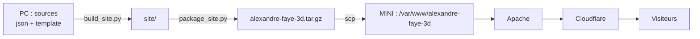

# CRÉATION DU SITE ALEXANDRE-FAYE.FR AVEC CLAUDE

Comment le nouveau site a été construit, avec quel outil et quel skill, ce qui a été
modifié par rapport au modèle de départ, puis comment le formulaire de contact et le script
de sauvegarde ont été mis en place sur le serveur MINI.

> **Pages liées** : *Modifier le contenu du site* (ajouter un récit, des photos, un sport…)
> et *Mettre à jour le site en ligne*.
{.is-info}

---

## 1. Le point de départ

L'ancien site `alexandre-faye.fr` était un **WordPress** (thème Astra, base MySQL
`newalexandre`), hébergé sur MINI (Ubuntu, Apache, derrière Cloudflare).

Objectif : le remplacer par un **site statique** plus moderne et plus sûr :

- plus de PHP pour les pages, plus de base de données, plus d'extensions à mettre à jour ;
- un rendu « haut de gamme » : un objet en verre 3D qui éclate puis se recompose au scroll ;
- garder le contenu existant : photos, vidéos, parcours, compétences, pages de sport.

---

## 2. Les outils utilisés

| Outil | Rôle |
|---|---|
| **Claude** (application de bureau, onglet *Code*, Claude Code) | Écrit et modifie les fichiers du projet sur le PC, lance les scripts, guide les commandes serveur |
| **Skill `premium-3d-glass`** | Le modèle de départ du site (voir section 3) |
| **Python** (`py`) sur le PC | Génère le site à partir des sources (`build_site.py`) et prépare l'archive (`package_site.py`) |
| **Three.js r160** | Le moteur 3D, exécuté dans le navigateur du visiteur (rien ne tourne sur le serveur) |
| **Apache + PHP 8.4** sur MINI | Sert les fichiers du site ; PHP ne sert **que** au formulaire de contact |
| **Postfix + relais OVH** | Envoie les e-mails du formulaire et des sauvegardes |
| **Cloudflare** | DNS, cache, HTTPS côté visiteurs, masque l'IP réelle du serveur |

### Comment on travaille avec Claude

1. On ouvre l'application Claude, onglet **Code**, sur le dossier `D:\Documents\Claude`.
2. On décrit ce qu'on veut en français (« ajoute une page sport », « le formulaire ne marche pas »…).
3. Claude lit les fichiers, les modifie, régénère le site et le vérifie dans son navigateur intégré.
4. Pour le **serveur**, Claude ne se connecte pas lui-même : il donne les commandes **une par une,
   expliquées**, on les tape sur MINI et on lui colle le résultat. C'est volontaire : rien ne
   s'exécute sur le serveur sans être compris.
5. Le fichier `RECAP.md` du projet résume tout l'état du projet : on le donne à Claude au début
   d'une nouvelle conversation pour qu'il reprenne là où on s'était arrêtés.

---

## 3. Le skill `premium-3d-glass`

Un **skill** est un paquet d'instructions et de fichiers qu'on donne à Claude pour une tâche
précise. Celui-ci a été fourni sous forme de zip (`premium-3d-glass-skill.zip`), au début de
la première conversation, avec l'adresse de l'ancien site WordPress.

### Ce que contient le skill

| Élément | Rôle |
|---|---|
| `SKILL.md` | La méthode : interviewer (entreprise, activité, e-mail, logo ou forme), choisir la forme, écrire le contenu, construire, vérifier |
| `template/js/app.js` | Le moteur 3D déjà écrit et testé : verre avec réfraction et dispersion, découpage en 4 fragments, recomposition au scroll |
| `template/css/styles.css` | La mise en page : header, chapitres, cartes en verre, formulaire |
| `template/tools/make_shape.py` | Une bibliothèque de formes 3D (lettres, raquette, serveur, nuage, montagne…) et un vérificateur de logos SVG |
| `template/tools/build_site.py` | Fabrique le site à partir d'un fichier de réglages `.json` |
| `references/` | La documentation du moteur et des formes |

### Ce que le skill produit tel quel

Une **seule page** : un objet 3D, cinq chapitres (Accueil, À propos, Services, Résultats,
Contact) et un formulaire qui ouvre simplement la messagerie du visiteur (`mailto:`).

---

## 4. Ce qui a été modifié par rapport au modèle

Le moteur 3D n'a pas été réécrit : on l'a **rempli** et **étendu**.

### a. Plusieurs pages au lieu d'une

| Page | Fichier de réglages | Objet 3D |
|---|---|---|
| Accueil | `site.json` | la lettre **A** (`letter-a`) |
| Compétences | `competences.json` | un serveur en tour (`server-rack`) |
| Sport | `sport.json` | une raquette fine et cordée (`racket`, épaisseur `0.1`) |
| Tennis, Course, Vélo, Natation, Randonnée | listées dans `sport.json` → `"subpages"` | pas de 3D : pages simples avec récits et galeries |
| Version anglaise | `site-en.json`, `competences-en.json` | mêmes objets |

`build_site.py` a été étendu pour générer toutes ces pages en une fois, avec le même header
(**Accueil · Compétences · Sport · Contact**, suivi du chapitre en cours, bouton **FR | EN**).

### b. Les parties longues

Sous la partie animée, chaque page a une partie « longue » écrite en HTML simple :

- `template/sections/parcours.html` : expérience et formation (accueil) ;
- `template/sections/competences.html` : les 7 catégories de compétences ;
- `template/sections/sport.html` et `template/sections/sport/*.html` : le journal de sport ;
- `template/sections/en/` : les mêmes en anglais.

### c. Le contenu repris de WordPress

- Le dossier `wp-content/uploads` de WordPress a été copié dans `upload/`, puis **trié et
  renommé** dans `template/media/` : `profil`, `cv`, `logo`, `randonnee` (20 photos),
  `velo` (9), `natation` (2), `tennis` (2 vidéos MP4), `course` (vide).
- Chaque photo existe en **deux tailles** : la grande (`bordeaux.jpg`, environ 1500 px) et une
  miniature pour les galeries (`bordeaux-mini.jpg`, 300 px), pour que les pages se chargent vite.
- Les anciennes adresses WordPress (`/competences/`, `/tennis/`, `/contact/`…) redirigent vers
  les nouvelles pages (redirections 301 dans `regles.conf`), pour ne pas perdre Google.

### d. Les réglages d'affichage

- Partie animée sur **4 écrans** de défilement (`.scroll-stage { height: 400vh }`).
- Réticule (curseur personnalisé) **retiré** : souris normale.
- Écran de chargement **retiré** : la 3D apparaît en fondu.
- Accueil : grande photo de profil et 4 bulles **LinkedIn · Wiki · CV · Sport**.

### e. Les outils ajoutés sur le PC

| Fichier | Rôle |
|---|---|
| `mettre-a-jour.bat` | Régénère le site dans `site/` et l'ouvre sur http://127.0.0.1:5180 |
| `preparer-mise-en-ligne.bat` | Régénère et emballe `mise-en-ligne\alexandre-faye-3d.tar.gz` + les fichiers serveur |
| `template/tools/package_site.py` | Crée l'archive avec uniquement les fichiers utiles |
| `TUTO.md` | Aide-mémoire pour modifier le contenu |
| `RECAP.md` | L'état complet du projet (fait foi) |

Chaque page charge ses fichiers avec une **étiquette de version** `?v=<empreinte>` calculée sur
leur contenu : dès qu'un fichier change, Cloudflare et les navigateurs rechargent la nouvelle
version au lieu de garder l'ancienne en cache.

---

## 5. La mise en ligne sur MINI



| Élément | Emplacement sur MINI |
|---|---|
| Le site (lecture seule, root:root, 755/644) | `/var/www/alexandre-faye-3d` |
| Règles du site (sécurité, redirections, cache, formulaire) | `/etc/apache2/alexandre-faye-3d/regles.conf` |
| Site HTTPS actif | `/etc/apache2/sites-available/alexandre-faye-3d-le-ssl.conf` |
| WordPress (intact, désactivé) | `/var/www/alexandre-faye.fr` + `alexandre-faye-le-ssl.conf` |

Retour à WordPress si besoin :

```bash
sudo a2dissite alexandre-faye-3d-le-ssl
sudo a2ensite alexandre-faye-le-ssl
sudo systemctl reload apache2
```

### Les protections en place

- Le dossier du site n'accepte que les lectures (`Require method GET HEAD`) et refuse de servir
  tout script (`.php`, `.sh`, `.py`…) ou fichier caché.
- En-têtes de sécurité : CSP, HSTS (HTTPS obligatoire pendant un an), `X-Frame-Options`,
  `nosniff`, `Referrer-Policy`, `Permissions-Policy`.
- Plus aucun accès au dossier de WordPress.

> **Leçons des incidents** : un `Listen 127.0.0.1:8081` a fait tomber Apache (port déjà pris,
> et `configtest` ne le voit pas) ; un fichier de règles activé comme site sans `<VirtualHost>`
> s'applique à **tous** les sous-domaines. D'où la règle : après toute modification Apache,
> `configtest` → `reload` → `systemctl is-active apache2`.
{.is-warning}

---

## 6. Le formulaire de contact (10/11/2026)

### Le principe

Le modèle ouvrait la messagerie du visiteur (`mailto:`). Il a été remplacé par un vrai envoi :

1. le site envoie le formulaire en **POST** vers `/api/contact` ;
2. Apache lance `contact.php` ;
3. `contact.php` envoie **deux e-mails** par Postfix et le relais OVH : le message pour
   `pro@alexandre-faye.fr`, et un accusé de réception avec la copie du message pour le visiteur ;
4. le site affiche « Merci ! Votre message est bien parti ».

Protections : champ piège invisible (`website`) contre les robots, **3 messages par heure et par
visiteur**, **40 par jour** au total, longueurs bornées, en-têtes d'e-mail nettoyés, et
Cloudflare Turnstile prévu (optionnel).

### Où sont les fichiers, et pourquoi là

| Fichier | Emplacement | Droits | Pourquoi |
|---|---|---|---|
| Programme | `/var/www/alexandre-faye-3d-api/contact.php` | root:root 644 | Hors du site : pas effacé à chaque mise à jour, et le site reste « rien d'exécutable » |
| Réglages | `/etc/alexandre-faye-3d/contact.ini` | root:www-data 640 | `/etc` = réglages ; contiendra la clé secrète Turnstile, jamais téléchargeable |
| Compteurs anti-abus | `/var/lib/alexandre-faye-3d-contact/` | www-data 700 | `/var/lib` = données écrites par un programme ; seul endroit où Apache écrit |

Dans `regles.conf`, un seul point d'entrée, en POST uniquement :

```apache
Alias /api/contact /var/www/alexandre-faye-3d-api/contact.php
<Directory /var/www/alexandre-faye-3d-api>
    Options None
    AllowOverride None
    Require method POST
</Directory>
```

### Les étapes suivies

1. Installer l'archive à jour du site.
2. Copier `contact.php`, `contact.ini`, créer le dossier des compteurs (commandes `install`
   avec les droits ci-dessus).
3. Vérifier que l'adresse d'expéditeur (`expediteur` dans `contact.ini`) est bien celle du
   compte OVH de Postfix, sinon OVH refuse l'envoi :

```bash
sudo cut -d' ' -f2 /etc/postfix/sasl/sasl_passwd | cut -d: -f1
```

4. **Comparer** l'ancien et le nouveau `regles.conf` avant de remplacer :

```bash
sudo cp /etc/apache2/alexandre-faye-3d/regles.conf /etc/apache2/alexandre-faye-3d/regles.conf.avant-formulaire
diff /etc/apache2/alexandre-faye-3d/regles.conf ~/serveur/regles.conf
```

> Le `diff` a montré que le nouveau fichier **supprimait l'en-tête HSTS**
> (`Strict-Transport-Security`), présent sur le serveur mais absent du fichier du PC. Il a été
> rajouté dans `deploiement/regles.conf` avant l'installation. Toujours comparer avant
> d'écraser une configuration !
{.is-warning}

5. Installer `regles.conf`, puis `configtest` → `reload` → `is-active`.
6. Test depuis le vrai site : message « Merci ! », et dans `/var/log/mail.log` deux lignes
   `status=sent` via `ssl0.ovh.net`, envoyées par `uid=33` (www-data, donc bien le formulaire).

---

## 7. Le script de sauvegarde (11/11/2026)

### Le besoin

Faire comme la sauvegarde WordPress existante (`/scripts/alexandre-faye-script.sh`, lancée par
cron) : une archive datée, copiée sur le disque de sauvegarde, gardée 52 jours, avec un e-mail
de compte rendu.

### Ce qui est sauvegardé

Il n'y a pas de base de données. Le script archive ce qui n'existe que sur le serveur :

- `/var/www/alexandre-faye-3d` (le site publié) ;
- `/var/www/alexandre-faye-3d-api` (le formulaire) ;
- `/etc/alexandre-faye-3d` (les réglages du formulaire) ;
- `/etc/apache2/alexandre-faye-3d` et `alexandre-faye-3d-le-ssl.conf` (la configuration Apache).

> La vraie source du site, c'est le **PC** (`D:\Documents\Claude\alexandre-faye-3d\`). Le serveur
> ne contient que le site généré : pense à sauvegarder aussi ce dossier du PC.
{.is-info}

### Ce que fait le script, étape par étape

| Étape | Détail |
|---|---|
| 1. Archive | `tar.gz` (garde propriétaires et droits, contrairement au zip) dans `/home/alexandre/Partage/alexandre-faye-3d/backup/`, lisible par root seulement |
| 2. Vérification | l'archive est relue en entier (`tar -tzf`) |
| 3. Copie | vers `/media/alexandre/sauvegarde-site/alexandre-faye-3d/`, **seulement si le disque est monté**, puis comparaison octet par octet (`cmp`) |
| 4. Nettoyage | suppression des sauvegardes de plus de 52 jours, seulement si tout a réussi |
| 5. Compte rendu | journal clair (résultat en premier, `[OK]` / `[ECHEC]` par étape, tailles, espace disque, liste des sauvegardes) envoyé par e-mail : « Sauvegarde site 3D : OK » ou « ECHEC » |

### Les corrections en cours de route

1. **Première version** : la copie visait `/media/alexandre/sauvegarde-wordpress` et la nuit
   suivante l'e-mail disait « disque de sauvegarde non branché ».
2. On a renommé la destination en `sauvegarde-site`, et **réécrit le journal**, qui n'était pas
   assez clair (on ne voyait pas ce qui avait réussi ou non).
3. Toujours « non monté » : `/etc/fstab` a montré que le disque NTFS est monté sur
   **`/media/alexandre` lui-même**. `sauvegarde-site` n'est qu'un dossier de ce disque. Le script
   vérifie donc maintenant `mountpoint /media/alexandre`.
4. Résultat : e-mail « RÉUSSIE », archive de 76 Mo, 126 éléments, copie identique.

Au passage, deux défauts ont été repérés dans l'ancien script WordPress : l'e-mail d'échec
ne peut jamais partir (adresse mal écrite avec un « à », et les `&&` sautent tout le bloc en cas
d'erreur), et le mot de passe MySQL est écrit en clair.

### Installation

```bash
sudo install -m 700 -o root -g root ~/serveur/alexandre-faye-3d-sauvegarde.sh /scripts/alexandre-faye-3d-sauvegarde.sh
```

Ligne ajoutée dans `sudo crontab -e` (3 h 30 les 1, 11, 21 et 31 du mois) :

```
# sauvegarde du site 3D alexandre-faye.fr (site + formulaire)
30 3 */10 * * /bin/bash /scripts/alexandre-faye-3d-sauvegarde.sh
```

Restauration :

```bash
sudo tar -xzf /home/alexandre/Partage/alexandre-faye-3d/backup/alexandre-faye-3d-[DATE].tar.gz -C /
```

### `nofail` sur le disque de sauvegarde

Sans cette option, si le disque NTFS ne répond pas au démarrage, MINI reste bloqué en mode de
secours (plus de site, plus de SSH). La ligne de `/etc/fstab` est devenue :

```
UUID=62EA3B04EA3AD44F /media/alexandre/ ntfs defaults,nofail 0 0
```

Vérifiée avec `sudo findmnt --verify` (0 erreur), puis `sudo systemctl daemon-reload`. Ancienne
version gardée dans `/etc/fstab.avant-nofail`.

---

## 8. Reste à faire

- Cloudflare **Turnstile** sur le formulaire (anti-robot).
- Audit de sécurité : Cloudflare Access devant Portainer, Deluge, Stirling PDF… ; TLS 1.2
  minimum ; DKIM, DMARC, SPF ; pare-feu limité aux IP Cloudflare.
- Contenu : vidéo de tennis à convertir, page Course à remplir, CV en anglais.
- Dans quelques semaines : supprimer WordPress (en gardant PHP pour le formulaire).
